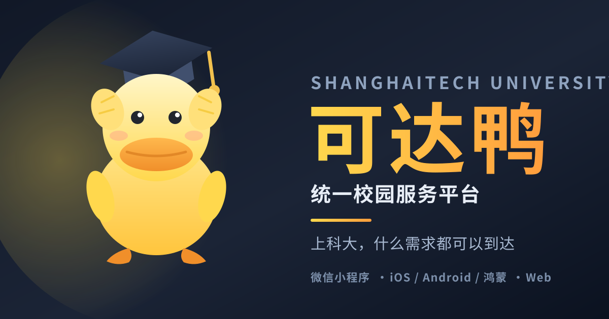
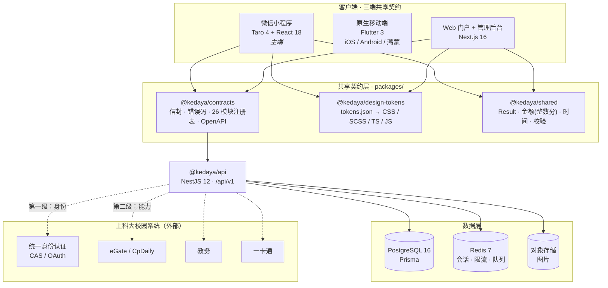

<div align="center">



# 可达鸭 · KedaYa

**上海科技大学 · 统一校园服务平台**

_上科大，什么需求都可以到达_

[](https://github.com/tzhazuma/kedaya/actions/workflows/ci.yml)


</div>

> [!WARNING]
> **可达鸭是第三方非官方平台**，由学生社区开发与维护，**不代表上海科技大学官方**。
> 涉及成绩、学籍、缴费等事务，请以学校官方系统为准。

---

## 这是什么

上科大的校园服务散落在十几个互不相通的入口里：拼单在微信群里、失物招领在墙墙上、
跑腿靠私聊、食堂营养没人知道、心理支持要翻官网找入口。

**可达鸭把这些收进一个平台**，一套账号、一套设计、一套数据模型，同时覆盖：

| 端 | 技术 | 状态 |
| ----------------------------------- | ------------------------------- | --------------------------------------------------------------------------------- |
| **微信小程序**（主端）              | Taro 4 + **React 18**           | ✅ 当前交付；26/26 契约模块有端上页面                                             |
| **原生移动端** iOS / Android / 鸿蒙 | Flutter 3（鸿蒙需 OHOS fork） | ⚠️ 入口已接（活动含列表 / 详情 / 新建 / 导入）；CI 配置存在，GitHub runner 未实跑 |
| **Web 门户 + 管理后台** | Next.js 16 + React 19 | ✅ 当前交付；门户 + 管理后台 + 活动无状态导入 |
| **后端**                            | NestJS 12 + Prisma + PostgreSQL | ✅ 当前交付；26 个契约模块中 21 个有端点                                          |

> **React 版本按端不同是刻意的**：`@tarojs/react@4.3.0` 的 peer 是 `react@^18`，
> 而 Next.js 16 接受 `^18.2.0 || ^19`。小程序锁 18.3.1、Web 用 19.3.1，
> npm workspaces 嵌套共存（实测通过）。详见契约 §2。

**名字的由来**：可达鸭 —— "在上科大什么需求都可以**到达**的鸭"。

---

## 已实现的功能

### 论坛 `forum`

版块 / 主题 / **楼中楼回复** / 举报（同人去重 + **3 人阈值自动隐藏**）/ 版主隐藏与恢复 / 软删。
**匿名按契约 §9 真解耦**：`anonymous=true` 时实名身份**不落库**（`authorId` 恒为 null），
只存 `HMAC(secret, userId|thread:<postId>)` —— 同帖同人一致、**跨帖不可关联**，
作者自助编辑靠重算 handle 证明身份（不需要任何映射表）。

### 常见问题 `faq`

分类 / 关键词检索 / **幂等投票**（唯一约束保证一人一票，重复投不改计数、改票两边同步）/
工单式自助答疑（未命中返回关键词建议，不引向量库）。

### 场馆预约 `facility`

时段冲突 → `CONFLICT`、金额整数分、发起人可取消。

### 校园活动 `activities`（第 26 个契约模块）

候选必须确认后才进活动日程；来源包括校园邮箱、用户主动提交的单篇公众号、手动和认证公众号授权同步；
站内信 + 订阅/厂商推送发件箱；支持 ICS / 手机日历，**不写入课程课表**。公众号没有读取关注列表
或批量历史文章的官方接口，因此不做自动发现或批量历史抓取。详见
[`docs/features/activities.md`](docs/features/activities.md)。

### 拼单 `groupbuy`（M0 的垂直切片）

列表 / 详情 / 参团，作为后续所有模块的分层范本。

### 其余模块（已登记，不是骨架）

**26 个契约模块已登记**：小程序端 26/26 有真实页面；后端 21/26 有端点
（`deadlines` / `campus-map` 只有小程序本机数据，`petition` / `teabreak` 只有契约与规则层）。
完整清单见下方[功能模块（26）](#功能模块26)。

各模块的**差异化实现**（不是同一套 CRUD 换皮）：

| 模块 | 真正做进去的东西 |
| ----------- | -------------------------------------------------------------------------------------------------- |
| 找搭子 | 封闭标签表（禁自由文本污染匹配）、可用时段硬过滤（跨零点按次日）、可解释推荐理由 |
| 野生动物 | 校方 GIS 真实栅格底图、观测点**模糊化**后才落点、k-匿名热点聚合、推断轨迹标虚线 |
| 食堂营养 | 菜品库快照（请求不带营养值）、六项营养汇总、缺口推荐（`sodiumMg` 是上限值）、忌口硬过滤 |
| 心理支持 | 危机热线 `prominence: primary` **首屏**渲染、接口失败有 `CRISIS_FALLBACK` 兜底、**不做诊断** |
| AI 校园画像 | 每个标签**都能说出来源**、页面明示心理支持与宿舍矛盾**不参与**画像、无数据时给空态不编造 |
| TechPie | 同学共建服务目录 + **人工核对**（`sync` 只把 status 写成 synced，没有上游同步） |
| 偷外卖 | 本人可见的**报备记录**，不是公开举报墙（归属只从 JWT 取） |
| 宿舍矛盾 | 匿名提交 + 二次同意门 + 一次性追踪码跟进，**没有公开列表**（接口恒 403） |
| 论坛 | 匿名**真解耦**（`authorId` 恒为 null，只存 HMAC handle）、3 人阈值自动隐藏 |
| 跳蚤 | 双列商品网格（图 → 价 → 成色/地点） |
| 场馆预约 | 时段冲突 → `CONFLICT`、金额整数分、发起人可取消、**冲突判定只在服务端** |
| 校园活动    | 候选必须确认；校园邮箱 / 单篇或认证公众号 / 手动；站内信与推送发件箱；ICS / 手机日历；不写课程课表 |
| 知枢工作台  | 日报、JARVIS 本地引用检索、资料库、知乎条目与 QQ 文本导入；小程序与 Flutter 共用本机持久化工作区   |

### 群机器人接入（基础设施，不计入契约模块）

[QQ 机器人官方 API v2](https://bot.q.qq.com/wiki/develop/api-v2/) 的
`GROUP_MESSAGE_CREATE`「群消息（全量模式）」支持机器人接收群内**每一条**消息
（需开启"接收所有消息"，且机器人被拉进群 + 群主授权）。

可达鸭把它接成**待确认草稿**，而不是自动发布：

```
QQ 群消息 → POST /group-bot/webhook/qq（Ed25519 验签）→ 解析成候选条目 → 待确认草稿
                                                                    ↓ 管理员确认
                                                          显式调用对应模块接口发布
```

- **验签不可跳过**：不验签的 webhook 就是任何人都能 POST 的写接口
- **用 rawBody 验签**：JSON 重新序列化会改字节，必然失败
- **不存发送者身份**：只留 `member_openid` 去重，昵称/QQ 号不落库
- **只处理文本**：图片不做 OCR
- **默认关闭**：`GROUP_BOT_ENABLED != 'true'` 时 webhook 一律 403

> ⚠️ **边界**：个人微信**没有**官方群消息 API（企微群 ≠ 微信群）。
> "跳蚤微信群"的官方路径是把群迁到 QQ 群或企业微信群；
> 读微信本地缓存（SQLCipher + 协议逆向）违规且不可维护。

---

## 当前完成度（2026-10-18 旧快照）

> 下表是历史快照，**不是当前基线**。当前 Windows 基线上有已知红灯：
> API techpie 3 项、Web buddy-tokens 1 项、API lint 5 项；它们都是既有问题，
> 不属于活动功能，详见 [`docs/features/activities.md`](docs/features/activities.md) §9。

| 端 | 类型检查 | 测试 | 构建 |
| -------------------- | -------------------------- | ------------------------------- | --------------------------------- |
| `packages/contracts` | ✅ 0 错 | ✅ **55** | — |
| `packages/shared` | ✅ 0 错 | ✅ **244** | — |
| `services/api` | ✅ 0 错 | ✅ **1584**（+9 skip） | — |
| `apps/miniapp` | ✅ 0 错 | ✅ **1265** | ✅ `build:weapp` + `verify:weapp` |
| `apps/web` | ✅ 0 错 | ✅ **787** | ✅ `next build` |
| `apps/mobile` | ✅ 0 错（2026-10-19 本机） | ⚠️ **679/680**（旧 token 断言） | ⚠️ 未在 GitHub runner 实跑 |

**旧快照合计 4614 个测试；当前基线并非全绿，见上方说明。**

小程序构建产物：**507 个模块工厂 / 主包 1.44 MiB / 16 个分包**
（微信主包上限 2 MiB，有余量）。

### 跨平台构建状态

| 平台 | 状态 |
| ----------------------------------------------- | ---------------------------------------------------------------------------------------------------- |
| 微信小程序 / Web / API | ✅ 当前交付；活动相关测试已实跑通过 |
| Android / Windows x64 / Linux x64 / macOS / iOS | ⚠️ 有 CI 配置（`.github/workflows/mobile-build.yml`），**GitHub runner 未实跑**；未在真机/模拟器启动 |
| Windows ARM64 | ⚠️ **实验**：仅手动触发，不进入 Release，未实跑 |
| Linux ARM64 | ❌ **未实现**（官方无 Linux ARM64 Flutter SDK） |
| HarmonyOS | ⚠️ 仅自托管 `self-hosted, linux, ohos` 流水线，**未验证** |

签名状态与构建细节见 [`docs/build/README.md`](docs/build/README.md)；不要写成已发布。

### 哪些是真的、哪些还是演示

我们宁可把这件事写清楚，也不想让用户以为模拟数据是真的。

| 能力 | 状态 | 说明 |
| ------------------------------------------------- | ----------------- | ---------------------------------------------------------------------------------------- |
| 26 个契约模块的**页面与端点**                     | ✅ 真实           | 小程序 25/25 有页面；后端 21/26 有端点                                                   |
| 论坛 / 跳蚤 / 跑腿 / 找搭子 / 失物招领 / 宿舍矛盾 | ✅ 真实 | 端到端可用的垂直切片 |
| 拼单 / 论坛的**社区数据** | ⚠️ 演示期 | 默认走内存 mock，无需后端即可体验 |
| 校园卡 / 课表 / 成绩 / CAS 登录 | ⚠️ **模拟数据** | `CAMPUS_DATA_MODE=mock`，响应标 `simulated: true`；`live` 需要校方书面授权 |
| 校园卡付款码 | ⚠️ **故意不可用** | mock 下返回 503，**不提供假码** |
| AI 校园画像 | ⚠️ 后端无生成逻辑 | `GET /me` 返回 `null` 是常态，页面给空态而**不在客户端编造标签** |
| 菜品拍照识别 | ⚠️ mock 适配器 | 响应 `mode: 'mock'`，界面明确标「演示期识别」 |
| 校园地图底图 | ⚠️ 授权未确认 | 用校方 GIS 真实栅格图，**上线前必须确认授权** |
| 校园活动                                          | ✅ 真实（MVP）    | 候选确认、站内信、认证公众号同步、推送发件箱、ICS / 手机日历；厂商送达仍需配置与真机验证 |
| 心理支持热线 | ⚠️ 待核实 | 上线前必须逐个拨通核实号码 |
| 群机器人 | ✅ 代码完整 | 需自行申请 QQ 开放平台机器人 + 配置公钥 + 开启 `GROUP_BOT_ENABLED` |

"哪些校内系统已接通"的唯一真相是
[`packages/contracts/src/campus-services.ts`](packages/contracts/src/campus-services.ts)
（`CAMPUS_SERVICES`，默认全部 `authorization: 'none'`、`upstreamConfirmed: false` —— **fail closed**）。

---

## 架构总览



---

## 三条不可妥协的架构原则

### 1. 六边形分层 + feature-first

每个端内部统一分层，依赖方向严格单向：

```
presentation ──> application ──> domain <── data
                                  ▲
                            platform（平台差异适配）
```

`domain` 层**零框架依赖**：它只定义模型和 `ports`（接口），由 `data` 层实现适配器。
这样领域逻辑可以被小程序与 Web 共享、被单元测试覆盖、被 mock 替换。

### 2. 两级身份模型

这是全项目**最容易写错**的地方：

| 层级 | 负责 | 产出 | 绝不包含 |
| --------------------------------------- | ----------------------------------------------------- | -------------- | ----------------------------------- |
| **第一级 · 身份层** `AuthPort` | 上科大统一身份认证（CAS / OAuth） | 可达鸭自有 JWT | 任何校园系统 cookie / session / tgc |
| **第二级 · 能力层** `CampusSessionPort` | 第三方校园系统绑定（eGate / CpDaily / 教务 / 一卡通） | 各系统 session | 身份 |

允许"**已登录但未绑定**" —— 此时身份有效，校园系统功能返回 `CAMPUS_BINDING_REQUIRED`。
这条规则来自 TechPie 的真实教训（CASTGC 曾被从身份层误读）。

### 3. 启动不阻塞

```
1. 同步：从本地存储 hydrate 缓存（关键路径，禁止网络）
2. 立即渲染首屏（缓存数据或骨架屏）
3. 后台并发：刷新 token → 拉各模块数据 → 失败静默降级
```

---

## 仓库结构

```
kedaya/
├── apps/
│   ├── miniapp/          Taro 4 → 微信小程序（主端）+ H5
│   ├── mobile/           Flutter 3 → iOS / Android / 鸿蒙（入口已接；构建未实跑）
│   └── web/              Next.js 16 → Web 门户 + 管理后台
├── services/
│   └── api/              NestJS 12 + Prisma → /api/v1
├── packages/
│   ├── contracts/        响应信封 · 错误码 · 26 模块注册表 · OpenAPI 3.1
│   ├── design-tokens/    tokens.json → CSS / SCSS / TS / JS（单一真相）
│   └── shared/           Result · 金额 · 时间 · 校验（纯 TS，客户端与 API 共用）
├── docs/
│   ├── architecture/     总览 · 领域模型 · API 契约 · 客户端架构 · 安全 · 路线图
│   ├── features/         功能规格：找搭子 · 野生动物地图 · TechPie 整合 · 校园活动
│   └── adr/              架构决策记录
└── assets/brand/         可达鸭吉祥物与封面（原创美术）
```

---

## 快速开始

本地开发使用 Node **22.23.3**（Prisma 要求 22.12+，Node 21 不受支持）。
首次安装及日常启动可使用：

```bash
nvm install
nvm use
./scripts/with-npm-lock.sh npm ci

./scripts/dev.sh weapp   # 编译微信小程序，然后在微信开发者工具导入仓库根目录
./scripts/dev.sh web     # Next.js 门户，http://localhost:3001
```

两个客户端默认均使用 Mock，可独立运行，无需启动数据库或后端。
`dev.sh` 会自动选择 `.nvmrc` 指定的 Node，避免旧终端仍使用 Node 21。

```bash
git clone https://github.com/tzhazuma/kedaya.git
cd kedaya
npm install
```

### Web 门户

```bash
npm run dev:web                    # http://localhost:3001
```

### 微信小程序（主端）

```bash
nvm use                            # 使用 .nvmrc 中的 Node 22（已安装依赖后）
npm run dev:weapp                   # 保持终端运行，等待编译成功
# 微信开发者工具 → 小程序 → 导入项目 → 选择本仓库根目录
# 根目录 project.config.json 已指向 apps/miniapp/dist/
```

首次运行需要先在仓库根目录执行 `npm ci`。只生成一次预览产物可执行
`npm run build:weapp`。也可以导入 `apps/miniapp/`，其配置指向同一份产物。
必须以「小程序」类型导入，不能选「其他项目」。如果之前误建为其他项目，
请回到项目列表的「小程序」分类重新导入。默认使用本地 Mock，无需启动 API 或 Docker。

### 后端

```bash
docker compose -f services/api/docker-compose.yml up -d   # Postgres + Redis
cp services/api/.env.example services/api/.env
npm run prisma:migrate -w @kedaya/api
npm run dev -w @kedaya/api          # http://localhost:3000/api/v1
```

### 全仓校验

```bash
npm run typecheck      # 全量类型检查（6 个 workspace）
npm run test           # 全量测试（各 workspace；基线红灯见 docs/features/activities.md §9）
npm run build          # 全量构建
npm run tokens         # 重新生成设计令牌 + 同步 Flutter 副本
```

---

## 功能模块（26）

**业务模块（17）**（需求图 14 个 + 场馆 / 众筹诉求 / 会议茶歇）

| 模块 | 说明 | 敏感级 |
| ------------ | ------------------------------------------------------ | -------- |
| 拼单 | 拼团凑单：发起、参团、成团、结算 | 低 |
| 偷外卖 | 外卖被拿错的举报、举证、协商、信用记录 | 中 |
| 跳蚤 | 二手闲置发布、搜索、议价、面交 | 低 |
| 宿舍矛盾 | 匿名调解申请、调解员介入、公约投票 | **高** |
| 跑腿 | 代取快递、买饭、送件，悬赏与接单 | 低 |
| 找搭子 | 运动、自习、吃饭、出行组队匹配 | 低 |
| 失物招领 | 丢失登记、拾获登记、双向匹配 | 低 |
| 营养管家 | 菜品库、每餐记录、每日需求与缺口推荐 | 中 |
| 论坛 | 版块、主题、回复、举报与治理 | 中 |
| AI 校园画像 | 基于行为的画像与推荐，可解释、可关闭 | **高** |
| 心理支持 | 倾听与预约入口，危机出口在首屏；不做诊断与治疗 | **最高** |
| 常见问题 | 知识库与工单式自助答疑 | 低 |
| TechPie 整合 | 与 TechPie / GeekPie 体系互联互通 | 中 |
| 野生动物 | 校园动物活动区域地图、投喂规范、上报 | 低 |
| 场馆预约 | 体育场馆、健身房等校园场馆的预约与核销 | 中 |
| 众筹诉求 | 把共同需求汇总成可核对的诉求，达到门槛后发信给对应部门 | 低 |
| 会议茶歇 | 把手边学术会议的时间地点和茶歇时报上来 | 低 |

**核心模块（8）**：身份 · 课表 · DDL 聚合 · 校园地点 · 校园活动 · 校园卡 · 我的 · 通知

> 模块清单的**唯一真相**是 [`packages/contracts/src/modules.ts`](packages/contracts/src/modules.ts)。
> 小程序与 Web 的导航、宫格、权限判定全部由它驱动，**不允许在各端硬编码**。

---

## 隐私与合规

| 规则 | 说明 |
| ---------------- | ------------------------------------------------------------------ |
| 敏感模块独立同意 | 心理支持 / 宿舍矛盾 / AI 画像 首次进入必须显式二次同意，可随时撤回 |
| 同意门不滥用 | 身份、校园卡的同意由登录/开卡行为隐含，不额外设门 |
| 数据最小化 | 心理与宿舍矛盾数据**不进入**通用画像；AI 画像不得读取这两个域 |
| 匿名可用 | 论坛 / 宿舍矛盾 / 偷外卖 支持匿名身份，与实名身份解耦存储 |
| 全量审计 | 敏感模块读写全部落审计日志（谁、何时、对哪条记录、什么动作） |
| 危机出口 | 心理模块必须提供危机干预热线，且不可被埋进二级菜单 |
| 不冒充官方 | 全站显著标注"第三方非官方平台" |

---

## 设计令牌：单一真相

所有颜色、间距、圆角、字号定义在 [`packages/design-tokens/tokens.json`](packages/design-tokens/tokens.json)，
由生成器派生出 TS、CSS、SCSS 和 JS 产物 —— **任何一端都不允许手写色值**：

```bash
npm run tokens
```

```
tokens.json ──┬──> src/tokens.generated.ts    Web / 小程序 / 后端
              ├──> dist/tokens.css            CSS 变量 --kdy-*
              ├──> dist/tokens.scss           SCSS 变量 $kdy-*
              └──> dist/tokens.js             运行时 ESM
```

---

## 与 TechPie 的关系

[TechPie](https://github.com/HeZeBang/TechPie-flutter)（GeekPie 出品，MIT）是本项目的**重要参考实现**。
可达鸭延续了它的核心架构思想 —— 六边形分层、feature-first、依赖装配、
启动不阻塞、两级身份模型 —— 并在此基础上：

- 把契约层抽成**共享 TypeScript 包**，供客户端与 API 使用
- 提供**微信小程序 + Web 门户与管理后台**
- 把模块从"课表/作业"扩展为**26 个校园服务模块**
- 强化隐私合规（二次同意 + 审计 + 匿名身份解耦）

TechPie 整合模块（`techpie`）用于与 TechPie / GeekPie 体系互联互通。

---

## 路线图

| 阶段 | 范围 | 状态 |
| ------------------- | -------------------------------------------------------------------------- | ------------------------------------- |
| **M0 · 框架** | 契约层、设计令牌、四端骨架、CI | ✅ 完成 |
| **M1 · 基础模块** | 身份、课表、校园卡、我的、通知 | ✅ 完成 |
| **M2 · 低敏感业务** | 拼单、跳蚤、跑腿、找搭子、失物招领、食堂营养、常见问题、野生动物、场馆预约 | ✅ 完成 |
| **M3 · 高敏感业务** | 论坛、偷外卖、宿舍矛盾、心理支持 | ✅ 完成 |
| **M4 · AI 与整合** | AI 校园画像、TechPie 整合 | ✅ 完成 |
| **M5 · 群信息接入** | QQ 官方群机器人 → 待确认草稿 | ✅ 代码完成，待申请机器人 |
| **M6 · 日程与活动** | 校园活动：候选确认、站内信、推送发件箱、ICS / 手机日历                     | ✅ MVP 完成；厂商送达需配置与真机验证 |

**26/26 契约模块已登记；21/26 有后端端点；小程序端 26/26 有真实页面。**

### 距离「生产可用」还差什么

这些**不是代码工作量**，而是需要外部条件或人工核实的项：

| 待办 | 阻塞原因 | 谁能解 |
| ----------------------------- | ----------------------------------------- | ----------------------------------------------- |
| 校园卡 / 课表 / 成绩切 `live` | 校方未开放接口，且无书面授权 | 校方信息化办公室 |
| CAS 真实对接 | 需要 `service ticket` 校验端点与 RSA 公钥 | 校方 |
| 校园地图底图授权 | 用的是校方 GIS 栅格图，**授权状态未确认** | 校方 |
| 心理支持热线核实 | 上线前必须逐个拨通核实号码仍有效 | 我们自己（人工） |
| 可达鸭名称的商标风险 | 「可达鸭」是任天堂在中国注册的官方中文名 | 需要法律意见 / 或改名 |
| 群机器人上线 | 需要 QQ 开放平台机器人资质 + 群主授权 | 我们申请 + 群主同意 |
| 活动提醒多渠道推送            | 微信订阅 / APNs / FCM / HMS 已有代码路径  | 需要真实模板、证书、厂商配置与真机送达验证      |
| 公众号历史 / 关注列表         | 个人关注列表与任意公众号历史没有公开 API  | 不做私有会话抓取；单篇导入 + 认证服务号官方同步 |

> 我们**不会**在没有授权的情况下把 `CAMPUS_DATA_MODE` 切成 `live`。
> 当前所有校园数据都标 `simulated: true`，且 [`campus-services.ts`](packages/contracts/src/campus-services.ts)
> 里 `authorization` 全部是 `'none'`。

### 规格文档（实现前写的，仍然有效）

| 文档 | 内容 |
| ---------------------------------------------------------------- | ----------------------------------------------------------------------------------------------------- |
| [`buddy-matching.md`](docs/features/buddy-matching.md) | 找搭子 —— 接入 [STUMatch](https://github.com/tzhazuma/STUMatch) 的匹配算法（含真实打分公式与行号） |
| [`wildlife-map.md`](docs/features/wildlife-map.md) | 野生动物 —— 校园地图底图、**WGS84↔GCJ-02 坐标系陷阱**、可离线降级的自动分类、轨迹推断、四层位置模糊化 |
| [`techpie-integration.md`](docs/features/techpie-integration.md) | TechPie 能力逐项映射 + 两级身份模型下的合规红线 |
| [`activities.md`](docs/features/activities.md) | 校园活动 —— 候选确认、三种来源、≤200 字证据、站内信限制、ICS / 手机日历、三端能力差异 |
| **[`docs/README.md`](docs/README.md)** | **📖 文档总索引** —— 55 份文档怎么读、哪些已过时、编号为什么有重复 |
| [`campus-map-data.md`](docs/features/campus-map-data.md) | 校园地图数据来源 —— OSM relation 5390610 实测坐标、11 条 Overpass 查询、25 个地点的定位依据 |

---

## 吉祥物与 IP

`assets/brand/` 下的可达鸭吉祥物与封面是**本项目原创美术**（纯 SVG 手写），
**不是**任天堂 / 宝可梦官方素材，也与其角色形象无衍生关系。

> [!NOTE]
> 需要诚实说明：「可达鸭」这一名称在中文语境下容易让人联想到宝可梦的 Psyduck 角色。
> 本项目**不使用任何官方素材、不冒充官方、不做商业化**。若未来涉及商标或商业化，
> 需重新评估命名（预案见 [`docs/adr/0005-brand-and-ip.md`](docs/adr/0005-brand-and-ip.md)）。

---

## 贡献

欢迎上科大同学参与。开始前请先读：

1. [`docs/architecture/00-FROZEN-CONTRACT.md`](docs/architecture/00-FROZEN-CONTRACT.md) —— 冻结契约，所有接口的真相来源
2. [`docs/architecture/`](docs/architecture/) —— 架构文档
3. [`docs/adr/`](docs/adr/) —— 架构决策记录

当前**已验证**的交付范围为微信小程序、Web 和 NestJS API；`apps/mobile` 的 Flutter 客户端
已有入口，但多平台构建只有 CI 配置、GitHub runner 未实跑（见
[`docs/features/activities.md`](docs/features/activities.md) §8）。旧冻结契约与 ADR 中涉及
原生端的内容保留作历史参考；当前客户端结构以
[客户端架构](docs/architecture/04-client-architecture.md) 为准。

**提 PR 前请跑 `npm run typecheck && npm run test`；除
[`docs/features/activities.md`](docs/features/activities.md) §9 记录的既有 Windows 基线红灯外，
不应新增失败。**

---

## License

[MIT](LICENSE) © 2026 可达鸭项目贡献者

<div align="center">
<sub>可达鸭 · 上科大，什么需求都可以到达</sub>
</div>
