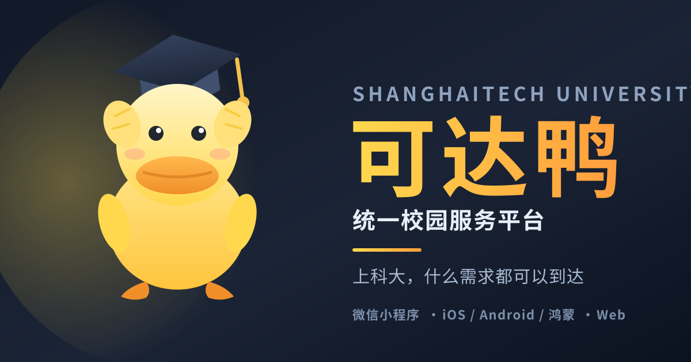
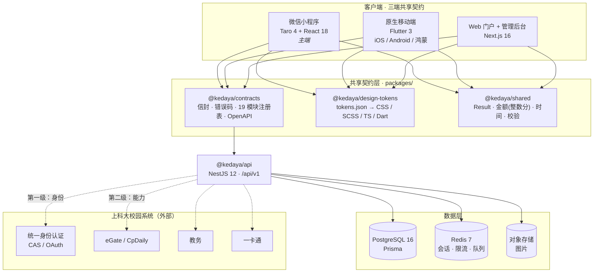

<div align="center">



# 可达鸭 · KedaYa

**上海科技大学 · 统一校园服务平台**

*上科大，什么需求都可以到达*

[](https://github.com/tzhazuma/kedaya/actions/workflows/ci.yml)


</div>

> [!WARNING]
> **可达鸭是第三方非官方平台**，由学生社区开发与维护，**不代表上海科技大学官方**。
> 涉及成绩、学籍、缴费等事务，请以学校官方系统为准。

---

## 这是什么

上科大的校园服务散落在十几个互不相通的入口里：拼单在微信群里、失物招领在墙墙上、
跑腿靠私聊、食堂营养没人知道、心理支持要翻官网找入口。

**可达鸭把这些收进一个平台**，一套账号、一套设计、一套数据模型，同时覆盖：

| 端 | 技术 | 状态 |
| --- | --- | --- |
| **微信小程序**（主端） | Taro 4 + **React 18** | ✅ 论坛 / 常见问题 / 拼单 已实现 |
| **原生移动端** iOS / Android / 鸿蒙 | Flutter 3 | ✅ 同上一组（**代码完整但未编译验证**） |
| **Web 门户 + 管理后台** | Next.js 16 + React 19 | ✅ 同上一组 + 管理后台 |
| **后端** | NestJS 12 + Prisma + PostgreSQL | ✅ 20 个模块，257 个测试 |

> **React 版本按端不同是刻意的**：`@tarojs/react@4.3.0` 的 peer 是 `react@^18`，
> 而 Next.js 16 接受 `^18.2.0 || ^19`。小程序锁 18.3.1、Web 用 19.3.1，
> npm workspaces 嵌套共存（实测通过）。详见契约 §2。

**名字的由来**：可达鸭 —— "在上科大什么需求都可以**到达**的鸭"。

---

## 已实现的功能

### 论坛 `forum`
版块 / 主题 / **楼中楼回复** / 举报（同人去重 + **3 人阈值自动隐藏**）/ 版主隐藏与恢复 / 软删。
**匿名按契约 §9 真解耦**：`anonymous=true` 时实名身份**不落库**（`authorId` 恒为 null），
只存 `HMAC(secret, userId|thread:<postId>)` —— 同帖同人一致、**跨帖不可关联**，
作者自助编辑靠重算 handle 证明身份（不需要任何映射表）。

### 常见问题 `faq`
分类 / 关键词检索 / **幂等投票**（唯一约束保证一人一票，重复投不改计数、改票两边同步）/
工单式自助答疑（未命中返回关键词建议，不引向量库）。

### 场馆预约 `facility`（第 20 个模块）
时段冲突 → `CONFLICT`、金额整数分、发起人可取消。

### 拼单 `groupbuy`（M0 的垂直切片）
列表 / 详情 / 参团，作为后续所有模块的分层范本。

> 其余 16 个模块目前是**可运行的骨架**（有端点、有分层、有测试），尚未实现完整领域逻辑。
> 下一步按 `docs/features/` 的规格推进：找搭子 / 猫鸟黑天鹅 / TechPie 整合。

---

## 架构总览



---

## 三条不可妥协的架构原则

### 1. 六边形分层 + feature-first

每个端内部统一分层，依赖方向严格单向：

```
presentation ──> application ──> domain <── data
                                  ▲
                            platform（平台差异适配）
```

`domain` 层**零框架依赖**：它只定义模型和 `ports`（接口），由 `data` 层实现适配器。
这样领域逻辑可以被三端共享、被单元测试覆盖、被 mock 替换。

### 2. 两级身份模型

这是全项目**最容易写错**的地方：

| 层级 | 负责 | 产出 | 绝不包含 |
| --- | --- | --- | --- |
| **第一级 · 身份层** `AuthPort` | 上科大统一身份认证（CAS / OAuth） | 可达鸭自有 JWT | 任何校园系统 cookie / session / tgc |
| **第二级 · 能力层** `CampusSessionPort` | 第三方校园系统绑定（eGate / CpDaily / 教务 / 一卡通） | 各系统 session | 身份 |

允许"**已登录但未绑定**" —— 此时身份有效，校园系统功能返回 `CAMPUS_BINDING_REQUIRED`。
这条规则来自 TechPie 的真实教训（CASTGC 曾被从身份层误读）。

### 3. 启动不阻塞

```
1. 同步：从本地存储 hydrate 缓存（关键路径，禁止网络）
2. 立即渲染首屏（缓存数据或骨架屏）
3. 后台并发：刷新 token → 拉各模块数据 → 失败静默降级
```

---

## 仓库结构

```
kedaya/
├── apps/
│   ├── miniapp/          Taro 4 → 微信小程序（主端）+ H5
│   ├── mobile/           Flutter → iOS / Android / 鸿蒙
│   └── web/              Next.js 16 → Web 门户 + 管理后台
├── services/
│   └── api/              NestJS 12 + Prisma → /api/v1
├── packages/
│   ├── contracts/        响应信封 · 错误码 · 19 模块注册表 · OpenAPI 3.1
│   ├── design-tokens/    tokens.json → CSS / SCSS / TS / Dart（单一真相）
│   └── shared/           Result · 金额 · 时间 · 校验（纯 TS，三端共用）
├── docs/
│   ├── architecture/     总览 · 领域模型 · API 契约 · 客户端架构 · 安全 · 路线图
│   ├── features/         功能规格：找搭子 · 猫鸟黑天鹅地图 · TechPie 整合
│   └── adr/              架构决策记录
└── assets/brand/         可达鸭吉祥物与封面（原创美术）
```

---

## 快速开始

```bash
git clone https://github.com/tzhazuma/kedaya.git
cd kedaya
npm install
```

### Web 门户

```bash
npm run dev -w @kedaya/web          # http://localhost:3000
```

### 微信小程序（主端）

```bash
npm run dev:weapp -w @kedaya/miniapp
# 然后用「微信开发者工具」打开 apps/miniapp/ 目录，指向 dist/
```

### 后端

```bash
docker compose -f services/api/docker-compose.yml up -d   # Postgres + Redis
cp services/api/.env.example services/api/.env
npm run prisma:migrate -w @kedaya/api
npm run dev -w @kedaya/api          # http://localhost:3000/api/v1
```

### 原生移动端

```bash
# 需先安装 Flutter SDK >= 3.6.2
cd apps/mobile && flutter pub get && flutter run
```

### 全仓校验

```bash
npm run typecheck      # 全量类型检查（6 个 workspace）
npm run test           # 全量测试（827 个用例）
npm run build          # 全量构建
npm run tokens         # 重新生成设计令牌 + 同步 Flutter 副本
```

---

## 功能模块（20）

**业务模块**（来自需求图）

| 模块 | 说明 | 敏感级 |
| --- | --- | --- |
| 拼单 | 拼团凑单：发起、参团、成团、结算 | 低 |
| 偷外卖 | 外卖被拿错的举报、举证、协商、信用记录 | 中 |
| 跳蚤 | 二手闲置发布、搜索、议价、面交 | 低 |
| 宿舍矛盾 | 匿名调解申请、调解员介入、公约投票 | **高** |
| 跑腿 | 代取快递、买饭、送件，悬赏与接单 | 低 |
| 找搭子 | 运动、自习、吃饭、出行组队匹配 | 低 |
| 失物招领 | 丢失登记、拾获登记、双向匹配 | 低 |
| 食堂营养 | 菜品营养数据、热量估算、饮食建议 | 低 |
| 论坛 | 版块、主题、回复、举报与治理 | 中 |
| AI 校园画像 | 基于行为的画像与推荐，可解释、可关闭 | **高** |
| 心理治疗 | 咨询预约、心理测评、危机干预入口 | **最高** |
| 常见问题 | 知识库与工单式自助答疑 | 低 |
| TechPie 整合 | 与 TechPie / GeekPie 体系互联互通 | 中 |
| 猫鸟黑天鹅 | 校园动物活动区域地图、投喂规范、上报 | 低 |
| 场馆预约 | 体育场馆、健身房等校园场馆的预约与核销 | 中 |

**基础模块**：身份 · 课表 · 校园卡 · 我的 · 通知

> 模块清单的**唯一真相**是 [`packages/contracts/src/modules.ts`](packages/contracts/src/modules.ts)。
> 三端的导航、宫格、权限判定全部由它驱动，**不允许在各端硬编码**。

---

## 隐私与合规

| 规则 | 说明 |
| --- | --- |
| 敏感模块独立同意 | 心理治疗 / 宿舍矛盾 / AI 画像 首次进入必须显式二次同意，可随时撤回 |
| 同意门不滥用 | 身份、校园卡的同意由登录/开卡行为隐含，不额外设门 |
| 数据最小化 | 心理与宿舍矛盾数据**不进入**通用画像；AI 画像不得读取这两个域 |
| 匿名可用 | 论坛 / 宿舍矛盾 / 偷外卖 支持匿名身份，与实名身份解耦存储 |
| 全量审计 | 敏感模块读写全部落审计日志（谁、何时、对哪条记录、什么动作） |
| 危机出口 | 心理模块必须提供危机干预热线，且不可被埋进二级菜单 |
| 不冒充官方 | 全站显著标注"第三方非官方平台" |

---

## 设计令牌：单一真相

所有颜色、间距、圆角、字号定义在 [`packages/design-tokens/tokens.json`](packages/design-tokens/tokens.json)，
由生成器派生出四端产物 —— **任何一端都不允许手写色值**：

```bash
npm run tokens
```

```
tokens.json ──┬──> src/tokens.generated.ts    Web / 小程序 / 后端
              ├──> dist/tokens.css            CSS 变量 --kdy-*
              ├──> dist/tokens.scss           SCSS 变量 $kdy-*
              └──> dart/kedaya_tokens.dart    Flutter KedaYaTokens
```

---

## 与 TechPie 的关系

[TechPie](https://github.com/HeZeBang/TechPie-flutter)（GeekPie 出品，MIT）是本项目的**重要参考实现**。
可达鸭延续了它的核心架构思想 —— 六边形分层、feature-first、Riverpod 装配、
启动不阻塞、两级身份模型 —— 并在此基础上：

- 把契约层抽成**跨语言共享包**（TechPie 是单一 Flutter 应用，无可共享契约层）
- 把端从"Flutter 一个应用"扩展为**小程序 + 原生 + Web 三端**
- 把模块从"课表/作业"扩展为**19 个校园服务模块**
- 强化隐私合规（二次同意 + 审计 + 匿名身份解耦）

TechPie 整合模块（`techpie`）用于与 TechPie / GeekPie 体系互联互通。

---

## 路线图

| 阶段 | 范围 | 状态 |
| --- | --- | --- |
| **M0 · 框架** | 契约层、设计令牌、四端骨架、CI | ✅ **完成** |
| **M1 · 基础模块** | 身份、课表、校园卡、我的、通知 | ⏳ 骨架就绪 |
| **M2 · 低敏感业务** | 拼单、跳蚤、跑腿、找搭子、失物招领、食堂营养、**常见问题**、**猫鸟黑天鹅**、场馆预约 | 🚧 **拼单 / 常见问题 已完成** |
| **M3 · 高敏感业务** | **论坛**、偷外卖、宿舍矛盾、心理治疗 | 🚧 **论坛已完成** |
| **M4 · AI 与整合** | AI 校园画像、TechPie 整合 | ⏳ 规格已就绪 |

**规格已就绪、待实现**（见 `docs/features/`）：

| 文档 | 内容 |
| --- | --- |
| [`buddy-matching.md`](docs/features/buddy-matching.md) | 找搭子 —— 接入 [STUMatch](https://github.com/tzhazuma/STUMatch) 的匹配算法（含真实打分公式与行号） |
| [`wildlife-map.md`](docs/features/wildlife-map.md) | 猫/鸟/黑天鹅 —— 校园地图底图、**WGS84↔GCJ-02 坐标系陷阱**、可离线降级的自动分类、轨迹推断、四层位置模糊化 |
| [`techpie-integration.md`](docs/features/techpie-integration.md) | TechPie 能力逐项映射 + 两级身份模型下的合规红线 |

---

## 吉祥物与 IP

`assets/brand/` 下的可达鸭吉祥物与封面是**本项目原创美术**（纯 SVG 手写），
**不是**任天堂 / 宝可梦官方素材，也与其角色形象无衍生关系。

> [!NOTE]
> 需要诚实说明：「可达鸭」这一名称在中文语境下容易让人联想到宝可梦的 Psyduck 角色。
> 本项目**不使用任何官方素材、不冒充官方、不做商业化**。若未来涉及商标或商业化，
> 需重新评估命名（预案见 [`docs/adr/0005-brand-and-ip.md`](docs/adr/0005-brand-and-ip.md)）。

---

## 贡献

欢迎上科大同学参与。开始前请先读：

1. [`docs/architecture/00-FROZEN-CONTRACT.md`](docs/architecture/00-FROZEN-CONTRACT.md) —— 冻结契约，所有接口的真相来源
2. [`docs/architecture/`](docs/architecture/) —— 架构文档
3. [`docs/adr/`](docs/adr/) —— 架构决策记录

**提 PR 前请确保 `npm run typecheck && npm run test` 全绿。**

---

## License

[MIT](LICENSE) © 2026 可达鸭项目贡献者

<div align="center">
<sub>可达鸭 · 上科大，什么需求都可以到达</sub>
</div>
