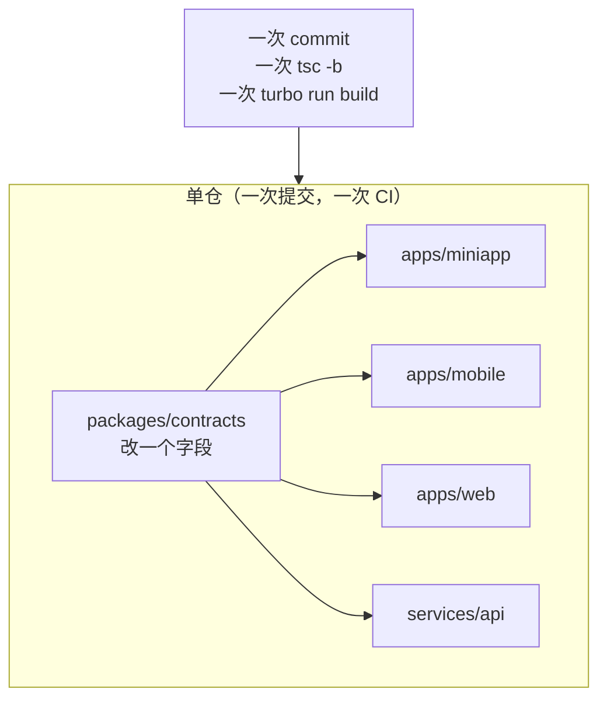

# ADR 0001 · 单仓多包 + npm workspaces + Turborepo

| 项 | 值 |
| --- | --- |
| 状态 | **已接受 (Accepted)** |
| 日期 | 2026-10-16 |
| 决策者 | Lead |
| 影响范围 | 仓库根、全部 `apps/*`、`services/*`、`packages/*` |
| 相关 | [0002-miniapp-framework.md](./0002-miniapp-framework.md)、[0003-mobile-framework.md](./0003-mobile-framework.md)、`docs/architecture/00-FROZEN-CONTRACT.md` §2 §3 |

---

## 1. 决策

采用**单仓多包（monorepo）**：

| 项 | 选型 | 版本 |
| --- | --- | --- |
| 仓库 | 单个 Git 仓库 `kedaya/` | — |
| 包管理 | **npm workspaces** | npm 11 |
| 构建编排 | **Turborepo** | `2.11.8` |
| 语言 | TypeScript | `5.9.3` |
| 布局 | `apps/` `services/` `packages/` `docs/` `assets/` | 见契约 §3 |

并明确：**不引入 pnpm，不引入 Nx，不拆多仓。**

---

## 2. 背景

### 2.1 这个项目有什么特征

| 特征 | 具体表现 | 对仓库结构的要求 |
| --- | --- | --- |
| **多端，共享同一份契约** | 3 个客户端 + 1 个后端，共享 `ApiEnvelope` / 19 个模块 ID / 错误码 | 契约必须能被 4 个消费方同时引用，且**原子更新** |
| **共享设计令牌** | 三端从 `tokens.ts` 派生 CSS/SCSS/Dart | 令牌改动必须同时触发三端重建 |
| **强类型的跨端边界** | TS 类型不一致 = 编译错误 | 需要一个覆盖全仓的 `tsc -b` |
| **多人并行开发** | 多个工作流同时改不同目录 | 写作用域必须物理隔离、互不干扰 |
| **任务书要求可验证** | 契约 §10 指定了 4 条验证命令 | 命令必须能在仓库根一次跑全 |

### 2.2 契约已经冻结的约束

契约 §3 已经写死了仓库布局，§10 已经写死了验证命令：

```bash
npm install                 # 根目录，workspace 链接
npx tsc -b                  # TS 全量类型检查
npm run build -w <app>      # 该 app 构建
npm run test -w <app>       # 该 app 测试
```

`npm run build -w <app>` 这个形状**就是 npm workspaces 的语法**（`-w` = `--workspace`）。所以"是否用 npm workspaces"这个问题在契约冻结时已经定了；本 ADR 记录的是**为什么这个选择是对的**，以及**为什么排除了其它方案**。

---

## 3. 被否决的方案及理由

### 3.1 方案 A：多仓（每个端一个仓库）

**方案描述**：`kedaya-contracts`、`kedaya-miniapp`、`kedaya-mobile`、`kedaya-web`、`kedaya-api` 五个独立仓库，`contracts` 通过 npm 私服发布。

**否决理由**

| # | 问题 | 具体后果 |
| --- | --- | --- |
| 1 | **契约变更变成跨仓协调** | 改一个字段：先改 `contracts` → 发版 → 4 个仓各自升级依赖 → 各自提交 → 各自 CI。一次改动 5 个 PR |
| 2 | **原子性丧失** | 无法做到"契约与消费方在同一次提交里一致"。中间态必然存在，且中间态就是坏的 |
| 3 | **需要维护私有 registry** | npm 私服（Verdaccio 等）的运维成本，对一个校园项目完全不划算 |
| 4 | **本地开发要 5 个 clone** | 新人的第一天成本极高 |
| 5 | **无法一次 `tsc -b` 全量检查** | 契约 §10 的验证命令失效 |
| 6 | **版本地狱** | 4 个端可能引用 4 个不同版本的 `contracts`，类型"看起来对"但行为不一致 |

**唯一真实优势**：CI 只跑受影响的仓。但这个优势 Turborepo 的**远程缓存 + 任务图**已经提供，且不需要付多仓的代价。

**结论**：否决。

### 3.2 方案 B：pnpm workspaces（+ pnpm 的 `catalog:` 协议）

**方案描述**：用 pnpm 替代 npm，利用其更快的安装、更严格的依赖隔离、`catalog:` 统一版本。

**pnpm 的客观优势**（不否认）

| 优势 | 说明 |
| --- | --- |
| 安装更快 | 内容寻址存储 + 硬链接，多项目场景下显著 |
| 磁盘更省 | 全局 store 去重 |
| **依赖隔离更严格** | 默认不允许访问未声明的幽灵依赖（phantom dependency） |
| `catalog:` 协议 | 集中管理版本，比 npm 的 `overrides` 更清晰 |
| workspace 协议成熟 | `workspace:*` 表达意图更明确 |

**否决理由**

| # | 问题 | 具体后果 |
| --- | --- | --- |
| 1 | **契约已冻结 npm** | 契约 §2 明确 `包管理 = npm workspaces (npm 11)`。改这个等于改契约，而契约是所有并行工作流的真相来源——冻结期内不可动 |
| 2 | **贡献者环境假设** | 校园项目的贡献者是学生，`node`/`npm` 是默认存在的；`pnpm` 需要额外安装与版本管理（corepack 在某些环境下不可用） |
| 3 | **Flutter 端不受益** | `apps/mobile` 用 pub，`pnpm` 的收益只覆盖 4 个 TS 包，边际收益降低 |
| 4 | **Turborepo 对两者的支持等价** | 编排层不构成差异化理由 |
| 5 | **幽灵依赖的严格性是把双刃剑** | 对快速迭代的校园项目，某些工具链（Next.js 的插件、Taro 的插件）依赖隐式提升；严格隔离会带来持续的排查成本 |
| 6 | **迁移成本 > 收益** | 已经用 npm workspaces 起的骨架，迁移会打断并行的多个工作流 |

**这是一个"更好但更贵"的选项，而不是"错的选项"。** 记录在此，供未来重新评估：

> **重新评估的触发条件**：任一成立则重开此议题 ——
> ① 安装时间成为日常瓶颈（CI 安装 > 3 分钟）；
> ② 出现因幽灵依赖导致的生产事故；
> ③ 仓库 TS 包数量超过 10 个。

**结论**：否决（当前）；保留重评条件。

### 3.3 方案 C：Nx

**方案描述**：用 Nx 替代 Turborepo，获得更强的任务图、代码生成器（generator）、影响分析（`nx affected`）、模块边界规则（`@nx/enforce-module-boundaries`）。

**否决理由**

| # | 问题 | 具体后果 |
| --- | --- | --- |
| 1 | **配置复杂度显著更高** | Nx 的 `project.json` / 插件体系 / executor 概念需要学习成本 |
| 2 | **`nx affected` 的优势被 Turborepo 覆盖** | Turborepo 的哈希任务图已经能做到"只跑受影响的" |
| 3 | **模块边界规则确实诱人** | `@nx/enforce-module-boundaries` 能强制 `presentation` 不能 import `data/api`——**这是 Nx 唯一真正有吸引力的能力** |
| 4 | **但边界可以用更便宜的方式强制** | ESLint `no-restricted-imports` + 各端的架构测试（`apps/mobile/test/architecture/`）已经能做到，且不引入 Nx |
| 5 | **与 Flutter 端不协同** | Nx 只管 TS 世界，`apps/mobile` 在 Nx 里是个外来户 |
| 6 | **契约 §2 已冻结 Turborepo `2.11.8`** | 同上 |

**结论**：否决。若未来需要模块边界强制，优先补 ESLint 规则而不是引入 Nx。

### 3.4 方案 D：单包（不用 workspaces，一个 `package.json` 管全部）

**方案描述**：所有代码放在一个 npm 包里，用 tsconfig 的 `paths` 做逻辑分层。

**否决理由**

| # | 问题 | 具体后果 |
| --- | --- | --- |
| 1 | **Flutter 端无法纳入** | `apps/mobile` 是 Dart 项目，物理上必须在自己的目录里有 `pubspec.yaml` |
| 2 | **依赖冲突** | Taro 4 与 Next.js 16 对 React 版本的诉求、构建工具链（webpack vs turbopack）的冲突无法在一个 `node_modules` 里干净解决 |
| 3 | **无法按端独立构建** | 契约 §10 要求 `npm run build -w <app>` |
| 4 | **写作用域无法隔离** | 契约 §3 的核心设计是"工作流只写自己的目录"；单包会让所有人的改动落在同一个 `package.json` 上，冲突不断 |

**结论**：否决。

### 3.5 方案 E：Git submodule / subtree 拼装

**方案描述**：一个"外壳"仓，用 submodule 引入各端。

**否决理由**：submodule 的指针管理是众所周知的痛苦源；且它解决的是"多仓的代码共享"，而我们**根本不需要多仓**。

**结论**：否决。

---

## 4. 决策依据（正面论证）

### 4.1 契约的原子性



契约变更的原子性是这个项目**最重要的架构属性**。19 个模块 ID、10 个错误码、`ApiEnvelope` 的形状——任何一个改动如果不能在一次提交里同时落到 4 个消费方，就必然产生"某些端还在用旧形状"的中间态。

### 4.2 写作用域隔离

契约 §3 把仓库切成互不重叠的写作用域：

| 作用域 | 所有者 |
| --- | --- |
| `docs/` | 工作流 A |
| `apps/miniapp/` | 工作流 C |
| `apps/mobile/` | 工作流 B |
| `apps/web/` | 工作流 D |
| `services/api/` | 工作流 E |
| `packages/`、`assets/`、根配置 | Lead |

**单仓让"作用域"成为一条可以机械检查的路径规则**（`git diff --name-only | grep -v '^docs/'`），而多仓会让每个作用域变成一个仓库——协调成本从"看路径"变成"看跨仓 PR"。

### 4.3 Turborepo 的任务图

```jsonc
// turbo.json（形状示意）
{
  "tasks": {
    "build":   { "dependsOn": ["^build"], "outputs": ["dist/**", ".next/**", "build/**"] },
    "test":    { "dependsOn": ["build"] },
    "lint":    {},
    "typecheck": { "dependsOn": ["^build"] }
  }
}
```

| 能力 | 对我们的价值 |
| --- | --- |
| `^build` 依赖 | 改 `packages/contracts` 自动重建 4 个消费方，不用手写顺序 |
| 内容哈希缓存 | 未改动的包不重复构建，CI 时间可控 |
| 并行执行 | 4 个端并行构建 |
| 远程缓存 | 多人协作时共享构建产物（可选） |

### 4.4 npm workspaces 的 `workspace:` 语义

```jsonc
// apps/miniapp/package.json
{
  "dependencies": {
    "@kedaya/contracts": "*",       // npm workspaces 用 "*" 表达 workspace 链接
    "@kedaya/design-tokens": "*"
  }
}
```

| 好处 | 说明 |
| --- | --- |
| 本地链接，无发布 | 改 `contracts` 立即在 `miniapp` 生效 |
| 不需要私服 | 零基础设施 |
| `npm install` 一条命令 | 新人第一天只需一条命令 |

**npm 的 `"*"` 语义要说明清楚**：npm workspaces 会把 `*` 解析为本地 workspace 包（当版本匹配时）。这是**隐式的**，不像 pnpm 的 `workspace:*` 那样自明。缓解措施：在根 `package.json` 里加一个注释性说明，并在 CI 里断言链接指向本地路径（`npm ls @kedaya/contracts` 的输出必须含 `-> ./packages/contracts`）。

---

## 5. 后果

### 5.1 正面后果

| # | 后果 |
| --- | --- |
| 1 | 契约变更原子化：一次提交同时落到 4 个消费方 |
| 2 | `npx tsc -b` 覆盖全仓 TS，类型不一致在 CI 就被拦下 |
| 3 | 写作用域可机械检查，并行开发不互相踩 |
| 4 | 零基础设施：不需要私服、不需要额外包管理器 |
| 5 | Turborepo 的 `^build` 保证派生顺序正确（令牌先于消费方构建） |
| 6 | 新人一条 `npm install` 即可开始 |

### 5.2 负面后果（必须承认）

| # | 负面后果 | 缓解措施 | 残余风险 |
| --- | --- | --- | --- |
| 1 | **CI 默认会跑全量**，仓库变大后变慢 | Turborepo 内容哈希 + 只跑受影响任务 | 中：初期包少，不痛；包多了要开远程缓存 |
| 2 | **根 `package.json` 是冲突热点** | 依赖只由 Lead 添加；工作流不碰根配置 | 中：这是一个流程约束，不是技术约束 |
| 3 | **依赖版本被迫统一** | 三端共享同一份 React 版本（小程序 19.3.1 / Web 也需一致） | ~~**高**~~ **已发生并已消解**：真实 `npm install` 触发 ERESOLVE（`@tarojs/react@4.3.0` peer 为 `react@^18`）。已按本条预设方案处置 —— **各 app 自带 React**：小程序 18.3.1 / Web 19.3.1，workspace 嵌套共存，实测通过 |
| 4 | **npm 的幽灵依赖比 pnpm 宽松** | 依赖必须显式声明（lint / review） | 中：可能出现"本地能跑、干净安装跑不了" |
| 5 | **`"*"` 的 workspace 语义不显式** | CI 断言链接指向本地 | 低 |
| 6 | **Flutter 端在编排之外** | `apps/mobile` 的构建/测试用 pub 命令，不进 turbo 任务图（或用一个 wrapper script 接入） | 中：需要额外写一个 `turbo.json` 的 `mobile#build` 包装任务 |

**第 3 条是最需要盯的风险 —— 它已经发生了，并已按预设方案处置。**

本 ADR 初稿预判"Taro 4 与 Next.js 16 对 React 的诉求可能不同"。M0 集成期用真实 `npm install` 证实了这一点：
`@tarojs/react@4.3.0` 的 peer 是 `react@^18`，与 Web 端的 React 19 **直接 ERESOLVE 冲突**，
`@types/react-dom@19` 又反向要求 `@types/react@^19`，形成链式冲突。

处置方式正是本条预设的方案 —— **把 React 提到各 app 的 `dependencies` 而不是根**，接受两个副本：

| 端 | React | `@types/react` | 实测落点 |
| --- | --- | --- | --- |
| `apps/miniapp` | `18.3.1` | `^18.3.31` | 根 `node_modules/react` |
| `apps/web` | `19.3.1` | `^19.3.0` | `apps/web/node_modules/react` |

**实测证据**：隔离镜像 `npm install --package-lock-only` → exit 0，1870 个包解析成功；
仓库根真实 `npm install` → exit 0，1660 个包审计通过。**风险已消解。**

> 教训：**冻结契约里的版本组合必须用真实安装验证过**，不能只看"最新版本号"就写进契约。

### 5.3 对开发流程的影响

| 环节 | 变化 |
| --- | --- |
| 新人上手 | 只需 `git clone` + `npm install` |
| 契约变更 | 一次 PR，一次 CI |
| 依赖新增 | 必须由 Lead 在根或对应 workspace 添加，工作流不得自行加根依赖 |
| 提交规范 | 建议 conventional commits + scope 用目录名（`feat(groupbuy):`、`docs(adr):`） |
| CI 门禁 | `npm install` → `npx tsc -b` → `turbo run lint test build` |

---

## 6. 验证方式

本决策必须能被下列命令验证（契约 §10）：

```bash
# 1. workspace 链接正确（契约 §10 第 1 条）
npm install
npm ls @kedaya/contracts @kedaya/design-tokens @kedaya/shared

# 2. 全量类型检查（契约 §10 第 2 条）
npx tsc -b

# 3. 单端构建与测试（契约 §10 第 3、4 条）
npm run build -w apps/miniapp
npm run test  -w apps/miniapp
```

**断言**：`npm ls` 的输出必须显示三个 `@kedaya/*` 包指向本地路径（`-> ./packages/...`），而不是 registry 版本。

---

## 7. 引用

| 来源 | 用途 |
| --- | --- |
| [npm workspaces 官方文档](https://docs.npmjs.com/cli/v11/using-npm/workspaces) | npm workspaces 的语义与 `-w` 参数 |
| [Turborepo 官方文档](https://turborepo.com/docs) | 任务图、`dependsOn`、缓存 |
| [Turborepo 2.x 发布说明](https://github.com/vercel/turborepo/releases) | 版本 `2.11.8` 的存在性 |
| [pnpm workspaces 官方文档](https://pnpm.io/workspaces) | 被否决方案 B 的客观能力（用于公平比较） |
| [Nx 官方文档](https://nx.dev/docs) | 被否决方案 C 的客观能力 |
| `docs/architecture/00-FROZEN-CONTRACT.md` §2 §3 §10 | 本决策的上游约束 |

> 版本号以契约 §2 为准（Lead 已从 npm registry 核实）。本 ADR 不重复声明版本，避免与契约漂移。

---

## 8. 未决问题

| # | 问题 | 建议 |
| --- | --- | --- |
| 1 | ~~React 版本在 Taro 与 Next.js 之间是否真的可以统一~~ **已实测关闭** | **结论：不能统一，但可以共存**（各 app 自带 React + workspace 嵌套安装）。已实测 |
| 2 | `apps/mobile`（Flutter）如何接入 Turborepo 任务图未定 | 建议用一个 wrapper script（`npm run build -w apps/mobile` 内部调 `flutter build`），保持命令形状统一 |
| 3 | 是否启用 Turborepo 远程缓存 | 初期不需要；CI 变慢时再评估 |
| 4 | 是否给 `packages/*` 加 `publishConfig` 以防误发布 | 建议加 `"private": true` |
| 5 | npm 11 的 `overrides` 是否足以解决潜在的依赖冲突 | 需在 M0 实测 |
