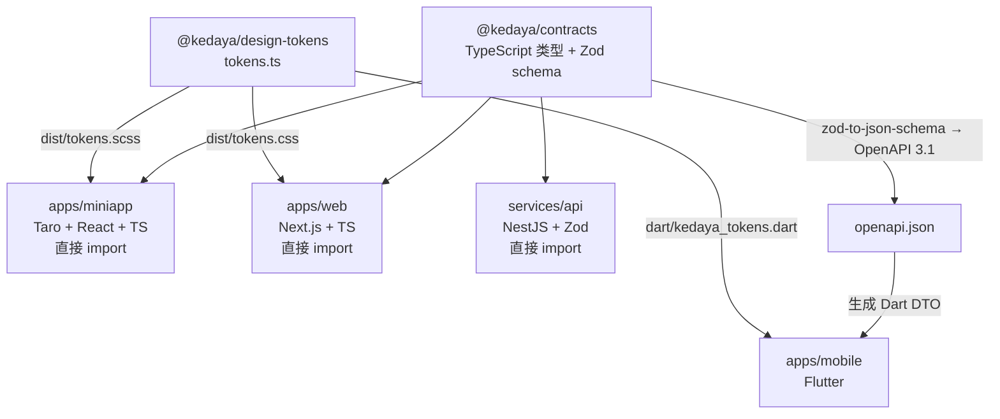

# ADR 0002 · 小程序框架选 Taro 4 而非 uni-app

| 项 | 值 |
| --- | --- |
| 状态 | **已接受 (Accepted)** |
| 日期 | 2026-10-16 |
| 决策者 | Lead |
| 影响范围 | `apps/miniapp`（主端，微信小程序 + H5） |
| 相关 | [0001-monorepo.md](./0001-monorepo.md)、[0003-mobile-framework.md](./0003-mobile-framework.md)、[0004-auth-two-tier.md](./0004-auth-two-tier.md)、`docs/architecture/00-FROZEN-CONTRACT.md` §2 |

---

## 1. 决策

微信小程序（**主端**）采用 **Taro 4.3.0 + React 18.3.1 + TypeScript 5.9.3**。

> **勘误（2026-10-16，M0 集成期）**：本文档初稿写的是 React 19.3.1（与当时的契约 §2 一致），
> 但**该组合在真实 `npm install` 下无法解析** —— `@tarojs/react@4.3.0` 的 peer 是 `react@^18`，
> `@tarojs/taro@4.3.0` 的 peer 是 `@types/react@^18`。Lead 已把契约 §2 改为
> 小程序 React `18.3.1` / Web React `19.3.1`，并用隔离镜像 `npm install --package-lock-only`
> 验证两个大版本可在同一 workspace 内**嵌套共存**（1870 个包解析成功、exit 0）。
> 详见契约 §2「⚠️ React 大版本按端不同（刻意，不要"统一"）」。
> **本文档的决策（选 Taro 而非 uni-app）不受影响** —— 受影响的只是 React 版本号。

```
apps/miniapp/
├── app/          Taro app 入口 + 页面注册
├── application/  hooks / use case
├── domain/       模型 + ports
├── data/         api / repositories / storage / mock
├── platform/     订阅消息 / 扫码 / 分享 / 地图
└── presentation/ pages / components / theme（消费 dist/tokens.scss）
```

**不使用 uni-app。** 不使用原生小程序开发（WXML/WXSS）。不使用 Remax / mpvue / Chameleon。

---

## 2. 背景

### 2.1 这个决策要满足什么

| # | 约束 | 来源 |
| --- | --- | --- |
| 1 | 主端是**微信小程序**，不是"多端随便哪端" | 契约 §1：`覆盖端 ① 微信小程序（主端）` |
| 2 | 必须与 `@kedaya/contracts`（TS + Zod）共享类型 | 契约 §6.1 §6.3 |
| 3 | 必须与 `@kedaya/design-tokens` 的 SCSS 产物对接 | 契约 §6.2 |
| 4 | 必须能落地契约 §7 的六层目录（`domain` 零框架依赖） | 契约 §7 |
| 5 | 必须与 Flutter 端共存于同一仓、共享同一份契约语义 | 契约 §3 |
| 6 | 必须有 **H5 兜底**（小程序被拒时仍有入口） | 契约 §3：`apps/miniapp` 注释含 H5 |
| 7 | 技术栈版本已从 npm registry 核实并冻结 | 契约 §2 |

### 2.2 两个候选的定位差异（先说清楚，避免错误对比）

| 项 | Taro | uni-app |
| --- | --- | --- |
| 维护方 | 京东凹凸实验室（NervJS） | DCloud |
| 官方描述 | "开放式跨端跨框架解决方案，支持使用 React/Vue/Nerv 等框架来开发……小程序 / H5 / RN / ASCF 元服务 等应用" | "使用 Vue 语法的跨端框架"；新版 **uni-app x** 用 UTS 语言 |
| 语言心智 | **就是 React / Vue**，用 TS 写业务 | uni-app：Vue；uni-app x：**UTS**（不是 TS） |
| 编译模型 | 编译期把 JSX/Vue SFC 转成各平台小程序代码 + **运行时适配层** | uni-app：编译 + 运行时；uni-app x：**编译为原生**（Kotlin/Swift/ArkTS） |

**关键区分**：`uni-app`（Vue + JS 运行时）与 `uni-app x`（UTS + 原生编译）是**两个不同的东西**。本 ADR 对两者都做比较，因为选型时必须同时考虑"现在用哪个"和"官方在往哪走"。

---

## 3. 对比表

> 数据采集时间：**2026-10-16**。GitHub 星标与版本号来自 GitHub REST API 与 npm registry 的实时查询（见 §6 采集命令）。
> 标注 `[需核实]` 的条目是**未经验证**的判断，不作为决策依据。

### 3.1 主对比表

| 维度 | Taro 4 | uni-app | 对本项目的意义 |
| --- | --- | --- | --- |
| **框架语言** | React / Vue / Preact / Svelte / Nerv（官方文档明列） | Vue（uni-app）；UTS（uni-app x） | 见 §3.2 |
| **TypeScript 支持** | **原生 TS**。业务代码就是 TS，`tsc -b` 直接覆盖 | uni-app：支持 TS，但类型体系与 Vue 选项式 API 的结合较弱；**uni-app x：UTS ≠ TS**，明确不支持 `undefined`、结构化类型、条件类型、映射类型、`Partial`/`Pick`/`Omit` 等 Utility Types、`as const`、确定赋值断言 | **决定性差异**，见 §3.2 |
| **微信生态成熟度** | 微信小程序为**一等公民**；官方文档将微信小程序列为首个支持平台 | 微信小程序同样是一等公民，DCloud 起家于小程序 | 平手 |
| **跨端能力** | 微信/京东/百度/支付宝/字节/QQ/钉钉/企业微信/飞书/快手小程序 + H5 + RN + 华为 ASCF 元服务 | 全平台小程序 + H5 + App（iOS/Android/鸿蒙） | **Taro 覆盖更广的小程序平台；uni-app 覆盖更广的 App 端**——但我们的 App 端由 Flutter 负责（见 [0003](./0003-mobile-framework.md)），所以这一项对本项目**不构成 uni-app 的优势** |
| **社区活跃度（GitHub 星标）** | `NervJS/taro` **37,714** ★ | `dcloudio/uni-app` **41,615** ★ | uni-app 星标更多；但见 §3.3 |
| **社区活跃度（提交时间）** | `pushed_at` = 2026-10-16T10:43:30Z | `pushed_at` = 2026-10-16T10:46:26Z | 两者都在活跃维护 |
| **Open Issues** | 1,590 | 711 | uni-app 未关 issue 更少（不代表质量差异，仓库策略不同） |
| **许可证** | GitHub API 报告 `NOASSERTION`（仓库根 license 未被 GitHub 识别为标准 SPDX） | **Apache-2.0**（GitHub API 识别） | **需注意**：Taro 的许可证需人工确认仓库内的 LICENSE 文件。见 §7 未决问题 U1 |
| **npm 包版本** | `@tarojs/cli` = **4.3.0**（MIT per npm metadata） | `@dcloudio/uni-app` = `2.0.2-5020620260917001`（Apache-2.0） | 契约冻结 Taro `4.3.0`，与实际一致 |
| **与 Flutter 共存** | 纯 TS 项目，与 `apps/mobile`（Dart）零耦合；共享的只有 `@kedaya/contracts` 的**语义** | 同上；但 uni-app x 的 UTS 与 TS 不兼容，会让"共享契约"退化为"手工翻译" | **Taro 胜**，见 §3.4 |
| **H5 兜底** | 官方支持 H5 编译 | 官方支持 H5 编译 | 平手 |
| **开发工具链** | CLI（`@tarojs/cli`）+ VSCode；不依赖专用 IDE | **HBuilderX 是官方主推 IDE**；CLI 也支持但文档与生态重心在 HBuilderX | **Taro 胜**：我们要求可脚本化、可在 CI 跑、可用任意编辑器。专用 IDE 与 monorepo + Turborepo 的配合成本更高 |
| **构建产物可控性** | 可配置 webpack/vite 层 | 配置项较多但封装更厚 | Taro 略胜（对分包、体积优化更可控） |
| **学习曲线** | 会 React + TS 即可 | 会 Vue 即可；但 uni-app x 需学 UTS | 取决于团队，见 §3.5 |

### 3.2 TypeScript 支持：这是决定性维度

本项目的架构核心是"**契约唯一真相**"（见 [01-overview.md](../architecture/01-overview.md) §1）。契约以 TypeScript 表达：

```ts
export type ApiEnvelope<T> =
  | { ok: true; data: T; traceId: string }
  | { ok: false; error: ApiError; traceId: string };
```

三种框架语言对这个类型的处理：

| 框架 | 能否直接 `import` 这个类型 | 代价 |
| --- | --- | --- |
| **Taro + React + TS** | **能**，零翻译 | 无 |
| uni-app + Vue + TS | 大体能，但 Vue 的类型推导（`defineProps` 泛型、模板 ref 类型）与复杂联合类型的结合有摩擦 | 中等 |
| **uni-app x + UTS** | **不能**。UTS 不支持结构化类型系统（采用名义类型）、不支持 `undefined`、不支持条件类型/映射类型/Utility Types、不支持 `as const` | **高**：契约里的联合类型、`Partial<T>`、`Record<K,V>`、`as const` 都要手工改写为 UTS 的 `type` + 类 |

**这条差异如何伤害本项目**

`ApiEnvelope<T>` 是一个**判别联合（discriminated union）**。在 TS 里：

```ts
if (env.ok) { env.data }        // 收窄到成功分支
else        { env.error.code }  // 收窄到失败分支
```

在 UTS 里没有结构化类型系统，这种"靠 `ok` 字段收窄"的模式无法自然表达，必须改成两个类 + `instanceof` 判断。**每一个契约类型都要翻译一次**，而契约有 19 个模块、10 个错误码、几十个实体。

`as const` 也被明确禁止——而契约 §6.2 的 `tokens.ts` **整个就是 `as const`**：

```ts
export const tokens = { color: { brand: '#FFC53D', ... } } as const;
```

设计令牌的生成器要消费这个对象。UTS 不支持 `as const`，意味着令牌的消费路径要重写。

**结论**：`uni-app x` 与"契约唯一真相"的架构是**根本冲突**的。`uni-app`（Vue + TS）没有这个冲突，但见 §3.3。

### 3.3 社区活跃度：星标多不等于更适合

| 指标 | Taro | uni-app | 解读 |
| --- | --- | --- | --- |
| 星标 | 37,714 | 41,615 | uni-app 多 3,901（+10.3%） |
| Fork | 4,867 | 3,707 | Taro 的 fork 更多 |
| Open Issues | 1,590 | 711 | 不构成质量结论：仓库的 issue 关闭策略不同 |
| 最近提交 | 2026-10-16 | 2026-10-16 | 都在活跃维护 |

**星标数不能作为决策依据**，原因：

1. uni-app 的历史更长（DCloud 起家更早），且其用户群以"不写 TS 的 Vue 开发者"为主——星标反映的是**用户基数**，不是**与本项目需求的契合度**。
2. 星标不区分 `uni-app` 与 `uni-app x`。官方正在把重心转向 uni-app x（UTS），而 UTS 恰好与我们的需求冲突。**一个项目星标多，但它的演进方向与我们的需求背道而驰，这不是优势。**
3. 本项目需要的不是"最多人用"，而是"能无损承载 TS 契约 + 能进 monorepo CI"。

**对 Taro 的诚实减分项**：GitHub API 报告 Taro 的许可证为 `NOASSERTION`（未能识别为标准 SPDX 许可证），而 uni-app 被识别为 Apache-2.0。这需要在采用前人工确认（见 §7 U1）。npm metadata 报告 `@tarojs/cli` 为 MIT，但**必须以仓库内的 LICENSE 文件为准**。

### 3.4 与 Flutter 共存

本项目 `apps/mobile` 用 Flutter（见 [0003](./0003-mobile-framework.md)）。小程序端与 Flutter 端的关系是：



| 端 | 消费契约的方式 | 保真度 |
| --- | --- | --- |
| 小程序（Taro） | 直接 import TS 类型 | **100%** |
| Web（Next.js） | 直接 import TS 类型 | **100%** |
| 后端（NestJS） | 同一份 Zod schema | **100%** |
| Flutter | OpenAPI → 生成 Dart DTO | **有损一次**（已在 [04-client-architecture.md](../architecture/04-client-architecture.md) §4.4 承认并用 CI 兜住） |

**如果小程序改用 uni-app x**：契约的消费方会从"3 个直接 + 1 个生成"变成"2 个直接 + 2 个生成"，而且 Flutter 那次生成是**机械翻译**（OpenAPI → DTO），uni-app x 那次是**手工改写**（TS → UTS，因为 UTS 不支持 Utility Types 与 `as const`）。手工改写无法用 CI 兜住——**类型漂移会变成静默的**。

### 3.5 团队与学习曲线（诚实说明）

| 情况 | Taro | uni-app |
| --- | --- | --- |
| 团队熟 React + TS | **最低成本** | 需要学 Vue |
| 团队熟 Vue | 需要学 React | **最低成本** |
| 团队两者都不熟 | React 生态资料更多、TS 资料更多 | Vue 上手更快（模板语法直观） |
| 团队熟原生小程序 | Taro 的心智是"写 React 但组件是小程序组件"，转换成本中等 | uni-app 的模板语法更接近原生小程序，转换成本较低 |

**本项目的实际情况**：契约 §2 已冻结 `Taro 4.3 + React 18.3.1`（初稿为 React 19.3.1，因 Taro 的 peer 约束已在 M0 集成期修正，见文首勘误）。本 ADR 不推翻该前提，只记录理由与替代方案。

**如果团队实际上是 Vue 团队**，正确的做法**不是**换 uni-app，而是重开本 ADR 并评估 "Taro + Vue 3"——因为 Taro 官方文档明确支持 Vue 与 Vue3（见 [Taro 基础教程——Vue3](https://docs.taro.zone/docs/vue3)）。这样既保住 TS 契约的无损消费，又不要求团队学 React。**这是本 ADR 最值得记住的一条**。

---

## 4. 被否决的方案及理由

### 4.1 方案 A：uni-app（Vue + TS）

| # | 否决理由 |
| --- | --- |
| 1 | 契约 §2 已冻结 Taro，且契约是全部并行工作流的真相来源，冻结期内不可改 |
| 2 | **官方演进方向是 uni-app x（UTS）**，而 UTS 与 TS 契约不兼容（§3.2）。采用 uni-app 意味着未来面临"要么不升级、要么重写"的两难 |
| 3 | HBuilderX 是官方主推 IDE，与 monorepo + Turborepo + 任意编辑器的诉求摩擦 |
| 4 | 类型体系与复杂联合类型（`ApiEnvelope<T>`）的结合不如 Taro 直接 |
| 5 | 没有一项对本项目的**独特**优势：小程序生态平手、跨端能力中的 App 端由 Flutter 负责 |

**如果团队是 Vue 团队**：改用 **Taro + Vue 3**，而不是 uni-app。理由见 §3.5。

### 4.2 方案 B：uni-app x（UTS + 原生编译）

| # | 否决理由 |
| --- | --- |
| 1 | **UTS ≠ TS**，且差异是结构性的：不支持 `undefined`、不支持结构化类型系统（名义类型）、不支持条件类型 / 映射类型 / Utility Types（`Partial`/`Pick`/`Omit`/`Record`…）、不支持 `as const`、不支持确定赋值断言 |
| 2 | 契约的 `ApiEnvelope<T>`（判别联合）与 `tokens.ts`（`as const`）**都无法直接表达** |
| 3 | 契约消费从"直接 import"退化为"手工翻译"，**类型漂移不可被 CI 捕获** |
| 4 | 本项目不需要 uni-app x 的核心卖点（编译为原生以获得 App 端性能）——App 端已由 Flutter 承担 |
| 5 | 学习成本：团队需学 UTS 这一门仅此一处使用的语言 |

**这是本 ADR 中最强的一条否决**：uni-app x 的技术方向与"契约唯一真相"的架构**根本冲突**。

### 4.3 方案 C：原生小程序（WXML / WXSS / JS）

| # | 否决理由 |
| --- | --- |
| 1 | 无法与 `@kedaya/contracts` 共享 TS 类型（原生小程序开发不经过 TS 编译链） |
| 2 | 无法落地契约 §7 的六层目录（`domain` 层零框架依赖在原生小程序里没有自然的表达） |
| 3 | 失去 H5 兜底能力 |
| 4 | 无法复用 `@kedaya/design-tokens` 的 SCSS 产物（原生用 WXSS，虽有 SCSS 预处理但工程化程度低） |
| 5 | 微信专属，未来若要上支付宝/字节小程序需重写 |

### 4.4 方案 D：Remax

| # | 否决理由 |
| --- | --- |
| 1 | 社区规模远小于 Taro，维护活跃度不确定 |
| 2 | 只支持 React，跨端平台覆盖窄于 Taro |
| 3 | 无 H5 兜底的同等成熟度 |
| 4 | 契约已冻结 Taro |

### 4.5 方案 E：mpvue / Chameleon / WePY

| # | 否决理由 |
| --- | --- |
| 1 | mpvue 长期不活跃（Vue 2 时代产物） |
| 2 | Chameleon 已停止维护 |
| 3 | WePY 是 Vue 风格但非标准 Vue，生态小 |
| 4 | 三者都无法承载 TS 契约的完整表达 |

### 4.6 方案 F：不用框架，用 WebView 包一个 H5

| # | 否决理由 |
| --- | --- |
| 1 | 微信对 WebView 内嵌 H5 的能力有大量限制（登录、支付、订阅消息、扫码均不可用） |
| 2 | 我们**必须**用到微信原生能力：`wx.login`（登录）、`wx.requestSubscribeMessage`（订阅消息）、`wx.scanCode`（扫码）、`onShareAppMessage`（分享） |
| 3 | 体验与原生小程序差距明显 |

---

## 5. 后果

### 5.1 正面后果

| # | 后果 |
| --- | --- |
| 1 | 小程序端**无损消费** `@kedaya/contracts`，与 Web、后端一致；`tsc -b` 一处检查三处 |
| 2 | 契约 §7 的六层目录在 Taro 里可自然落地（`domain/` 是纯 TS，零 Taro import） |
| 3 | 纯 CLI 工具链，可进 Turborepo 任务图、可在 CI 跑、可用任意编辑器 |
| 4 | 保留 H5 编译能力作为小程序被拒时的兜底 |
| 5 | 未来若需上支付宝/字节小程序，同一套代码可编译过去 |
| 6 | 若团队转向 Vue，可用 **Taro + Vue 3** 而**不必**换框架，保护了契约消费路径 |

### 5.2 负面后果（必须承认）

| # | 负面后果 | 缓解 | 残余风险 |
| --- | --- | --- | --- |
| 1 | **Taro 的许可证在 GitHub API 上显示 `NOASSERTION`** | 采用前人工确认仓库 LICENSE 文件 | **中**：需在 M0 结束前确认（U1） |
| 2 | ~~Taro 的 React 19 支持需要与 Next.js 16 的 React 版本协调~~ **已发生并已解决** | **已实测**：小程序 React 18.3.1 / Web React 19.3.1 在 workspace 内嵌套共存 | **已消解**（见 [0001](./0001-monorepo.md) §5.2 第 3 条） |
| 3 | 星标少于 uni-app，社区资料相对少 | 官方文档完整（有中文 4.x 文档与教程） | 低 |
| 4 | Taro 的运行时适配层有性能开销（相比原生小程序） | 关键页面做体积与渲染优化；主包 ≤ 2MB | 低 |
| 5 | Taro 的 issue 数较多（1,590 open） | 不构成质量结论；遇到问题查官方文档与 discussions | 低 |
| 6 | 若团队实际是 Vue 团队，需重开 ADR | 已给出明确替代路径（Taro + Vue 3） | 低 |

### 5.3 对工程实践的影响

| 环节 | 影响 |
| --- | --- |
| 目录结构 | 按契约 §7 六层；`domain/` 与 `application/` 是纯 TS，可在 Node 里单测 |
| 构建 | `npm run build -w apps/miniapp`（契约 §10） |
| 测试 | `npm run test -w apps/miniapp`；架构约束测试（无字面量色值、`presentation` 不发请求） |
| 设计令牌 | 消费 `@kedaya/design-tokens/dist/tokens.scss`，`$kdy-*` 变量 |
| 平台差异 | 全部收敛到 `platform/`：`subscribeMessage` / `scanCode` / `shareAppMessage` / `map` |
| 分包 | 主包 ≤ 2MB，需在 M2 前定分包边界（见 [06-roadmap.md](../architecture/06-roadmap.md) 风险） |

---

## 6. 验证与采集命令

本 ADR 中的所有外部数据可用下列命令复现（采集时间 2026-10-16）：

```bash
# GitHub 星标 / fork / issues / license / 最近提交
for r in NervJS/taro dcloudio/uni-app; do
  curl -s "https://api.github.com/repos/$r" | python3 -c \
    "import sys,json;d=json.load(sys.stdin);print(d['full_name'],d['stargazers_count'],d['forks_count'],d['open_issues_count'],d['license'],d['pushed_at'])"
done

# npm 上的最新版本与 license
curl -s "https://registry.npmjs.org/@tarojs/cli/latest"     | python3 -c "import sys,json;d=json.load(sys.stdin);print(d['version'],d['license'])"
curl -s "https://registry.npmjs.org/@dcloudio/uni-app/latest" | python3 -c "import sys,json;d=json.load(sys.stdin);print(d['version'],d['license'])"
```

采集结果（2026-10-16）：

| 仓库 | ★ | Fork | Open Issues | License (GitHub API) | pushed_at |
| --- | --- | --- | --- | --- | --- |
| `NervJS/taro` | 37,714 | 4,867 | 1,590 | `NOASSERTION` | 2026-10-16T10:43:30Z |
| `dcloudio/uni-app` | 41,615 | 3,707 | 711 | `Apache-2.0` | 2026-10-16T10:46:26Z |

| npm 包 | version | license (npm metadata) |
| --- | --- | --- |
| `@tarojs/cli` | 4.3.0 | MIT |
| `@dcloudio/uni-app` | 2.0.2-5020620260917001 | Apache-2.0 |

---

## 7. 引用

| 来源 | 用途 |
| --- | --- |
| [Taro 官方文档（4.x）](https://docs.taro.zone/docs/) | 框架语言支持（React/Vue/Preact/Svelte/Nerv）、支持的小程序平台清单、H5/RN/ASCF 支持 |
| [Taro 基础教程 · Vue3](https://docs.taro.zone/docs/vue3) | 佐证"团队若是 Vue 团队可用 Taro + Vue 3 而非换框架" |
| [Taro 基础教程 · React](https://docs.taro.zone/docs/react-overall) | React 支持 |
| [NervJS/taro（GitHub）](https://github.com/NervJS/taro) | 星标、issue、提交活跃度 |
| [dcloudio/uni-app（GitHub）](https://github.com/dcloudio/uni-app) | 星标、issue、提交活跃度、许可证 |
| [uni-app x 官方文档](https://doc.dcloud.net.cn/uni-app-x/) | uni-app x 的定位（UTS + 原生编译） |
| [UTS 与 TS 的差异](https://doc.dcloud.net.cn/uni-app-x/uts/uts_diff_ts.html) | **UTS 不支持 undefined / 结构化类型 / 条件类型 / 映射类型 / Utility Types / `as const` / 确定赋值断言**——本 ADR §3.2 与 §4.2 的直接依据 |
| `docs/architecture/00-FROZEN-CONTRACT.md` §1 §2 §3 §6 §7 | 本决策的上游约束 |

**未使用的来源**：搜索结果中的第三方对比文章（如腾讯云开发者社区、阿里云开发者社区的横评）**未被引用为决策依据**，因为它们的评测口径不可验证。本 ADR 只引用**官方文档**与**可复现的 API 数据**。

---

## 8. 未决问题

| # | 问题 | 影响 | 建议 |
| --- | --- | --- | --- |
| U1 | **Taro 的许可证需人工确认**（GitHub API 报 `NOASSERTION`，npm 报 MIT）。以仓库内 LICENSE 文件为准 | 合规 | M0 结束前确认；若为非 MIT/Apache 类许可证，需评估影响 |
| U2 | ~~Taro 4.3 的 React 版本与 Next.js 16 能否在 monorepo 里统一~~ **已关闭** | 构建 | **已实测关闭**：不能"统一"，但**可以共存**。小程序锁 React 18.3.1、Web 用 React 19.3.1，npm workspaces 嵌套安装（见 [0001](./0001-monorepo.md) §5.2） |
| U3 | 团队实际是 React 还是 Vue 背景，本文档无法确认 | **决策有效性** | 若为 Vue 背景，应重开本 ADR 并改选 **Taro + Vue 3**（不是 uni-app） |
| U4 | 小程序分包边界未定（主包 2MB 限制） | 主端可发布性 | M2 前定 |
| U5 | 是否需要支持微信以外的平台（支付宝/字节小程序）未定 | 架构投入 | 建议先只做微信 + H5；Taro 保留了扩展能力 |
| U6 | uni-app x 的 UTS 约束列表可能随版本演进放松 | 本 ADR 的 §4.2 结论时效性 | 每年复查一次；若 UTS 支持了结构化类型与 Utility Types，可重开评估 |
