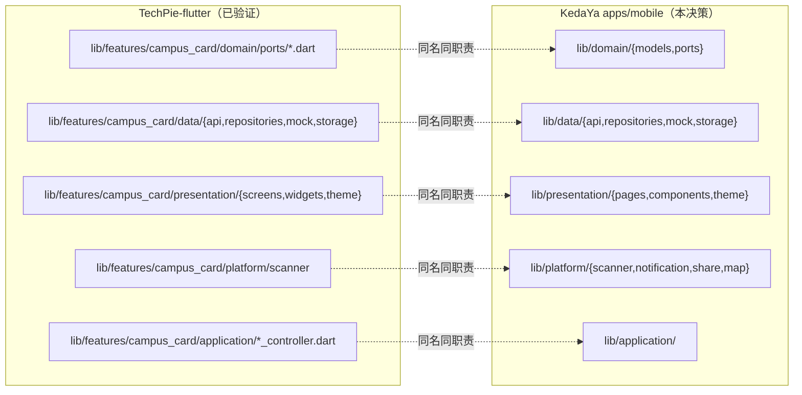

# ADR 0003 · 原生移动端选 Flutter 而非 React Native

| 项 | 值 |
| --- | --- |
| 状态 | **已接受 (Accepted)** |
| 日期 | 2026-10-16 |
| 决策者 | Lead |
| 影响范围 | `apps/mobile`（iOS / Android / 鸿蒙 NEXT） |
| 相关 | [0002-miniapp-framework.md](./0002-miniapp-framework.md)、[0004-auth-two-tier.md](./0004-auth-two-tier.md)、[01-overview.md](../architecture/01-overview.md)、[04-client-architecture.md](../architecture/04-client-architecture.md) |
| 参考实现 | [`HeZeBang/TechPie-flutter`](https://github.com/HeZeBang/TechPie-flutter)（clone 于 `/tmp/techpie-ref`） |

---

## 1. 决策

原生移动端采用 **Flutter**，SDK 约束 `>=3.6.2 <4.0.0`，覆盖 iOS / Android / 鸿蒙 NEXT。

```
apps/mobile/
├── lib/
│   ├── app/           装配：main.dart、DI、路由
│   ├── application/   用例/控制器
│   ├── domain/        纯领域：models + ports（零框架依赖）
│   ├── data/          api / repositories / storage / mock
│   ├── platform/      MethodChannel：scanner / notification / share / map
│   └── presentation/  pages / components / theme
└── test/architecture/ 架构约束测试
```

**不使用 React Native。** 不使用原生双端（Swift/Kotlin 各写一套）。不使用 Kotlin Multiplatform。

---

## 2. 背景

### 2.1 这个决策要满足什么

| # | 约束 | 来源 |
| --- | --- | --- |
| 1 | 覆盖 **iOS + Android + 鸿蒙 NEXT** | 契约 §1 |
| 2 | 落地契约 §7 的六层目录，且 `domain` 层**零框架依赖** | 契约 §7 硬规则 1 |
| 3 | 实现契约 §8 的启动时序（同步 hydrate → 立即渲染 → 后台并发） | 契约 §8 |
| 4 | 消费 `@kedaya/design-tokens` 的 Dart 产物 | 契约 §6.2 |
| 5 | 与小程序、Web、后端共享同一份契约语义 | 契约 §6.1 |
| 6 | 有参考实现可借鉴（降低从零设计的风险） | 任务背景：TechPie-flutter |
| 7 | 平台差异（扫码/推送/分享/地图）收敛到 `platform/` | 契约 §7 |

### 2.2 为什么鸿蒙是决定性约束

契约 §1 明确要求覆盖 **鸿蒙 NEXT**。这是所有"跨平台框架选型"里最苛刻的一条：

| 框架 | 鸿蒙 NEXT 支持现状 | 对我们的含义 |
| --- | --- | --- |
| **Flutter** | 有 **OHOS 官方/社区 fork**（`flutter_flutter`，channel `ohos`），可 `flutter build hap` | 有路径，但需要独立的 SDK checkpoint（见 §4.2） |
| React Native | 无成熟官方路径；社区尝试不完整 | 需自研原生桥接，成本不可控 |
| 原生双端 | iOS/Android 之外还要写一套 ArkTS | 三套代码，成本最高 |

**TechPie-flutter 已经在这条路上走通了**（README 明确列出 HarmonyOS NEXT 为已测试平台），这为"鸿蒙可行"提供了实证，而不是推测。

---

## 3. 对比表

> 数据采集时间：**2026-10-16**。GitHub 数据来自 REST API 实时查询（采集命令见 §6）。

| 维度 | Flutter | React Native | 对本项目的意义 |
| --- | --- | --- | --- |
| **语言** | Dart | TypeScript / JS | 见 §3.1（这是 RN 唯一的真实优势） |
| **渲染模型** | 自绘引擎（Skia/Impeller），**不依赖平台原生控件** | 依赖平台原生控件（新架构 Fabric 仍桥接到原生视图） | Flutter 的 UI 在三端**像素级一致**；RN 的 UI 随平台控件变化 |
| **鸿蒙 NEXT** | 有 OHOS fork，可 `flutter build hap`；**TechPie 已验证** | 无成熟路径 | **决定性**，见 §2.2 |
| **iOS / Android** | 一等公民 | 一等公民 | 平手 |
| **性能** | AOT 编译为原生机器码；自绘无桥接开销 | Hermes + 新架构（Fabric/TurboModules）大幅改善，但仍有 JS↔原生边界 | Flutter 在**高频动画与长列表**上更可预测；本项目的列表页与扫码页受益 |
| **状态管理** | 社区方案多样（Provider / Riverpod / Bloc） | 与 React 生态一致（Redux / Zustand / TanStack Query） | **RN 胜**：可直接复用 Web 端的心智 |
| **与 `@kedaya/contracts` 的距离** | Dart 无法直接消费 TS 类型，需 OpenAPI → 生成 DTO | TS 可直接 import（同一语言） | **RN 胜**，但代价与收益见 §3.1 |
| **安全存储** | `flutter_secure_storage`（Keychain / Keystore / HUKS） | `react-native-keychain` 等 | 平手 |
| **生物识别** | `local_auth` | `react-native-biometrics` | 平手 |
| **扫码** | `mobile_scanner`（成熟） | `react-native-vision-camera` + 扫码插件 | 平手 |
| **推送** | `firebase_messaging` + APNs 原生 | 同 | 平手 |
| **社区规模（GitHub ★）** | `flutter/flutter` **180,236** ★ | `react/react-native` **126,690** ★ | Flutter 更多（+42%） |
| **Fork** | 34,255 | 25,319 | — |
| **Open Issues** | 13,364 | 1,177 | 不构成质量结论（仓库策略不同） |
| **许可证** | **BSD-3-Clause**（GitHub API 识别） | **MIT**（GitHub API 识别） | 两者都宽松；平手 |
| **最近提交** | 2026-10-16T05:42:27Z | 2026-10-16T11:11:43Z | 都活跃 |
| **npm/Dart 包生态** | pub.dev；核心库齐全 | npm；生态更大（可复用 JS 库） | RN 生态更大，但本项目需要的库两边都有 |
| **热重载 / 开发体验** | 热重载成熟稳定 | Fast Refresh 成熟 | 平手 |
| **构建产物体积** | 较大（引擎内置），约 10–20MB 起 | 较小 | Flutter 略逊；对本项目可接受 |
| **桌面端（可选）** | 支持 macOS/Linux/Windows | 支持 Windows/macOS（社区） | 我们不需要桌面端 |
| **CI 复杂度** | 需要 Flutter SDK；鸿蒙需独立 fork 的 SDK checkpoint | Node + Xcode/Android SDK | **Flutter 更复杂**（见 §4.2） |

### 3.1 语言差异的真实代价（诚实评估）

RN 的核心优势是"**与 Web/小程序同语言**"：可以直接 `import` `@kedaya/contracts`。

但我们已经在 [04-client-architecture.md](../architecture/04-client-architecture.md) §4.4 承认并设计了"Flutter 通过 OpenAPI 生成 Dart DTO"这条路径，并用 CI 兜住：

```bash
npm run gen:dart-dto -w packages/contracts
git diff --exit-code apps/mobile/lib/data/api/generated/
```

**关键判断：这个代价是可接受的，因为它是"机械翻译"而非"手工改写"。**

| 消费方式 | 是否机械 | 能否 CI 兜住 | 漂移风险 |
| --- | --- | --- | --- |
| TS → TS（小程序/Web/后端） | 是（零翻译） | 是 | 无 |
| OpenAPI → Dart DTO（Flutter） | **是**（生成器机械产出） | **是**（`git diff --exit-code`） | 低 |
| TS → UTS（uni-app x，见 [0002](./0002-miniapp-framework.md) §3.2） | **否**（需手工改写，因为 UTS 不支持 Utility Types / `as const` / 结构化类型） | 否 | **高** |

所以"RN 能直接 import 契约"这个优势，**被它在鸿蒙上的缺失完全抵消**。语言一致性是一个**工程便利性**优势；鸿蒙支持是一个**产品覆盖范围**约束。后者是硬约束。

### 3.2 渲染模型差异的实际影响

| 场景 | Flutter（自绘） | RN（原生控件） |
| --- | --- | --- |
| 三端 UI 一致性 | **像素级一致** | 随平台控件变化，需要额外适配 |
| 我们的设计令牌（`KedaYaTokens`）落地 | 直接映射到 `ThemeData`，完全可控 | 需映射到平台控件样式，部分样式不可控 |
| iOS 26 Liquid Glass 等新系统特性 | 需自行实现（TechPie 就是这么做的：`usesIosLiquidGlass()` 用 MethodChannel 检测后自行渲染） | 可能自动获得 |
| 长列表（`forum` 帖子流、`flea-market` 商品流） | `ListView.builder` 惰性构建，性能可预测 | `FlatList` + 新架构，性能已大幅改善 |
| 扫码页（`campus-card` 付款码） | `mobile_scanner` 直接用平台相机 | 需 `vision-camera` + 原生模块 |

**对本项目的净影响**：我们的 UI 是**强品牌一致性**导向的（三端共用设计令牌，见 [04-client-architecture.md](../architecture/04-client-architecture.md) §3）。Flutter 的自绘模型让"令牌 → UI"的映射更直接、更可控。

**TechPie 的实证**：它用 `usesIosLiquidGlass()` / `usesLegacyIosChrome()` 在 iOS 上做了平台化分支（见其 `lib/utils/platform.dart`），说明自绘模型下做平台适配**是可行的**，只是需要显式工作。

---

## 4. 被否决的方案及理由

### 4.1 方案 A：React Native

| # | 否决理由 |
| --- | --- |
| 1 | **鸿蒙 NEXT 无成熟路径**（§2.2）。契约 §1 要求覆盖鸿蒙，这是硬约束 |
| 2 | 语言一致性的优势被代价抵消（§3.1）：我们的契约消费路径本就为 Flutter 设计了生成器 + CI 兜底 |
| 3 | 自绘 vs 原生控件：我们的强品牌一致性诉求更契合自绘模型（§3.2） |
| 4 | 社区规模小于 Flutter（126,690 vs 180,236 ★） |
| 5 | 无参考实现可借鉴——TechPie-flutter 已经用 Flutter 走通了同一所学校、同一批校园系统、同一个鸿蒙目标 |
| 6 | 契约 §2 已冻结 Flutter |

**唯一真实优势**（记录在案，供未来重评）：TS 与 Web/小程序同语言，可直接 import `@kedaya/contracts`，且状态管理心智可复用。

### 4.2 方案 B：原生双端（Swift + Kotlin）+ ArkTS

| # | 否决理由 |
| --- | --- |
| 1 | **三套代码**（iOS / Android / 鸿蒙），成本与维护量最高 |
| 2 | 契约 §7 的六层目录要在三套语言里各实现一遍，`domain` 层无法共享 |
| 3 | 与"单仓多包 + 共享契约"的架构根本冲突 |
| 4 | 团队规模不支持 |

### 4.3 方案 C：Kotlin Multiplatform (KMP) + Compose Multiplatform

| # | 否决理由 |
| --- | --- |
| 1 | iOS 侧成熟度仍不及 Flutter；鸿蒙侧无路径 |
| 2 | Compose Multiplatform 的 iOS 支持在生产环境的案例少于 Flutter |
| 3 | 无参考实现；团队学习成本高 |
| 4 | 契约已冻结 Flutter |

### 4.4 方案 D：Flutter + 鸿蒙用 ArkTS 单独写一套

**描述**：iOS/Android 用 Flutter，鸿蒙用 ArkTS 原生重写。

| # | 否决理由 |
| --- | --- |
| 1 | 鸿蒙端要重写一遍全部 UI 与业务逻辑 |
| 2 | `domain` 层的模型与状态机无法共享（Dart vs ArkTS） |
| 3 | **但这条路径保留为降级方案**：如果 OHOS Flutter fork 的维护中断，鸿蒙端可降级为"Web 版 + 系统浏览器"或"ArkTS 精简版" |

### 4.5 方案 E：只做小程序 + Web，不做原生 App

| # | 否决理由 |
| --- | --- |
| 1 | 契约 §1 明确要求三端 |
| 2 | 小程序有包体积与能力限制（订阅消息一次性、无后台任务、无生物识别） |
| 3 | 原生推送的触达率显著高于小程序订阅消息（见 [04-client-architecture.md](../architecture/04-client-architecture.md) §5.2） |

**但这条路径保留为降级方案**：如果原生端的投入产出不成立，可以把资源集中到小程序 + Web。

### 4.6 方案 F：Capacitor / Cordova 包 Web

| # | 否决理由 |
| --- | --- |
| 1 | 扫码、推送、生物识别的性能与体验不可接受 |
| 2 | 无鸿蒙路径 |
| 3 | 不是"原生移动端"的合格实现 |

---

## 5. 与 TechPie-flutter 的架构延续性论证

这是本 ADR 的**第二个核心论据**（第一个是鸿蒙）。

### 5.1 TechPie 已经验证过的事实

TechPie-flutter 是上科大 GeekPie 的第三方校园服务平台（MIT），与我们**服务同一所学校、同一批校园系统、同样的鸿蒙目标**。它已经走通的路：

| 已验证项 | TechPie 的做法 | 对我们的价值 |
| --- | --- | --- |
| 鸿蒙 NEXT 构建 | OHOS Flutter fork + `flutter build hap`；CI 用容器镜像承载工具链（`ci/Dockerfile.ohos-buildenv`） | **证明鸿蒙可行**，且给出了 CI 方案（约 4.5GB 工具链，宿主 runner 装不下） |
| 分层架构 | `lib/features/<feature>/{app,application,domain,data,platform,presentation}` | **契约 §7 的六层目录就是从它继承的**（契约 §7 标题即"继承 TechPie 的六边形 + feature-first"） |
| 启动时序 | 同步 hydrate → `runApp` → unawaited 后台 refresh + fan-out | **契约 §8 直接继承** |
| 两级身份模型 | `AuthService`（SSO 身份）与 `ThirdPartyAuthService`（eGate/CpDaily 会话）分离 | **契约 §5 直接继承**，见 [0004](./0004-auth-two-tier.md) |
| mock adapter | `data/mock/`（`demo_repositories.dart` / `in_memory_ports.dart` / `demo_scenarios.dart`） | **契约 §7 硬规则 4 直接继承** |
| 领域层零框架依赖 | `domain/ports/*.dart` 是纯抽象接口；`domain/models/*.dart` 只依赖 `dart:core` + `package:meta` | 契约 §7 硬规则 1 的可行性证明 |
| 鸿蒙安全存储 | `flutter_secure_storage_ohos`（**硬 fork，非联邦插件**） | **踩坑记录**：上游包在 OHOS 上会崩 |
| 金额处理 | `MoneyFen` 值对象，从 API 读入时对非整数**直接抛错**，不静默截断 | 契约 §6.1「金额整数分」的实现范式 |

### 5.2 结构对照



**差异（我们与 TechPie 不同之处，必须明确）**：

| 项 | TechPie | KedaYa | 理由 |
| --- | --- | --- | --- |
| feature 组织 | `lib/features/<feature>/`（feature-first，每 feature 自带六层） | `lib/<layer>/`（layer-first，全局六层） | 契约 §7 冻结的是 layer-first 形状；两种都满足"domain 零依赖"，但我们的模块数（19）更多，layer-first 更利于共享基础设施 |
| DI | 手工装配 + `ServiceProvider`（InheritedWidget） | 同思路，具体方案待定 | TechPie 证明"不用 DI 框架"可行 |
| 数据层 | 各 feature 自带 `data/api/` | 全局 `data/api/`（唯一网络出口） | 契约 §7 硬规则 3 更严格 |
| 令牌 | 各 feature 自带 `presentation/theme/tokens.dart` | 全局消费 `@kedaya/design-tokens` 的 Dart 产物 | 契约 §6.2 要求跨端唯一真相 |
| 后端 | 自建 Node 后端 | NestJS + 共享 `@kedaya/contracts` | 我们的多端共享诉求更强 |

**注意**：TechPie 在 `README.md` 第 118–120 行的 `## License` 段落声明为 **MIT**。但**仓库根目录没有 `LICENSE` 文件**，GitHub API 因此报告 `license: None`（未识别）。

| 事实 | 来源 |
| --- | --- |
| README 声明 MIT | `/tmp/techpie-ref/README.md` 第 118–120 行 |
| 无 `LICENSE` 文件 | `find . -iname "LICENSE*"` 无结果 |
| GitHub API `license = null` | `GET /repos/HeZeBang/TechPie-flutter` |

**对本项目的含义**：README 声明通常被认定为有效的许可声明，但**缺少 LICENSE 文件会让许可状态在形式上不完整**。因此我们的立场是：

1. **只借鉴架构模式**（分层形状、启动时序、身份分层、mock 策略）——模式是思想，不受版权保护。
2. **不复制其代码**。契约 §7 §8 §5 继承的是**设计**，不是实现。
3. 若未来需要直接复用代码，**先与 GeekPie 确认许可**并要求其补上 `LICENSE` 文件，再保留版权声明。见 §9 U10。

### 5.3 延续性带来的具体收益

| # | 收益 |
| --- | --- |
| 1 | 契约 §7 §8 §5 的三处"继承 TechPie"有了实证支撑，不是凭空设计 |
| 2 | 鸿蒙 CI 方案可参考（容器镜像承载工具链） |
| 3 | 已知的坑可提前规避（`flutter_secure_storage_ohos` 必须用 fork；OHOS 上游包缺失需 `dependency_overrides`） |
| 4 | 同一所学校的校园系统对接经验可参考 |
| 5 | 如果未来要与 TechPie 互通（`techpie` 模块），同一技术栈降低集成成本 |

### 5.4 延续性的**风险**（诚实说明）

| # | 风险 | 缓解 |
| --- | --- | --- |
| 1 | **继承 TechPie 的架构缺陷** | 我们在 §5.2 明确列了 5 处差异；不盲目照搬 |
| 2 | TechPie 为鸿蒙回退了 Dart/Flutter 版本（其 README 有明确警告），我们可能也要付出同样代价 | 契约已冻结 `>=3.6.2 <4.0.0`；若鸿蒙要求更低版本，需重开契约 |
| 3 | OHOS Flutter fork 的维护依赖社区，可能中断 | 降级方案见 §4.4 |
| 4 | 借鉴模式被误认为复制代码 | 在 `apps/mobile/README.md` 明确声明"架构模式借鉴，代码为原创；TechPie 为 MIT" |

---

## 6. 后果

### 6.1 正面后果

| # | 后果 |
| --- | --- |
| 1 | 覆盖 iOS / Android / **鸿蒙 NEXT**，满足契约 §1 |
| 2 | `domain` 层可用 `dart:core` 实现零框架依赖（TechPie 已证明） |
| 3 | 强品牌一致性：自绘引擎让设计令牌到 UI 的映射完全可控 |
| 4 | 有参考实现，架构风险显著降低 |
| 5 | 长列表与扫码页的性能可预测 |
| 6 | 若未来需要 macOS/Linux/Windows 桌面端，同一代码库可编译 |

### 6.2 负面后果（必须承认）

| # | 负面后果 | 缓解 | 残余风险 |
| --- | --- | --- | --- |
| 1 | **Dart 无法直接消费 TS 契约**，需 OpenAPI → Dart DTO 生成 | 生成器 + CI `git diff --exit-code` | 低（机械翻译） |
| 2 | **两套 Flutter SDK**：上游 Flutter（iOS/Android）+ OHOS fork（鸿蒙）。TechPie 明确记录"OHOS fork 的 `gen_snapshot` 在 Linux x64 AOT 上崩溃" | 用构建脚本强制正确的 SDK；CI 分平台 | **中**：这是真实的运维复杂度 |
| 3 | 鸿蒙的 pub 包生态不完整，需 `dependency_overrides` 指向 OpenHarmony-SIG fork | 参考 TechPie 的 override 清单 | **中**：升级上游包时需验证鸿蒙 |
| 4 | `flutter_secure_storage_ohos` 是**硬 fork 非联邦插件**，导入上游包会在 OHOS 崩溃 | 明确只用 fork | 低（已知） |
| 5 | 鸿蒙 CI 工具链约 4.5GB，无法装在 hosted runner 上 | 容器镜像（参考 `ci/Dockerfile.ohos-buildenv`） | 中 |
| 6 | 构建产物体积较大（引擎内置） | 拆分 ABI + 资源优化 | 低 |
| 7 | Dart 语言对 TS 团队的额外学习成本 | 团队规模小、语言简单 | 低 |
| 8 | 与 Web/小程序**不能共享状态管理心智** | 各端按平台习惯选型（契约未强制统一） | 低 |
| 9 | 鸿蒙可能需要回退 Dart/Flutter 版本（TechPie 的教训） | 契约已设 `>=3.6.2 <4.0.0` 下限 | 中 |

### 6.3 对工程实践的影响

| 环节 | 影响 |
| --- | --- |
| 构建 | `npm run build -w apps/mobile` 内部调 `flutter build`（需 wrapper，见 [0001](./0001-monorepo.md) §8 U2） |
| 测试 | `flutter test`；含架构约束测试（`domain` 纯净度、无字面量色值） |
| SDK 管理 | 两个 checkpoint；`.envrc` / 脚本强制切换（参考 TechPie） |
| CI | 分平台 job；鸿蒙用容器镜像 |
| 契约消费 | `openapi-typescript` → JSON Schema → `json_serializable` 生成 DTO，CI 校验无 diff |
| 许可 | 在 README 声明"架构模式借鉴 TechPie（MIT），代码原创" |

---

## 7. 验证与采集命令

```bash
# GitHub 数据（采集时间 2026-10-16）
curl -sL "https://api.github.com/repos/flutter/flutter"        | python3 -c \
  "import sys,json;d=json.load(sys.stdin);print(d['full_name'],d['stargazers_count'],d['forks_count'],d['license']['spdx_id'],d['pushed_at'])"
curl -sL "https://api.github.com/repositories/29028775"        | python3 -c \
  "import sys,json;d=json.load(sys.stdin);print(d['full_name'],d['stargazers_count'],d['forks_count'],d['license']['spdx_id'],d['pushed_at'])"
```

> 注：`facebook/react-native` 已 301 重定向到 `react/react-native`（GitHub API 的 `repositories/29028775` 是稳定入口）。

采集结果（2026-10-16）：

| 仓库 | ★ | Fork | Open Issues | License | pushed_at |
| --- | --- | --- | --- | --- | --- |
| `flutter/flutter` | 180,236 | 34,255 | 13,364 | BSD-3-Clause | 2026-10-16T05:42:27Z |
| `react/react-native` | 126,690 | 25,319 | 1,177 | MIT | 2026-10-16T11:11:43Z |

---

## 8. 引用

| 来源 | 用途 |
| --- | --- |
| [Flutter 官方文档](https://docs.flutter.dev/) | Flutter 的能力与平台支持 |
| [Flutter 多平台支持](https://flutter.dev/multi-platform) | 官方列出的目标平台 |
| [flutter/flutter（GitHub）](https://github.com/flutter/flutter) | 星标、fork、许可证、活跃度 |
| [react/react-native（GitHub）](https://github.com/react/react-native) | 被否决方案的客观数据（公平比较） |
| [React Native 官方文档](https://reactnative.dev/) | RN 的能力与新架构 |
| [`HeZeBang/TechPie-flutter`](https://github.com/HeZeBang/TechPie-flutter) | **架构延续性的实证来源**：六层目录、启动时序、两级身份模型、mock adapter、鸿蒙构建、`MoneyFen` |
| TechPie-flutter `CLAUDE.md`（本地 clone `/tmp/techpie-ref/CLAUDE.md`） | 两套 Flutter SDK 的必要性、`flutter_secure_storage_ohos` 硬 fork、启动时序、Auth 边界 |
| TechPie-flutter `lib/features/campus_card/domain/money_fen.dart` | 金额整数分的实现范式（非整数抛错，不静默截断） |
| TechPie-flutter `lib/features/campus_card/domain/ports/auth_port.dart` | `domain/ports` 零框架依赖的实现范式 |
| `docs/architecture/00-FROZEN-CONTRACT.md` §1 §2 §6 §7 §8 | 本决策的上游约束 |

**许可声明**：TechPie-flutter 的 `README.md` 声明 MIT，但**仓库根目录无 `LICENSE` 文件**（GitHub API 报告 `license = null`）。本 ADR **只借鉴架构模式**（分层形状、启动时序、身份分层、mock 策略），**不复制其代码**。若未来直接复用代码，必须先与 GeekPie 确认许可并要求其补上 `LICENSE` 文件。

---

## 9. 未决问题

| # | 问题 | 影响 | 建议 |
| --- | --- | --- | --- |
| M1 | **OHOS Flutter fork 的具体版本与上游 Flutter 的版本关系未实测** | 构建可行性 | M0/M1 期间实测；可能需要回退 Dart 版本（TechPie 的教训） |
| M2 | 鸿蒙的推送通道（华为 Push Kit）需要开发者资质，个人开发者可能受限 | 鸿蒙端推送可用性 | 见 [06-roadmap.md](../architecture/06-roadmap.md) 风险；降级为"打开应用时拉取" |
| M3 | DI 方案未定（手工装配 + InheritedWidget vs Riverpod vs Bloc） | 代码组织 | TechPie 证明手工装配可行；建议 M0 定 |
| M4 | 路由方案未定（GoRouter vs Navigator 2.0） | 导航实现 | 建议 GoRouter |
| M5 | OpenAPI → Dart DTO 的生成器未选定（`openapi-generator` vs 自研模板） | 契约消费路径 | 见 [04-client-architecture.md](../architecture/04-client-architecture.md) §9 C5 |
| M6 | 鸿蒙是否需要独立的 `presentation` 分支（原生卡片、实时窗） | 工作量 | M4 评估 |
| M7 | `flutter_secure_storage_ohos` 的长期维护状态未知 | 鸿蒙端安全存储 | 持续关注；必要时自行维护 fork |
| M8 | 是否复用 TechPie 的校园系统对接实现（涉及许可与合规） | 工作量与合规 | 需 Lead 与 GeekPie 沟通；**默认不复用代码，只借鉴模式** |
| M9 | 桌面端（macOS/Linux/Windows）是否要做 | 范围 | 建议不做；Flutter 保留了可能性 |
| M10 | **TechPie-flutter 缺少 `LICENSE` 文件**（README 声明 MIT，GitHub API 报 `license = null`） | 若未来复用其代码的许可风险 | 需 Lead 与 GeekPie 沟通补上 LICENSE；在此之前**只借鉴模式、不复制代码** |
