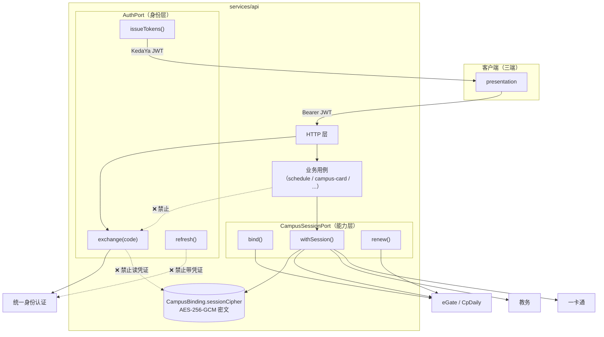
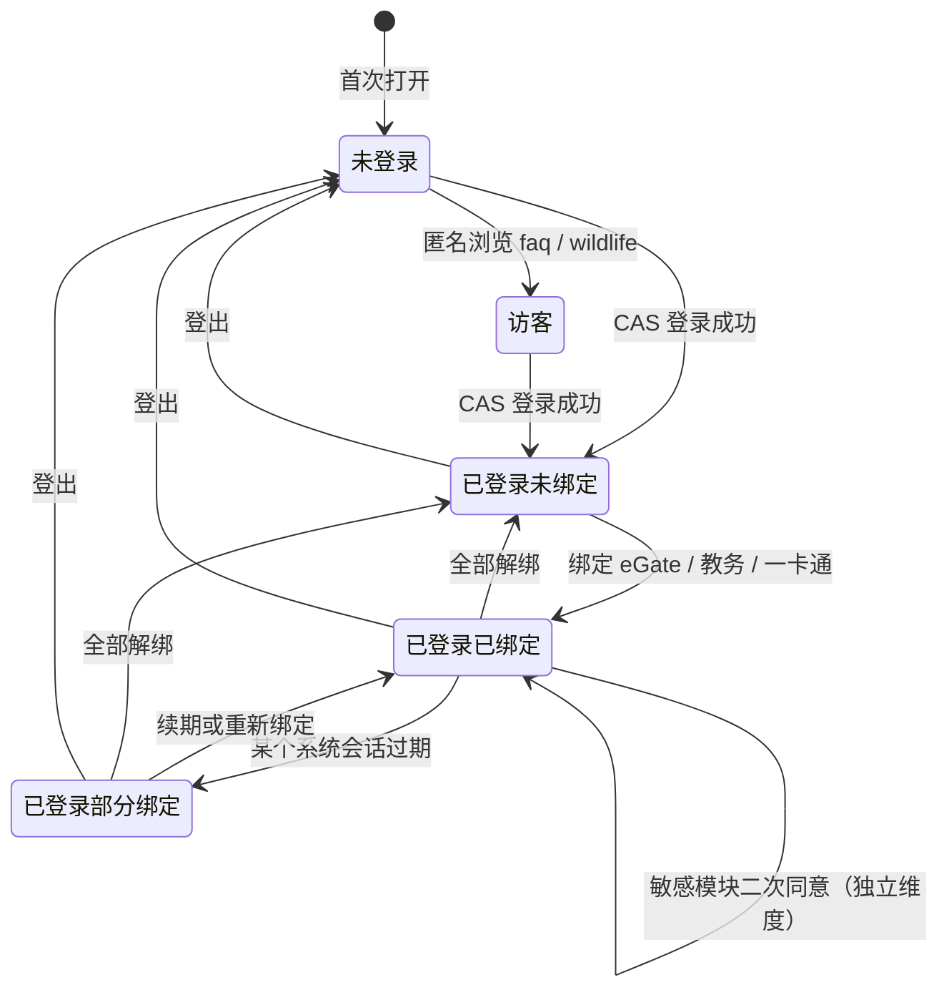

# ADR 0004 · 两级身份模型（身份层 / 能力层）必须解耦

| 项 | 值 |
| --- | --- |
| 状态 | **已接受 (Accepted)** |
| 日期 | 2026-10-16 |
| 决策者 | Lead |
| 影响范围 | `services/api`（`AuthPort` / `CampusSessionPort`）、三端登录流程、`@kedaya/contracts` |
| 相关 | [0003-mobile-framework.md](./0003-mobile-framework.md)、[05-security-privacy.md](../architecture/05-security-privacy.md) §2 §4、[01-overview.md](../architecture/01-overview.md) §5、`docs/architecture/00-FROZEN-CONTRACT.md` §5 |
| 教训来源 | [`HeZeBang/TechPie-flutter`](https://github.com/HeZeBang/TechPie-flutter) 的 CASTGC 边界 |

---

## 1. 决策

身份被拆成**两个互不可见的层**，由两个不同的 Port 承载：

```
第一级 · 身份层 (Identity)
  来源：上科大统一身份认证（CAS / Egate OAuth）
  决定："你是谁" —— userId / 学号 / 姓名 / 院系
  唯一产出：KedaYa 自有 JWT（access + refresh）
  承载者：AuthPort

第二级 · 能力层 (Campus Session)
  来源：第三方校园系统绑定（eGate / CpDaily / 教务 / 一卡通）
  决定："你能访问哪些校园系统"
  产出：各系统的 session cookie（如 CASTGC）
  承载者：CampusSessionPort
```

**四条硬规则**（契约 §5）：

| # | 规则 |
| --- | --- |
| 1 | `AuthPort` **只认第一级**。它不知道任何校园系统的 cookie / session / tgc |
| 2 | 任何校园系统能力**必须**通过 `CampusSessionPort` 获取，**不得**从 `AuthPort` 读取 |
| 3 | "已登录但未绑定" 是**合法状态**。此时身份有效，校园系统功能返回 `CAMPUS_BINDING_REQUIRED` |
| 4 | 敏感模块（`wellbeing` / `dorm-harmony` / `ai-portrait`）的授权是**独立**的，需二次同意 |

---

## 2. 背景

### 2.1 为什么这是"最容易出错的地方"

契约 §5 原文：**"这是本项目最容易出错的地方"**。

原因：校园服务的身份来源天然是**两个不相关的系统**：

| 系统 | 回答的问题 | 凭证形态 | 有效期 |
| --- | --- | --- | --- |
| 统一身份认证（CAS） | 你是谁 | 一次性 ticket → 我们自签 JWT | 我们控制（15min / 30d） |
| eGate / CpDaily | 你能访问哪些校园系统 | `CASTGC` cookie + 一整套会话 cookie | 上游控制，会过期 |

**这两个东西的失效模式完全不同**：
- JWT 失效 → 用户重新登录（我们知道怎么做）。
- CASTGC 失效 → 用户需要**重新绑定 eGate**（需要用户提供学号密码，或走上游的续期接口）。

**如果把它们混在一起**，那么"CASTGC 过期"会被误判为"登录过期"，用户被踢出登录——而他其实只是需要重新绑定校园系统。反过来更糟：如果身份层"顺手"存了 CASTGC，那么一次身份层的日志打印、一次 JWT 载荷序列化、一次错误上报，都可能把校园系统凭证泄漏出去。

### 2.2 TechPie 的 CASTGC 教训（实证来源）

TechPie-flutter 已经踩过这个坑，并在 `CLAUDE.md` 里留下了明确的边界说明。以下引文来自其 `CLAUDE.md`（本地 clone `/tmp/techpie-ref/CLAUDE.md`）：

> **`AuthService`** — primary account ONLY: GeekPie Uni-Auth (Casdoor) SSO login via `UniAuthService`, SSO token refresh, logout cascade. Owns the SSO identity session (`UserSession` with `geekpieToken`/`geekpieRefreshToken`). **It deliberately knows nothing about CASTGC/CpDaily — `UserSession` has no `tgc`/`cookies`/`sessionToken`/`tenantId` fields.**
>
> **`ThirdPartyAuthService`** — bind/unbind/auto-renew for Gradescope, Hydro, **and eGate**. The eGate binding (`ThirdPartyPlatform.egate`) is the SINGLE source of CASTGC / CpDaily session in the app: `hasEgateBinding`, `egateBinding`, `egateCookies()` (always appends `CASTGC=<tgc>`), `egateStudentId`, `renewEgateBinding()`... **Every campus-system feature (schedule, blackboard, exam, oa-gym, ecourse/student-leave webviews) reads its CpDaily session through these accessors, never from `AuthService.session`.**
>
> **Auth model boundary (important)** — There are two distinct account tiers — do not cross them:
> - **Primary account** = GeekPie SSO (Casdoor). Determines `auth.isLoggedIn` and user identity (userName). Produces NO CASTGC.
> - **eGate binding** = a third-party account that holds the campus CpDaily session (CASTGC). Required by every campus-system feature. A user can be SSO-logged-in but have no eGate binding — such a user is "logged in" but cannot use schedule/blackboard/exam/gym/webview features until they bind eGate.
>
> **CASTGC must never be read off `AuthService.session`.** Always go through `ThirdPartyAuthService.egateCookies()` / `egateStudentId` / `renewEgateBinding()`.

**从这段记录能提炼出三个教训**：

| # | 教训 | TechPie 的做法 | 我们能改进的地方 |
| --- | --- | --- | --- |
| L1 | 两层身份必须分离 | `AuthService` 与 `ThirdPartyAuthService` 分离 | **保留**，并提升为 Port 级别的接口契约 |
| L2 | 靠"模型里不放字段"来隔离 | `UserSession` 刻意不含 `tgc`/`cookies`/`sessionToken`/`tenantId` | **加强**：字段缺席是**弱约束**——任何人给 `UserSession` 加一个 `cookies` 字段就破坏了边界，且不会有任何测试失败。我们需要**编译期/测试期**的强制 |
| L3 | 靠文档与命名约定来提醒 | `CLAUDE.md` 里用大段文字 + 加粗警告 | **加强**：文档是**最弱**的约束。我们需要架构测试 |

**L2 和 L3 是本 ADR 的核心增量**：TechPie 用"字段缺席 + 文档警告"实现边界；我们要求"**接口分离 + 架构测试**"。因为：

> 一个只有文档保护的边界，在一次紧急修 bug 时就会消失。

### 2.3 一个具体的失败场景（说明为什么弱约束不够）

假设某天有人要加一个功能："在个人资料页显示 eGate 绑定状态"。

**弱约束（TechPie 模式）下的可能实现**：

```ts
// 有人觉得这样最方便
interface UserSession {
  userId: string;
  name: string;
  geekpieToken: string;
  // 顺手加一个
  egateCookies?: string;   // ← 边界在这里破了
}

// 然后在 profile 用例里
const cookies = auth.session.egateCookies;   // ← 从身份层读了校园凭证
```

这个改动**不会有任何测试失败**，**不会有类型错误**，`CLAUDE.md` 的警告也不会被读到。直到某天：
- 有人给 `UserSession` 加了一个 `toJson()` 用于埋点上报 → **CASTGC 进了日志**；
- 有人把 `UserSession` 塞进 JWT 载荷 → **CASTGC 发到了客户端**；
- 有人在错误上报里 `JSON.stringify(session)` → **CASTGC 进了第三方崩溃平台**。

**强约束（本 ADR 模式）下的同一需求**：

```ts
// 只能这样写
const binding = await campusSession.getBinding(userId, 'egate');  // 显式、可审计
return { bound: binding.status === 'ACTIVE' };                    // 只取状态，不取凭证
```

`CampusSessionPort` **不提供**返回 cookie 明文的方法给业务层——它只提供 `getBinding()`（返回状态元数据）和内部使用的 `withSession()`（在 Port 实现内部注入凭证）。业务代码**在类型上就拿不到** CASTGC。

---

## 3. 对比：弱约束 vs 强约束

| 维度 | 弱约束（字段缺席 + 文档） | 强约束（本 ADR） |
| --- | --- | --- |
| 边界在哪 | 一个 interface 的字段列表 | 两个 Port 的方法签名 |
| 破坏边界需要什么 | 加一个字段（无任何反馈） | 让 `AuthPort` 依赖 `CampusSessionPort`（架构测试失败） |
| 凭证能否被业务层读到 | **能**（只要有人加了字段） | **不能**（Port 不暴露） |
| 凭证能否进 JWT | 能（如果它恰好在 session 对象上） | 不能（JWT 载荷有字段白名单 + 测试） |
| 凭证能否进日志 | 能 | 不能（日志脱敏规则 + 扫描测试） |
| 谁来发现违规 | 读文档的人 | CI |
| 边界失效的方式 | **静默** | **响亮**（测试红） |

---

## 4. 被否决的方案及理由

### 4.1 方案 A：单一 session（把 CASTGC 放进身份 session）

**描述**：一个 `UserSession` 同时装 JWT 和 CASTGC。

| # | 否决理由 |
| --- | --- |
| 1 | **凭证泄漏面最大化**：session 对象会被序列化（JWT 载荷、日志、错误上报、缓存），CASTGC 会跟着走 |
| 2 | **失效语义混淆**：CASTGC 过期 ≠ 登录过期。混在一起会让用户被错误登出 |
| 3 | **无法表达"已登录但未绑定"**（契约 §5 硬规则 3）——这是真实且常见的状态 |
| 4 | **审计困难**：无法区分"读了身份"和"读了校园凭证" |
| 5 | 这正是 TechPie 明确避开的做法（`UserSession` 无 `tgc`/`cookies` 字段） |

### 4.2 方案 B：把 CASTGC 放进 JWT 载荷

**描述**：JWT 里带一个 `campusSession` 字段，客户端每次请求带上，服务端解出来用。

| # | 否决理由 |
| --- | --- |
| 1 | **JWT 是客户端可读的**（Base64 编码，非加密）。CASTGC 直接暴露给客户端与任何能看到 token 的地方 |
| 2 | JWT 会被 CDN、代理、日志、浏览器开发者工具看到 |
| 3 | **无法撤销**：JWT 自包含，CASTGC 泄漏后无法单独撤销它，只能等 JWT 过期 |
| 4 | 体积膨胀：整套校园 cookie 可能数 KB，放进每个请求的 header |
| 5 | 违反契约 §5 硬规则 2 |

### 4.3 方案 C：`AuthPort` 直接提供校园能力

**描述**：`AuthPort` 上直接加 `getSchedule()` / `getCardBalance()` 等方法。

| # | 否决理由 |
| --- | --- |
| 1 | **职责爆炸**：`AuthPort` 会随每个校园系统的接入而膨胀 |
| 2 | **换一次认证方式就要改所有校园模块**（契约 §5 硬规则 1 的反面） |
| 3 | 无法独立测试：测 `schedule` 要 mock 整个认证链 |
| 4 | 违反单一职责，且 `AuthPort` 的 mock 会变得极重 |

### 4.4 方案 D：客户端用 WebView 注入 cookie 直连校园系统

**描述**：客户端拿到 CASTGC，用 WebView 打开校园页面并注入 cookie。

| # | 否决理由 |
| --- | --- |
| 1 | **CASTGC 必须下发到客户端**，泄漏面最大化（客户端沙箱、WebView 缓存、调试工具） |
| 2 | 客户端需要维护 cookie 注入逻辑，三端各写一遍 |
| 3 | 无法审计（谁在何时访问了校园系统，服务端不知道） |
| 4 | 无法做速率限制与服务端缓存 |
| 5 | 校园系统的 CORS / 域名策略不可控 |
| 6 | **TechPie 正是这么做的**（`FeatureMode.webviewWithCookie` + 注入 CASTGC），而我们要改进它：把 WebView 场景收敛到服务端渲染的受限页面，或明确标注为"降级能力" |

> **对 TechPie 的公平说明**：TechPie 是**纯客户端应用**（Flutter，无自建后端的校园系统代理），它没有服务端可以托管 cookie。我们在这一点上有架构优势（有 NestJS 后端），所以**应该**把凭证留在服务端。这不是"TechPie 做错了"，而是"我们的架构允许我们做得更好"。

### 4.5 方案 E：客户端本地缓存校园凭证（加密存储）

**描述**：客户端把 CASTGC 加密存在 Keychain/Keystore，离线时直接用。

| # | 否决理由 |
| --- | --- |
| 1 | 仍然是"凭证下发到客户端"——只是加了把锁 |
| 2 | 移动端被 root/越狱后，Keychain 内容可被提取 |
| 3 | 三端各需一套实现，且小程序端**没有安全存储**（沙箱内明文） |
| 4 | 与契约 §7 的分层约定冲突（凭证属于 `data/` 的敏感数据，不该被 UI 层间接持有） |

### 4.6 方案 F：单点登录联合（把 KedaYa 做成 CAS 的一个 client，每次请求都走 CAS）

**描述**：不做自有 JWT，每次请求都拿 CAS ticket 验证。

| # | 否决理由 |
| --- | --- |
| 1 | **性能**：每个 API 请求都要与上游 CAS 交互 |
| 2 | **可用性耦合**：CAS 挂了，KedaYa 全站不可用 |
| 3 | 无法表达 KedaYa 自有的授权（角色、同意记录） |
| 4 | 无法支持匿名用户（`forum` 匿名浏览、`faq`、`wildlife` 无需登录） |
| 5 | 上游 CAS 不一定支持这种用法 |

### 4.7 方案 G：把两层合并成一个"校园统一会话"（承认两者耦合）

**描述**：既然校园系统都来自同一所学校，就做一个统一的 `CampusUnifiedSession`。

| # | 否决理由 |
| --- | --- |
| 1 | **现实不是这样**：CAS 与 eGate 是**两个不同的系统**，凭证形态、有效期、续期方式都不同 |
| 2 | 不同校园系统（教务 / 一卡通）的会话**各自独立**，不能合并 |
| 3 | 合并后无法单独撤销某一个系统的绑定 |
| 4 | 契约 §5 明确要求分离 |

---

## 5. 决策依据（正面论证）

### 5.1 两个 Port 的接口形状

```ts
// services/api/src/domain/ports/auth.port.ts —— 只认第一级
export interface AuthPort {
  /** 生成上游认证地址 + state（防 CSRF） */
  buildLoginUrl(state: string): Promise<LoginUrl>;
  /** 用回调 code 换取身份。返回值【不含】任何校园凭证 */
  exchange(code: string): Promise<Identity>;
  /** 签发 KedaYa 自有 JWT */
  issueTokens(identity: Identity, deviceHint?: string): Promise<TokenPair>;
  /** 轮换 refresh（旧 token 立即失效） */
  refresh(refreshToken: string): Promise<TokenPair>;
  /** 撤销全部 refresh */
  revokeAll(userId: string): Promise<void>;
  /** 登出级联：撤销 token + 通知 CampusSessionPort 清理绑定 */
  signOut(userId: string): Promise<void>;
}

export interface Identity {
  userId: string;
  studentId: string;
  name: string;
  department?: string;
  email?: string;
  // 【注意】这里没有 cookies / tgc / sessionToken / tenantId
}
```

```ts
// services/api/src/domain/ports/campus-session.port.ts —— 只认第二级
export type CampusSystem = 'egate' | 'jwc' | 'ecard' | 'techpie';

export interface CampusSessionPort {
  /** 绑定：用户提供学号密码，我们与上游建立会话，密文落库 */
  bind(userId: string, system: CampusSystem, credential: CampusCredential): Promise<CampusBindingInfo>;

  /** 解绑：删除密文 */
  unbind(userId: string, system: CampusSystem): Promise<void>;

  /** 查询绑定状态（只返回元数据，【不返回】凭证） */
  getBinding(userId: string, system: CampusSystem): Promise<CampusBindingInfo | null>;

  /** 续期 */
  renew(userId: string, system: CampusSystem): Promise<CampusBindingInfo>;

  /**
   * 在会话内执行一次上游调用。
   * 凭证只在实现内部注入，【绝不】出现在返回值或参数里。
   */
  withSession<T>(
    userId: string,
    system: CampusSystem,
    fn: (session: CampusSessionHandle) => Promise<T>,
  ): Promise<T>;
}

/** 绑定状态元数据。故意不含凭证。 */
export interface CampusBindingInfo {
  system: CampusSystem;
  status: 'ACTIVE' | 'EXPIRING' | 'EXPIRED' | 'REVOKED' | 'ERROR';
  expiresAt?: string;
  lastRenewAt?: string;
  externalStudentId?: string;   // 上游学号，用于展示与去重
}
```

**关键设计**：`withSession` 是**回调式**的。凭证作为 `CampusSessionHandle` 只在回调执行期间存在，业务层无法把它带出去（除非显式违反，而架构测试会抓）。这是"能力层"最核心的封装。

### 5.2 运行时边界



**读图要点**：
- 客户端只拿 KedaYa JWT，**永远拿不到** CASTGC。
- 业务用例（`uc`）只通过 `withSession()` 触达校园系统，**拿不到凭证本身**。
- `AuthPort` 与 `CampusBinding.sessionCipher` 之间是**禁止边**。

### 5.3 三级状态机（用户视角）



**注意最后一条**：敏感模块的同意是**独立维度**，不是这个状态机的一环。`已登录已绑定` 且未同意 `wellbeing` 时，访问 `wellbeing` 返回 `CONSENT_REQUIRED`——这与绑定状态无关。

**"已登录未绑定"是合法状态**（契约 §5 硬规则 3），不是错误：

| 场景 | 期望行为 |
| --- | --- |
| 用户登录后未绑定任何校园系统 | `auth` / `profile` / `notifications` / `faq` / `wildlife` / `forum`(只读) 可用 |
| 用户访问 `schedule` | `409 CAMPUS_BINDING_REQUIRED`，客户端跳绑定引导页 |
| 用户绑定 eGate 后 | `schedule` 可用 |
| eGate 会话过期 | `schedule` 返回 `409 CAMPUS_BINDING_REQUIRED`，但**用户仍是登录状态**（不跳登录页） |

**最后一条是这套设计最重要的用户体验收益**：校园会话过期不会把用户踢出登录。

### 5.4 错误码映射（"未绑定"不是"未认证"）

| 情况 | 错误码 | HTTP | 客户端行为 |
| --- | --- | --- | --- |
| 无 JWT / JWT 过期 | `UNAUTHENTICATED` | 401 | 静默 refresh → 失败则跳登录 |
| JWT 有效但未绑定校园系统 | `CAMPUS_BINDING_REQUIRED` | **409** | **跳绑定引导页**（不跳登录） |
| 校园会话上游失效 | `UPSTREAM_UNAVAILABLE` | 502 | 展示缓存 + 提示稍后重试 |
| 身份有效但缺敏感模块同意 | `CONSENT_REQUIRED` | 403 | 弹同意页 |

**`CAMPUS_BINDING_REQUIRED` 用 409 而不是 401** 是刻意的：401 会触发客户端的"登出并跳登录"逻辑，那是错误的行为。

---

## 6. 后果

### 6.1 正面后果

| # | 后果 |
| --- | --- |
| 1 | **CASTGC 永不离开服务端**：客户端、JWT、日志、错误上报都拿不到 |
| 2 | **校园会话过期 ≠ 登录过期**：用户不会被错误登出 |
| 3 | **可单独撤销**：解绑 eGate 不影响登录；撤销 JWT 不影响绑定（反之亦然） |
| 4 | **可独立审计**：区分"读身份"与"读校园凭证" |
| 5 | **可独立测试**：`schedule` 的测试只需 mock `CampusSessionPort` |
| 6 | **换认证方式的影响面收敛**：CAS 换成别的协议只改 `AuthPort` 的实现 |
| 7 | **边界可被 CI 强制**：见 §7 |
| 8 | **敏感模块的同意与身份完全解耦**：撤回同意不影响登录 |

### 6.2 负面后果（必须承认）

| # | 负面后果 | 缓解 | 残余风险 |
| --- | --- | --- | --- |
| 1 | **服务端必须托管校园凭证**，成为高价值攻击目标 | 字段级加密（`campus-key`）+ 密钥分离 + 审计 + 最小权限 DB 账号 | **中**：这是集中化的固有代价。分散到客户端是"把风险摊给每个用户"，我们不选那条路 |
| 2 | **服务端必须处理上游 cookie 的续期与失效**，逻辑复杂 | `CampusBinding` 状态机（`ACTIVE`/`EXPIRING`/`EXPIRED`/`ERROR`）+ Worker 主动续期 | 中 |
| 3 | 用户必须把学号密码交给 KedaYa 才能绑定 | 明确告知 + 加密存储 + 可随时解绑；不使用密码的场景（如 OAuth 授权）优先 | **中**：信任问题，非技术问题 |
| 4 | 无法支持"客户端直连校园系统"的场景 | 服务端代理所有校园调用；极少数必须 WebView 的场景收敛为受限页面 | 低 |
| 5 | 三层状态（未登录/已登录未绑定/已登录已绑定）增加 UI 复杂度 | 三端统一状态模型 + `CAMPUS_BINDING_REQUIRED` 的统一引导页 | 低 |
| 6 | 回调式 `withSession` 的写法比直接读 cookie 啰嗦 | 接受——这是刻意的摩擦，它让"读凭证"变得显眼 | 低 |

### 6.3 对工程实践的影响

| 环节 | 影响 |
| --- | --- |
| 新模块接入校园系统 | 必须走 `CampusSessionPort.withSession()`；不得注入自己的 cookie 逻辑 |
| 错误处理 | 必须区分 `UNAUTHENTICATED`（跳登录）与 `CAMPUS_BINDING_REQUIRED`（跳绑定） |
| 日志 | 日志中间件的脱敏规则必须覆盖 `sessionCipher` / `cookies` / `CASTGC` / `tgc` |
| 审计 | `auth` 与 `campus-card` 都落审计（契约 §9），但**审计不记凭证** |
| 客户端 | 三端都不需要 cookie 管理逻辑（这是简化） |
| 测试 | 每个校园模块的测试 mock `CampusSessionPort`，不 mock 上游 |

---

## 7. 如何强制（这是本 ADR 与"文档警告"的区别）

### 7.1 架构测试（必须实现）

```ts
// services/api/test/architecture/auth-campus-isolation.test.ts
describe('两级身份模型的边界', () => {
  it('AuthPort 的返回值类型不含任何凭证字段', async () => {
    // 断言 Identity / TokenPair 的键集合
    expect(Object.keys(identityFixture())).not.toEqual(
      expect.arrayContaining(['cookies', 'tgc', 'sessionToken', 'tenantId', 'sessionCipher'])
    );
  });

  it('AuthPort 的实现不 import CampusSessionPort', async () => {
    const src = await readFile('src/data/auth/cas-auth.adapter.ts', 'utf8');
    expect(src).not.toMatch(/campus-session\.port/);
  });

  it('domain/auth 下不出现凭证字段名', async () => {
    const files = await glob('src/domain/auth/**/*.ts');
    for (const f of files) {
      expect(await readFile(f, 'utf8')).not.toMatch(/\b(tgc|CASTGC|sessionCipher|cookies)\b/);
    }
  });
});
```

```ts
// services/api/test/architecture/no-credentials-in-responses.test.ts
it('任何 API 响应 schema 都不含凭证字段', () => {
  const schemas = collectResponseSchemas();   // 遍历 OpenAPI components.schemas
  const forbidden = ['sessionCipher', 'cookies', 'tgc', 'CASTGC', 'password', 'refreshToken'];
  for (const s of schemas) {
    expect(flattenKeys(s)).not.toEqual(expect.arrayContaining(forbidden));
  }
});
```

### 7.2 ESLint 规则

```js
// services/api/.eslintrc 片段
'no-restricted-imports': ['error', {
  paths: [{
    name: '../data/auth/cas-auth.adapter',
    importNames: ['CasAuthAdapter'],
    message: '校园模块不得直接依赖 AuthPort 的具体实现，请使用 CampusSessionPort',
  }],
}],
```

### 7.3 日志脱敏

```ts
// services/api/src/platform/logging/redact.ts
export const REDACT_KEYS = [
  'password', 'token', 'accessToken', 'refreshToken',
  'sessionCipher', 'cookies', 'cookie', 'tgc', 'CASTGC',
  'intakeNote', 'answers', 'payload',
] as const;
```

### 7.4 契约测试

```bash
# 断言：所有 /api/v1/* 的响应里都不出现凭证字段
npm run test:contract -w services/api
```

**这四个手段合起来，才让"边界"从文档变成 CI 门禁。**

---

## 8. 验证命令

```bash
# 1. 架构测试
npm run test -w services/api -- architecture

# 2. 契约测试（响应 schema 不含凭证）
npm run test:contract -w services/api

# 3. 真实链路：登录但不绑定，访问 schedule
curl -s -H "Authorization: Bearer $JWT" localhost:3000/api/v1/schedule/items | jq
# 期望：{"ok":false,"error":{"code":"CAMPUS_BINDING_REQUIRED",...}}

# 4. 真实链路：绑定后访问
# 期望：{"ok":true,"data":{"items":[...]}}

# 5. 解绑后 JWT 仍然有效（不应跳登录）
curl -s -H "Authorization: Bearer $JWT" localhost:3000/api/v1/profile | jq .ok
# 期望：true
```

---

## 9. 引用

| 来源 | 用途 |
| --- | --- |
| [`HeZeBang/TechPie-flutter`](https://github.com/HeZeBang/TechPie-flutter) | CASTGC 教训的原始出处 |
| TechPie-flutter `CLAUDE.md`（本地 `/tmp/techpie-ref/CLAUDE.md`） | §2.2 的三段引文：`AuthService` 无 `tgc`/`cookies` 字段；`ThirdPartyAuthService` 是 CASTGC 的 SINGLE source；"Auth model boundary (important)" |
| TechPie-flutter `lib/features/campus_card/domain/ports/auth_port.dart` | `domain/ports` 的表达方式（`AuthSnapshot` / `restoreLocal()` / `signIn()`） |
| TechPie-flutter `README.md` §Roadmap | "eGate binding / CpDaily keep-alive (via /api/auth/renew)" —— 说明上游续期接口存在 |
| `docs/architecture/00-FROZEN-CONTRACT.md` §5 | 本决策的上游约束（四条硬规则） |
| `docs/architecture/01-overview.md` §5 | 两级身份模型的时序图 |
| `docs/architecture/05-security-privacy.md` §2 §4 | 权限域划分与凭证加密方案 |

---

## 10. 未决问题

| # | 问题 | 影响 | 建议 |
| --- | --- | --- | --- |
| T1 | **上游续期接口的可用性未确认**（TechPie 用 `/api/auth/renew`，那是它自建后端的能力；我们的 `CampusSessionPort` 能否自动续期取决于上游是否提供） | 用户可能需要频繁重新绑定 | M1 期间与信息办/GeekPie 确认；若不可用，`EXPIRING` 状态要提前 24h 通知用户 |
| T2 | 绑定 eGate 是否需要用户提供学号密码？若上游支持 OAuth 授权，应优先走 OAuth | 用户体验与安全 | M1 确认 |
| T3 | `CampusSessionHandle` 的具体形状未定（是 cookie jar 还是单 token） | 接口设计 | 取决于上游凭证形态；M1 定 |
| T4 | 服务端托管校园凭证的**合规性**未与学校确认（学校可能不允许第三方代持会话） | **M1 可能降级** | **立即推进**（见 [06-roadmap.md](../architecture/06-roadmap.md) X1） |
| T5 | `techpie` 系统的会话如何与 KedaYa 的绑定模型融合（TechPie 是另一个第三方平台） | M4 设计 | 见 [06-roadmap.md](../architecture/06-roadmap.md) X12 |
| T6 | 是否需要支持"同一用户绑定多个 eGate 账号"（理论上不应发生） | 数据模型 | 建议唯一约束 `(userId, system)` |
| T7 | 契约 §5 未规定 `AuthPort` 的方法清单（本 ADR 给出了一个方案） | 契约完整性 | **建议 Lead 把这个接口清单补进契约或单独文件** |
| T8 | `CampusSessionPort` 的 `withSession` 回调式设计是否会让 Prisma 事务边界复杂化 | 实现 | M1 验证；必要时提供 `runInSession()` 的事务友好变体 |
