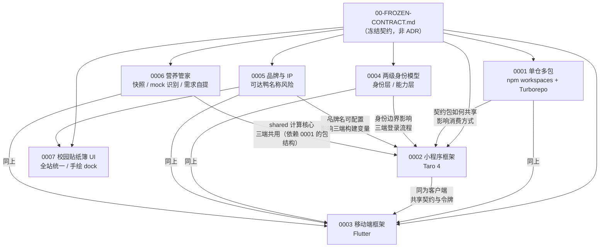

# 架构决策记录（ADR）索引

> 本目录记录**不可轻易推翻的架构决策**。每条 ADR 都包含：决策 / 背景 / 被否决的方案及理由 / 后果。
> 上游真相来源：`docs/architecture/00-FROZEN-CONTRACT.md`。ADR 解释**为什么**，契约规定**是什么**；冲突时以契约为准，并应重开对应的 ADR。

版本：`v1` · 2026-10-16 · 最后更新：2026-10-18

---

## 1. 索引表

| ID | 标题 | 状态 | 决策要点 | 影响范围 | 日期 |
| --- | --- | --- | --- | --- | --- |
| [0001](./0001-monorepo.md) | 单仓多包 + npm workspaces + Turborepo | **已接受** | 单仓；npm workspaces；Turborepo `2.11.8`；**不用** pnpm / Nx / 多仓 / 单包 | 仓库根、全部 `apps/*` `services/*` `packages/*` | 2026-10-16 |
| [0002](./0002-miniapp-framework.md) | 小程序框架选 Taro 4 而非 uni-app | **已接受** | Taro `4.3.0` + React `18.3.1` + TS；**不用** uni-app / uni-app x（UTS）/ 原生小程序 / Remax | `apps/miniapp` | 2026-10-16 |
| [0003](./0003-mobile-framework.md) | 原生移动端选 Flutter 而非 React Native | **已接受** | Flutter `>=3.6.2 <4.0.0`，覆盖 iOS/Android/鸿蒙；**不用** RN / 原生双端 / KMP | `apps/mobile` | 2026-10-16 |
| [0004](./0004-auth-two-tier.md) | 两级身份模型必须解耦 | **已接受** | `AuthPort`（身份层）与 `CampusSessionPort`（能力层）分离；CASTGC 永不离开服务端 | `services/api`、三端登录、`@kedaya/contracts` | 2026-10-16 |
| [0005](./0005-brand-and-ip.md) | 品牌与 IP：「可达鸭」名称的风险与规避 | **已接受，但风险未消解** | 吉祥物原创；不使用宝可梦素材；不冒充官方；不商业化；英文名优先；**品牌名可配置**；备降级预案 | 产品命名、美术、域名、商店上架、全部对外文案 | 2026-10-16 |
| [0006](./0006-nutrition-butler.md) | 营养管家：数据可信度、识别边界与需求归属 | **已接受** | 营养唯一来源=菜品库快照；请求不带营养值；识别用 mock + Port seam（`mode` 诚实标注）；需求用户自提（估算器只预填）；六项口径去糖；计算收敛 shared 一份；精确匹配不模糊；本地时区切天 | `packages/shared`、`services/api` canteen 模块、小程序营养页、Web 菜品后台 | 2026-10-18 |
| [0007](./0007-campus-sticker-ui.md) | 小程序全线 UI 统一到「校园贴纸簿」 | **已接受**（深色模式待续） | 视觉语言全站统一为贴纸簿；不做整体 merge，逐层移植；取色进 `colorCampus` / `colorNight` 新分组；基准仍 375pt（设计稿数字 ÷2）；圆角三档 + 白卡细描边（不用灰底/玻璃）；淡色面只用于功能卡；底部导航换自绘 `KdyDock`（`tabBar.custom`）；新增入口页 `welcome`；深色模式第二阶段 | `apps/miniapp` 样式与外壳、`packages/design-tokens`、`docs/miniapp-ui.md` | 2026-10-18 |

**状态取值**：`提议 (Proposed)` / `已接受 (Accepted)` / `已接受但风险未消解 (Accepted with UNRESOLVED risk)` / `已废弃 (Deprecated)` / `被取代 (Superseded by NNNN)`

---

## 2. 决策依赖关系

**读图要点**

- 六条 ADR 全部从契约派生，**没有一条可以独立于契约存在**。
- `0004` / `0006` 是影响**服务端内部结构**的 ADR（其余主要影响仓库/客户端）。
- `0006` 给 `canteen` 模块增加了三个扩展点（meal / nutrition-target / recognition），并确立了 `packages/shared` 承载跨端纯函数计算的先例。
- `0005` 是唯一带有**未消解风险**的 ADR，且它影响的是**所有端**（品牌名是跨端的构建变量）。
- `0001` 是其余各条的**基础设施前置**：契约包的共享方式决定了 `0002`/`0003` 如何消费类型，也决定了 `0006` 的计算核心放在 shared。

---

## 3. 每条 ADR 的被否决方案一览

| ADR | 被否决的方案 |
| --- | --- |
| [0001](./0001-monorepo.md) | ① 多仓（每端一仓）② pnpm workspaces ③ Nx ④ 单包 ⑤ Git submodule/subtree |
| [0002](./0002-miniapp-framework.md) | ① uni-app（Vue + TS）② **uni-app x（UTS）** ③ 原生小程序 ④ Remax ⑤ mpvue/Chameleon/WePy ⑥ WebView 包 H5 |
| [0003](./0003-mobile-framework.md) | ① React Native ② 原生双端 + ArkTS ③ Kotlin Multiplatform ④ Flutter + 鸿蒙 ArkTS 重写 ⑤ 只做小程序 + Web ⑥ Capacitor/Cordova |
| [0004](./0004-auth-two-tier.md) | ① 单一 session（含 CASTGC）② CASTGC 放进 JWT 载荷 ③ `AuthPort` 直接提供校园能力 ④ 客户端 WebView 注入 cookie ⑤ 客户端加密缓存凭证 ⑥ 每次请求走 CAS ⑦ 合并成"校园统一会话" |
| [0005](./0005-brand-and-ip.md) | ① 不做任何规避（直接用）② 立即改名 ③ "擦边改字"（科答鸭/到达鸭）④ 做周边商品 |
| [0006](./0006-nutrition-butler.md) | ① 信任客户端传营养值 ② 只存 dishId 读时 JOIN 最新营养 ③ 演示期接真实视觉 API ④ 给默认每日需求 ⑤ 保留七项（含糖）⑥ 每端各写一套计算 ⑦ 菜名模糊匹配 ⑧ UTC 切天 |

---

## 4. 与其他文档的关系

| 文档 | 关系 |
| --- | --- |
| `docs/architecture/00-FROZEN-CONTRACT.md` | **上游**。ADR 解释契约的**理由**；契约规定**接口**。契约变更时应重开对应 ADR |
| [01-overview.md](../architecture/01-overview.md) | 系统总览。ADR `0004` 的时序图在其中 §5 |
| [02-domain-model.md](../architecture/02-domain-model.md) | 领域模型。ADR `0004` 的身份分层影响 `auth` / `schedule` / `campus-card` |
| [03-api-contract.md](../architecture/03-api-contract.md) | API 契约。ADR `0004` 的 `CAMPUS_BINDING_REQUIRED`（409）定义在其中 §2.1 |
| [04-client-architecture.md](../architecture/04-client-architecture.md) | 客户端架构。ADR `0001`/`0002`/`0003`/`0005` 在此落地 |
| [05-security-privacy.md](../architecture/05-security-privacy.md) | 安全与隐私。ADR `0004` 的凭证加密、ADR `0005` 的合规门禁在此 |
| [06-roadmap.md](../architecture/06-roadmap.md) | 路线图。ADR 的未决问题在 §6「跨期事项」中被排期 |

---

## 5. 按状态分组的未决问题

以下问题来自各 ADR 的「未决问题」章节。**加粗的是阻塞性项**（不解决会阻塞某个里程碑）。

| 来源 ADR | 未决问题 | 严重性 | 阻塞谁 |
| --- | --- | --- | --- |
| 0001 | React 版本在 Taro 与 Next.js 间能否统一 | 中 | M0 |
| 0001 | `apps/mobile` 如何接入 Turborepo 任务图 | 低 | M0 |
| 0002 | **Taro 的许可证需人工确认**（GitHub API 报 `NOASSERTION`） | 中 | M0 |
| 0002 | **团队实际是 React 还是 Vue 背景**（若是 Vue，应改选 Taro + Vue 3） | **高** | 决策有效性 |
| 0003 | **OHOS Flutter fork 与上游 Flutter 的版本关系未实测** | **高** | M0/M1 |
| 0003 | **TechPie-flutter 缺少 `LICENSE` 文件**（README 声明 MIT） | 中 | 仅在复用代码时 |
| 0004 | **服务端托管校园凭证的合规性未与学校确认** | **高** | M1 |
| 0004 | 上游续期接口的可用性未确认 | **高** | M1 |
| 0004 | 契约未规定 `AuthPort` 的方法清单（本 ADR 给出了方案） | 中 | 契约完整性 |
| 0005 | **未做中国商标网实时检索（G-IP1）** | **高** | 上线 |
| 0005 | **未取得法律意见（G-IP2）** | **高** | 上线 |
| 0005 | **吉祥物美术是否已绘制、是否符合 8 条 checklist** | **高** | 上线 |
| 0005 | **微信小程序名称是否已被占用** | **高** | M1 |
| 0006 | **菜品营养数据的初始来源未定**（人工 / 公示爬取 / 供应商提供，当前只有演示种子数据） | **高** | M1 |
| 0006 | **新录入菜品的过敏原没有服务端推断**（只有种子脚本按菜名推断，「忌口」硬过滤对新菜不生效） | **高** | 上线 |
| 0006 | **小程序 mock 演示控制面必须在生产构建中移除**（当前靠 `USE_MOCK` 开关隔离） | **高** | 上线 |
| 0006 | 推荐算法权重（0.2 / 0.05 等）未经真实数据校准 | 中 | 上线后调参 |
| 0006 | 真实视觉识别服务选型 | 中 | 演示期后 |

---

## 6. 新增 ADR 的流程

| # | 步骤 |
| --- | --- |
| 1 | 确认这是**架构决策**（影响多个模块/端，或难以回退），而不是实现细节 |
| 2 | 编号：`NNNN-<kebab-title>.md`，四位数，顺序递增 |
| 3 | 必须包含四段：**决策 / 背景 / 被否决的方案及理由 / 后果** |
| 4 | 「被否决的方案」必须给出**具体理由**，不能只写"不选它" |
| 5 | 外部论断必须有**可访问的来源 URL**（不用搜索结果里的第三方评测文章作为决策依据） |
| 6 | 「后果」必须同时写**正面**与**负面**；负面后果要给出缓解措施与**残余风险** |
| 7 | 必须有「未决问题」章节（没有未决问题的 ADR 通常是没想清楚） |
| 8 | 在本文件 §1 索引表加一行 |
| 9 | 若 ADR 推翻已有决策，把旧 ADR 状态改为 `被取代 (Superseded by NNNN)`，**不删除** |

---

## 7. 写作约定

| 约定 | 说明 |
| --- | --- |
| 语言 | 中文为主，技术术语保留英文 |
| 版本号 | **不重复声明**。以契约 §2 为准（契约已从 npm registry 核实） |
| 外部数据 | 必须给采集时间与可复现命令（见各 ADR 的「验证与采集命令」章节） |
| 链接可达性 | 对自动化访问不可达的站点要显式标注（如 ADR 0005 的中时新闻网、广东政法网） |
| 未验证的判断 | 显式标注 `[需核实]` 或写入「未决问题」，**不得混入决策依据** |
| 诚实性 | 负面后果与残余风险必须写。**不允许**只写优点的 ADR |
