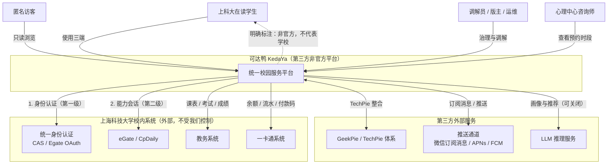
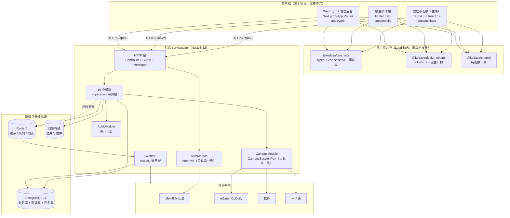
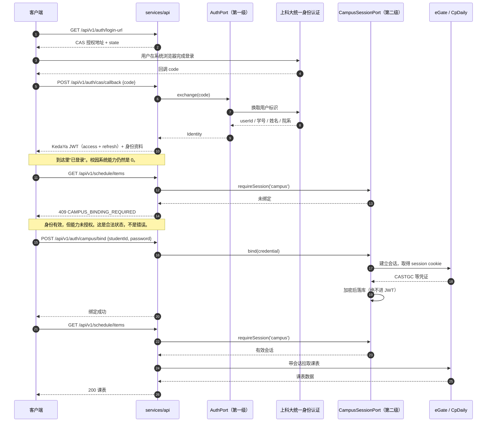
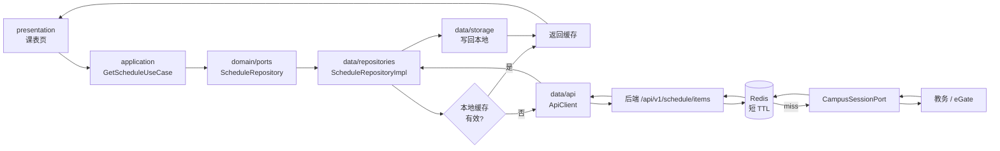
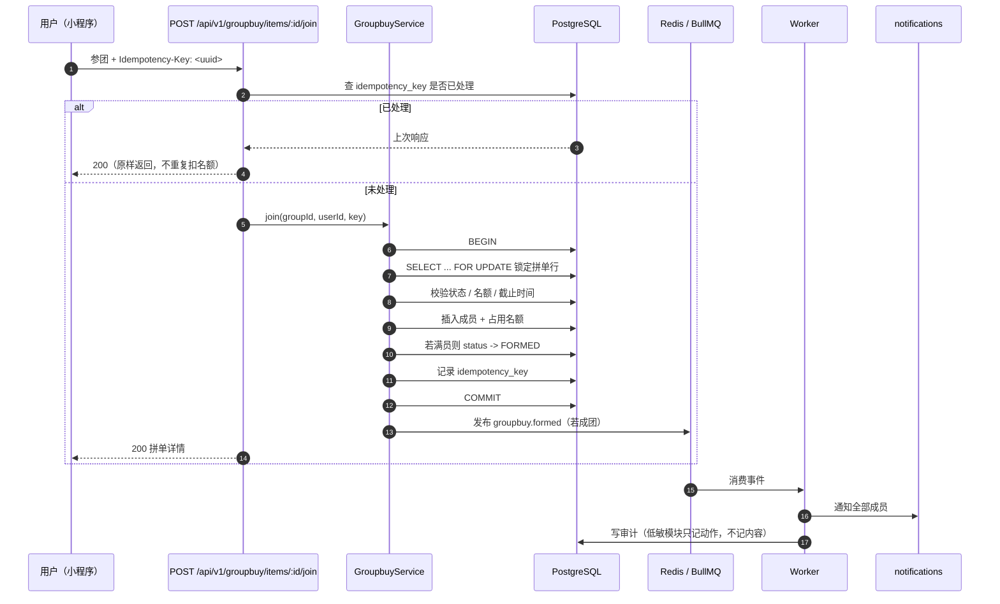
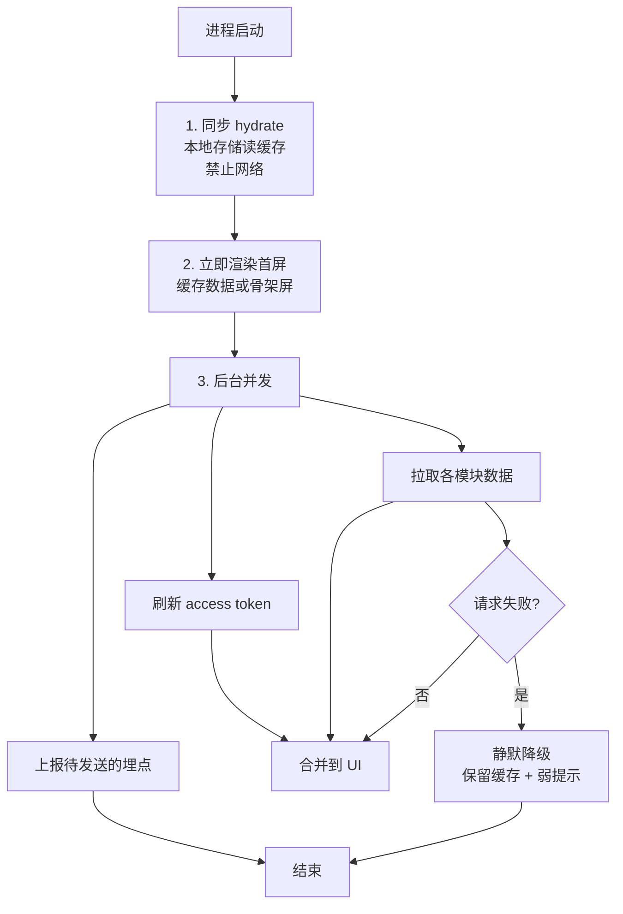
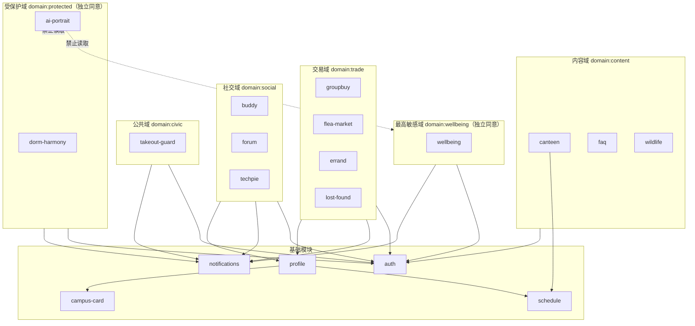
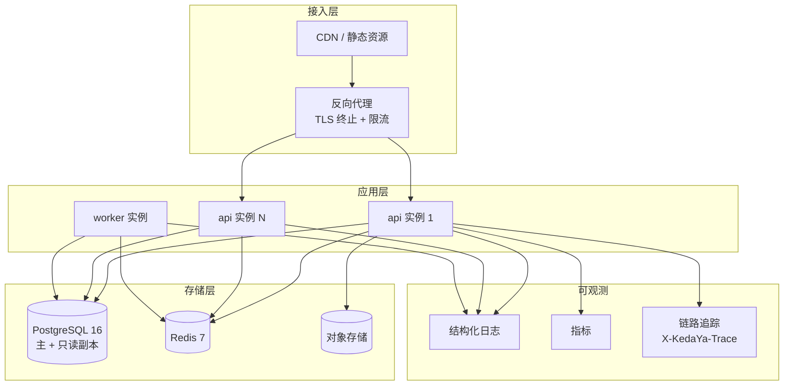

# 01 · 系统总览

> 上游真相来源：`docs/architecture/00-FROZEN-CONTRACT.md`（下称 **契约**）。
> 本文只描述**怎么拼起来**；字段级契约见 [03-api-contract.md](./03-api-contract.md)，领域细节见 [02-domain-model.md](./02-domain-model.md)。

版本：`v1` · 2026-10-16

---

## 1. 一句话架构

**一个后端（NestJS + PostgreSQL + Redis）作为全部校园系统能力的唯一出口，三个客户端（微信小程序 / Flutter 原生 / Next.js Web）只消费 HTTP API，通过一个共享契约包 `@kedaya/contracts` 与一套设计令牌 `@kedaya/design-tokens` 保持形状一致。**

推论（这是本架构最重要的三条不变量）：

1. **客户端永不直连校园系统。** 统一身份认证、eGate、教务、一卡通的凭证只存在于后端 `CampusSessionPort` 的实现里。客户端拿不到、也不需要 CASTGC。
2. **客户端的形状由包决定，不由约定决定。** 三个端的请求/响应类型来自同一个 `@kedaya/contracts`，色值来自同一个 `tokens.ts`。类型不一致是**编译错误**，不是 code review 问题。
3. **身份与能力分离。** "你是谁"（JWT）和"你能访问哪些校园系统"（campus session）是两条独立的链路，见 §5。

---

## 2. 参与者（Actors）

| 参与者 | 说明 | 交互的端 |
| --- | --- | --- |
| 上科大在读学生 | 主用户群。登录、用业务模块、管理隐私开关 | 三端 |
| 匿名用户 | 未登录或选择匿名身份。可浏览 `faq` / `wildlife` / `forum` 只读 | 小程序、Web |
| 模块调解员 / 版主 | 在 `dorm-harmony` 调解、在 `forum` 治理。**不是独立账号体系**，是 `profile` 上的角色位 | 小程序、Web 管理后台 |
| 平台运维 / 审核员 | 处理举报、看审计日志 | Web 管理后台 |
| 心理中心咨询师 | 只看到 `wellbeing` 预约的**最小必要字段**（时段 + 脱敏学号），看不到画像 | Web 管理后台（受限视图） |

**角色模型**：单一用户账号 + 一组角色位（`role` 字段），不做多账号体系。见 [05-security-privacy.md](./05-security-privacy.md) §3。

---

## 3. C4 · Level 1 上下文图

**读图要点**

- 校内系统的四条连线**全部由后端发起**。没有任何一条从 `student` 直连 `cas` 或 `ecard`——这是与"用 WebView 内嵌校园页面"方案的根本区别。
- `cas` 与 `egate` 是**两条独立的线**，对应两级身份模型（§5）。把它们合并成一条线是 TechPie 踩过的坑，见 [../adr/0004-auth-two-tier.md](../adr/0004-auth-two-tier.md)。
- `llm` 是虚线能力（可关闭）。`ai-portrait` 关闭后，这条线断掉不影响任何其它模块。

---

## 4. C4 · Level 2 容器图

**容器清单**

| 容器 | 技术 | 职责 | 可独立部署 |
| --- | --- | --- | --- |
| `apps/miniapp` | Taro 4.3 + React 19 | 微信小程序主端 + H5 兜底 | 是 |
| `apps/mobile` | Flutter `>=3.6.2 <4.0.0` | iOS / Android / 鸿蒙 | 是 |
| `apps/web` | Next.js 16 App Router | Web 门户 + 管理后台 | 是 |
| `services/api` | NestJS 12.1.3 | 全部业务逻辑与校园系统出口 | 是（API + Worker 同镜像不同入口） |
| `packages/contracts` | TypeScript 5.9.3 | 类型、Zod schema、模块表 | 否（npm 包） |
| `packages/design-tokens` | TypeScript 5.9.3 + 代码生成 | 令牌唯一真相 + CSS/SCSS/Dart 派生 | 否（npm 包） |
| `packages/shared` | TypeScript 5.9.3 | `fenToYuan` 等纯函数 | 否（npm 包） |
| PostgreSQL 16 | — | 业务、审计、匿名三库隔离 | 否 |
| Redis 7 | — | 缓存、BullMQ 队列、限流计数 | 否 |

**为什么 API 与 Worker 同仓同镜像**：Worker 消费的领域事件（成团、匹配、提醒、超时关闭）全部由 API 侧模块产生，共享同一套 Prisma schema 与 domain 代码。拆成两个仓会让 schema 漂移，收益为零。

---

## 5. 两级身份模型（架构核心）

这是契约 §5 的图形化表达。**把它贴在每个新工程师的第一天**。

**三条硬规则（与契约 §5 逐条对应）**

| # | 规则 | 实现位置 | 违反的后果 |
| --- | --- | --- | --- |
| 1 | `AuthPort` 不知道任何 cookie/tgc/session | `services/api/src/domain/ports/auth.port.ts` | 换一次认证方式就要改所有校园模块 |
| 2 | 校园能力只能从 `CampusSessionPort` 取 | `services/api/src/domain/ports/campus-session.port.ts` | 权限泄漏：普通浏览者拿到校园系统身份 |
| 3 | "已登录但未绑定" 是合法状态 | `CAMPUS_BINDING_REQUIRED` 错误码 | 用户被卡在登录页，永远进不去 |

---

## 6. 数据流

### 6.1 读路径（以课表为例，展示缓存分层）

三层缓存，每层职责不同：

| 层 | 位置 | TTL | 失效策略 |
| --- | --- | --- | --- |
| 客户端本地 | `data/storage` | 见 04 文档表 | 启动 hydrate + 下拉刷新 |
| 服务端 Redis | `services/api` | 课表 6h、一卡通余额 60s | 写操作主动失效 |
| 上游校园系统 | 外部 | — | 上游为准 |

### 6.2 写路径（以拼单成团为例，展示幂等与事件）

**幂等实现要点**（契约 §6.1 冻结了 `Idempotency-Key` 头）：

- 唯一索引建在 `(user_id, idempotency_key)` 上，不是单列——不同用户的 key 空间互不干扰。
- 记录里存**响应体快照**，重放时原样返回，保证客户端重试语义正确。
- 保留期 24 小时，由 Worker 清理。

### 6.3 启动时序（契约 §8，三端一致）

**禁止**：启动时 `await` 任何网络请求。首屏必须是缓存或骨架屏。这一条在三个端都是 CI 可检查的（见 [04-client-architecture.md](./04-client-architecture.md) §6）。

---

## 7. 模块地图（19 个模块 · 契约 §4）

### 7.1 业务模块（14）

| ID | 中文 | 归属权限域 | 敏感级 | 依赖的基础模块 |
| --- | --- | --- | --- | --- |
| `groupbuy` | 拼单 | `domain:trade` | 低 | `auth` `notifications` `profile` |
| `takeout-guard` | 偷外卖 | `domain:civic` | 中 | `auth` `notifications` |
| `flea-market` | 跳蚤 | `domain:trade` | 低 | `auth` `notifications` `profile` |
| `dorm-harmony` | 宿舍矛盾 | `domain:protected` | **高** | `auth` `notifications` |
| `errand` | 跑腿 | `domain:trade` | 低 | `auth` `notifications` `profile` |
| `buddy` | 找搭子 | `domain:social` | 低 | `auth` `notifications` `profile` |
| `lost-found` | 失物招领 | `domain:trade` | 低 | `auth` `notifications` |
| `canteen` | 食堂营养 | `domain:content` | 低 | `auth` |
| `forum` | 论坛 | `domain:social` | 中 | `auth` `notifications` `profile` |
| `ai-portrait` | AI 校园画像 | `domain:protected` | **高** | `auth` `profile` |
| `wellbeing` | 心理支持 | `domain:wellbeing` | **最高** | `auth` `notifications` |
| `faq` | 常见问题 | `domain:content` | 低 | — |
| `techpie` | TechPie 整合 | `domain:social` | 中 | `auth` |
| `wildlife` | 野生动物 | `domain:content` | 低 | — |

### 7.2 基础模块（5）

| ID | 中文 | 归属权限域 | 敏感级 | 被谁依赖 |
| --- | --- | --- | --- | --- |
| `auth` | 身份 | `domain:identity` | 高（无同意门） | 全部 |
| `schedule` | 课表 | `domain:campus` | 中 | 首页、`canteen` |
| `campus-card` | 校园卡 | `domain:campus` | 高（无同意门） | 首页、`profile` |
| `profile` | 我的 | `domain:identity` | 中 | 全部 |
| `notifications` | 通知 | `domain:platform` | 中 | 全部业务模块 |

### 7.3 模块依赖总图

**关键禁令**（契约 §9）：`ai-portrait` 到 `wellbeing` / `dorm-harmony` 的边是**禁止边**，画成虚线是为了显式记录这条禁令。实现上由 `packages/contracts/src/modules.ts` 的域声明 + API 层 Guard 双向强制，见 [05-security-privacy.md](./05-security-privacy.md) §2.3。

---

## 8. 部署拓扑

**部署约束**

| 约束 | 值 | 理由 |
| --- | --- | --- |
| API 无状态 | 必须 | 会话在 Redis + PostgreSQL，JWT 自包含 |
| 迁移与启动解耦 | `prisma migrate deploy` 独立 job | 多实例并发迁移会互相锁死 |
| Worker 单写者 | 领域事件的消费是幂等的 | 至少一次投递，不假设恰好一次 |
| 追踪贯通 | `X-KedaYa-Trace` 请求头 → 响应 `traceId` | 契约 §6.1 冻结；客户端报错时带上它 |

---

## 9. 跨切面关注点

| 关注点 | 落点 | 详见 |
| --- | --- | --- |
| 错误信封 | `ApiEnvelope<T>`，10 个 `ApiErrorCode` | [03-api-contract.md](./03-api-contract.md) §2 |
| 认证 | `Authorization: Bearer`，JWT access 15min / refresh 30d | [05-security-privacy.md](./05-security-privacy.md) §4 |
| 授权 | 权限域 Guard，按模块 ID 查表 | [05-security-privacy.md](./05-security-privacy.md) §2 |
| 限流 | Redis 滑动窗口，按 `userId` + 路由桶 | [05-security-privacy.md](./05-security-privacy.md) §6 |
| 审计 | 敏感模块全部读写落审计 | [05-security-privacy.md](./05-security-privacy.md) §5 |
| 分页 | 游标分页，禁用 offset | [03-api-contract.md](./03-api-contract.md) §3 |
| 金额 | 整数分 `amountFen`，**全链路无浮点** | [02-domain-model.md](./02-domain-model.md) §2.3 |
| 时间 | ISO-8601 UTC 字符串 | 契约 §6.1 |
| 设计令牌 | `tokens.ts` 唯一真相，三端派生 | [04-client-architecture.md](./04-client-architecture.md) §3 |

---

## 10. 本文档未覆盖的部分

- 单个模块的实体字段、状态机、用例 → [02-domain-model.md](./02-domain-model.md)
- 端点级别的请求/响应 JSON → [03-api-contract.md](./03-api-contract.md)
- 三端目录与平台差异 → [04-client-architecture.md](./04-client-architecture.md)
- 加密、保留期、合规清单 → [05-security-privacy.md](./05-security-privacy.md)
- 分期与验收 → [06-roadmap.md](./06-roadmap.md)
- 技术选型的理由与替代方案 → [../adr/README.md](../adr/README.md)
