# 02 · 领域模型

> 上游真相来源：`docs/architecture/00-FROZEN-CONTRACT.md`（下称 **契约**）。
> 本文覆盖契约 §4 的全部 **19 个模块**（14 业务 + 5 基础）。
> 端点形状见 [03-api-contract.md](./03-api-contract.md)；权限域见 [05-security-privacy.md](./05-security-privacy.md)。

版本：`v1` · 2026-10-16

---

## 0. 阅读约定

### 0.1 通用字段（**所有**实体都隐含拥有，下文不再重复）

| 字段 | 类型 | 必填 | 说明 |
| --- | --- | --- | --- |
| `id` | `string` | 是 | ULID。有序、无碰撞、不可枚举。**不用自增整数**（会泄漏业务量） |
| `createdAt` | `string` | 是 | ISO-8601 UTC |
| `updatedAt` | `string` | 是 | ISO-8601 UTC |
| `deletedAt` | `string \| null` | 否 | 软删除。业务实体一律软删，审计实体永不删 |

### 0.2 类型记号

| 记号 | 含义 |
| --- | --- |
| `string(ulid)` | ULID 主键或外键 |
| `string(iso)` | ISO-8601 UTC 时间串 |
| `int` / `int fen` | 整数；`fen` 表示单位是**分** |
| `enum<A\|B>` | 字符串枚举，取值受限 |
| `T?` | 可空 |
| **粗体字段名** | 该模块状态机的驱动字段 |

### 0.3 三条全局规则

1. **金额一律 `int fen`。** 契约 §6.1 冻结。禁止在领域层出现 `float`/`number` 小数。参考 `TechPie` 的 `MoneyFen`：从 API 读入时对非整数直接抛错，不做静默截断。
2. **状态流转只走领域方法。** 禁止在 Controller 里直接 `prisma.x.update({ status })`。每个状态机在 `domain/` 下有一个 `canTransition(from, to)` 纯函数，被单测覆盖。
3. **匿名身份与实名身份在不同表。** 任何 `authorId` 字段如果是匿名身份，值来自 `AnonymousIdentity.id`，不是 `User.id`。见 [05-security-privacy.md](./05-security-privacy.md) §4。

### 0.4 全局 ER 图（跨模块主干）

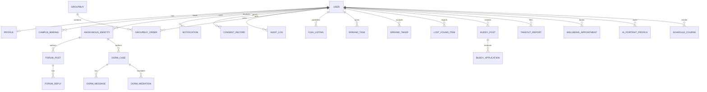

---

## 1. 交易与匹配类模块（重点）

契约明确要求重点覆盖 `groupbuy` / `errand` / `flea-market` / `lost-found` 的**交易与匹配状态机**。这四个模块共享一套模式，先讲共性再逐个展开。

### 1.1 四个模块的共性模式

| 关注点 | 统一做法 |
| --- | --- |
| 状态存储 | `status` 单字段 + `statusChangedAt`，**不用状态历史表**（审计日志承担历史） |
| 状态流转 | `domain/<mod>/state-machine.ts` 导出 `canTransition(from, to): boolean` |
| 并发控制 | 涉及名额/唯一占用的操作用 `SELECT ... FOR UPDATE` |
| 超时关闭 | 由 Worker 扫描，不依赖用户动作 |
| 争议入口 | 全部提供 `POST /items/:id/dispute`，进入 `DISPUTED` 终态 |
| 金额 | `amountFen: int`；`groupbuy`/`errand` 的结算走线下，平台**不经手资金** |

> **平台不经手资金**是一个明确的产品决策：`groupbuy` 的"结算"是**对账**，`errand` 的"悬赏"是**声明**。任何形式的代收代付都会引入支付牌照问题。见 [06-roadmap.md](./06-roadmap.md) M2 风险。

### 1.2 `groupbuy` 拼单

**核心实体**

| 实体 | 字段 | 类型 | 必填 | 说明 |
| --- | --- | --- | --- | --- |
| `Groupbuy` | `title` | `string` | 是 | 1–60 字 |
| | `description` | `string` | 否 | ≤1000 字 |
| | `category` | `enum<food\|drink\|supplies\|ticket\|other>` | 是 | |
| | `**status**` | `enum<DRAFT\|OPEN\|FORMED\|SETTLING\|COMPLETED\|CANCELLED\|EXPIRED\|DISPUTED>` | 是 | 驱动字段 |
| | `targetCount` | `int` | 是 | 2–50，成团所需人数 |
| | `joinedCount` | `int` | 是 | 冗余计数，与 `GroupbuyOrder` 在同一事务内更新 |
| | `unitAmountFen` | `int fen` | 否 | 单价；纯凑单可为空 |
| | `totalAmountFen` | `int fen` | 否 | 由 `unitAmountFen * targetCount` 派生，**存下来便于对账** |
| | `deadlineAt` | `string(iso)` | 是 | 必须 > `createdAt + 1h`，且 ≤ `createdAt + 7d` |
| | `pickupSpot` | `string` | 否 | 取货地点，面交类必填 |
| | `creatorId` | `string(ulid)` | 是 | → `User.id` |
| | `idempotencyKey` | `string` | 否 | 创建幂等 |
| `GroupbuyOrder` | `groupbuyId` | `string(ulid)` | 是 | → `Groupbuy.id` |
| | `userId` | `string(ulid)` | 是 | → `User.id` |
| | `**status**` | `enum<JOINED\|CONFIRMED\|WITHDRAWN\|NO_SHOW\|DISPUTED>` | 是 | |
| | `quantity` | `int` | 是 | ≥1，默认 1 |
| | `note` | `string` | 否 | ≤200 字 |
| | `joinedAt` | `string(iso)` | 是 | |
| | `confirmedAt` | `string(iso)` | 否 | 发起人确认到货/到场时写入 |

**状态机 · `Groupbuy`**

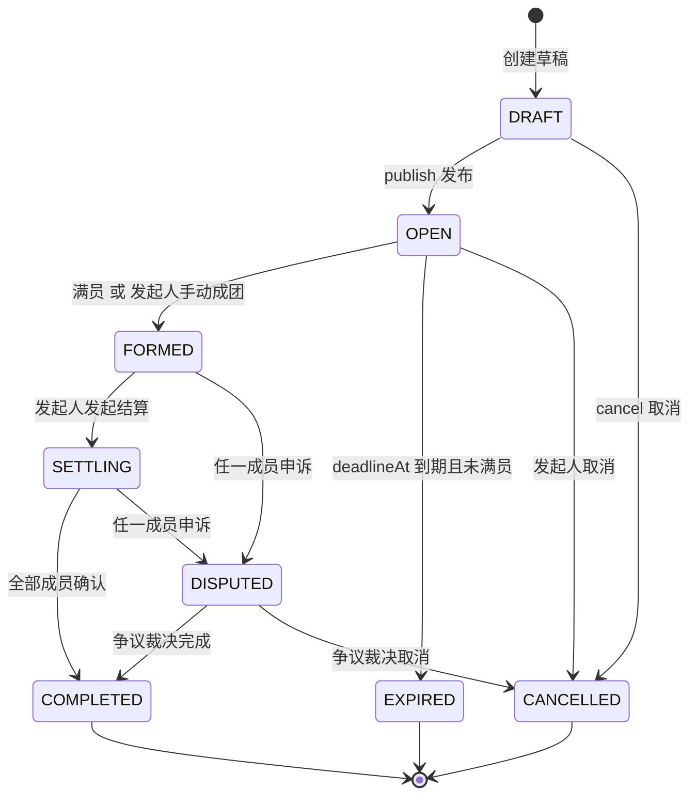

**状态机 · `GroupbuyOrder`**

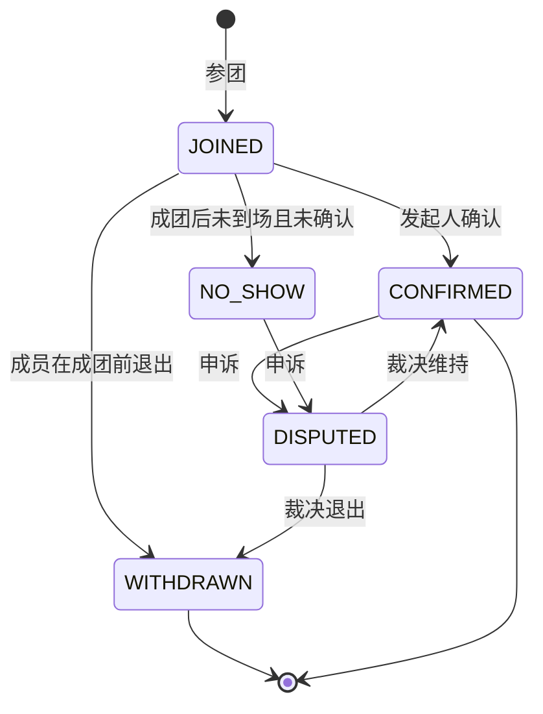

**流转规则（`canTransition` 必须拒绝的组合）**

| 从 | 到 | 允许 | 条件 |
| --- | --- | --- | --- |
| `DRAFT` | `OPEN` | 是 | `targetCount >= 2` 且 `deadlineAt` 合法 |
| `OPEN` | `FORMED` | 是 | `joinedCount >= targetCount`，或 `creatorId` 主动成团 |
| `OPEN` | `EXPIRED` | 是 | 仅 Worker，且 `now > deadlineAt` |
| `OPEN` | `SETTLING` | **否** | 未成团不能结算 |
| `FORMED` | `OPEN` | **否** | 不允许退回，防止名额被反复占 |
| `CANCELLED` | 任何 | **否** | 终态（除审计） |
| `COMPLETED` | 任何 | **否** | 终态 |

**关键用例**

| 用例 | 入口 | 要点 |
| --- | --- | --- |
| `CreateGroupbuy` | `POST /items` | `Idempotency-Key` 必填；创建者自动占 1 个名额并生成 `GroupbuyOrder` |
| `JoinGroupbuy` | `POST /items/:id/join` | 行锁 → 校验 `OPEN` + 未过期 + 未满 + 未重复参团 → 写单 → 满员则转 `FORMED` → 发事件 |
| `WithdrawJoin` | `POST /items/:id/withdraw` | 仅 `JOINED` 可退；`FORMED` 后不可退，只能 `NO_SHOW` |
| `ConfirmOrder` | `POST /orders/:oid/confirm` | 仅 `creatorId` 可调 |
| `SettleGroupbuy` | `POST /items/:id/settle` | 全部 `CONFIRMED` 才能 `COMPLETED`；有 `NO_SHOW` 则进入 `DISPUTED` |
| `ExpireGroupbuy` | Worker | 每分钟扫描 `OPEN` 且过期的行，批量转 `EXPIRED` 并发通知 |

**依赖**：`auth`（`creatorId`/`userId` 必须实名）、`notifications`（成团/到期/结算）、`profile`（取昵称头像）。

### 1.3 `errand` 跑腿

**核心实体**

| 实体 | 字段 | 类型 | 必填 | 说明 |
| --- | --- | --- | --- | --- |
| `ErrandTask` | `title` | `string` | 是 | 1–60 字 |
| | `kind` | `enum<pickup\|deliver\|buy\|print\|other>` | 是 | |
| | `**status**` | `enum<DRAFT\|OPEN\|ASSIGNED\|PICKED\|DELIVERED\|COMPLETED\|CANCELLED\|EXPIRED\|DISPUTED>` | 是 | |
| | `rewardFen` | `int fen` | 是 | 悬赏，0 表示无偿 |
| | `fromLocation` | `string` | 是 | ≤120 字 |
| | `toLocation` | `string` | 是 | ≤120 字 |
| | `expectedBy` | `string(iso)` | 否 | 期望完成时间 |
| | `expireAt` | `string(iso)` | 是 | 无人接单的过期时间 |
| | `posterId` | `string(ulid)` | 是 | → `User.id` |
| | `takerId` | `string(ulid)` | 否 | → `User.id`，接单后写入 |
| | `proofUrls` | `string[]` | 否 | 送达凭证图片，≤3 张 |
| `ErrandTaker` | `taskId` | `string(ulid)` | 是 | → `ErrandTask.id` |
| | `userId` | `string(ulid)` | 是 | → `User.id` |
| | `appliedAt` | `string(iso)` | 是 | |
| | `**status**` | `enum<APPLIED\|ACCEPTED\|REJECTED\|WITHDRAWN>` | 是 | |

**状态机 · `ErrandTask`**

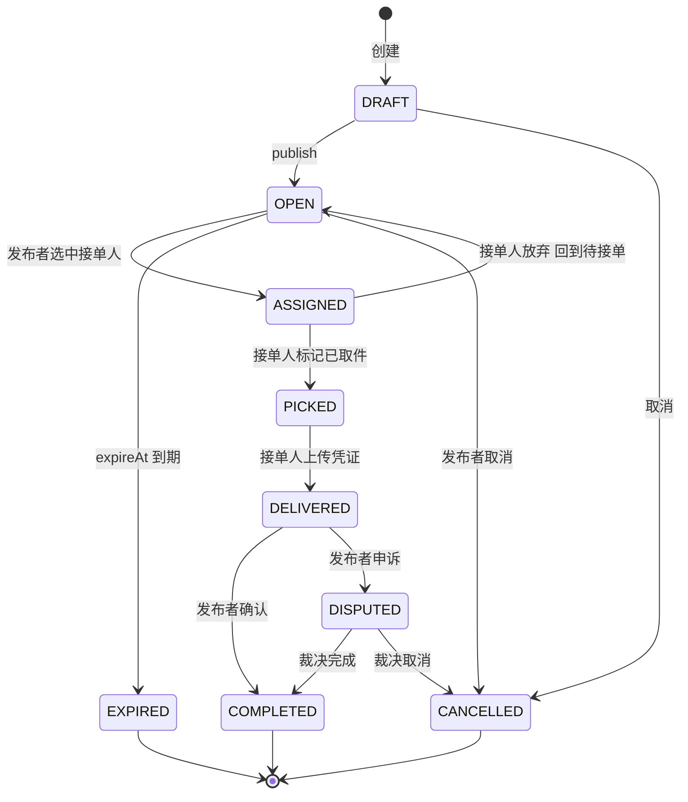

**匹配规则（这是 `errand` 与其它交易模块的关键差异）**

`errand` 是**发布者挑选制**，不是先到先得：

| 规则 | 值 | 理由 |
| --- | --- | --- |
| 可申请人数上限 | 10 | 防止高悬赏任务被刷 |
| 申请冷却 | 同一 `takerId` 对同一 `posterId` 30 分钟内最多申请 3 次 | 防骚扰 |
| 发布者可见信息 | 申请人的昵称、信用分、历史完成数 | 不做实名展示 |
| 接单人放弃惩罚 | `ASSIGNED → OPEN` 记一次 `abandonCount`，>3 次降权 | 减少放鸽子 |

**关键用例**

| 用例 | 入口 | 要点 |
| --- | --- | --- |
| `PublishErrand` | `POST /items` | `rewardFen` 上限 50000（500 元），超出需人工审核标记 |
| `ApplyErrand` | `POST /items/:id/apply` | 写 `ErrandTaker`，不改变 `ErrandTask.status` |
| `AssignErrand` | `POST /items/:id/assign` | 仅 `posterId`；选定后其余申请转 `REJECTED` |
| `MarkPicked` / `MarkDelivered` | `POST /items/:id/picked` / `/delivered` | 仅 `takerId`；`delivered` 必须带 `proofUrls` |
| `ConfirmErrand` | `POST /items/:id/confirm` | 仅 `posterId`；`COMPLETED` 后更新双方信用分 |
| `ExpireErrand` | Worker | 扫描 `OPEN` 且过 `expireAt` |

**依赖**：`auth`、`notifications`（接单/送达/确认）、`profile`（信用分与历史数）。

### 1.4 `flea-market` 跳蚤

**核心实体**

| 实体 | 字段 | 类型 | 必填 | 说明 |
| --- | --- | --- | --- | --- |
| `FleaListing` | `title` | `string` | 是 | 1–60 字 |
| | `description` | `string` | 否 | ≤2000 字 |
| | `category` | `enum<book\|electronics\|clothing\|daily\|bike\|ticket\|other>` | 是 | |
| | `**status**` | `enum<DRAFT\|ACTIVE\|RESERVED\|SOLD\|WITHDRAWN\|REMOVED>` | 是 | |
| | `priceFen` | `int fen` | 是 | ≥0；0 表示赠送 |
| | `negotiable` | `bool` | 是 | 是否接受议价，默认 `true` |
| | `condition` | `enum<new\|like_new\|good\|fair\|poor>` | 是 | |
| | `imageUrls` | `string[]` | 是 | 1–9 张 |
| | `tradeSpot` | `string` | 是 | 面交地点，如"图书馆一楼" |
| | `sellerId` | `string(ulid)` | 是 | → `User.id` |
| | `viewCount` | `int` | 是 | 默认 0，异步累加 |
| | `publishedAt` | `string(iso)` | 否 | |
| `FleaOffer` | `listingId` | `string(ulid)` | 是 | → `FleaListing.id` |
| | `buyerId` | `string(ulid)` | 是 | → `User.id` |
| | `**status**` | `enum<PENDING\|ACCEPTED\|REJECTED\|WITHDRAWN\|EXPIRED>` | 是 | |
| | `offerFen` | `int fen` | 是 | 议价出价 |
| | `message` | `string` | 否 | ≤200 字 |
| | `expiresAt` | `string(iso)` | 是 | 出价后 24h 失效 |

**状态机 · `FleaListing`**

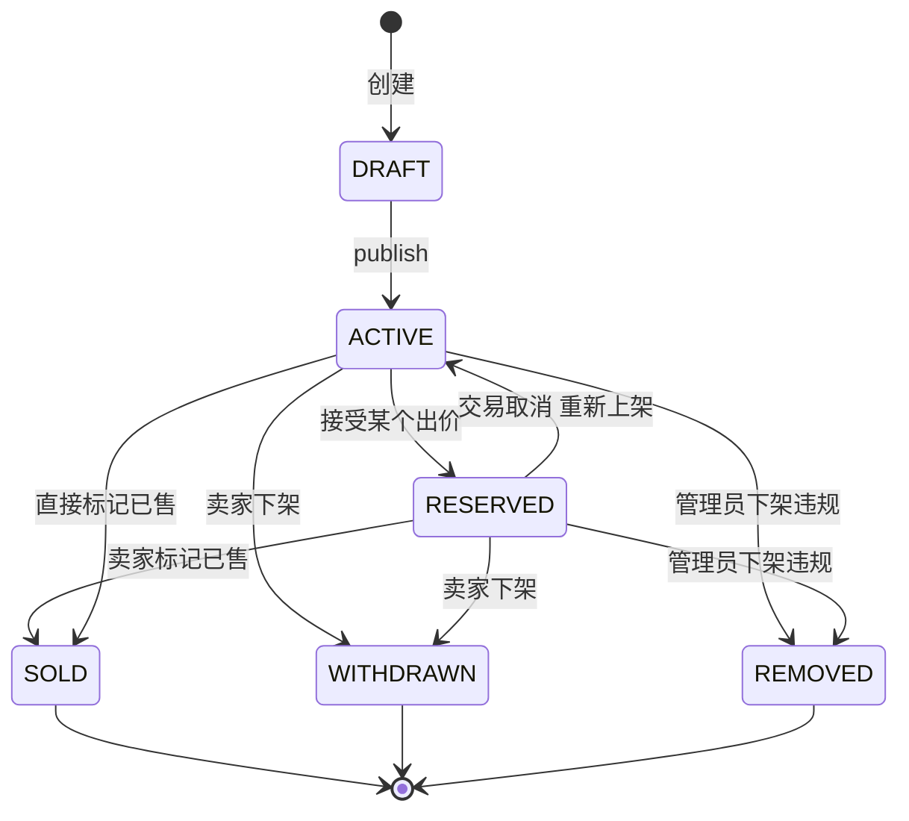

**状态机 · `FleaOffer`**

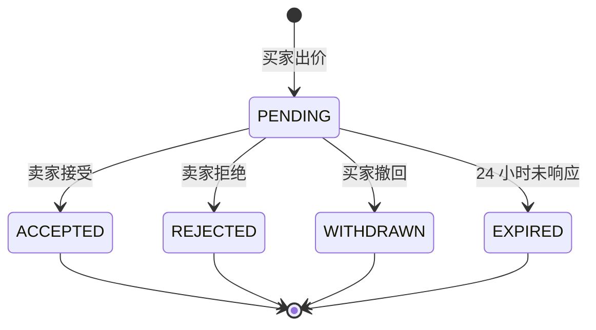

**关键用例**

| 用例 | 入口 | 要点 |
| --- | --- | --- |
| `PublishListing` | `POST /items` | 图片先经对象存储直传 + 内容审核；未通过则 `DRAFT` 停留 |
| `MakeOffer` | `POST /items/:id/offers` | 同一买家对同一商品最多 3 个 `PENDING` 出价 |
| `AcceptOffer` | `POST /offers/:oid/accept` | **行锁**：同一 `listing` 只能有一个 `ACCEPTED`；接受时商品转 `RESERVED`，其余 `PENDING` 批量转 `REJECTED` |
| `MarkSold` | `POST /items/:id/sold` | 仅 `sellerId` |
| `Relist` | `POST /items/:id/relist` | `RESERVED` → `ACTIVE`，重置 `publishedAt` |
| `ExpireOffers` | Worker | 扫描超 24h 的 `PENDING` |

**依赖**：`auth`、`notifications`（收到出价/被接受）、`profile`。

### 1.5 `lost-found` 失物招领

**核心实体**

| 实体 | 字段 | 类型 | 必填 | 说明 |
| --- | --- | --- | --- | --- |
| `LostFoundItem` | `kind` | `enum<LOST\|FOUND>` | 是 | 丢失登记 / 拾获登记 |
| | `title` | `string` | 是 | 1–60 字 |
| | `description` | `string` | 否 | ≤2000 字。**丢失登记里禁止写证件号等敏感串**（有前置校验） |
| | `category` | `enum<card\|electronics\|book\|clothing\|key\|bag\|other>` | 是 | |
| | `**status**` | `enum<OPEN\|MATCHED\|RETURNED\|CLOSED\|EXPIRED>` | 是 | |
| | `occurredAt` | `string(iso)` | 是 | 丢失/拾获发生时间，不能晚于当前 |
| | `location` | `string` | 是 | ≤120 字 |
| | `imageUrls` | `string[]` | 否 | ≤6 张 |
| | `reporterId` | `string(ulid)` | 是 | → `User.id` |
| | `matchedItemId` | `string(ulid)` | 否 | 双向匹配的对端 |
| | `contactHint` | `string` | 否 | 联系方式提示，**不存明文手机号** |
| `LostFoundMatch` | `lostItemId` | `string(ulid)` | 是 | → `LostFoundItem.id`（`kind = LOST`） |
| | `foundItemId` | `string(ulid)` | 是 | → `LostFoundItem.id`（`kind = FOUND`） |
| | `score` | `int` | 是 | 0–100 匹配分 |
| | `**status**` | `enum<PROPOSED\|CONFIRMED\|REJECTED>` | 是 | |
| | `proposedBy` | `enum<SYSTEM\|USER>` | 是 | 系统自动匹配 or 用户手动关联 |

**状态机 · `LostFoundItem`**

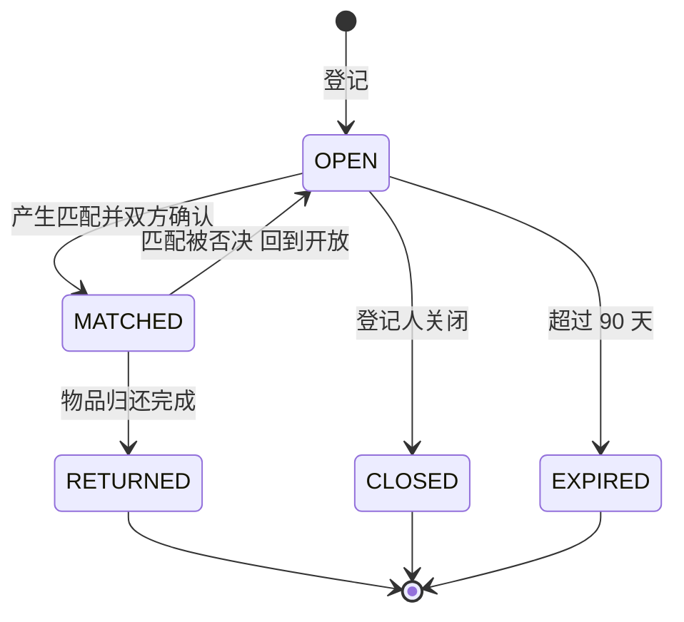

**双向匹配算法（这是 `lost-found` 的核心，必须可解释）**

匹配分 `score` 由四段加权，**每一段都落库**，前端可展示"为什么推荐这条"：

| 维度 | 权重 | 计算 |
| --- | --- | --- |
| 类别一致 | 30 | `category` 相同得满分，否则 0 |
| 地点相似 | 25 | 地点串归一化（去空白/统一别名）后 Jaccard 相似度 × 25 |
| 时间邻近 | 25 | `|lostAt - foundAt|`：≤2h 得 25，≤24h 得 15，≤7d 得 8，否则 0 |
| 文本相似 | 20 | 标题+描述分词后的余弦相似度 × 20 |

`score >= 60` 才生成 `LostFoundMatch(PROPOSED)`，并给双方推通知。**人工确认才转 `MATCHED`**——不做自动归还。

**关键用例**

| 用例 | 入口 | 要点 |
| --- | --- | --- |
| `ReportItem` | `POST /items` | 丢失登记的前置校验：拒绝含 18 位身份证 / 银行卡号的描述 |
| `ProposeMatch` | `POST /items/:id/match` | 用户手动关联，`proposedBy = USER`，跳过阈值 |
| `ConfirmMatch` | `POST /matches/:mid/confirm` | **双方都确认**才 `MATCHED` |
| `RejectMatch` | `POST /matches/:mid/reject` | 任一方否决即 `REJECTED`，双方回到 `OPEN` |
| `MarkReturned` | `POST /items/:id/returned` | 需要 `MATCHED` |
| `ExpireItems` | Worker | 90 天未结案转 `EXPIRED` |

**依赖**：`auth`、`notifications`（匹配候选通知）。

---

## 2. 其余业务模块

### 2.1 `takeout-guard` 偷外卖（敏感级：中）

**核心实体**

| 实体 | 字段 | 类型 | 必填 | 说明 |
| --- | --- | --- | --- | --- |
| `TakeoutReport` | `**status**` | `enum<DRAFT\|SUBMITTED\|EVIDENCE_REQUIRED\|NEGOTIATING\|RESOLVED\|ESCALATED\|REJECTED\|WITHDRAWN>` | 是 | |
| | `anonymous` | `bool` | 是 | 是否匿名提交，默认 `true` |
| | `reporterId` | `string(ulid)` | 是 | 匿名时为 `AnonymousIdentity.id` |
| | `suspectHint` | `string` | 否 | 描述性线索。**禁止指名道姓写学号/姓名**（前置校验 + 人工复核） |
| | `location` | `string` | 是 | 外卖架位置 |
| | `occurredAt` | `string(iso)` | 是 | |
| | `evidenceUrls` | `string[]` | 否 | 举证图片 ≤5 张 |
| | `claimFen` | `int fen` | 否 | 主张金额 |
| | `creditDelta` | `int` | 否 | 结案后对相关方的信用变动 |
| `TakeoutNegotiation` | `reportId` | `string(ulid)` | 是 | → `TakeoutReport.id` |
| | `fromParty` | `enum<REPORTER\|COUNTERPART\|ADMIN>` | 是 | |
| | `body` | `string` | 是 | ≤500 字，**过敏感词与联系方式过滤** |
| | `visibleToCounterpart` | `bool` | 是 | 协商内容是否对被诉方可见 |

**状态机**

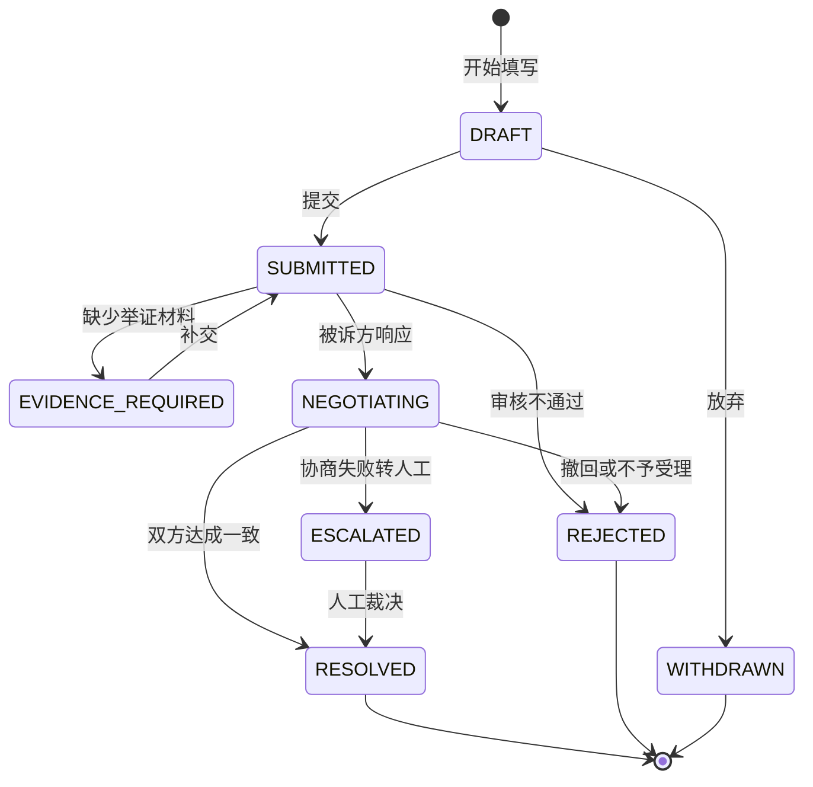

**关键用例**

| 用例 | 入口 | 要点 |
| --- | --- | --- |
| `SubmitReport` | `POST /items` | 匿名时创建/复用 `AnonymousIdentity`；前置校验拒绝含学号/姓名的 `suspectHint` |
| `AddEvidence` | `POST /items/:id/evidence` | 每份举证带 `sha256`，防重复提交同一张图 |
| `RespondAsCounterpart` | `POST /items/:id/respond` | 被诉方**只能看到事件描述**，看不到举报人身份 |
| `Resolve` | `POST /items/:id/resolve` | 写 `creditDelta`，并落审计 |

**依赖**：`auth`（可匿名）、`notifications`。
**敏感约束**：匿名身份与实名身份**分表存储**，举报人与被诉方的关联只在 `admin` 域可查，见 [05-security-privacy.md](./05-security-privacy.md) §4。

### 2.2 `dorm-harmony` 宿舍矛盾（敏感级：**高**，独立同意）

**核心实体**

| 实体 | 字段 | 类型 | 必填 | 说明 |
| --- | --- | --- | --- | --- |
| `DormCase` | `**status**` | `enum<DRAFT\|SUBMITTED\|TRIAGE\|MEDIATING\|AGREEMENT\|RESOLVED\|CLOSED\|ESCALATED>` | 是 | |
| | `anonymous` | `bool` | 是 | 默认 `true`，且**一旦提交不可改为实名** |
| | `applicantId` | `string(ulid)` | 是 | 匿名时为 `AnonymousIdentity.id` |
| | `topic` | `enum<noise\|hygiene\|schedule\|guest\|belongings\|other>` | 是 | |
| | `summary` | `string` | 是 | ≤1000 字，**不得含宿舍号以外的可识别信息**（提示而非强拦） |
| | `dormBuilding` | `string` | 是 | 楼栋，如 `3号楼` |
| | `dormRoom` | `string` | 否 | 房间号，**仅调解员可见** |
| | `severity` | `enum<low\|medium\|high>` | 是 | `high` 触发优先分诊 |
| | `mediatorId` | `string(ulid)` | 否 | 指派后写入 |
| | `consentRecordId` | `string(ulid)` | 是 | → `ConsentRecord.id`，**必填**，证明二次同意 |
| `DormMessage` | `caseId` | `string(ulid)` | 是 | → `DormCase.id` |
| | `fromParty` | `enum<APPLICANT\|MEDIATOR\|SYSTEM>` | 是 | 被诉方不直接进入会话，只经调解员转述 |
| | `body` | `string` | 是 | ≤1000 字 |
| `DormMediation` | `caseId` | `string(ulid)` | 是 | |
| | `**status**` | `enum<SCHEDULED\|HELD\|CANCELLED\|NO_SHOW>` | 是 | |
| | `scheduledAt` | `string(iso)` | 是 | |
| | `mode` | `enum<online\|offline>` | 是 | |
| `DormAgreement` | `caseId` | `string(ulid)` | 是 | |
| | `clauses` | `{ text: string; votes: string[] }[]` | 是 | 公约条款 + 投票人 |
| | `**status**` | `enum<DRAFTING\|VOTING\|ADOPTED\|REJECTED>` | 是 | |
| | `adoptedAt` | `string(iso)` | 否 | |

**状态机 · `DormCase`**

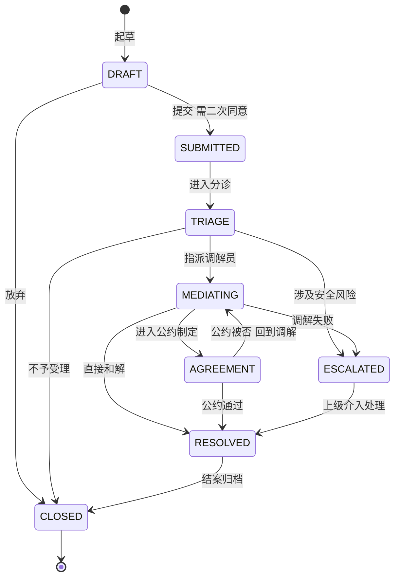

**敏感流程（必须逐条实现）**

| # | 要求 | 实现 |
| --- | --- | --- |
| 1 | 首次进入必须二次同意 | `DormCase.consentRecordId` 非空才能 `SUBMITTED`；无记录返回 `CONSENT_REQUIRED` |
| 2 | 匿名不可逆 | `SUBMITTED` 之后 `anonymous` 字段写入即冻结（DB 层 trigger 拒绝 UPDATE） |
| 3 | 房间号最小可见 | `dormRoom` 只在 `domain:protected:mediator` 视图返回；普通查询投影掉该列 |
| 4 | 被诉方不直接进会话 | 无 `DormMessage.fromParty = RESPONDENT`，转述由调解员完成 |
| 5 | 全部读写落审计 | `AuditLog` 记录 `caseId` + `actorId` + `action`，**不记录 `body` 内容** |
| 6 | 不进通用画像 | `ai-portrait` 的 Guard 显式拒绝 `domain:protected` |
| 7 | 撤回同意即停用 | 撤回后 `status` 强制转 `CLOSED`，调解员侧失去访问 |

**关键用例**

| 用例 | 入口 | 要点 |
| --- | --- | --- |
| `SubmitCase` | `POST /items` | 校验 `consentRecordId`；创建匿名身份 |
| `TriageCase` | `POST /items/:id/triage` | 仅调解员；`severity = high` 进优先队列 |
| `AssignMediator` | `POST /items/:id/assign` | 写入 `mediatorId`，被指派者需 `role = mediator` |
| `PostMessage` | `POST /items/:id/messages` | 全量审计 |
| `DraftAgreement` | `POST /items/:id/agreements` | 条款数 1–10 |
| `VoteAgreement` | `POST /agreements/:aid/vote` | 达 2/3 同意转 `ADOPTED` |

**依赖**：`auth`、`notifications`（分诊/调解安排）。

### 2.3 `buddy` 找搭子（敏感级：低）

**核心实体**

| 实体 | 字段 | 类型 | 必填 | 说明 |
| --- | --- | --- | --- | --- |
| `BuddyPost` | `activity` | `enum<sport\|study\|meal\|travel\|game\|other>` | 是 | |
| | `**status**` | `enum<OPEN\|FULL\|CLOSED\|EXPIRED\|CANCELLED>` | 是 | |
| | `title` | `string` | 是 | 1–60 字 |
| | `description` | `string` | 否 | ≤1000 字 |
| | `location` | `string` | 是 | |
| | `startsAt` | `string(iso)` | 是 | 必须晚于当前 |
| | `capacity` | `int` | 是 | 2–20 |
| | `joinedCount` | `int` | 是 | |
| | `genderPreference` | `enum<any\|same\|other>` | 是 | 默认 `any`；**不提供性别筛选以外的筛选** |
| | `creatorId` | `string(ulid)` | 是 | |
| `BuddyApplication` | `postId` | `string(ulid)` | 是 | |
| | `applicantId` | `string(ulid)` | 是 | |
| | `**status**` | `enum<PENDING\|ACCEPTED\|REJECTED\|WITHDRAWN>` | 是 | |
| | `message` | `string` | 否 | ≤200 字 |

**状态机 · `BuddyPost`**

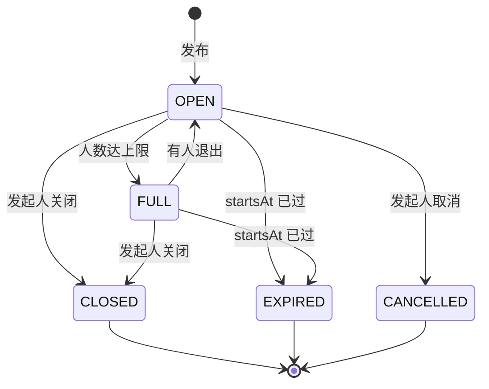

**关键用例**：`CreatePost` / `Apply` / `Decide`（接受即占名额，行锁）/ `Withdraw` / `ClosePost`。
**依赖**：`auth`、`notifications`、`profile`。

### 2.4 `forum` 论坛（敏感级：中）

**核心实体**

| 实体 | 字段 | 类型 | 必填 | 说明 |
| --- | --- | --- | --- | --- |
| `ForumBoard` | `slug` | `string` | 是 | 唯一，`slugify` 生成 |
| | `name` | `string` | 是 | 1–30 字 |
| | `description` | `string` | 否 | ≤200 字 |
| | `visibility` | `enum<public\|campus_only>` | 是 | `campus_only` 需登录 |
| | `postCount` | `int` | 是 | 冗余计数 |
| `ForumPost` | `boardId` | `string(ulid)` | 是 | → `ForumBoard.id` |
| | `title` | `string` | 是 | 1–100 字 |
| | `body` | `string` | 是 | ≤20000 字，Markdown 子集 |
| | `**status**` | `enum<DRAFT\|PUBLISHED\|LOCKED\|HIDDEN\|DELETED>` | 是 | |
| | `anonymous` | `bool` | 是 | 默认 `false` |
| | `authorId` | `string(ulid)` | 是 | 匿名时为 `AnonymousIdentity.id` |
| | `tags` | `string[]` | 否 | ≤5 个，每个 ≤16 字 |
| | `replyCount` | `int` | 是 | |
| | `likeCount` | `int` | 是 | |
| | `pinnedAt` | `string(iso)` | 否 | 置顶时间 |
| `ForumReply` | `postId` | `string(ulid)` | 是 | |
| | `parentReplyId` | `string(ulid)` | 否 | 二级回复 |
| | `body` | `string` | 是 | ≤5000 字 |
| | `**status**` | `enum<PUBLISHED\|HIDDEN\|DELETED>` | 是 | |
| | `anonymous` | `bool` | 是 | |
| | `authorId` | `string(ulid)` | 是 | |
| `ForumReport` | `targetType` | `enum<POST\|REPLY>` | 是 | |
| | `targetId` | `string(ulid)` | 是 | |
| | `reason` | `enum<spam\|abuse\|illegal\|privacy\|other>` | 是 | |
| | `**status**` | `enum<PENDING\|UPHELD\|DISMISSED>` | 是 | |
| | `reporterId` | `string(ulid)` | 是 | 可匿名 |

**状态机 · `ForumPost`**

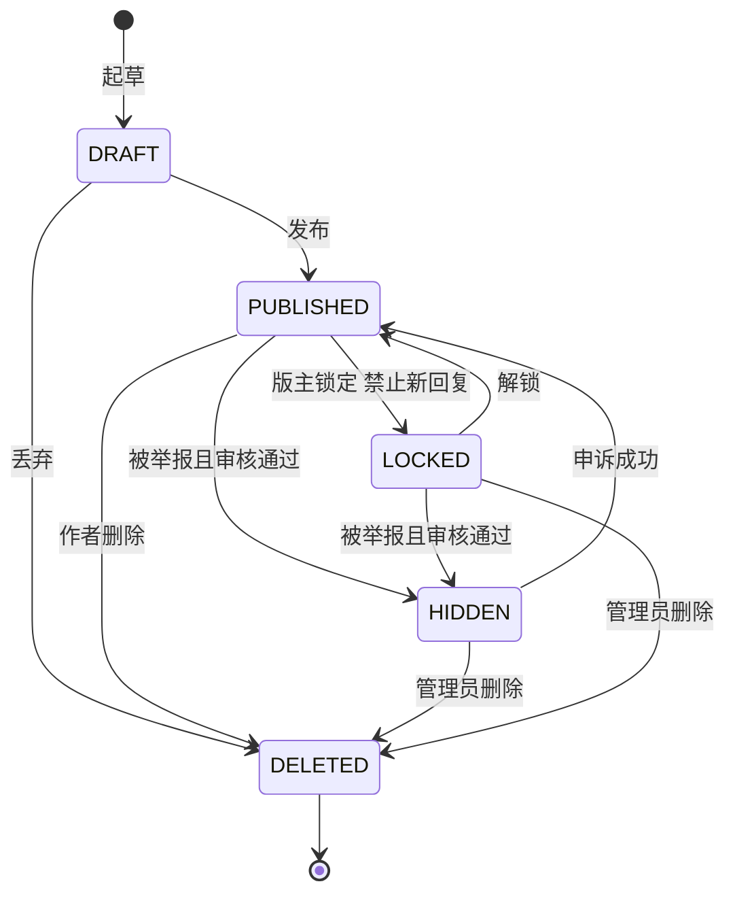

**治理规则**

| 规则 | 值 |
| --- | --- |
| 举报达阈值自动隐藏 | 3 个不同用户举报 → `HIDDEN` + 进人工队列 |
| 发帖频率 | 单用户 10 分钟 3 帖、24 小时 20 帖 |
| 回复频率 | 单用户 1 分钟 5 回复 |
| 匿名发帖 | 允许；但**同一 `AnonymousIdentity` 在板块内可被版主追溯**，对普通用户不可见 |
| 敏感词 | 命中即拦截并返回 `VALIDATION_FAILED`，不静默改写 |

**关键用例**：`CreatePost` / `Reply` / `Report` / `Moderate`（版主）/ `Lock` / `Hide`。
**依赖**：`auth`、`notifications`（被回复/被举报）、`profile`。

### 2.5 `canteen` 食堂营养（敏感级：低）

**核心实体**

| 实体 | 字段 | 类型 | 必填 | 说明 |
| --- | --- | --- | --- | --- |
| `Dish` | `name` | `string` | 是 | 1–40 字 |
| | `canteen` | `enum<canteen1\|canteen2\|canteen3\|other>` | 是 | |
| | `priceFen` | `int fen` | 否 | |
| | `kcal` | `int` | 是 | 每份热量 |
| | `proteinG` / `fatG` / `carbG` | `number` | 是 | 克，一位小数 |
| | `sodiumMg` | `int` | 否 | |
| | `allergens` | `string[]` | 否 | 过敏原标签 |
| | `**status**` | `enum<ACTIVE\|STALE\|REMOVED>` | 是 | `STALE` 表示超过 90 天未核验 |
| `MealLog` | `userId` | `string(ulid)` | 是 | |
| | `dishId` | `string(ulid)` | 是 | |
| | `eatenAt` | `string(iso)` | 是 | |
| | `portion` | `enum<half\|one\|double>` | 是 | 默认 `one` |

**状态机 · `Dish`**

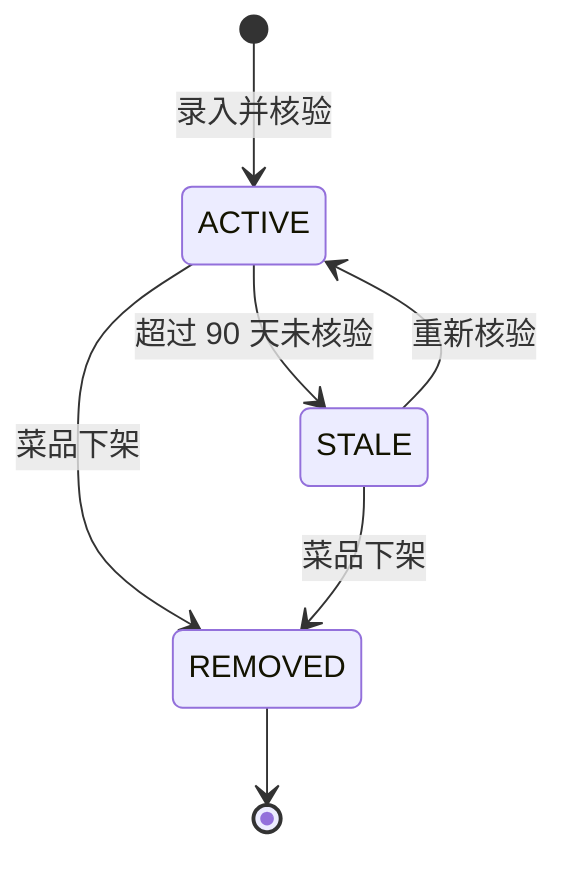

**营养建议算法（可解释，不做医疗声明）**

- 每日建议：`kcal` 目标按用户设置（默认 2000），蛋白质 ≥ 每公斤体重 1.2g（体重可选填）。
- 输出模板固定：**"今日已记录 X kcal，其中蛋白质 Y g"** + 一句中性提示。
- **禁止**出现"减肥""治疗""诊断"等词。所有文案走白名单模板，不做 LLM 生成。
- `MealLog` 属于**行为数据**，进 `domain:content`，`ai-portrait` 可读（用户已开画像时）。

**关键用例**：`ListDishes`（支持按食堂/热量区间筛选）/ `LogMeal` / `DailySummary`。
**依赖**：`auth`、`schedule`（可选：按上课时段推荐）。

### 2.6 `ai-portrait` AI 校园画像（敏感级：**高**，独立同意）

**核心实体**

| 实体 | 字段 | 类型 | 必填 | 说明 |
| --- | --- | --- | --- | --- |
| `AiPortraitProfile` | `userId` | `string(ulid)` | 是 | |
| | `**status**` | `enum<DISABLED\|BUILDING\|ACTIVE\|STALE>` | 是 | 默认 `DISABLED` |
| | `consentRecordId` | `string(ulid)` | 是 | **必填**，无同意则不存在此记录 |
| | `interestTags` | `{ tag: string; weight: number; evidence: string[] }[]` | 是 | **每条标签必须带证据来源** |
| | `sourceDomains` | `string[]` | 是 | 参与计算的数据域，白名单 |
| | `lastBuiltAt` | `string(iso)` | 否 | |
| | `expiresAt` | `string(iso)` | 是 | 默认 30 天后 `STALE` |
| `AiPortraitFeedback` | `userId` | `string(ulid)` | 是 | |
| | `tag` | `string` | 是 | |
| | `verdict` | `enum<ACCURATE\|INACCURATE\|HIDE>` | 是 | `HIDE` 永久排除该标签 |

**状态机**

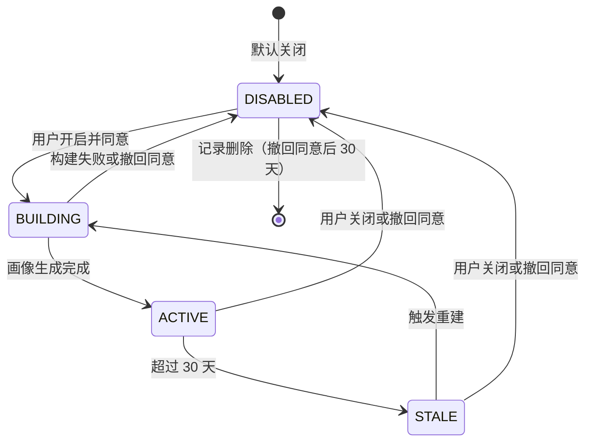

**硬约束（契约 §9 逐条落地）**

| # | 约束 | 实现 |
| --- | --- | --- |
| 1 | 默认关闭 | 无 `AiPortraitProfile` 行 = 关闭；不开画像也能用全部其它功能 |
| 2 | 数据源白名单 | `sourceDomains` 只允许 `domain:trade` / `domain:content` / `domain:social` |
| 3 | **禁止读 `wellbeing` / `dorm-harmony`** | Guard 双向拒绝；`AiPortraitProfile.sourceDomains` 写入时校验，读取时再校验 |
| 4 | 每条标签可解释 | `evidence` 存"因为你在 `flea-market` 浏览了 N 次 `electronics`"，前端可展示 |
| 5 | 可关闭可删除 | 关闭 = 删除 `AiPortraitProfile` 行 + 清除缓存；审计保留 30 天后匿名化 |
| 6 | 不用于风控 | 画像**不得**作为举报/信用处罚的输入 |

**关键用例**：`EnablePortrait`（需同意）/ `RebuildPortrait` / `GiveFeedback` / `DisablePortrait`。
**依赖**：`auth`、`profile`。

### 2.7 `wellbeing` 心理支持（敏感级：**最高**，独立同意）

这是全系统敏感度最高的模块。**默认最小化**：`wellbeing` 的存在本身在其它模块不可见。
定位是**倾听与预约入口**（危机出口在首屏），**不做诊断、不做治疗**。
> ⚠️ 本节下列 `WellbeingAssessment`（PHQ-9 / GAD-7 等量表）与风险分级**未实现也不打算实现** ——
> 量表作答属于医疗行为。已交付范围见 `docs/delivery-plan.md` 与 `docs/architecture/03-api-contract.md` §6.6。

**核心实体**

| 实体 | 字段 | 类型 | 必填 | 说明 |
| --- | --- | --- | --- | --- |
| `WellbeingAppointment` | `userId` | `string(ulid)` | 是 | **不匿名**——心理咨询必须可联系 |
| | `**status**` | `enum<DRAFT\|PENDING\|CONFIRMED\|RESCHEDULED\|COMPLETED\|CANCELLED\|NO_SHOW>` | 是 | |
| | `counselorId` | `string(ulid)` | 否 | 确认后写入 |
| | `slotStart` / `slotEnd` | `string(iso)` | 是 | 30 分钟粒度 |
| | `mode` | `enum<online\|offline>` | 是 | |
| | `topic` | `enum<stress\|relationship\|sleep\|academic\|crisis\|other>` | 是 | `crisis` 触发危机流程 |
| | `intakeNote` | `string` | 否 | ≤1000 字，**加密存储**，仅咨询师可见 |
| | `consentRecordId` | `string(ulid)` | 是 | 必填 |
| | `anonToCounselor` | `bool` | 是 | 默认 `false`；为 `true` 时咨询师只见脱敏学号 |
| `WellbeingAssessment` | `userId` | `string(ulid)` | 是 | |
| | `scale` | `enum<PHQ9\|GAD7\|PSS10>` | 是 | 标准量表，**不自创量表** |
| | `answers` | `int[]` | 是 | 逐题分值 |
| | `totalScore` | `int` | 是 | |
| | `riskLevel` | `enum<none\|low\|moderate\|high>` | 是 | 由量表阈值派生 |
| | `**status**` | `enum<IN_PROGRESS\|SUBMITTED\|REVIEWED>` | 是 | |
| `CrisisResource` | `region` | `string` | 是 | 默认 `shanghaitech` |
| | `name` | `string` | 是 | 热线/机构名 |
| | `phone` | `string` | 是 | |
| | `hours` | `string` | 是 | |
| | `priority` | `int` | 是 | 排序，**不可为负** |

**状态机 · `WellbeingAppointment`**

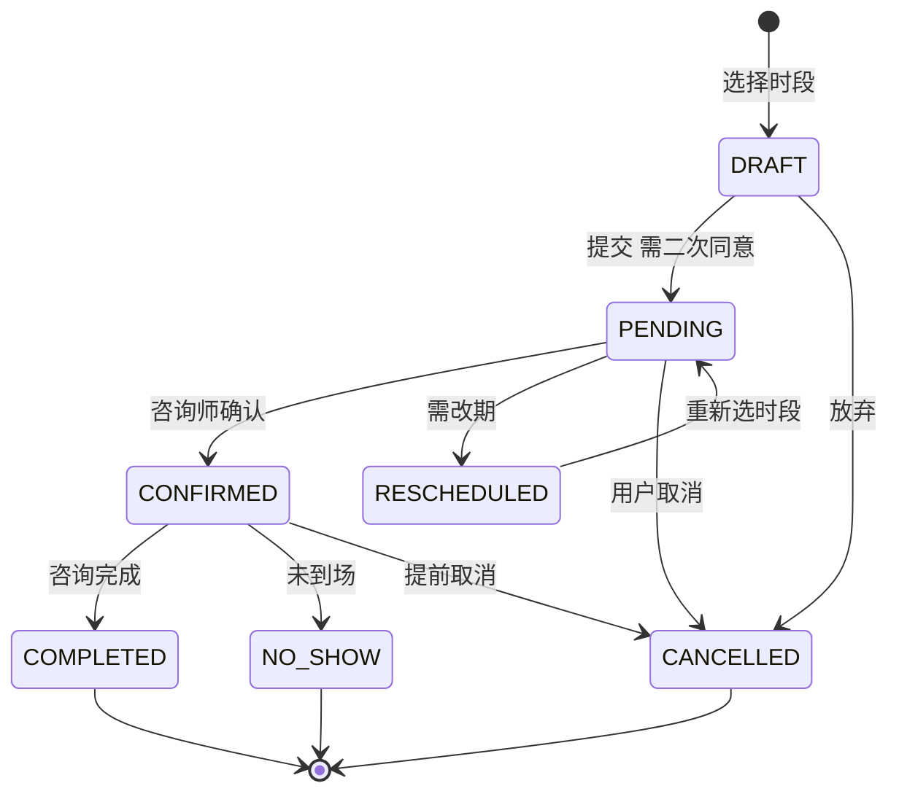

**危机干预流程（不可被埋进二级菜单，契约 §9 硬要求）**

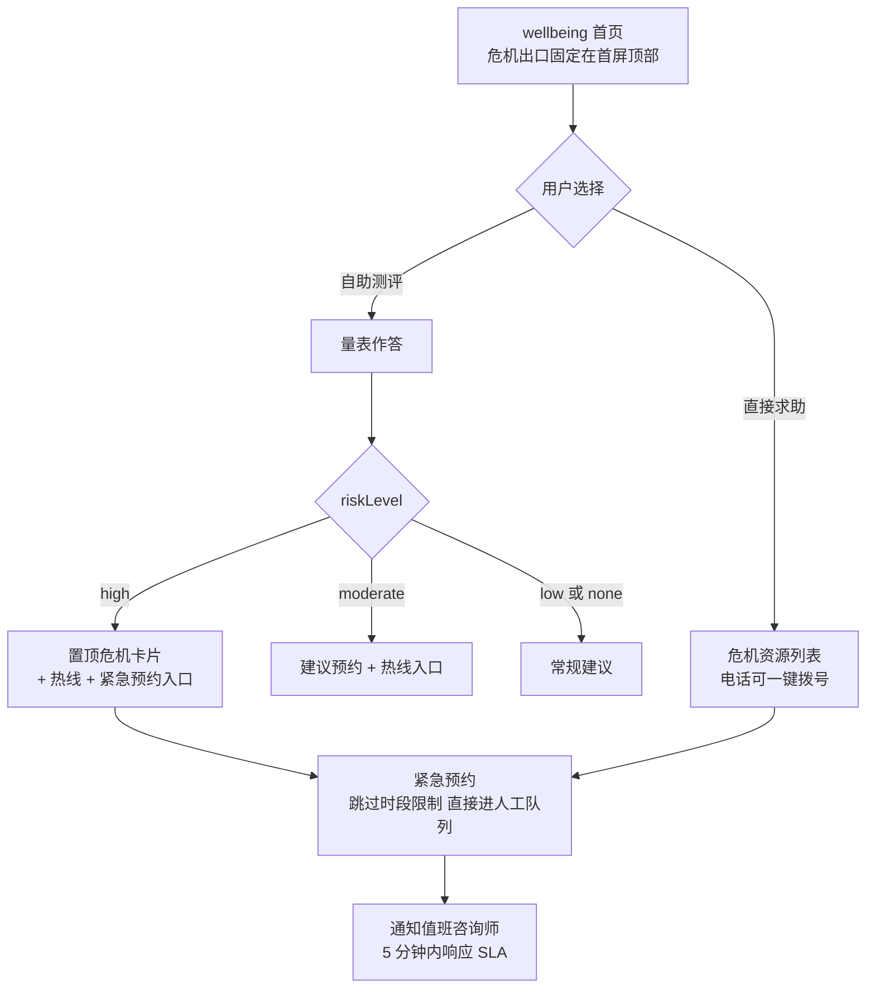

**硬约束**

| # | 约束 | 实现 |
| --- | --- | --- |
| 1 | 危机出口在首屏 | `presentation` 层结构约束：`CrisisBanner` 是 `WellbeingHome` 的第一个子节点，**不折叠** |
| 2 | 热线可一键拨号 | 三端各有 `platform/` 拨号适配 |
| 3 | `intakeNote` 加密 | 应用层 AES-256-GCM，密钥在 KMS，DB 只见密文 |
| 4 | 不进画像 | `ai-portrait` Guard 硬拒绝 `domain:wellbeing` |
| 5 | 咨询师最小可见 | 只返回 `slotStart/End`、`mode`、`topic`、脱敏学号；`userId` 不返回 |
| 6 | 撤回同意 | `status → CANCELLED`，`intakeNote` 立即软删，30 天后硬删 |
| 7 | 审计不留内容 | 只记"谁在何时读了哪条预约"，不记 `intakeNote` |

**关键用例**：`ListSlots` / `BookAppointment`（需同意）/ `SubmitAssessment` / `ListCrisisResources`（**无需登录**）/ `CancelAppointment`。
**依赖**：`auth`、`notifications`（预约确认；通知文案不得出现"心理""咨询"字样，用中性模板如"你有一条新的日程安排"）。

### 2.8 `faq` 常见问题（敏感级：低）

**核心实体**

| 实体 | 字段 | 类型 | 必填 | 说明 |
| --- | --- | --- | --- | --- |
| `FaqArticle` | `slug` | `string` | 是 | 唯一 |
| | `question` | `string` | 是 | 1–120 字 |
| | `answer` | `string` | 是 | Markdown 子集，≤10000 字 |
| | `category` | `string` | 是 | |
| | `**status**` | `enum<DRAFT\|PUBLISHED\|ARCHIVED>` | 是 | |
| | `helpfulCount` / `unhelpfulCount` | `int` | 是 | |
| `FaqTicket` | `userId` | `string(ulid)` | 否 | 未登录也可提交，此时为 `null` |
| | `contact` | `string` | 是 | 邮箱或微信，**不存明文手机号** |
| | `question` | `string` | 是 | ≤2000 字 |
| | `**status**` | `enum<OPEN\|ANSWERED\|CLOSED>` | 是 | |

**状态机 · `FaqTicket`**

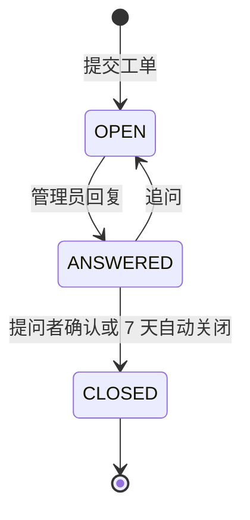

**关键用例**：`SearchFaq`（无需登录）/ `SubmitTicket` / `AnswerTicket` / `VoteHelpful`。
**依赖**：`notifications`（可选）。

### 2.9 `techpie` TechPie 整合（敏感级：中）

**核心实体**

| 实体 | 字段 | 类型 | 必填 | 说明 |
| --- | --- | --- | --- | --- |
| `TechpieLink` | `userId` | `string(ulid)` | 是 | |
| | `provider` | `enum<techpie\|geekpie>` | 是 | |
| | `**status**` | `enum<UNLINKED\|LINKING\|LINKED\|EXPIRED\|REVOKED>` | 是 | |
| | `externalUserId` | `string` | 否 | 对端标识 |
| | `tokenCipher` | `string` | 否 | 对端 token，**加密存储** |
| | `expiresAt` | `string(iso)` | 否 | |
| | `lastSyncAt` | `string(iso)` | 否 | |
| `TechpieSyncJob` | `linkId` | `string(ulid)` | 是 | |
| | `kind` | `enum<pull_schedule\|pull_deadline\|push_post>` | 是 | |
| | `**status**` | `enum<QUEUED\|RUNNING\|SUCCEEDED\|FAILED\|SKIPPED>` | 是 | |
| | `attempts` | `int` | 是 | 指数退避，最多 5 次 |

**状态机 · `TechpieLink`**

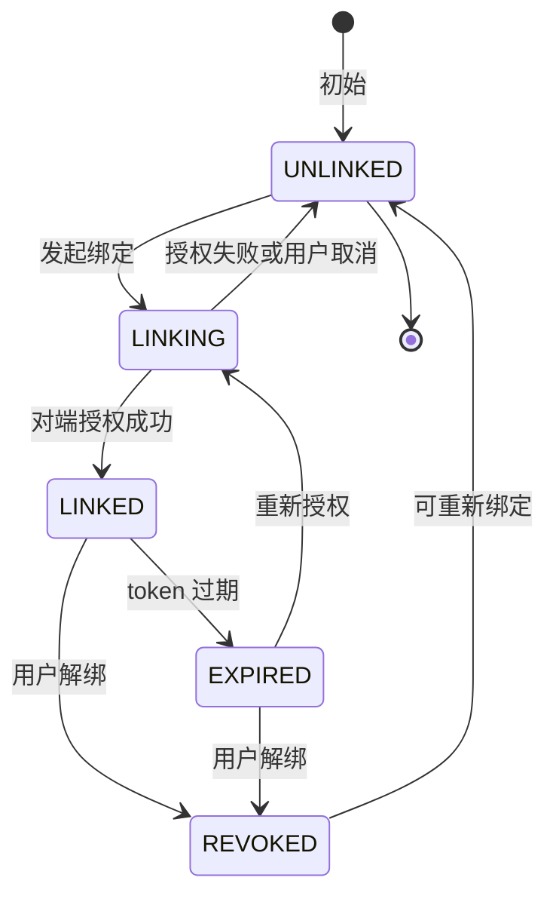

**关键用例**：`StartLink` / `CompleteLink` / `Unlink` / `RunSync`（Worker）。
**依赖**：`auth`。
**边界**：TechPie 的 `CASTGC` 之类的校园会话**绝不进入 KedaYa 的身份层**；如需其能力，走 `CampusSessionPort` 的 `techpie` 实现，见 [../adr/0004-auth-two-tier.md](../adr/0004-auth-two-tier.md)。

### 2.10 `wildlife` 猫鸟黑天鹅（敏感级：低）

**核心实体**

| 实体 | 字段 | 类型 | 必填 | 说明 |
| --- | --- | --- | --- | --- |
| `WildlifeZone` | `name` | `string` | 是 | 如"图书馆后草坪" |
| | `species` | `string[]` | 是 | 主要物种标签 |
| | `geo` | `{ lat: number; lng: number; radiusM: number }` | 是 | 圆形区域 |
| | `feedingPolicy` | `enum<allowed\|discouraged\|forbidden>` | 是 | |
| | `note` | `string` | 否 | ≤500 字 |
| `WildlifeSighting` | `zoneId` | `string(ulid)` | 否 | |
| | `species` | `string` | 是 | |
| | `**status**` | `enum<PENDING\|PUBLISHED\|REJECTED>` | 是 | 默认 `PENDING` 待审核 |
| | `geo` | `{ lat: number; lng: number }` | 是 | |
| | `photoUrls` | `string[]` | 否 | ≤3 张 |
| | `healthConcern` | `bool` | 是 | 是否疑似受伤/异常 |
| | `reporterId` | `string(ulid)` | 是 | |

**状态机 · `WildlifeSighting`**

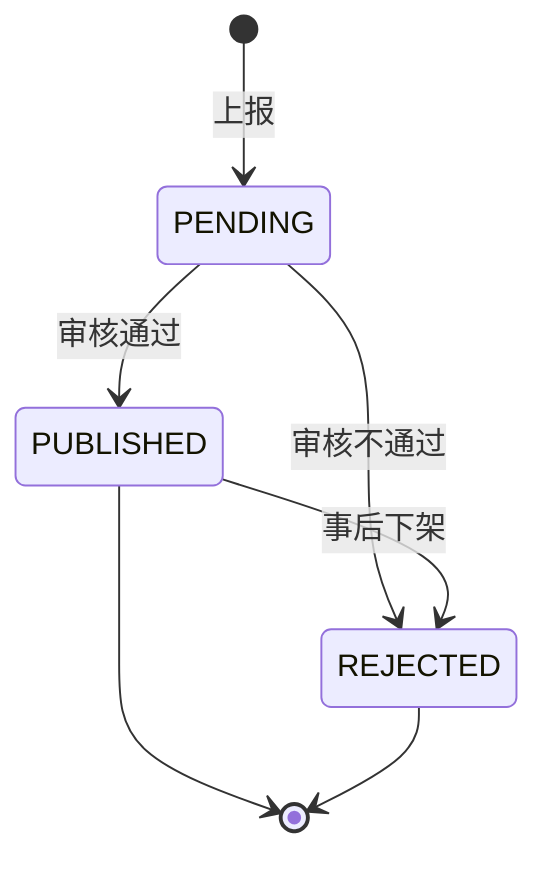

**关键用例**：`ListZones`（无需登录）/ `ReportSighting` / `Moderate`。
**依赖**：`auth`、`notifications`（健康异常时通知社团）。

---

## 3. 基础模块

### 3.1 `auth` 身份（敏感级：高，**无同意门**）

**为什么无同意门**：契约 §9 明确——登录这个行为本身就是同意。再叠一层门只是无意义的点击。

**核心实体**

| 实体 | 字段 | 类型 | 必填 | 说明 |
| --- | --- | --- | --- | --- |
| `User` | `id` | `string(ulid)` | 是 | |
| | `studentId` | `string` | 是 | 学号，唯一。**加密列**（确定性加密以便查重） |
| | `name` | `string` | 是 | 姓名。**加密列** |
| | `department` | `string` | 否 | 院系 |
| | `email` | `string` | 否 | 必须 `*@shanghaitech.edu.cn`（`isShanghaiTechEmail`） |
| | `**status**` | `enum<ACTIVE\|SUSPENDED\|DELETED>` | 是 | |
| | `roles` | `string[]` | 是 | `user` / `mediator` / `moderator` / `admin` / `counselor` |
| | `lastLoginAt` | `string(iso)` | 否 | |
| `RefreshToken` | `userId` | `string(ulid)` | 是 | |
| | `tokenHash` | `string` | 是 | 只存哈希 |
| | `**status**` | `enum<ACTIVE\|ROTATED\|REVOKED\|EXPIRED>` | 是 | |
| | `expiresAt` | `string(iso)` | 是 | 30 天 |
| | `deviceHint` | `string` | 否 | UA 摘要 |
| `CampusBinding` | `userId` | `string(ulid)` | 是 | |
| | `system` | `enum<egate\|jwc\|ecard\|techpie>` | 是 | |
| | `**status**` | `enum<ACTIVE\|EXPIRING\|EXPIRED\|REVOKED\|ERROR>` | 是 | |
| | `sessionCipher` | `string` | 是 | 校园会话密文。**绝不出现在任何响应体** |
| | `expiresAt` | `string(iso)` | 否 | |
| | `lastRenewAt` | `string(iso)` | 否 | |

**状态机 · `CampusBinding`**

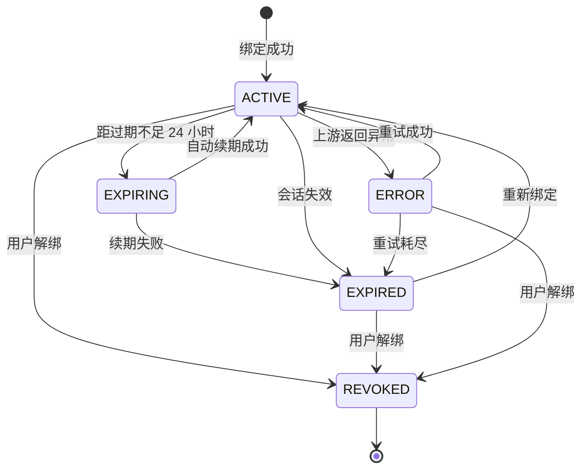

**关键用例**

| 用例 | 入口 | 要点 |
| --- | --- | --- |
| `GetLoginUrl` | `GET /api/v1/auth/login-url` | 生成 CAS 授权地址 + `state`（防 CSRF） |
| `CasCallback` | `POST /api/v1/auth/cas/callback` | 换 code → 身份 → 签发 KedaYa JWT。**此路径不产生任何校园会话** |
| `Refresh` | `POST /api/v1/auth/refresh` | refresh token 轮换（旧 token 立即 `ROTATED`） |
| `Logout` | `POST /api/v1/auth/logout` | 撤销全部 refresh token |
| `BindCampus` | `POST /api/v1/auth/campus/bind` | 写 `CampusBinding`，密文落库 |
| `UnbindCampus` | `DELETE /api/v1/auth/campus/:system` | 删除密文，转 `REVOKED` |

**依赖**：无（最底层）。
**硬规则**：`AuthPort` 的返回值里**不允许**出现 `sessionCipher` / `cookies` / `tgc` 任何字段。

### 3.2 `schedule` 课表（敏感级：中）

**核心实体**

| 实体 | 字段 | 类型 | 必填 | 说明 |
| --- | --- | --- | --- | --- |
| `Semester` | `name` | `string` | 是 | 如 `2026-2027-1` |
| | `startsOn` / `endsOn` | `string(iso)` | 是 | 日期 |
| | `**status**` | `enum<UPCOMING\|ACTIVE\|ARCHIVED>` | 是 | 同一时刻只允许一个 `ACTIVE` |
| `Course` | `semesterId` | `string(ulid)` | 是 | |
| | `code` | `string` | 是 | 课程号 |
| | `name` | `string` | 是 | |
| | `teacher` | `string` | 否 | |
| | `credits` | `number` | 否 | |
| `CourseSession` | `courseId` | `string(ulid)` | 是 | |
| | `weekday` | `int` | 是 | 1–7 |
| | `periodStart` / `periodEnd` | `int` | 是 | 节次 |
| | `weeks` | `int[]` | 是 | 上课周次 |
| | `location` | `string` | 否 | |
| `Exam` | `courseId` | `string(ulid)` | 是 | |
| | `startsAt` | `string(iso)` | 是 | |
| | `durationMin` | `int` | 是 | |
| | `location` | `string` | 否 | |
| | `seat` | `string` | 否 | |

**状态机 · `Semester`**

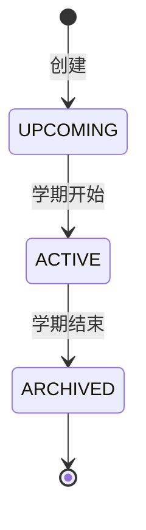

**关键用例**：`SyncSchedule`（走 `CampusSessionPort`，失败返回 `UPSTREAM_UNAVAILABLE` 但**保留上次缓存**）/ `ListCourses` / `ListExams` / `GetCurrentSemester`。
**依赖**：`auth`（必须 `CampusBinding(system=jwc|egate)` 为 `ACTIVE`，否则 `CAMPUS_BINDING_REQUIRED`）。

### 3.3 `campus-card` 校园卡（敏感级：高，**无同意门**）

**核心实体**

| 实体 | 字段 | 类型 | 必填 | 说明 |
| --- | --- | --- | --- | --- |
| `CampusCard` | `userId` | `string(ulid)` | 是 | |
| | `cardNoMasked` | `string` | 是 | **只存掩码**，如 `****1234` |
| | `balanceFen` | `int fen` | 是 | 缓存值，TTL 60s |
| | `**status**` | `enum<ACTIVE\|FROZEN\|LOST\|CLOSED>` | 是 | |
| | `syncedAt` | `string(iso)` | 是 | |
| `CardTransaction` | `cardId` | `string(ulid)` | 是 | |
| | `occurredAt` | `string(iso)` | 是 | |
| | `amountFen` | `int fen` | 是 | 负数表示支出 |
| | `merchant` | `string` | 否 | |
| | `kind` | `enum<meal\|shop\|recharge\|refund\|other>` | 是 | |
| `PaymentCode` | `cardId` | `string(ulid)` | 是 | |
| | `payload` | `string` | 是 | **短 TTL（60s）且一次性**，加密存储 |
| | `**status**` | `enum<ISSUED\|USED\|EXPIRED\|REVOKED>` | 是 | |
| | `expiresAt` | `string(iso)` | 是 | |

**状态机 · `PaymentCode`**

```mermaid
stateDiagram-v2
    [*] --> ISSUED : 请求付款码
    ISSUED --> USED : 被扫码核销
    ISSUED --> EXPIRED : 60 秒到期
    ISSUED --> REVOKED : 用户主动作废或退出页面
    USED --> [*]
    EXPIRED --> [*]
    REVOKED --> [*]
```

**状态机 · `CampusCard`**

```mermaid
stateDiagram-v2
    [*] --> ACTIVE : 绑定成功
    ACTIVE --> FROZEN : 挂失冻结
    FROZEN --> ACTIVE : 解冻
    ACTIVE --> LOST : 报失
    LOST --> ACTIVE : 找回并解挂
    ACTIVE --> CLOSED : 销户
    LOST --> CLOSED : 销户
    FROZEN --> CLOSED : 销户
    CLOSED --> [*]
```

**关键用例**：`SyncCard` / `ListTransactions`（游标分页）/ `IssuePaymentCode`（**每次调用生成新码，旧码立即 `REVOKED`**）/ `RevokePaymentCode`。
**依赖**：`auth`（需 `CampusBinding(system=ecard)`）。
**硬规则**：付款码**不进日志**、**不进审计正文**，审计只记 `ISSUED`/`REVOKED` 动作。

### 3.4 `profile` 我的（敏感级：中）

**核心实体**

| 实体 | 字段 | 类型 | 必填 | 说明 |
| --- | --- | --- | --- | --- |
| `Profile` | `userId` | `string(ulid)` | 是 | |
| | `nickname` | `string` | 是 | 1–20 字，默认由姓名派生 |
| | `avatarUrl` | `string` | 否 | 对象存储地址 |
| | `bio` | `string` | 否 | ≤200 字 |
| | `campus` | `string` | 否 | 校区 |
| | `creditScore` | `int` | 是 | 默认 100，范围 0–150 |
| | `abandonCount` | `int` | 是 | 跑腿放弃次数 |
| | `showRealName` | `bool` | 是 | 默认 `false` |
| `PrivacySetting` | `userId` | `string(ulid)` | 是 | |
| | `allowPortrait` | `bool` | 是 | 默认 `false` |
| | `allowPush` | `bool` | 是 | 默认 `true` |
| | `anonymousByDefault` | `bool` | 是 | 默认 `false` |
| | `searchable` | `bool` | 是 | 默认 `true` |
| `ConsentRecord` | `userId` | `string(ulid)` | 是 | |
| | `module` | `string` | 是 | `wellbeing` / `dorm-harmony` / `ai-portrait` |
| | `scope` | `string` | 是 | 同意文本版本号，如 `wellbeing-v1` |
| | `**status**` | `enum<GRANTED\|REVOKED\|EXPIRED>` | 是 | |
| | `grantedAt` | `string(iso)` | 是 | |
| | `revokedAt` | `string(iso)` | 否 | |
| | `ipHash` | `string` | 否 | IP 哈希，用于争议举证 |

**状态机 · `ConsentRecord`**

```mermaid
stateDiagram-v2
    [*] --> GRANTED : 用户显式同意
    GRANTED --> REVOKED : 用户撤回
    GRANTED --> EXPIRED : 同意文本升版且未重新同意
    EXPIRED --> GRANTED : 重新同意新版
    REVOKED --> GRANTED : 重新同意
    REVOKED --> [*]
```

**关键用例**：`GetProfile` / `UpdateProfile` / `UpdatePrivacy` / `GrantConsent` / `RevokeConsent`（**撤回后级联清理**：`ai-portrait` 删画像行，`wellbeing` 软删 `intakeNote`，`dorm-harmony` 转 `CLOSED`）。
**依赖**：`auth`。

### 3.5 `notifications` 通知（敏感级：中）

**核心实体**

| 实体 | 字段 | 类型 | 必填 | 说明 |
| --- | --- | --- | --- | --- |
| `Notification` | `userId` | `string(ulid)` | 是 | |
| | `kind` | `enum<system\|trade\|social\|reminder\|governance>` | 是 | |
| | `title` | `string` | 是 | ≤40 字 |
| | `body` | `string` | 是 | ≤200 字 |
| | `deepLink` | `string` | 否 | 站内路由，如 `kedaya://groupbuy/items/01H...` |
| | `**status**` | `enum<UNREAD\|READ\|ARCHIVED>` | 是 | |
| | `sensitiveLevel` | `enum<normal\|restricted>` | 是 | `restricted` 时**不显示明文内容**，只提示"有新消息" |
| `PushSubscription` | `userId` | `string(ulid)` | 是 | |
| | `channel` | `enum<wechat_subscribe\|apns\|fcm\|web_push>` | 是 | |
| | `token` | `string` | 是 | 设备令牌/模板订阅计数 |
| | `**status**` | `enum<ACTIVE\|INVALID\|REVOKED>` | 是 | 上游返回失效即置 `INVALID` |
| `PushDelivery` | `notificationId` | `string(ulid)` | 是 | |
| | `channel` | `enum<wechat_subscribe\|apns\|fcm\|web_push>` | 是 | |
| | `**status**` | `enum<QUEUED\|SENT\|FAILED\|SKIPPED\|SUPPRESSED>` | 是 | `SUPPRESSED` = 用户关了推送 |
| | `attempts` | `int` | 是 | |
| | `errorCode` | `string` | 否 | |

**状态机 · `Notification`**

```mermaid
stateDiagram-v2
    [*] --> UNREAD : 生成
    UNREAD --> READ : 用户打开
    UNREAD --> ARCHIVED : 自动归档 90 天
    READ --> ARCHIVED : 用户归档或 90 天
    ARCHIVED --> [*]
```

**状态机 · `PushDelivery`**

```mermaid
stateDiagram-v2
    [*] --> QUEUED : 入队
    QUEUED --> SUPPRESSED : 用户关闭推送或未授权订阅
    QUEUED --> SENT : 上游接受
    QUEUED --> FAILED : 上游拒绝
    FAILED --> QUEUED : 指数退避重试 最多 3 次
    SENT --> [*]
    SUPPRESSED --> [*]
```

**关键用例**：`ListNotifications` / `MarkRead` / `MarkAllRead` / `RegisterPushToken` / `Dispatch`（Worker）。
**依赖**：`auth`。
**硬规则**：`wellbeing` 相关通知的 `title`/`body` 必须是中性模板（如"你有一条新的日程安排"），且 `sensitiveLevel = restricted`。

---

## 4. 模块间依赖矩阵

`→` 表示"左侧依赖右侧"。只列直接依赖。

| 模块 | 依赖 |
| --- | --- |
| `auth` | — |
| `profile` | `auth` |
| `notifications` | `auth` |
| `schedule` | `auth`, `campus-session` |
| `campus-card` | `auth`, `campus-session` |
| `groupbuy` | `auth`, `profile`, `notifications` |
| `takeout-guard` | `auth`, `notifications` |
| `flea-market` | `auth`, `profile`, `notifications` |
| `dorm-harmony` | `auth`, `notifications` |
| `errand` | `auth`, `profile`, `notifications` |
| `buddy` | `auth`, `profile`, `notifications` |
| `lost-found` | `auth`, `notifications` |
| `canteen` | `auth`, `schedule`(可选) |
| `forum` | `auth`, `profile`, `notifications` |
| `ai-portrait` | `auth`, `profile` |
| `wellbeing` | `auth`, `notifications` |
| `faq` | `notifications`(可选) |
| `techpie` | `auth`, `campus-session` |
| `wildlife` | `auth`, `notifications` |

**禁止的依赖**（由 Guard 强制，写进 `packages/contracts/src/modules.ts` 的域声明）：

| 禁止 | 理由 |
| --- | --- |
| `ai-portrait` → `wellbeing` | 契约 §9：画像不得读取心理域 |
| `ai-portrait` → `dorm-harmony` | 契约 §9：画像不得读取宿舍矛盾域 |
| 任何模块 → `campus-card.sessionCipher` | 会话密文只在 `CampusSessionPort` 内部可见 |
| `presentation` → `data/api`（三端） | 契约 §7：UI 不得直接发请求 |

---

## 5. 本文档未决问题

| # | 问题 | 影响 | 建议 |
| --- | --- | --- | --- |
| D1 | `groupbuy` 的"结算"是否需要记录线下支付凭证（截图）？当前模型只记 `CONFIRMED` | 争议举证弱 | 建议 M2 前定：加 `settlementProofUrls` 或明确不做 |
| D2 | `lost-found` 匹配权重（30/25/25/20）是拍脑袋值，没有历史数据校准 | 匹配质量 | 上线后按 `CONFIRMED/PROPOSED` 比例调参 |
| D3 | `errand` 的 `rewardFen` 上限 50000 分是否合理，需与学校沟通 | 合规 | M2 前确认 |
| D4 | `wellbeing` 的 `counselorId` 是 KedaYa 账号还是外部咨询师？若外部，需要一套只读账号 | 实现范围 | 建议 M3 前定，倾向"受限角色 + 学校 SSO" |
| D5 | `forum` 匿名身份"版主可追溯"的实现方式（密钥托管还是映射表） | 隐私 | 见 [05-security-privacy.md](./05-security-privacy.md) §4.4 |
| D6 | `techpie` 与 GeekPie 的对接协议尚未拿到正式文档 | M4 进度 | 需要 Lead 与对方确认 |
| D7 | `dorm-harmony` 的"公约投票"参与人范围（同宿舍？同楼层？）未定 | 模型正确性 | 建议 M3 前定，当前模型按"案件相关人"实现 |
