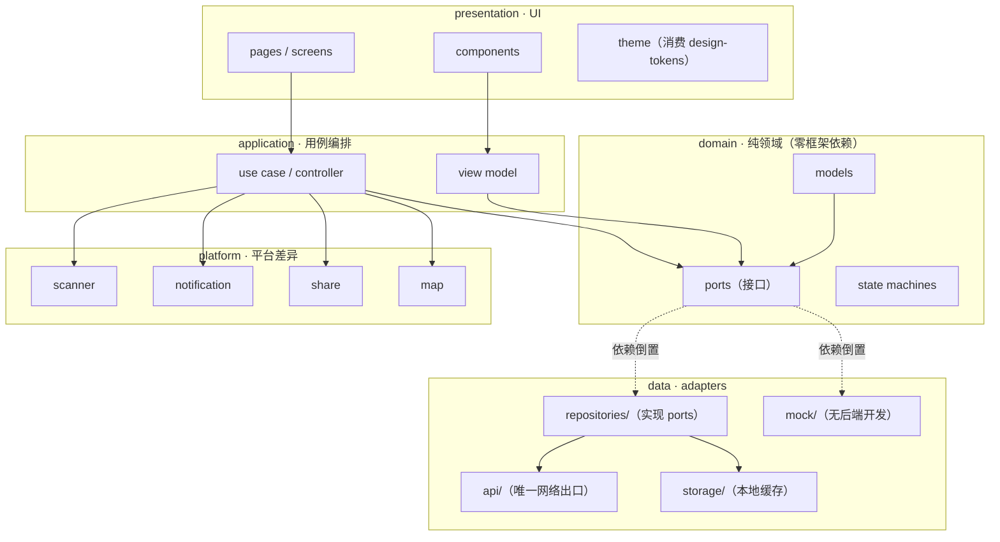
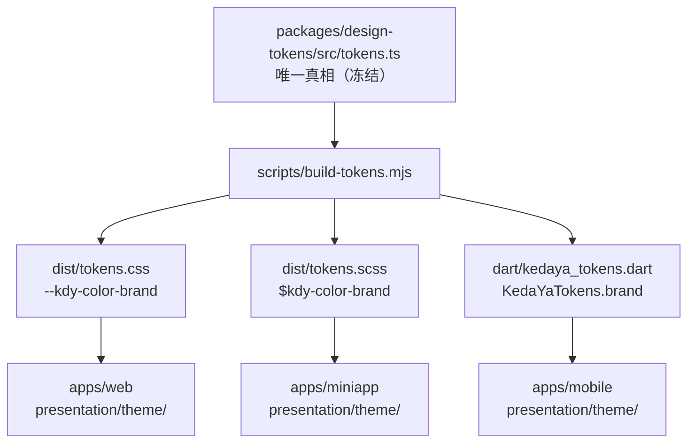
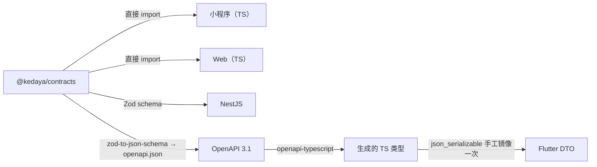
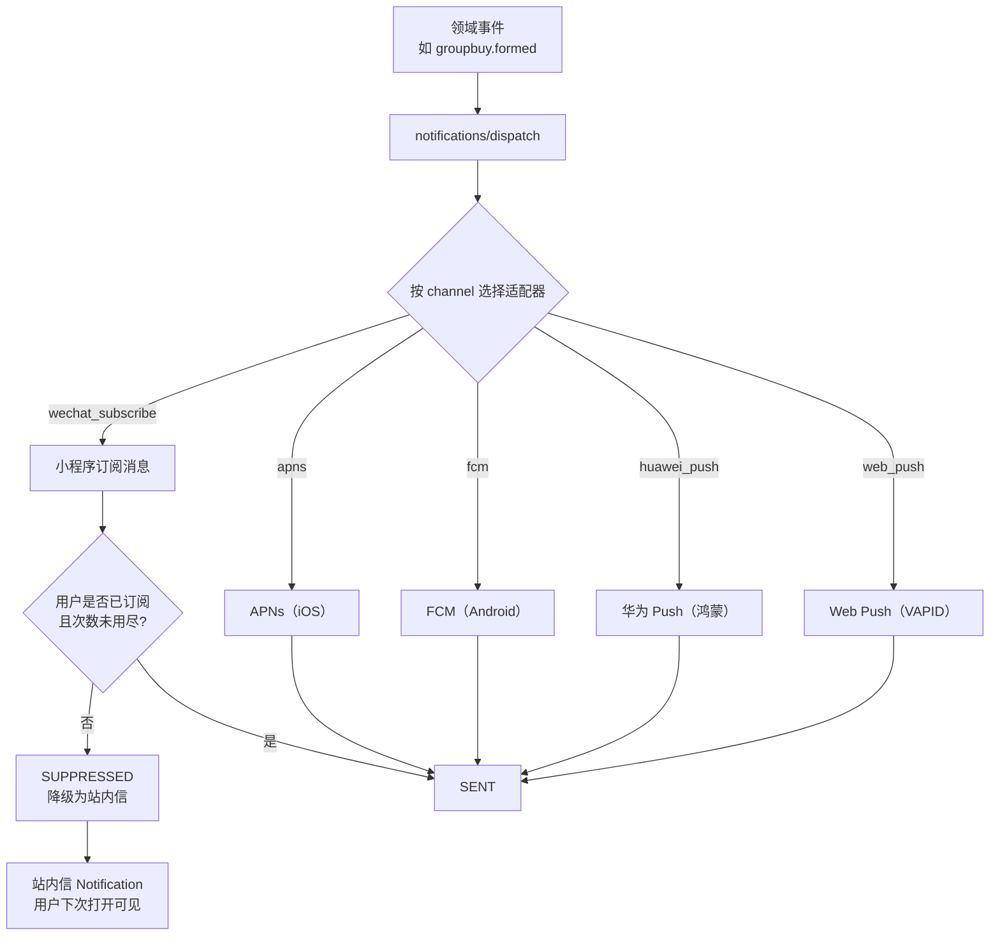
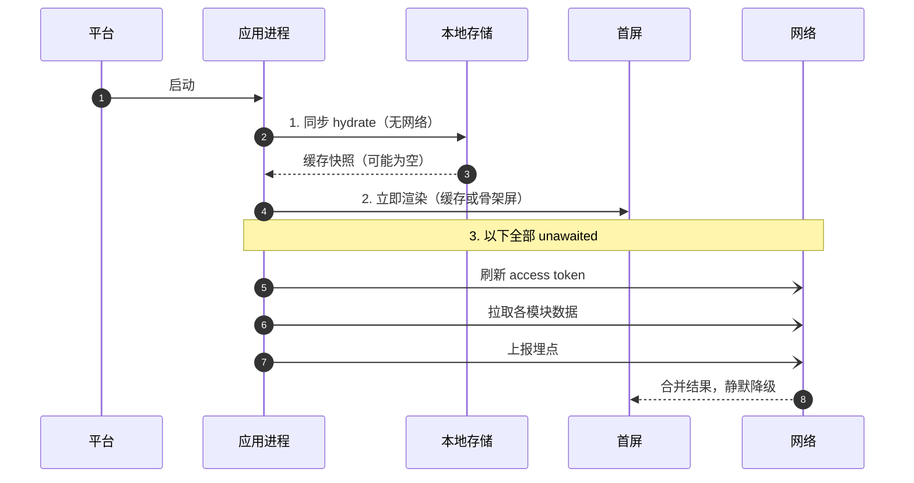

# 04 · 客户端架构

> 上游真相来源：`docs/architecture/00-FROZEN-CONTRACT.md`（下称 **契约**）§6.2 §6.3 §7 §8。
> 覆盖三个端：`apps/miniapp`（Taro，主端）、`apps/mobile`（Flutter）、`apps/web`（Next.js）。
> 服务端契约见 [03-api-contract.md](./03-api-contract.md)；权限与隐私见 [05-security-privacy.md](./05-security-privacy.md)。

版本：`v1` · 2026-10-16

---

## 1. 三端的分工与不变量

| 端 | 技术 | 定位 | 不可替代的能力 |
| --- | --- | --- | --- |
| `apps/miniapp` | Taro 4.3.0 + React 18.3.1 | **主端**。绝大多数用户从这里进来 | 微信登录、订阅消息、微信分享、小程序码 |
| `apps/mobile` | Flutter `>=3.6.2 <4.0.0` | 重度用户 + 鸿蒙覆盖 | 原生推送、扫码、后台任务、离线缓存质量 |
| `apps/web` | Next.js 16.4.2 App Router | Web 门户 + **管理后台** | 大屏治理界面、审计查询、SEO 落地页 |

**三条不变量**（违反即为架构退化）：

| # | 不变量 | 强制手段 |
| --- | --- | --- |
| I1 | 三端**不重复定义**任何跨端类型 | 类型只来自 `@kedaya/contracts`；`tsc -b` 全量检查 |
| I2 | 三端**不手写**任何色值/间距/圆角 | 只从 `@kedaya/design-tokens` 派生；ESLint 规则禁字面量色值 |
| I3 | 三端启动**不阻塞网络** | 启动路径无 `await` 网络调用；CI 静态检查 + 冷启动埋点 |

---

## 2. 分层职责（契约 §7）

### 2.1 统一分层



**依赖方向**（契约 §7 冻结）：`presentation → application → domain ← data`。

| 规则 | 检查方式 |
| --- | --- |
| `domain` 零框架依赖（Flutter 端只允许 `dart:core` + 自有模型） | `apps/mobile/test/architecture/domain_purity_test.dart` 扫 import |
| `presentation` 禁止直接发请求 | ESLint `no-restricted-imports`（TS 端）/ Dart lint 自定义规则 |
| 每个 feature 自带 `README.md` | CI 检查目录下存在该文件 |
| 必须有 mock adapter | CI 检查 `data/mock/` 存在且被至少一个测试引用 |

### 2.2 三端的目录落地

**`apps/miniapp`（Taro + React）**

```
apps/miniapp/
├── app/                    # 装配：Taro app 入口、路由注册、Provider 树
│   ├── app.config.ts       # 页面注册（Taro 特有）
│   ├── app.tsx
│   └── providers.tsx
├── application/            # hooks + use case
│   └── groupbuy/useCreateGroupbuy.ts
├── domain/
│   ├── models/             # 从 @kedaya/contracts re-export + 端内视图模型
│   └── ports/              # GroupbuyRepository 等接口
├── data/
│   ├── api/                # request.ts（唯一 Taro.request 调用点）
│   ├── repositories/
│   ├── storage/            # Taro.getStorageSync 封装
│   └── mock/
├── platform/               # 小程序差异：subscribeMessage / scanCode / shareAppMessage / map
└── presentation/
    ├── pages/
    ├── components/
    └── theme/              # 消费 dist/tokens.scss
```

**`apps/mobile`（Flutter）**

```
apps/mobile/
├── lib/
│   ├── app/                # main.dart、DI（Provider）、路由（GoRouter）
│   ├── application/        # use case / controller
│   ├── domain/
│   │   ├── models/
│   │   └── ports/
│   ├── data/
│   │   ├── api/            # dio 封装，唯一网络出口
│   │   ├── repositories/
│   │   ├── storage/        # flutter_secure_storage + shared_preferences
│   │   └── mock/
│   ├── platform/           # MethodChannel 适配：scanner / notification / share / map
│   └── presentation/
│       ├── pages/
│       ├── components/
│       └── theme/          # 消费 dart/kedaya_tokens.dart
└── test/
    └── architecture/       # 架构约束测试（domain 纯净度、分层 import）
```

**`apps/web`（Next.js App Router）**

```
apps/web/
├── app/                    # App Router 路由段（同时是"装配"层）
│   ├── (portal)/           # 面向学生的门户
│   ├── (admin)/            # 管理后台（独立 layout + 独立鉴权）
│   └── api/                # 只做 BFF 转发与 cookie 处理，不含业务逻辑
├── application/            # server actions / use case
├── domain/
├── data/
│   ├── api/                # fetch 封装，唯一网络出口
│   ├── repositories/
│   ├── storage/            # 仅 httpOnly cookie（不放业务数据）
│   └── mock/
├── platform/               # web push / file upload / clipboard
└── presentation/
    ├── components/
    └── theme/              # 消费 dist/tokens.css
```

**`apps/web` 的双入口注意点**：`(portal)` 与 `(admin)` 是**两套独立鉴权**。管理后台要求 `role ∈ {mediator, moderator, admin, counselor}`，且必须二次校验（`middleware.ts` + 每个 Server Action 内再校验一次）。理由：Next.js middleware 曾多次出现绕过 CVE，单点校验不可信。

---

## 3. 设计令牌的跨端一致（契约 §6.2）

### 3.1 唯一真相与派生



| 产物 | 消费者 | 形式 | 命名规则 |
| --- | --- | --- | --- |
| `dist/tokens.css` | Web | CSS 变量 | `--kdy-<group>-<key>`，camelCase → kebab-case |
| `dist/tokens.scss` | 小程序 | SCSS 变量 | `$kdy-<group>-<key>` |
| `dart/kedaya_tokens.dart` | Flutter | `static const` | `KedaYaTokens.brandStrong` |

### 3.2 命名映射（逐条，避免生成器自由发挥）

| `tokens.ts` | CSS 变量 | SCSS 变量 | Dart |
| --- | --- | --- | --- |
| `color.brand` | `--kdy-color-brand` | `$kdy-color-brand` | `KedaYaTokens.colorBrand` |
| `color.brandStrong` | `--kdy-color-brand-strong` | `$kdy-color-brand-strong` | `KedaYaTokens.colorBrandStrong` |
| `color.brandSoft` | `--kdy-color-brand-soft` | `$kdy-color-brand-soft` | `KedaYaTokens.colorBrandSoft` |
| `color.textMuted` | `--kdy-color-text-muted` | `$kdy-color-text-muted` | `KedaYaTokens.colorTextMuted` |
| `space.4` | `--kdy-space-4` | `$kdy-space-4` | `KedaYaTokens.space4` |
| `radius.lg` | `--kdy-radius-lg` | `$kdy-radius-lg` | `KedaYaTokens.radiusLg` |
| `fontSize.md` | `--kdy-font-size-md` | `$kdy-font-size-md` | `KedaYaTokens.fontSizeMd` |
| `lineHeight.normal` | `--kdy-line-height-normal` | `$kdy-line-height-normal` | `KedaYaTokens.lineHeightNormal` |
| `fontWeight.semibold` | `--kdy-font-weight-semibold` | `$kdy-font-weight-semibold` | `KedaYaTokens.fontWeightSemibold` |
| `shadow.md` | `--kdy-shadow-md` | `$kdy-shadow-md` | `KedaYaTokens.shadowMd` |
| `fontFamily.sans` | `--kdy-font-family-sans` | `$kdy-font-family-sans` | `KedaYaTokens.fontFamilySans` |

**转换规则**：`camelCase` → `kebab-case`（在大小写边界插入 `-` 并转小写）。数字键（`space.4`）保持原样，不加前缀。

### 3.3 三端如何消费

| 端 | 用法 | 禁止 |
| --- | --- | --- |
| Web | Tailwind 配置里把 token 映射成 utility（`bg-brand`、`p-4`） | 写 `#FFC53D`、`style={{ color: '#FFC53D' }}` |
| 小程序 | SCSS `@use '@kedaya/design-tokens/dist/tokens.scss' as t;` 然后 `color: t.$kdy-color-brand` | 写 hex 字面量 |
| Flutter | `KedaYaTokens.colorBrand` 建 `ThemeData` | 写 `Color(0xFFFFC53D)` |

**ESLint / lint 规则（必须实现）**

```js
// 三端共用思路：禁字面量色值与魔法间距
'no-restricted-syntax': ['error',
  { selector: "Literal[value=/^#[0-9a-fA-F]{3,8}$/]", message: '色值必须来自 @kedaya/design-tokens' },
  { selector: "Literal[value=/^rgba?\\(/]", message: '色值必须来自 @kedaya/design-tokens' },
]
```

Flutter 侧用 `analysis_options.yaml` 的 `custom_lint` 或一个源码扫描测试：

```dart
// apps/mobile/test/architecture/no_hardcoded_colors_test.dart
// 断言 lib/presentation/** 下不出现 Color(0x...)、Colors.xxx（白名单：Colors.transparent）
```

### 3.4 为什么令牌必须生成而不是手抄

手抄三份的失败模式是**静默的**：Web 改了 `brandStrong`，小程序没改，两边按钮的 hover/active 色差 5%，谁都不会报 bug，但品牌一致性已经破了。生成 + CI 校验 `git diff --exit-code` 让这种漂移变成**构建失败**。

---

## 4. 跨端一致性策略

### 4.1 一致的是"什么"，不是"怎么做"

| 层次 | 是否跨端一致 | 说明 |
| --- | --- | --- |
| 数据模型 / 字段名 | **必须一致** | 来自 `@kedaya/contracts` |
| 状态机与错误码 | **必须一致** | 来自 `@kedaya/contracts` |
| 色值 / 间距 / 圆角 / 字阶 | **必须一致** | 来自 `@kedaya/design-tokens` |
| 文案（面向用户的中文） | **必须一致** | 来自 `@kedaya/contracts/src/copy/`（见 §4.2） |
| 信息架构（一级入口顺序） | **必须一致** | 见 §4.3 |
| 交互手势 / 转场动画 | 允许不同 | 遵循各平台 HIG / Material |
| 导航容器 | 允许不同 | 小程序 tabBar / Flutter BottomNav / Web 侧栏 |
| 表单校验时机 | 允许不同 | 平台习惯差异 |

### 4.2 文案集中管理

```ts
// packages/contracts/src/copy/errors.ts
export const ERROR_COPY: Record<ApiErrorCode, string> = {
  UNAUTHENTICATED: '登录状态已失效，请重新登录',
  FORBIDDEN: '你没有权限进行这个操作',
  NOT_FOUND: '没有找到相关内容',
  VALIDATION_FAILED: '填写的内容有几处需要修改',
  RATE_LIMITED: '操作太频繁了，请稍后再试',
  CONFLICT: '当前状态不允许这个操作',
  CAMPUS_BINDING_REQUIRED: '需要先绑定校园系统才能使用这个功能',
  CONSENT_REQUIRED: '使用前需要你先确认知情同意',
  UPSTREAM_UNAVAILABLE: '校园系统暂时不可用，请稍后再试',
  INTERNAL: '出了点问题，请稍后再试',
};
```

**规则**：服务端返回的 `error.message` 是**兜底**；客户端优先用 `ERROR_COPY[code]`，只在需要 `details` 差异化时用服务端 message。这样同一错误在三端说同一句话。

### 4.3 信息架构（一级入口，三端一致）

| 位置 | 小程序 tabBar | Flutter BottomNav | Web 侧栏 |
| --- | --- | --- | --- |
| 1 | 首页 | 首页 | 首页 |
| 2 | 服务 | 服务 | 服务 |
| 3 | 校园卡 | 校园卡 | 校园卡 |
| 4 | 消息 | 消息 | 消息 |
| 5 | 我的 | 我的 | 我的 |

**`wellbeing` 的危机出口例外**：它出现在"服务"页**第一屏顶部**，且在小程序首页也保留一个入口卡片。契约 §9 要求它"不可被埋进二级菜单"——一级 tabBar 放不下 19 个模块，但危机出口必须是**从首页两次点击内可达**。三端都要满足这个约束，且要有测试。

### 4.4 契约包的三端消费方式



**Flutter 的诚实说明**：Dart 无法直接消费 TS 类型。当前的方案是"OpenAPI → 生成 Dart DTO"，生成器与模板由 Lead 在 `packages/contracts/scripts/` 维护。这是一个**已知的重复点**，必须靠 CI 兜住：

```bash
# CI：重新生成 Dart DTO，若有 diff 则失败
npm run gen:dart-dto -w packages/contracts
git diff --exit-code apps/mobile/lib/data/api/generated/
```

---

## 5. 平台差异清单

这是三端**必须分叉**的地方。每一项都要在 `platform/` 下有独立实现，`application/` 只依赖接口。

### 5.1 总表

| 能力 | 小程序（微信） | Flutter（iOS/Android/鸿蒙） | Web |
| --- | --- | --- | --- |
| **推送** | 订阅消息（`requestSubscribeMessage` + 服务端模板消息） | APNs（iOS）/ FCM（Android）/ 华为 Push（鸿蒙） | Web Push（VAPID） |
| **推送授权** | 一次性，**每次发送前都要重新请求订阅** | 系统级一次授权，长期有效 | 浏览器授权，可被撤销 |
| **推送可达性** | 仅在用户主动订阅后的有限次数内可达 | 授权后长期可达 | 取决于浏览器 |
| **扫码** | `wx.scanCode` | `mobile_scanner` 包 + 相机权限 | `BarcodeDetector` API（Safari 不支持，需 fallback 到手动输入） |
| **分享** | `onShareAppMessage` / `onShareTimeline` | `share_plus` → 系统分享面板 | `navigator.share`（不支持则复制链接） |
| **地图** | `wx.openLocation`（腾讯地图） | `url_launcher` 打开系统地图 / 内嵌 flutter_map | 高德/腾讯 JS API 或静态图 + 外链 |
| **拨号** | `wx.makePhoneCall` | `url_launcher: tel:` | `tel:` 链接（移动端可用） |
| **登录** | `wx.login` → `code` → 换 openid | 走系统浏览器 CAS（不用 WebView） | 走浏览器 CAS 重定向 |
| **生物识别** | 不支持 | `local_auth`（Face ID / 指纹） | WebAuthn（可选，M4 评估） |
| **本地存储** | `wx.setStorageSync`，**上限 10MB** | `shared_preferences` + `flutter_secure_storage` | `localStorage`（≤5MB）+ httpOnly cookie |
| **安全存储** | 无（小程序沙箱内明文） | Keychain / Keystore / HUKS | 无（不放敏感数据） |
| **文件上传** | `wx.uploadFile` | `dio` multipart | `fetch` + `FormData` |
| **支付** | 微信支付（**本项目不使用**） | — | — |

### 5.2 推送：这是最大的一处差异



**小程序订阅消息的硬约束（工程师必须知道）**

| 约束 | 后果 | 应对 |
| --- | --- | --- |
| 用户必须**主动点击**才能触发 `requestSubscribeMessage` | 不能在启动时静默订阅 | 在**有上下文**的时机请求：提交拼单后问"成团时通知你？" |
| 一次订阅 = 一次（或模板规定的有限次数）发送机会 | 订阅一次只能推一条 | 关键事件才用订阅消息；其余走站内信 |
| 模板必须**预先在微信后台申请并审核** | 文案被模板固定，不能自由发挥 | `wellbeing` 的模板必须用中性措辞（见 §5.4） |
| 长期订阅（`always`）只对特定行业开放 | 校园服务**大概率拿不到** | 按"一次性订阅"设计，不假设长期订阅 |

**Flutter 端对比**：APNs/FCM 一次授权长期有效，可以在任意时刻推送。这意味着**同一业务事件在小程序和 Flutter 上的触达率天然不同**——产品设计不能假设"用户一定会收到"。

**因此的架构决定**：站内信（`notifications` 模块的 `Notification` 实体）是**真相**，推送是**尽力而为的加速器**。任何"用户必须知道"的信息，必须能从站内信查到。推送失败（`SUPPRESSED` / `FAILED`）不改变业务状态。

### 5.3 扫码

| 端 | 实现 | 注意 |
| --- | --- | --- |
| 小程序 | `wx.scanCode({ onlyFromCamera: false })` | 可从相册选图，用户友好 |
| Flutter | `mobile_scanner` + `permission_handler` | 必须处理"拒绝相机权限"的分支，给出到设置页的引导 |
| Web | `BarcodeDetector`（Chrome/Edge 支持，**Safari 不支持**） | 检测 `'BarcodeDetector' in window`，否则降级为手动输入 |

**统一接口**（三端各自实现，`application/` 只依赖这个）：

```ts
interface ScannerPort {
  isAvailable(): Promise<boolean>;
  scan(options: { fromCamera: boolean }): Promise<Result<string>>;  // 返回解码后的字符串
}
```

`campus-card` 的付款码、`lost-found` 的资产标签都用它。

### 5.4 通知文案的敏感约束

`wellbeing` 与 `dorm-harmony` 的通知**不得**在推送正文里出现敏感词。

| 模块 | 禁止出现 | 允许的模板 |
| --- | --- | --- |
| `wellbeing` | "心理"、"咨询"、"治疗"、"测评"、"抑郁" | "你有一条新的日程安排，请到应用内查看" |
| `dorm-harmony` | "矛盾"、"投诉"、"调解"、"举报" | "你的申请有新进展，请到应用内查看" |
| `takeout-guard` | "偷"、"外卖被拿" | "你的报告有新回复，请到应用内查看" |

实现方式：这些模块的通知统一用 `sensitiveLevel = restricted`（见 [02-domain-model.md](./02-domain-model.md) §3.5），**服务端只下发 `title = "有新消息"` + `deepLink`**，客户端拿到后到应用内拉真实内容。

---

## 6. 启动时序（契约 §8）

### 6.1 三端统一的三步



### 6.2 三端的具体落地

| 端 | 步骤 1 | 步骤 2 | 步骤 3 |
| --- | --- | --- | --- |
| 小程序 | `Taro.getStorageSync('kdy.cache.v1')` | 直接 render 缓存 | `useEffect` 里并发 `queryClient.prefetchQuery` |
| Flutter | `SharedPreferences` + `FlutterSecureStorage` 同步读 | `runApp` with cached state | `unawaited(...)` 并行 refresh + fetch |
| Web | Server Component 读 cookie + 边缘缓存 | SSR 直出 | 客户端 `useQuery` 接管 |

### 6.3 缓存键与失效

| 数据 | 缓存键 | TTL | 失效触发 |
| --- | --- | --- | --- |
| 身份快照 | `kdy.auth.v1` | 会话期 | logout / 401 |
| 课表 | `kdy.schedule.v1.<semesterId>` | 6 小时 | 下拉刷新 / 学期切换 |
| 校园卡余额 | `kdy.card.balance.v1` | 60 秒 | 进入页面 / 付款码生成后 |
| 列表页（各模块） | `kdy.list.v1.<module>.<queryHash>` | 5 分钟 | 下拉刷新 |
| 通知未读数 | `kdy.notif.unread.v1` | 30 秒 | 收到推送 / 打开消息页 |

**版本化缓存键**（`.v1`）是刻意的：模型变更时直接换版本号，旧缓存自然失效，不需要写迁移代码。

### 6.4 如何保证"不阻塞网络"不是一句口号

| 端 | 检查手段 |
| --- | --- |
| 小程序 | `apps/miniapp/test/architecture/no_network_in_boot.test.ts`：断言 `app.tsx` 的同步执行路径中没有 `await request(` |
| Flutter | `apps/mobile/test/architecture/boot_sequence_test.dart`：用 fake port 断言 `main()` 返回时首帧已渲染且无网络调用 |
| Web | 冷启动埋点：`bootToFirstPaint` 与 `networkFirstCall` 的时间差必须 > 0；CI 用 Lighthouse CI 设阈值 |

---

## 7. 状态管理与数据层

### 7.1 三端选型

| 端 | 服务端状态 | 客户端状态 |
| --- | --- | --- |
| 小程序 | TanStack Query 5.104.3 | React `useState` + 少量 Context（**不引入 Redux**） |
| Web | TanStack Query 5.104.3 | 同上；表单用 React Hook Form |
| Flutter | 自研 `AsyncNotifier` 风格的 controller + repository 缓存 | `ChangeNotifier` / `ValueNotifier` |

**为什么小程序/Web 不引入 Redux**：服务端状态已被 TanStack Query 接管，剩下的客户端状态（弹窗开关、表单草稿）用 `useState` 足够。引入 Redux 会带来"同一份数据两个真相"的经典问题。

### 7.2 Repository 的形状（三端一致）

```ts
// domain/ports/groupbuy-repository.ts（纯接口，零依赖）
export interface GroupbuyRepository {
  list(query: ListGroupbuyQuery): Promise<Page<GroupbuySummary>>;
  detail(id: string): Promise<GroupbuyDetail>;
  create(body: CreateGroupbuyBody, idempotencyKey: string): Promise<GroupbuyDetail>;
  join(id: string, idempotencyKey: string): Promise<GroupbuyDetail>;
}
```

| 实现 | 位置 | 用途 |
| --- | --- | --- |
| `ApiGroupbuyRepository` | `data/repositories/` | 真实后端 |
| `MockGroupbuyRepository` | `data/mock/` | 无后端开发、Storybook、UI 测试 |

**Mock 不是可选项**：契约 §7 硬规则 4。没有 mock，UI 开发会被后端进度卡死。

---

## 8. 三个端的验收清单

### 8.1 通用（三端都要过）

- [ ] `domain/` 下无框架 import（有测试）
- [ ] `presentation/` 无直接网络调用（有 lint / 测试）
- [ ] 无字面量色值（有 lint / 测试）
- [ ] 启动路径无 `await` 网络（有测试）
- [ ] 每个 feature 目录有 `README.md`
- [ ] `data/mock/` 存在且被测试引用
- [ ] 所有枚举解析有 `UNKNOWN` fallback
- [ ] 错误文案来自 `ERROR_COPY`，不硬编码

### 8.2 端特有

| 端 | 特有验收项 |
| --- | --- |
| 小程序 | 订阅消息在"用户主动操作后"请求，不在启动时；`wellbeing` 通知模板中性 |
| 小程序 | 主包体积 ≤ 2MB（微信限制），超出部分走分包 |
| Flutter | 三个平台（iOS/Android/鸿蒙）都能构建；`domain/` 只 import `dart:core` |
| Flutter | 相机/通知权限被拒时都有降级分支 |
| Web | `(portal)` 与 `(admin)` 鉴权独立，Server Action 内二次校验 |
| Web | Safari 无 `BarcodeDetector` 时降级到手动输入 |

---

## 9. 本文档未决问题

| # | 问题 | 影响 | 建议 |
| --- | --- | --- | --- |
| C1 | 鸿蒙的推送通道选型未定（华为 Push Kit 需企业资质，个人开发者受限） | `apps/mobile` 鸿蒙端推送可能不可用 | M4 前确认；降级为"打开应用时拉取" |
| C2 | `@kedaya/design-tokens` 的 Dart 产物路径契约写的是 `dart/kedaya_tokens.dart`，未说明 Flutter 如何消费（path dependency vs 拷贝） | 构建集成 | 建议 path dependency，需 Lead 确认 |
| C3 | 契约 §6.2 的 `tokens.ts` 未包含暗色模式令牌 | 深色模式无法实现 | 需 Lead 决定是否加 `colorDark` 组 |
| C4 | 小程序分包策略（主包 2MB 限制）在契约里没提 | 主端可能超限 | 建议 M1 就定分包边界 |
| C5 | Flutter DTO 从 OpenAPI 生成的工具链尚未选定（`openapi-generator` vs 自研模板） | 重复点风险 | 建议自研最小模板，可控 |
| C6 | Web 端的 `wellbeing` 是否要支持（咨询师后台 vs 学生端） | 范围 | 建议 M3 只在学生端做，咨询师后台单列 |
| C7 | 三端"信息架构一致"缺少自动化检查手段 | 容易漂移 | 建议在 `@kedaya/contracts` 里定义 `NAV_ITEMS` 常量，三端引用 |
