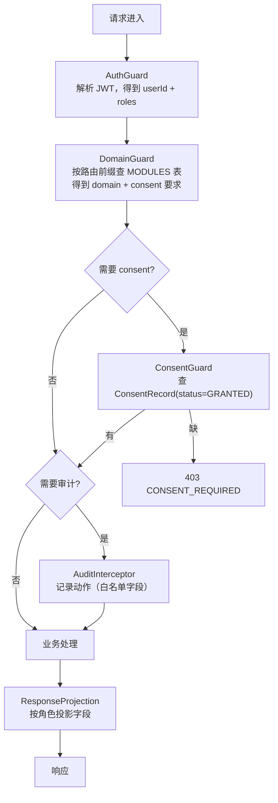
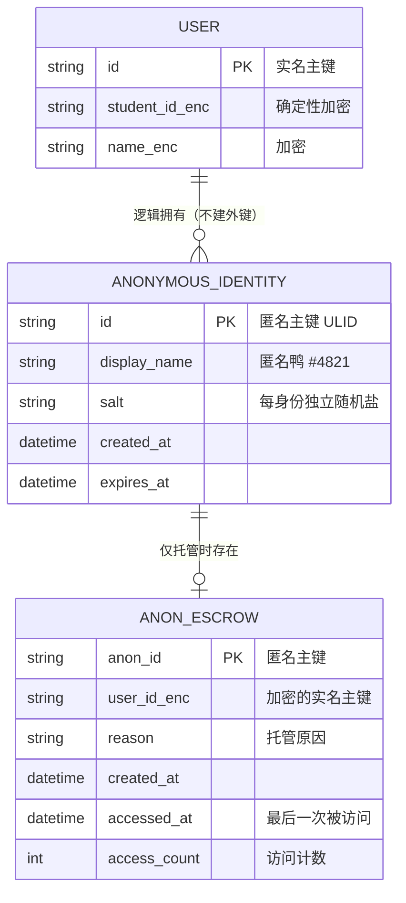
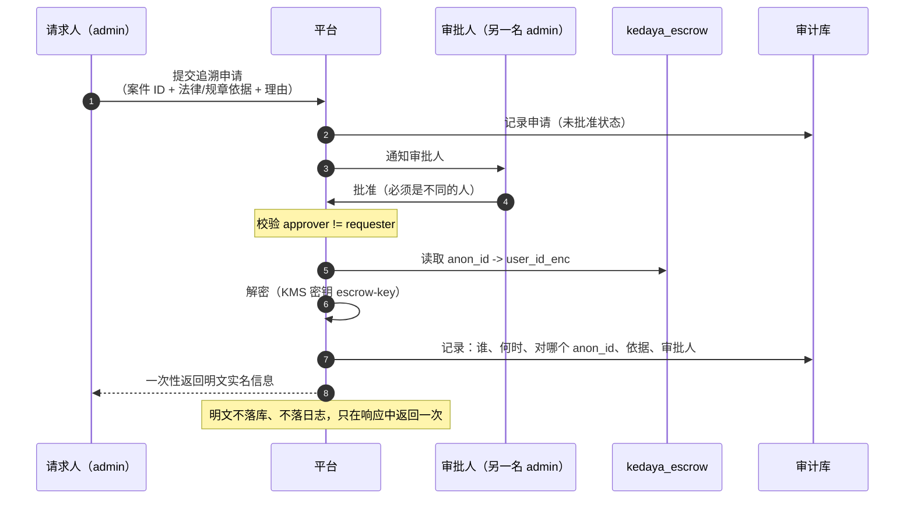
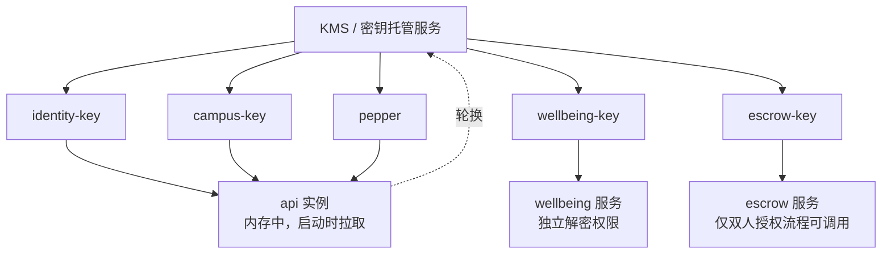
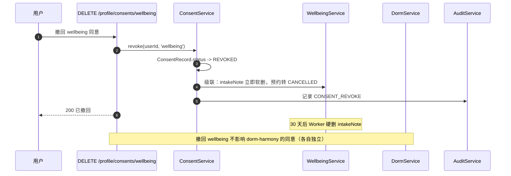
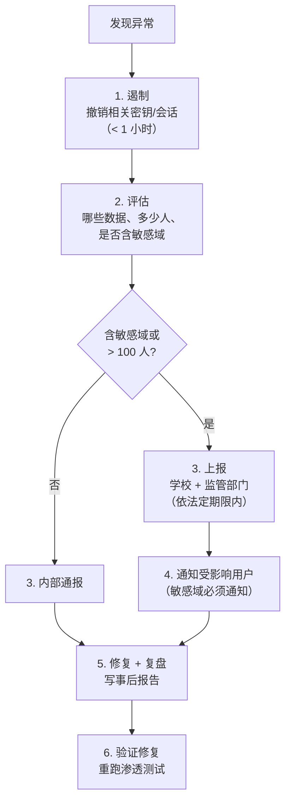

# 05 · 安全与隐私

> 上游真相来源：`docs/architecture/00-FROZEN-CONTRACT.md`（下称 **契约**）§5 §9。
> 本文把契约 §9 的 6 条规则变成可实现的机制。
> 领域实体见 [02-domain-model.md](./02-domain-model.md)；端点见 [03-api-contract.md](./03-api-contract.md)。

版本：`v1` · 2026-10-16

---

## 0. 一句话立场

**可达鸭处理的是学生的心理状态、宿舍矛盾、消费流水和身份凭证。这不是"以后再加安全"的系统。**

三条不可妥协的原则：

| # | 原则 | 违反的典型表现 |
| --- | --- | --- |
| P1 | **最小化**：能不知道就不知道 | 为了"以后可能有用"而记录心理预约的自由文本 |
| P2 | **隔离**：敏感域之间互不可见 | 用一条 SQL join 把画像和心理数据关联起来 |
| P3 | **可审计**：谁在何时看了什么，必须能回答 | 只有应用日志，没有独立审计表 |

---

## 1. 威胁模型（先明确敌手）

| 敌手 | 能力 | 主要目标 | 我们的对策 |
| --- | --- | --- | --- |
| 好奇的普通用户 | 只能调公开 API | 通过接口探测他人身份、宿舍号、是否在用心理服务 | 存在性预言机防护（§2.4）、字段投影、`NOT_FOUND` 不区分 |
| 恶意用户 | 有正常账号，可批量请求 | 枚举学号、刷举报、骚扰特定人 | 限流、幂等、举报阈值、`suspectHint` 前置校验 |
| 越权的调解员/版主 | 有 `mediator` / `moderator` 角色 | 查看与自己无关的敏感案件 | 案件级访问控制（§2.3）、全量审计、审计可被复核 |
| 内部运维 | 有数据库读权限 | 批量导出敏感数据 | 字段级加密（§5）、密钥分离（§5.3）、审计表 append-only |
| 外部攻击者 | 有网络访问 | 拖库、会话劫持 | 加密存储、短 TTL access token、refresh 轮换（§4） |
| 上游校园系统 | 被我们调用 | — | 我们**不**向上游发送超出必要的用户数据（§7.3） |

**明确的非目标**：我们不防御拥有主机 root 权限且有 KMS 密钥的攻击者。那种情况下没有任何应用层方案有效。我们的目标是让"单点泄漏"不等于"全量泄漏"。

---

## 2. 权限域划分

### 2.1 七个权限域（**冻结**）

| 域 ID | 中文 | 包含模块 | 敏感级 | 二次同意 | 审计 | 独立加密 |
| --- | --- | --- | --- | --- | --- | --- |
| `domain:identity` | 身份域 | `auth`, `profile` | 高 | **否**（登录即同意） | 是 | 是 |
| `domain:campus` | 校园域 | `schedule`, `campus-card` | 高 | **否**（开卡即同意） | 是 | 是 |
| `domain:platform` | 平台域 | `notifications` | 中 | 否 | 否 | 否 |
| `domain:trade` | 交易域 | `groupbuy`, `flea-market`, `errand`, `lost-found` | 低 | 否 | 否 | 否 |
| `domain:social` | 社交域 | `forum`, `buddy`, `techpie` | 中 | 否 | 部分（`forum` 治理动作） | 否 |
| `domain:civic` | 公共域 | `takeout-guard` | 中 | 否 | 是 | 否 |
| `domain:content` | 内容域 | `canteen`（**中**，见下方例外）、`faq`, `wildlife` | 低 | 否 | `canteen` 写操作 | 否 |
| `domain:protected` | 受保护域 | `dorm-harmony`, `ai-portrait` | **高** | **是** | 是 | 是 |
| `domain:wellbeing` | 心理域 | `wellbeing` | **最高** | **是** | 是 | 是（+ 应用层加密） |

> **`canteen` 的例外（2026-10-17，ADR 0006 D21）**：`canteen` 不再是纯「菜品营养表」。
> 营养管家在同模块内保存**每餐饮食记录**与**身体档案（性别/年龄/身高/体重）**，
> 这些是可推断健康状况的个人信息，因此该模块敏感级单独上调为**中**，
> 菜品写操作落审计（`canteen.dish.create/update/soft_delete`）。
> 仍不设二次同意门：不做医学判断、不对外共享、不上传体检数据。
> 若后续接入食堂/校医院数据，应重新评估是否升级为受保护域。

> **共 9 个权限域**：基础三域（`identity` / `campus` / `platform`）+ 业务四域（`trade` / `social` / `civic` / `content`）+ 受保护两域（`protected` / `wellbeing`）。
> 契约 §4 的 19 个模块**每个恰好属于一个域**，无遗漏、无重叠。

### 2.2 域到模块的映射（唯一真相）

```ts
// packages/contracts/src/modules.ts（形状示意，实际由 Lead 维护）
export const MODULES = {
  groupbuy:       { domain: 'trade',     sensitivity: 'low',      consent: false, audit: false },
  'takeout-guard':{ domain: 'civic',     sensitivity: 'medium',   consent: false, audit: true  },
  'flea-market':  { domain: 'trade',     sensitivity: 'low',      consent: false, audit: false },
  'dorm-harmony': { domain: 'protected', sensitivity: 'high',     consent: true,  audit: true  },
  errand:         { domain: 'trade',     sensitivity: 'low',      consent: false, audit: false },
  buddy:          { domain: 'social',    sensitivity: 'low',      consent: false, audit: false },
  'lost-found':   { domain: 'trade',     sensitivity: 'low',      consent: false, audit: false },
  canteen:        { domain: 'content',   sensitivity: 'medium',   consent: false, audit: true  },
  forum:          { domain: 'social',    sensitivity: 'medium',   consent: false, audit: true  },
  'ai-portrait':  { domain: 'protected', sensitivity: 'high',     consent: true,  audit: true  },
  wellbeing:      { domain: 'wellbeing', sensitivity: 'critical', consent: true,  audit: true  },
  faq:            { domain: 'content',   sensitivity: 'low',      consent: false, audit: false },
  techpie:        { domain: 'social',    sensitivity: 'medium',   consent: false, audit: false },
  wildlife:       { domain: 'content',   sensitivity: 'low',      consent: false, audit: false },
  auth:           { domain: 'identity',  sensitivity: 'high',     consent: false, audit: true  },
  schedule:       { domain: 'campus',    sensitivity: 'medium',   consent: false, audit: false },
  'campus-card':  { domain: 'campus',    sensitivity: 'high',     consent: false, audit: true  },
  profile:        { domain: 'identity',  sensitivity: 'medium',   consent: false, audit: false },
  notifications:  { domain: 'platform',  sensitivity: 'medium',   consent: false, audit: false },
} as const;
```

**判定 `consent` 的规则**（契约 §9 明确要求可测试，落在 `packages/contracts/src/modules.test.ts`）：

```
consent = (sensitivity === 'high' || sensitivity === 'critical')
          AND domain NOT IN ('identity', 'campus')
```

即：`auth` 与 `campus-card` 虽然 `sensitivity = high`，但因为登录/开卡本身即同意，**不设同意门**。`schedule` 是 `medium`，也不需要同意门（它依赖 `campus` 绑定，绑定动作本身即授权）。

### 2.3 域间访问控制



**跨域读写的显式拒绝表**（这是 P2 原则的落地）：

| 发起方 | 目标 | 允许 | 说明 |
| --- | --- | --- | --- |
| `ai-portrait` | `domain:wellbeing` | **拒绝** | 契约 §9：画像不得读取心理域 |
| `ai-portrait` | `domain:protected`（`dorm-harmony`） | **拒绝** | 契约 §9：画像不得读取宿舍矛盾域 |
| `ai-portrait` | `domain:trade` / `domain:content` / `domain:social` | 允许 | 白名单 |
| 任何域 | `campus-card.sessionCipher` | **拒绝** | 会话密文只在 `CampusSessionPort` 内部 |
| 任何域 | `auth.sessionCipher` | **拒绝** | 同上 |
| `notifications` | 任意域的**内容** | **拒绝** | 通知只拿"事件 + deepLink"，不拿正文 |
| `mediator` 角色 | 非本人案件 | **拒绝** | 案件级 ACL，见 §2.4 |

实现：`AiPortraitSourceGuard` 在**写入 `sourceDomains` 时**和**读取时**各校验一次。只校验一次是不够的——模块表可能被改。

### 2.4 案件级访问控制（`dorm-harmony` / `takeout-guard` / `wellbeing`）

域级 Guard 不够：同域内用户 A 也不能看用户 B 的案件。

| 模块 | 可见规则 |
| --- | --- |
| `dorm-harmony` | 申请人看自己的；调解员看 `mediatorId = self` 的；`admin` 看全部（**且落审计**） |
| `takeout-guard` | 举报人看自己的；被诉方看"被通知到的那个案件"的**受限视图**（无举报人身份）；`admin` 看全部 |
| `wellbeing` | 学生看自己的；`counselor` 看 `counselorId = self` 的**脱敏视图**；`admin` **不可见 `intakeNote`** |

**`admin` 也不能看 `intakeNote`**：这是刻意的。心理记录的自由文本只有被指派的咨询师能读，连平台管理员都不行。需要时走线下流程。

**存在性预言机防护**：越权访问一律返回 `404 NOT_FOUND`，不返回 `403`。否则攻击者可以区分"这条记录不存在"和"这条记录存在但你没权限"，从而枚举案件数量。

---

## 3. 角色与最小权限

### 3.1 角色定义

| 角色 | 授予方式 | 能做什么 | 不能做什么 |
| --- | --- | --- | --- |
| `user` | 默认 | 全部低敏模块 | 任何治理动作 |
| `mediator` | 人工授予（学工/宿管） | 被指派的 `dorm-harmony` 案件 | 看别人的案件；看心理数据 |
| `moderator` | 人工授予 | `forum` 的锁定/隐藏/删帖 | 看匿名作者的真实身份（需走 §4.4 流程） |
| `counselor` | 人工授予（心理中心） | 被指派的 `wellbeing` 预约的脱敏视图 | 看画像、看宿舍矛盾、导出数据 |
| `admin` | 极少 | 平台配置、审计查询 | **看 `intakeNote`**；改审计日志 |

**一个人可以同时有多个角色**（`roles: string[]`）。角色变更必须落审计。

### 3.2 角色的二次校验

管理后台（`apps/web` 的 `(admin)`）的鉴权必须在**两个地方**都做：

```ts
// 1. middleware.ts —— 拦掉绝大多数
// 2. 每个 Server Action 内部 —— 因为 middleware 历史上出过绕过漏洞
async function assertRole(required: Role[]) {
  const session = await getSession();          // 从 httpOnly cookie 解出
  if (!session) throw new ApiError('UNAUTHENTICATED');
  if (!required.some(r => session.roles.includes(r))) throw new ApiError('FORBIDDEN');
}
```

**理由**：Next.js middleware 的鉴权绕过是一个反复出现的漏洞类别。不把 middleware 当作唯一防线。

---

## 4. 匿名身份与实名身份的存储解耦

契约 §9：`forum` / `dorm-harmony` / `takeout-guard` 支持匿名身份，**与实名身份解耦存储**。

### 4.1 三张表，两个库



**关键点：`AnonymousIdentity` 表里没有 `userId` 列，也没有指向 `User` 的外键。**

这是"解耦存储"的具体含义。业务表（`ForumPost.authorId`、`DormCase.applicantId`、`TakeoutReport.reporterId`）在匿名时存的是 `AnonymousIdentity.id`，**通过外键只能到匿名表，走不到实名**。

### 4.2 匿名身份的创建

```ts
// 伪代码
function createAnonymousIdentity(userId: string): AnonymousIdentity {
  const salt = crypto.randomBytes(16);                      // 每身份独立
  const seq  = hashToFourDigits(userId, salt);              // 稳定但不含实名线索
  return {
    id: ulid(),
    displayName: `匿名鸭 #${seq}`,
    salt,
    // 注意：这里【不写】任何指向 userId 的列
  };
}
```

`hashToFourDigits` 是**单向**的：给定 `displayName` 无法反推 `userId`。但同一用户在同一匿名身份下始终显示同一昵称（因为 `salt` 固定）。

**用户可以拥有多个匿名身份吗？**

| 模块 | 策略 |
| --- | --- |
| `forum` | 每用户最多 3 个匿名身份，让用户在不同话题里用不同身份 |
| `dorm-harmony` | **每案件一个**匿名身份，案件之间不可关联 |
| `takeout-guard` | 每报告一个，避免"这个人举报过 5 次"被识别 |

### 4.3 匿名数据的存储隔离

| 数据 | 存放库 | 说明 |
| --- | --- | --- |
| `AnonymousIdentity` | `kedaya_anon`（独立库） | 与业务库物理分离 |
| 匿名帖子/案件内容 | `kedaya_anon` | 内容与匿名身份同库 |
| `User` / `Profile` | `kedaya_main` | 实名数据 |
| `AnonEscrow` | `kedaya_escrow`（**第三个库**） | 唯一能连接匿名与实名的地方 |
| `AuditLog` | `kedaya_audit`（append-only） | 第四个库 |

**跨库查询在应用层禁止**：三个库用不同的数据库账号，`kedaya_main` 的账号**没有** `kedaya_escrow` 的读权限。这是物理隔离，不是"约定不查"。

### 4.4 托管表（`AnonEscrow`）：唯一但受控的连接点

为什么需要它？因为**存在合法的追溯需求**：

| 场景 | 是否需要追溯 | 处理 |
| --- | --- | --- |
| 匿名用户发布违法内容，需要移交学校 | 是 | 走 §4.5 流程 |
| 匿名用户申请删除自己的数据（PIPL 权利） | 是 | 用户主动触发，无需审批 |
| 调解员想"看看这人是谁" | **否** | 明确拒绝，无任何接口支持 |
| 平台想做用户画像 | **否** | 画像 Guard 硬拒绝匿名数据 |
| 匿名用户自己申诉"这条不是我发的" | 是 | 走 §4.5 流程 |

**托管记录的写入时机**：创建匿名身份时**同时**写入 `AnonEscrow`（而不是"需要时才写"）。理由：如果按需写入，那"写入了"本身就是信号，而且按需写入需要一个能连接两库的服务，那个服务就成了常驻风险点。预先写入 + 严格访问控制更简单。

### 4.5 追溯的双人授权流程



**硬规则**

| # | 规则 |
| --- | --- |
| 1 | 申请人 ≠ 审批人（代码校验，不是流程约定） |
| 2 | 每次访问递增 `access_count` 并更新 `accessed_at` |
| 3 | `access_count > 3` 的匿名身份自动告警（异常高频追溯） |
| 4 | 追溯结果**只返回一次**，不缓存、不落库 |
| 5 | 用户主动的删除请求走**独立路径**，不需要双人审批（是用户自己的权利） |

---

## 5. 敏感数据加密

### 5.1 字段级加密清单

| 表 | 字段 | 加密方式 | 密钥 | 为什么 |
| --- | --- | --- | --- | --- |
| `User` | `studentId` | **确定性** AES-SIV | `identity-key` | 需要按学号查重，所以必须确定性 |
| `User` | `name` | 随机化 AES-256-GCM | `identity-key` | 不需要查询 |
| `User` | `email` | 随机化 AES-256-GCM | `identity-key` | |
| `CampusBinding` | `sessionCipher` | 随机化 AES-256-GCM | `campus-key` | 校园会话凭证 |
| `CampusCard` | `cardNo` | **确定性** AES-SIV | `campus-key` | 需要按卡号去重；**响应中只返回掩码** |
| `PaymentCode` | `payload` | 随机化 AES-256-GCM | `campus-key` | 一次性、60s TTL |
| `WellbeingAppointment` | `intakeNote` | 随机化 AES-256-GCM | **`wellbeing-key`** | 最高敏感，独立密钥 |
| `WellbeingAssessment` | `answers` | 随机化 AES-256-GCM | `wellbeing-key` | 量表作答可推断健康状况 |
| `TechpieLink` | `tokenCipher` | 随机化 AES-256-GCM | `campus-key` | 第三方 token |
| `AnonEscrow` | `userId` | 随机化 AES-256-GCM | **`escrow-key`** | 匿名-实名连接点 |

### 5.2 为什么区分"确定性"与"随机化"

| 类型 | 能查等值 | 泄漏面 | 用在哪 |
| --- | --- | --- | --- |
| 确定性（AES-SIV） | 是 | 相同明文 → 相同密文，可被频率分析 | 必须查重/查等值的字段（学号、卡号） |
| 随机化（AES-GCM） | 否 | 每次密文不同 | 其余全部 |

**代价要诚实说明**：确定性加密的 `studentId` 可以被"已知学号字典"攻击（学号是可枚举的：年份 + 院系 + 序号）。缓解措施：

1. 数据库账号无直接读权限，必须经应用层。
2. 加盐：`AES-SIV(key, studentId || globalPepper)`，`pepper` 在 KMS，不在库里。
3. 速率限制：任何按学号查询的接口都有严格限流。

### 5.3 密钥管理



| 规则 | 说明 |
| --- | --- |
| 密钥不进代码库、不进环境变量明文 | 通过 KMS SDK 在启动时拉取到内存 |
| `wellbeing-key` 与 `escrow-key` 只授予对应服务 | 即使 API 被攻破，拿不到心理数据与匿名映射 |
| 密钥轮换 | 每年一次 + 疑似泄漏时立即；轮换后旧密文惰性重加密 |
| 密钥版本随密文存储 | 密文格式：`v<keyVersion>:<nonce>:<ciphertext>` |

### 5.4 传输与静态加密

| 层 | 措施 |
| --- | --- |
| 传输 | TLS 1.3 强制；HSTS；证书固定（移动端可选） |
| 数据库静态 | 云盘加密（透明） + 上述字段级加密（不透明，防 DBA） |
| 备份 | 加密备份；恢复演练每季度一次 |
| 对象存储 | 服务端加密 + 私有桶 + 预签名 URL（TTL 5 分钟） |
| 日志 | 结构化日志，敏感字段在写入前脱敏（§6.3） |

---

## 6. 审计日志

契约 §9：敏感模块读写全部落审计（谁、何时、对哪条记录、什么动作）。

### 6.1 表结构

| 字段 | 类型 | 必填 | 说明 |
| --- | --- | --- | --- |
| `id` | `string(ulid)` | 是 | |
| `occurredAt` | `string(iso)` | 是 | 毫秒精度 |
| `actorId` | `string(ulid)` | 是 | 操作者。系统操作填 `system` |
| `actorRoles` | `string[]` | 是 | 当时的角色快照（**角色变更后仍能还原当时权限**） |
| `actorIpHash` | `string` | 否 | IP 的 HMAC，不存明文 IP |
| `actorUserAgent` | `string` | 否 | 截断到 256 字符 |
| `action` | `enum` | 是 | 见 §6.2 |
| `moduleId` | `string` | 是 | 19 个模块 ID 之一 |
| `domain` | `string` | 是 | 权限域 |
| `targetType` | `string` | 是 | 实体类型，如 `DormCase` |
| `targetId` | `string` | 是 | 实体 ID |
| `targetOwnerId` | `string` | 否 | 目标归属者。匿名时为 `AnonymousIdentity.id` |
| `outcome` | `enum<SUCCESS\|DENIED\|ERROR>` | 是 | |
| `reason` | `string` | 否 | `DENIED` 时必填，如 `NOT_CASE_MEDIATOR` |
| `traceId` | `string` | 是 | 与响应体的 `traceId` 一致 |
| `fieldAccess` | `string[]` | 否 | **读取**了哪些敏感字段（字段名，非值） |
| `diffSummary` | `json` | 否 | **仅非敏感字段**的变更摘要 |
| `escrowApprovalId` | `string` | 否 | 追溯操作时指向双人审批记录 |

### 6.2 必须审计的动作

| `action` | 触发点 |
| --- | --- |
| `READ` | 敏感模块的详情读取（**列表读取按批次记一条**，避免日志爆炸） |
| `CREATE` / `UPDATE` / `DELETE` | 敏感模块的写操作 |
| `EXPORT` | 任何数据导出 |
| `CONSENT_GRANT` / `CONSENT_REVOKE` | 同意记录变更 |
| `ROLE_CHANGE` | 角色授予/撤销 |
| `ESCROW_ACCESS` | 匿名-实名追溯 |
| `MEDIATOR_ASSIGN` | 调解员指派 |
| `MODERATE` | 版主锁定/隐藏/删帖 |
| `LOGIN` / `LOGOUT` / `LOGIN_FAILED` | 身份事件 |
| `PAYMENT_CODE_ISSUE` / `PAYMENT_CODE_REVOKE` | 付款码（**只记动作，不记码值**） |

### 6.3 绝对不进审计的内容

| 内容 | 理由 |
| --- | --- |
| `WellbeingAppointment.intakeNote` 正文 | 最高敏感；审计可被运维读取 |
| `WellbeingAssessment.answers` 具体作答 | 同上 |
| 付款码 `payload` | 凭证 |
| 校园会话 `sessionCipher` / CASTGC | 凭证 |
| 密码、token、refresh token | 凭证 |
| 匿名身份到实名的映射结果 | 只在 `ESCROW_ACCESS` 里记"访问了哪个 anon_id"，不记结果 |
| 用户 IP 明文 | 只存 HMAC |

**实现方式**：`AuditInterceptor` 使用**字段白名单**（默认拒绝），不是黑名单。新增实体时如果不显式声明可审计字段，就不会被记录。

### 6.4 审计表的不可变性

```sql
-- 应用账号只有 INSERT 和 SELECT，没有 UPDATE / DELETE
GRANT INSERT, SELECT ON kedaya_audit.audit_log TO kedaya_api;
REVOKE UPDATE, DELETE ON kedaya_audit.audit_log FROM kedaya_api;
```

| 措施 | 说明 |
| --- | --- |
| append-only 权限 | 应用层无法篡改 |
| 分区表按月 | 便于归档与查询 |
| 保留期 | 普通审计 2 年；`wellbeing` / `dorm-harmony` 审计 5 年（合规需要） |
| 归档 | 超期后转冷存储，仍不可改 |
| 校验 | 每条记录存 `prevHash`，形成哈希链；每日校验一次 |

**哈希链**：`hash = SHA256(prevHash || 本条规范化 JSON)`。这样删改任意一条都会被发现。这是"运维也不能悄悄改审计"的唯一有效手段。

### 6.5 审计的查询接口

| 端点 | 角色 | 说明 |
| --- | --- | --- |
| `GET /api/v1/admin/audit?module=&actor=&from=&to=` | `admin` | 游标分页查询 |
| `GET /api/v1/admin/audit/target/:type/:id` | `admin` | 某条记录的全部访问历史 |
| `GET /api/v1/admin/audit/me` | 任何登录用户 | **我自己的数据被谁访问过** |

**`/audit/me` 是刻意提供的**：学生有权知道自己被谁看过。这是对内部人员最有效的约束。

---

## 7. 数据保留与删除

### 7.1 保留期表

| 数据 | 保留期 | 到期动作 | 依据 |
| --- | --- | --- | --- |
| `User` 账号 | 账号存续期 + 注销后 30 天 | 匿名化（保留 ID，清空 `studentId`/`name`/`email`） | 用户权利 + 业务连续性 |
| `RefreshToken` | 30 天 | 硬删 | 无价值 |
| `CampusBinding` | 解绑即删密文 | 硬删 `sessionCipher` | 凭证 |
| `WellbeingAppointment` | 完成/取消后 **1 年** | 硬删（含 `intakeNote`） | 医疗类数据最小保留 |
| `WellbeingAssessment` | 提交后 **1 年** | 硬删 | 同上 |
| `DormCase` + 消息 | 结案后 **2 年** | 匿名化（清空正文，保留统计） | 校园纠纷处理需要 |
| `TakeoutReport` | 结案后 **1 年** | 匿名化 | 信用记录参考期 |
| `AiPortraitProfile` | 关闭即删；未关闭时 30 天 `STALE` | 硬删 | 契约 §9：可关闭可删除 |
| `ConsentRecord` | **永久**（账号注销后转匿名保留） | 不删 | 举证需要 |
| `ForumPost` / `Reply` | 删除后 30 天 | 硬删 | 允许误删恢复 |
| `Notification` | 90 天 | 硬删 | 无长期价值 |
| `CardTransaction` | **3 年** | 硬删 | 财务记录 |
| `PaymentCode` | 24 小时 | 硬删 | 凭证 |
| `AuditLog` | 2 年 / 敏感域 5 年 | 转冷存储 | 合规 |
| `IdempotencyRecord` | 24 小时 | 硬删 | 无价值 |
| 对象存储图片 | 随所属实体删除，**延迟 30 天** | 硬删 | 允许恢复 |

**实现**：所有保留期由 `services/api/src/platform/retention/retention-policy.ts` 声明式定义，Worker 每日执行一次。**新增实体必须在该文件登记**，否则 CI 失败。

### 7.2 用户的数据权利

| 权利 | 实现 | 端点 |
| --- | --- | --- |
| 访问 | 导出我全部数据的 JSON | `GET /api/v1/profile/export` |
| 更正 | 资料可改；学号/姓名以学校为准，不可改 | `PATCH /api/v1/profile` |
| 删除 | 注销账号，30 天后匿名化 | `POST /api/v1/profile/delete-account` |
| 撤回同意 | 逐模块撤回 | `DELETE /api/v1/profile/consents/:module` |
| 可携带 | 导出为 JSON（机器可读） | 同"访问" |

**撤回同意的级联**（必须原子）：



### 7.3 数据出境与上游共享

| 场景 | 是否发生 | 说明 |
| --- | --- | --- |
| 数据出境 | **否** | 全部数据存于境内；不接境外 SaaS |
| 向学校共享 | 仅限"追溯流程" | 且需双人授权 + 审计 |
| 向上游校园系统发送 | 仅发送认证所需 | 绑定校园系统时只发学号 + 凭证，**不发**我们的 userId、画像、行为数据 |
| 向 LLM 服务发送 | 仅在 `ai-portrait` 开启时 | 只发**脱敏后的标签**，不发原文、不发 `userId` |
| 向第三方 SDK 发送 | 最小化 | 详见 §8.4 |

**LLM 的具体约束**：`ai-portrait` 调用 LLM 时，payload 里只有形如 `["electronics", "bike", "study"]` 的标签与权重，**没有任何可识别个人的信息**。且 LLM 响应只用于生成标签，不做自由文本生成。

---

## 8. 应用层安全

### 8.1 认证

| 项 | 值 |
| --- | --- |
| Access token | JWT，**ES256** 签名，TTL 15 分钟 |
| Refresh token | 不透明随机串，TTL 30 天，**一次性轮换** |
| 轮换检测 | 已轮换的 refresh 被再次使用 → 判定为盗用，**撤销该用户全部 refresh** |
| 存储（客户端） | Flutter：Keychain/Keystore；小程序：`Taro.setStorageSync`（沙箱）；Web：httpOnly + Secure + SameSite=Lax cookie |
| JWT 载荷 | 只有 `sub`(userId)、`roles`、`iat`、`exp`、`jti`。**不含**学号、姓名、院系 |

**JWT 里不放学号姓名**是刻意的：JWT 会被客户端读取、可能被日志记录、可能被 CDN 缓存。`profile` 接口按需返回。

### 8.2 授权

见 §2。要点重申：

1. 域 Guard 是**默认拒绝**：路由没有在 `MODULES` 表里登记 → 直接 500（开发期）而不是放行。
2. 角色 Guard 在 Server Action / Controller 内部二次校验。
3. 资源级 ACL 对敏感模块是**必须的**，不是可选的。

### 8.3 输入校验与输出编码

| 风险 | 措施 |
| --- | --- |
| 注入 | Prisma 参数化查询；**禁止** `$queryRawUnsafe`（lint 规则） |
| XSS | `forum` 的 Markdown 子集白名单渲染；Web 端不用 `dangerouslySetInnerHTML` 除非经过 sanitizer |
| SSRF | 服务端不接收用户提供的 URL 去 fetch（`techpie` 的对端地址是配置，不是用户输入） |
| 文件上传 | 白名单 MIME + 大小上限（图片 5MB）+ 魔数校验 + 重编码剥离 EXIF |
| 敏感词 | 同步检查 + 不回显命中词（见 [03-api-contract.md](./03-api-contract.md) §7.4） |
| 学号/证件号泄漏 | `lost-found` / `takeout-guard` 的正文前置正则校验，拒绝含 18 位身份证、银行卡号 |

**EXIF 剥离是必须的**：用户上传的失物照片可能带 GPS 坐标，直接发布等于泄漏宿舍位置。

### 8.4 第三方 SDK 与追踪

| SDK | 用途 | 数据 | 可否关闭 |
| --- | --- | --- | --- |
| 微信 JS-SDK | 分享、订阅消息 | openid（微信侧） | 否（主端必需） |
| 地图 SDK | `wildlife` / `lost-found` 位置 | 位置坐标 | 是（不授权则只显示文字地点） |
| 崩溃上报 | 稳定性 | 堆栈、设备型号、`traceId` | 是 |
| 产品埋点 | 功能改进 | 事件名 + 匿名 ID，**不含内容** | 是（`PrivacySetting.allowAnalytics`） |

**没有广告 SDK、没有行为追踪 SDK。** 这是产品定位决定的：校园服务不需要变现，引入广告 SDK 会把隐私风险从"可控"变成"不可控"。

### 8.5 限流与反滥用

| 维度 | 实现 |
| --- | --- |
| 按用户 | Redis 滑动窗口，按"路由桶"计数（桶定义在 `@kedaya/contracts`） |
| 按 IP | 仅用于未登录端点（登录、`faq`、`wildlife` 列表） |
| 按资源 | 如"同一拼单 1 分钟最多 30 次参团尝试" |
| 登录失败 | 5 次失败后指数退避，**不锁定账号**（防 DoS） |
| 举报 | 同一用户对同一目标只能举报一次；24 小时最多 20 次举报 |

**登录失败不锁定账号**：锁定账号是经典的拒绝服务放大器——攻击者可以用错密码把任意用户锁在外面。

---

## 9. 合规检查清单

> **重要免责声明**：以下清单是**工程自查**，不构成法律意见。上线前必须由学校法务/合规部门复核。未决问题见 §11。

### 9.1 《个人信息保护法》(PIPL) 对齐

| 条款 | 要求 | 我们的实现 | 状态 |
| --- | --- | --- | --- |
| 第 13 条 | 处理个人信息需有合法性基础 | 同意（敏感模块）+ 合同必要（登录/服务提供） | 已设计 |
| 第 14 条 | 同意需自愿、明确 | 敏感模块独立同意页，非默认勾选 | 已设计 |
| 第 15 条 | 可撤回同意 | `DELETE /profile/consents/:module` + 级联清理 | 已设计 |
| 第 17 条 | 告知处理目的、方式、种类、期限 | 同意页必须列出这四项 | **待写文案** |
| 第 24 条 | 自动化决策需透明、可拒绝 | `ai-portrait` 默认关闭、可解释、可关闭 | 已设计 |
| 第 28 条 | 敏感个人信息需单独同意 + 告知必要性 | `wellbeing`（健康）、`dorm-harmony` 单独同意 | 已设计 |
| 第 30 条 | 敏感信息需告知对个人权益的影响 | 同意页必须写明 | **待写文案** |
| 第 45 条 | 查阅、复制、可携带 | `GET /profile/export` | 已设计 |
| 第 47 条 | 删除权 | 注销 + 保留期表 | 已设计 |
| 第 51 条 | 安全措施（加密、去标识化、审计） | §5 §6 | 已设计 |
| 第 55 条 | 处理敏感信息需事前影响评估 (PIA) | **未做** | **待办** |
| 第 56 条 | PIA 报告需保存 3 年 | **未做** | **待办** |

### 9.2 《数据安全法》与《网络安全法》

| 要求 | 实现 | 状态 |
| --- | --- | --- |
| 数据分类分级 | §2.1 的九域三级 | 已设计 |
| 日志留存 ≥ 6 个月 | 审计 2 年 / 敏感域 5 年 | 已设计 |
| 等级保护备案 | **未做** | **待办**（若部署在校内网，可能要求等保二级） |
| 数据出境评估 | 无出境 | 不适用 |

### 9.3 微信小程序平台合规

| 要求 | 实现 | 状态 |
| --- | --- | --- |
| 用户隐私保护指引（小程序后台填写） | 需与 §9.1 的告知一致 | **待办** |
| 不得诱导分享 | 分享入口不强制、不奖励 | 已设计 |
| 不得收集与服务无关的信息 | 最小化原则 | 已设计 |
| 类目资质 | 心理服务、二手交易可能需特定类目 | **待办，需核实** |
| 内容安全（`security.msgSecCheck`） | `forum` / `flea-market` 接入 | 已设计 |

### 9.4 校园场景的额外要求

| 要求 | 实现 | 状态 |
| --- | --- | --- |
| 不冒充学校官方 | 全站显著标注"第三方非官方平台" | 已设计（见 [01-overview.md](./01-overview.md) §3） |
| 校园系统凭证不落客户端 | `CampusSessionPort` 仅服务端 | 已设计 |
| 不违反学校网络使用规定 | **需与信息办确认** | **待办** |
| 心理服务的资质与转介责任 | **需与心理中心确认** | **待办** |
| 二手交易的纠纷处理责任 | 需在用户协议中明确平台免责范围 | **待办** |

### 9.5 上线前必须完成的门禁

| # | 门禁 | 责任方 | 状态 |
| --- | --- | --- | --- |
| G1 | 隐私政策与用户协议文案完成并法务复核 | 待定 | **未完成** |
| G2 | 敏感模块同意页文案（含 §9.1 第 17/30 条要求） | 待定 | **未完成** |
| G3 | 个人信息保护影响评估 (PIA) 报告 | 待定 | **未完成** |
| G4 | 微信小程序类目资质确认 | 待定 | **未完成** |
| G5 | 与学校信息办/心理中心的沟通结论 | 待定 | **未完成** |
| G6 | 渗透测试（至少覆盖越权与 IDOR） | 待定 | **未完成** |
| G7 | 数据恢复演练 | 待定 | **未完成** |
| G8 | 品牌与 IP 风险处理（见 [../adr/0005-brand-and-ip.md](../adr/0005-brand-and-ip.md)） | 待定 | **未完成** |

---

## 10. 安全开发流程

| 环节 | 措施 |
| --- | --- |
| 代码评审 | 涉及敏感模块的 PR 需要至少两人 review，其中一人是模块 owner |
| 静态检查 | ESLint 规则：禁 `$queryRawUnsafe`、禁字面量色值、禁 `presentation` 直接 import `data/api` |
| 依赖扫描 | `npm audit` + Dependabot，高危 7 天内修 |
| 密钥扫描 | pre-commit hook 阻止疑似密钥提交 |
| 架构测试 | 域隔离、审计白名单、保留期登记的自动化测试 |
| 渗透测试 | 每个大版本前一次，重点 IDOR 与越权 |
| 事故响应 | 见 §10.1 |

### 10.1 数据泄漏响应预案



**必须记录的时间线**：发现时间、遏制时间、评估完成时间、上报时间、用户通知时间。这些时间是合规要求的一部分。

---

## 11. 本文档未决问题

| # | 问题 | 严重性 | 需要谁决定 |
| --- | --- | --- | --- |
| S1 | PIA（个人信息保护影响评估）报告无人负责 | **高** | 需 Lead 指派 |
| S2 | 隐私政策、用户协议、同意页文案均未编写 | **高** | 需法务 + 产品 |
| S3 | 微信小程序类目资质（心理服务 / 二手交易）是否可获批未知 | **高** | 需核实微信规则 |
| S4 | `wellbeing` 是否属于"医疗服务"（涉及资质）未确认 | **高** | 需心理中心 + 法务 |
| S5 | 双人审批流程的"审批人"从哪来（只有一名 admin 时流程会死锁） | 中 | 建议至少 2 名 admin，或引入学校侧审批人 |
| S6 | 哈希链审计的校验失败时如何处理（是停服还是告警）未定 | 中 | 建议告警 + 人工介入，不停服 |
| S7 | 学号的确定性加密在"已知学号字典"下的实际风险未量化 | 中 | 建议做一次专项评估 |
| S8 | 对象存储的图片是否要做"人脸/人像"检测（失物照片可能含他人） | 中 | 建议 M2 前评估 |
| S9 | 等保备案是否必需（取决于部署位置）未确认 | 中 | 需与信息办确认 |
| S10 | 契约 §9 提到"未成年人/危机"，但本项目用户为大学生（成年人），未成年人场景是否需要覆盖未明确 | 低 | 建议明确"不面向未成年人"，并在协议中声明 |
| S11 | `domain:protected` 的 `takeout-guard` 是否也应设同意门？契约未列，当前按"否"实现 | 低 | 需 Lead 确认 |
| S12 | 审计日志的 `fieldAccess` 粒度（字段名 vs 字段组）未定 | 低 | 建议字段组，降低日志量 |
