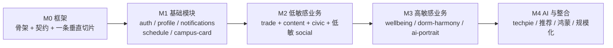
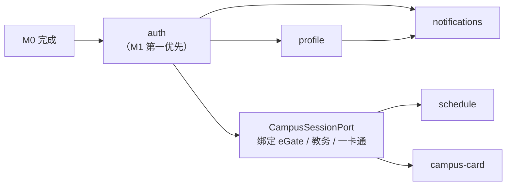
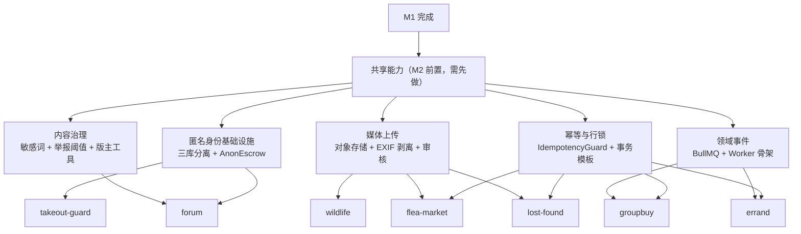
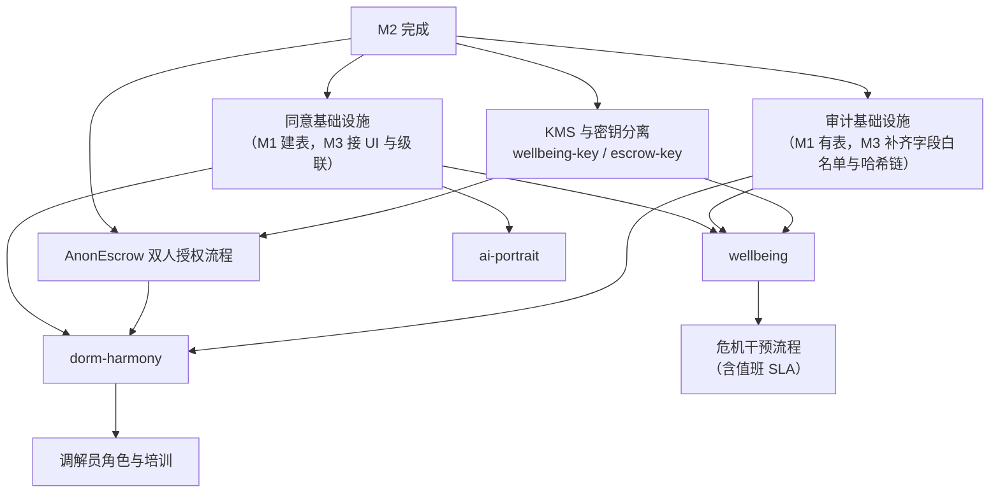
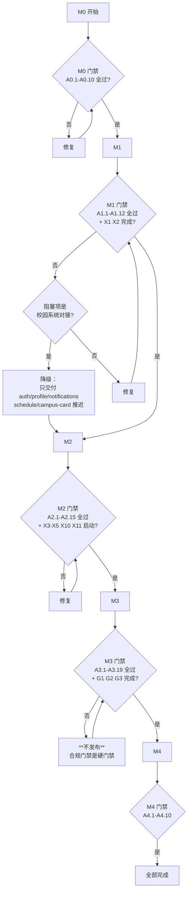

# 06 · 分期路线图

> 上游真相来源：`docs/architecture/00-FROZEN-CONTRACT.md`（下称 **契约**）§4 §10。
> 本文把 19 个模块分配到 M0–M4 五个里程碑，每期给出**范围 / 依赖 / 验收标准 / 风险**。
> 模块定义见 [02-domain-model.md](./02-domain-model.md)；合规门禁见 [05-security-privacy.md](./05-security-privacy.md) §9.5。

版本：`v1` · 2026-10-16

---

## 0. 路线图总览

| 里程碑 | 主题 | 模块数 | 核心风险 | 完成判据（一句话） |
| --- | --- | --- | --- | --- |
| **M0** | 框架 | 0（1 条切片） | 契约漂移 | 三端 + 后端能跑通一条真实链路 |
| **M1** | 基础模块 | 5 | 校园系统对接不确定 | 能登录、能看课表、能看余额 |
| **M2** | 低敏感业务 | 11 | 内容治理与合规 | 主端日活可用，无重大内容事故 |
| **M3** | 高敏感业务 | 3 | **合规与伦理** | 敏感模块上线且通过合规门禁 |
| **M4** | AI 与整合 | 0（增强 + `techpie`） | 依赖外部方 | 与 GeekPie 互通、推荐生效、鸿蒙覆盖 |

**排序原则**（为什么是这个顺序）：

| # | 原则 | 体现 |
| --- | --- | --- |
| 1 | **先打通链路再堆功能** | M0 只有一条垂直切片，但它穿过了所有层 |
| 2 | **基础模块是全部业务的前置** | M1 的 `auth` 不完成，M2 的任何模块都无从做起 |
| 3 | **敏感模块最后做，因为合规最慢** | M3 的合规门禁（PIA、法务、资质）需要最长提前期，**但必须在 M1 期间就开始推进**（见 §6） |
| 4 | **AI 依赖数据积累** | M4 的画像需要 M2 的行为数据，提前做没有输入 |
| 5 | **外部依赖单独一期** | `techpie` 的进度不由我们控制，不能阻塞主线 |

---

## 1. M0 · 框架

### 1.1 范围

| 交付物 | 具体内容 | 归属 |
| --- | --- | --- |
| 仓库骨架 | npm workspaces + Turborepo 2.11.8 + `tsconfig.base.json` | Lead |
| `@kedaya/contracts` | `ApiEnvelope` / `ApiError` / `ApiErrorCode` / `Page<T>` / `ApiRequest` / 19 模块表 | Lead |
| `@kedaya/design-tokens` | `tokens.ts` + 生成 `tokens.css` / `tokens.scss` / `kedaya_tokens.dart` | Lead |
| `@kedaya/shared` | `fenToYuan` / `yuanToFen` / `formatRelativeTime` / `isShanghaiTechEmail` / `assertNever` / `slugify` | Lead |
| 后端骨架 | NestJS 12 装配 + 响应信封拦截器 + 错误过滤器 + Prisma 连接 + `/health` | 工作流 E |
| 三端骨架 | 各自的分层目录 + 一个能渲染的页面 + mock adapter | 工作流 B/C/D |
| **一条垂直切片** | `faq` 的列表与详情，**穿过全部层**（presentation → application → domain ← data → API → DB） | 三端 + 后端 |
| CI | `npm install` / `npx tsc -b` / `npm run build -w <app>` / `npm run test -w <app>` 全绿 | Lead |

**为什么切片选 `faq`**：它是最简单的模块（无状态机、无交易、无敏感数据），但完整穿过所有层。用最便宜的模块验证架构，而不是用最贵的。

### 1.2 依赖

| 依赖 | 说明 |
| --- | --- |
| 无内部依赖 | M0 是起点 |
| 外部 | npm registry 可达；PostgreSQL 16 + Redis 7 可起（本地 Docker 即可） |

### 1.3 验收标准

| # | 标准 | 验证方式 |
| --- | --- | --- |
| A0.1 | `npm install` 在干净 clone 上成功，workspace 链接正确 | 在 CI 的干净容器里跑 |
| A0.2 | `npx tsc -b` 零错误，覆盖全部 TS 包 | CI |
| A0.3 | 三端各自 `npm run build -w <app>` 成功 | CI |
| A0.4 | 三端各自 `npm run test -w <app>` 通过（至少 1 个真实测试） | CI |
| A0.5 | `faq` 切片在**三个端**都能看到真实后端返回的数据 | 手工验证 + 截图 |
| A0.6 | 设计令牌三端产物存在且值一致（同一 token 在 CSS/SCSS/Dart 里数值相同） | 自动比对脚本 |
| A0.7 | 后端 `/api/v1/faq/items` 返回合法 `ApiEnvelope`，`traceId` 非空 | curl |
| A0.8 | 启动时序：三端冷启动不阻塞网络（埋点或测试证明） | 各自的架构测试 |
| A0.9 | 每个 feature 目录有 `README.md` | CI 检查 |
| A0.10 | `data/mock/` 存在且被至少一个测试引用 | CI 检查 |

### 1.4 风险

| 风险 | 概率 | 影响 | 缓解 |
| --- | --- | --- | --- |
| 契约在实现过程中被发现缺陷 | 高 | 三端返工 | 契约冻结，缺陷写进交付说明由 Lead 统一修订；**不允许**各自改 |
| Flutter 鸿蒙 SDK 环境搭建失败 | 中 | `apps/mobile` 阻塞 | M0 只要求 iOS/Android 可构建，鸿蒙推迟到 M4 |
| 设计令牌生成器与三端消费方式不匹配 | 中 | 返工 | M0 就用真实产物构建，不用占位符 |
| 微信小程序开发者账号未就绪 | 中 | 主端无法真机验证 | 提前申请；M0 用 H5 模式验证 |

---

## 2. M1 · 基础模块

### 2.1 范围

契约 §4.2 的 5 个基础模块，**全部**：

| 模块 | M1 交付内容 | 不做 |
| --- | --- | --- |
| `auth` | CAS 登录、JWT 签发与轮换、登出、`CampusBinding` 绑定/解绑/自动续期 | 第三方登录（微信以外） |
| `profile` | 资料读写、隐私开关、`ConsentRecord` 的**基础设施**（同意页在 M3 接） | 数据导出（M2 补） |
| `notifications` | 站内信、未读数、小程序订阅消息通道、APNs/FCM 通道 | Web Push（M4） |
| `schedule` | 学期、课程、考试；走 `CampusSessionPort` | 成绩、作业 |
| `campus-card` | 余额、流水、付款码（60s TTL） | 充值、挂失 |

### 2.2 依赖

| 前置 | 说明 |
| --- | --- |
| M0 全部验收项 | 硬前置 |
| **上游校园系统的对接权限** | 与信息办确认可用的认证方式；这是 M1 最大的外部不确定性 |
| 微信小程序账号 + 服务器域名白名单 | 主端必须 |

### 2.3 验收标准

| # | 标准 | 验证方式 |
| --- | --- | --- |
| A1.1 | 真实上科大学生账号能完成 CAS 登录，拿到 KedaYa JWT | 真机 + 真实账号 |
| A1.2 | **未绑定校园系统时，`schedule` 返回 `409 CAMPUS_BINDING_REQUIRED`** | 集成测试 |
| A1.3 | 绑定后 `schedule` 返回真实课表，且**课表数据与教务系统一致**（抽样比对 3 个账号） | 手工比对 |
| A1.4 | `CampusBinding.sessionCipher` **不出现在任何 API 响应里** | 契约测试（扫描全部响应 schema） |
| A1.5 | refresh token 轮换生效；重放已轮换的 token 会导致全部 refresh 撤销 | 安全测试 |
| A1.6 | `campus-card` 付款码 60 秒过期，旧码立即失效；码值不进日志、不进审计正文 | 集成测试 + 日志检查 |
| A1.7 | 校园卡余额缓存 TTL 60 秒生效 | 集成测试 |
| A1.8 | `notifications` 站内信在小程序、Flutter 两端都能收到并正确跳转 | 真机 |
| A1.9 | 小程序订阅消息在**用户主动操作后**请求，不在启动时 | 代码审查 + 真机 |
| A1.10 | 三端 `profile` 的隐私开关状态一致 | 跨端验证 |
| A1.11 | 全部审计动作（`LOGIN` / `ROLE_CHANGE` / `PAYMENT_CODE_ISSUE`）正确落审计表 | 集成测试 |
| A1.12 | 审计表对应用账号**无 UPDATE/DELETE 权限** | 数据库权限验证 |

### 2.4 风险

| 风险 | 概率 | 影响 | 缓解 |
| --- | --- | --- | --- |
| **校园系统没有公开 API，只能逆向/复用第三方实现** | **高** | M1 整体阻塞或方案不合规 | 立即与信息办沟通；若不可行，降级为"只做 `auth` + `profile` + `notifications`，`schedule`/`campus-card` 推迟" |
| 一卡通付款码涉及资金，学校可能不允许第三方生成 | 中 | `campus-card` 部分功能不可用 | 提前确认；降级为"只读余额与流水" |
| CAS 回调域名需要学校报备 | 中 | 登录不可用 | 提前申请 |
| 校园会话自动续期的失败率不可控 | 中 | 用户频繁要求重新绑定 | 实现"距过期 24h 预警 + 主动续期 + 失败降级到只读缓存" |
| 鸿蒙 Flutter fork 与主分支不兼容 | 中 | 鸿蒙端推迟 | M1 不要求鸿蒙 |

---

## 3. M2 · 低敏感业务

### 3.1 范围

契约 §4.1 中 `敏感级 = 低` 与 `中` 的模块，共 11 个：

| 模块 | 敏感级 | M2 交付 | 备注 |
| --- | --- | --- | --- |
| `groupbuy` | 低 | 创建/参团/成团/结算/申诉 | 含行锁与幂等 |
| `flea-market` | 低 | 发布/搜索/议价/面交 | 含图片上传 + EXIF 剥离 |
| `errand` | 低 | 发布/申请/指派/送达/确认 | 含信用分 |
| `lost-found` | 低 | 双向登记 + 匹配算法 + 归还确认 | 含匹配分解释 |
| `buddy` | 低 | 发布/申请/接受/关闭 | |
| `canteen` | 低 | **营养管家**：菜品库（Web 后台 CRUD）+ 拍照/菜名记录 + 每日汇总 + 缺口推荐 | 文案白名单；设计取舍见 [ADR 0006](../adr/0006-nutrition-butler.md)，端点到 API 契约 §12 |
| `wildlife` | 低 | 区域地图 + 上报 + 审核 | 地图 SDK 接入 |
| `faq` | 低 | 知识库 + 工单 | M0 已有切片，此处补齐 |
| `takeout-guard` | 中 | 举报/举证/协商/信用 | 匿名身份基础设施 |
| `forum` | 中 | 版块/主题/回复/举报/治理 | 内容安全接入 |
| `ai-portrait` | — | **仅基础设施**（表结构 + Guard），**不开启功能** | 功能在 M4 |

**`ai-portrait` 为什么在 M2 只做基础设施**：契约 §9 要求它**不得读取** `wellbeing` / `dorm-harmony`。这个禁令必须在**那些模块还不存在的时候**就写进 Guard，否则等 M3 的模块上线时，"画像读一下也没关系"的诱惑会导致违规。**先立规矩，再放数据。**

### 3.2 依赖

**M2 的真正工作量在"共享能力"这 5 项**，不在模块本身。每个模块的 CRUD 都是薄的；5 项共享能力每个都影响 11 个模块。

### 3.3 验收标准

| # | 标准 | 验证方式 |
| --- | --- | --- |
| A2.1 | `groupbuy` 并发参团不超员：100 并发请求打同一个 `targetCount=4` 的拼单，最终 `joinedCount ≤ 4` | 压测脚本 |
| A2.2 | 幂等生效：同一 `Idempotency-Key` 重放 10 次，只产生 1 条记录且响应体一致 | 集成测试 |
| A2.3 | `flea-market` 同一商品只能有一个 `ACCEPTED` 出价（并发接受测试） | 并发测试 |
| A2.4 | `lost-found` 匹配分可解释：响应里带四段分值 | 接口验证 |
| A2.5 | 上传图片的 EXIF GPS 被剥离 | 上传带 GPS 的照片后下载检查 |
| A2.6 | `forum` 匿名发帖：`ForumPost.authorId` 在数据库里指向 `AnonymousIdentity`，**无法通过任何 API 走到 `User`** | 数据流审计 + 代码审查 |
| A2.7 | `takeout-guard` 的 `suspectHint` 含学号/姓名时被拒绝 | 集成测试 |
| A2.8 | 举报达 3 个不同用户即自动 `HIDDEN` | 集成测试 |
| A2.9 | 敏感词命中时**不回显命中词** | 接口验证 |
| A2.10 | `ai-portrait` 的 Guard 拒绝读取 `domain:wellbeing` / `domain:protected`（即使这两个域尚无数据） | **单元测试必须存在且通过** |
| A2.11 | 匿名身份与实名数据在**物理上不同库**，`kedaya_main` 账号无 `kedaya_escrow` 读权限 | 数据库权限验证 |
| A2.12 | 全部 11 个模块的列表接口走游标分页，无 `offset` 参数 | 契约测试 |
| A2.13 | 全部金额字段是整数分，无浮点 | 类型检查 + schema 检查 |
| A2.14 | 主端（小程序）日活可用性：连续 7 天无 P0 事故 | 线上监控 |
| A2.15 | 小程序主包 ≤ 2MB | 构建产物检查 |
| A2.16 | `canteen` 营养管家：菜品营养修正后，**历史餐记录的快照值不变**；`POST /canteen/meals` 请求体不带营养字段；未设置需求时推荐接口返回 400 引导 | 集成测试（见 [ADR 0006](../adr/0006-nutrition-butler.md) D1 D2 D11） |

### 3.4 风险

| 风险 | 概率 | 影响 | 缓解 |
| --- | --- | --- | --- |
| **内容治理出事故**（违规内容被传播） | 中 | 平台被封禁 | 敏感词 + 图片审核 + 举报阈值 + 人工值班；上线前做内容安全演练 |
| 二手交易纠纷责任不清 | 中 | 法律风险 | 用户协议明确平台免责范围；平台不经手资金 |
| 匿名身份被"关联攻击"（通过发帖时间/风格识别） | 中 | 隐私失效 | 每案件/每帖独立匿名身份；不展示精确时间戳（只到分钟） |
| 图片存储成本失控 | 中 | 成本 | 上传即压缩到 1600px 长边 + WebP；30 天未访问的图片转冷存储 |
| 11 个模块并行开发导致契约漂移 | 中 | 集成困难 | 契约冻结 + `tsc -b` 全量检查 + 每个模块必须有契约测试 |
| 小程序分包策略未定导致主包超限 | 中 | 主端无法发布 | M2 开始前定分包边界 |
| 校园卡付款码方案被学校否决 | 低 | M1 遗留问题 | 已在 M1 风险中 |

---

## 4. M3 · 高敏感业务

### 4.1 范围

契约 §4.1 中 `敏感级 = 高 / 最高` 的 3 个模块：

| 模块 | 敏感级 | 交付内容 | 特殊要求 |
| --- | --- | --- | --- |
| `wellbeing` | **最高** | 时段列表、预约、量表（PHQ-9/GAD-7/PSS-10）、危机资源出口、取消 | 独立密钥加密；危机出口首屏；通知文案中性 |
| `dorm-harmony` | **高** | 匿名申请、分诊、调解员指派、会话、公约投票 | 二次同意；匿名不可逆；案件级 ACL |
| `ai-portrait` | **高** | **功能开启**：画像生成、可解释标签、反馈、关闭与删除 | 默认关闭；可解释；禁止读敏感域 |

**M3 是整条路线图上风险最高的一期**，因为它同时涉及：
- 法律合规（PIA、单独同意、敏感信息处理）
- 伦理（心理危机干预的责任边界）
- 技术（最高级别加密与审计）

### 4.2 依赖

### 4.3 验收标准

| # | 标准 | 验证方式 |
| --- | --- | --- |
| A3.1 | 首次进入 `wellbeing` / `dorm-harmony` / `ai-portrait` 必须显式同意；无同意时返回 `403 CONSENT_REQUIRED` | 集成测试 |
| A3.2 | 撤回同意后**级联清理**生效：`ai-portrait` 画像行删除；`wellbeing` 的 `intakeNote` 软删；`dorm-harmony` 案件转 `CLOSED` | 集成测试 |
| A3.3 | `intakeNote` 在数据库中为密文；`wellbeing-key` 只授予 `wellbeing` 服务 | 数据库检查 + 权限验证 |
| A3.4 | `intakeNote` **不出现在**任何日志、审计正文、API 列表响应中 | 全量日志扫描 |
| A3.5 | `dorm-harmony` 的 `anonymous` 字段在 `SUBMITTED` 后**无法通过任何路径改为 `false`**（含 DB 层） | 尝试 UPDATE 被拒 |
| A3.6 | `dormRoom` 只在调解员视图返回；普通查询投影掉该列 | 接口验证 |
| A3.7 | 调解员只能访问 `mediatorId = self` 的案件；越权返回 `404` 而非 `403` | 越权测试 |
| A3.8 | 危机资源出口**无需登录**可访问，且在小程序/Flutter/Web 三端都能从首页**两次点击内到达** | 手工验证 + UI 测试 |
| A3.9 | 量表风险分级的阈值与标准量表一致（PHQ-9 等） | 单元测试对照量表文档 |
| A3.10 | `wellbeing` 与 `dorm-harmony` 的推送文案**不含敏感词**（"心理""咨询""矛盾""调解"） | 文案扫描测试 |
| A3.11 | `ai-portrait` 默认关闭；关闭状态下全部其它功能可用 | 集成测试 |
| A3.12 | `ai-portrait` 的每条标签都有 `evidence` 且可展示 | 接口验证 |
| A3.13 | `ai-portrait` 读取 `wellbeing` / `dorm-harmony` 的任何尝试都被拒绝并落审计 | 单元测试 + 集成测试 |
| A3.14 | 匿名-实名追溯必须**两人授权**，同一人无法自批 | 集成测试 |
| A3.15 | 审计哈希链校验通过；篡改一条记录能被检测到 | 校验脚本 |
| A3.16 | `/api/v1/admin/audit/me` 返回"我的数据被谁访问过" | 接口验证 |
| A3.17 | **合规门禁 G1–G3 完成**（隐私政策、同意页文案、PIA 报告） | 见 [05-security-privacy.md](./05-security-privacy.md) §9.5 |
| A3.18 | 危机流程有明确的值班响应 SLA 且有人负责 | 组织层面确认 |
| A3.19 | 渗透测试覆盖越权与 IDOR，无高危发现 | 第三方测试 |

### 4.4 风险

| 风险 | 概率 | 影响 | 缓解 |
| --- | --- | --- | --- |
| **PIA / 法务 / 资质未完成导致无法上线** | **高** | M3 阻塞 | **M1 期间就开始推进**（见 §6）；不把合规留到 M3 |
| `wellbeing` 是否构成"医疗服务"未定 | 中 | 可能需资质或不可做 | 与心理中心确认边界；必要时降级为"预约 + 转介"，不做任何评估解读 |
| 危机干预的责任边界（用户表达自伤意图时平台的责任） | 中 | 伦理与法律风险 | 明确 SLA + 值班机制 + 免责声明 + 紧急联系人流程；**必须在协议中写清** |
| 咨询师资源不足，预约排队 | 中 | 体验差 | 与心理中心确认容量；提供候补与自助资源 |
| 调解员培训不足导致二次伤害 | 中 | 伦理风险 | 制定调解员手册与培训；限制调解员权限范围 |
| 双人授权流程在只有 1 名 admin 时死锁 | 中 | 追溯不可用 | 至少配置 2 名 admin，或引入学校侧审批人 |
| 画像被质疑"监视学生" | 中 | 舆论风险 | 默认关闭 + 完全可解释 + 不用于任何奖惩；宣传口径明确 |
| 敏感数据被内部人员查询 | 中 | 信任崩塌 | 审计 + `/audit/me` + 双人授权 + 密钥分离 |

---

## 5. M4 · AI 与整合

### 5.1 范围

| 交付物 | 内容 |
| --- | --- |
| `techpie` | 与 TechPie / GeekPie 体系互联：账号绑定、课表/作业拉取、内容互通 |
| `ai-portrait` 增强 | 基于 M2 积累的行为数据做推荐；推荐位接入各模块 |
| Web Push | 补齐第四个推送通道 |
| 鸿蒙完善 | 华为 Push、原生卡片、实时窗（若 SDK 允许） |
| 规模化 | 性能优化、缓存策略调优、成本优化 |
| 无障碍 | 三端 WCAG 2.1 AA 对齐 |

**`techpie` 为什么在 M4**：它的进度**不由我们控制**（依赖 GeekPie 侧的协议与配合）。把它放在最后一期，避免外部依赖阻塞主线。如果对方提前就绪，可以提前启动。

### 5.2 依赖

| 依赖 | 说明 |
| --- | --- |
| M2 的行为数据 | 画像的输入 |
| M3 的同意基础设施 | 画像开启的前置 |
| GeekPie 的对接协议文档 | `techpie` 的硬前置 |
| 华为开发者资质 | 鸿蒙推送的硬前置 |

### 5.3 验收标准

| # | 标准 | 验证方式 |
| --- | --- | --- |
| A4.1 | `techpie` 绑定/解绑/同步全流程可用；token 加密存储 | 集成测试 |
| A4.2 | TechPie 的校园会话**不进入 KedaYa 身份层**（`AuthPort` 返回值无相关字段） | 契约测试 |
| A4.3 | 画像推荐命中率有基线数据（点击率 ≥ 基线） | A/B 测试 |
| A4.4 | 画像关闭后推荐位降级为"热门内容"，不报错 | 集成测试 |
| A4.5 | Web Push 在 Chrome/Edge/Firefox 可用 | 跨浏览器测试 |
| A4.6 | 鸿蒙端推送可用（或明确记录不可用的原因与降级方案） | 真机 |
| A4.7 | 三端无障碍：键盘可达、屏幕阅读器可读、对比度 ≥ 4.5:1 | axe-core + 手工 |
| A4.8 | P95 接口延迟 ≤ 300ms（不含上游校园系统调用） | 压测 |
| A4.9 | 缓存命中率 ≥ 80%（课表、列表页） | 监控 |
| A4.10 | 单用户月成本 ≤ 目标值 | 成本核算 |

### 5.4 风险

| 风险 | 概率 | 影响 | 缓解 |
| --- | --- | --- | --- |
| GeekPie 侧不配合或协议变更 | 中 | `techpie` 延期 | 保持 M4 的"可选"性质；不阻塞其它交付 |
| 华为开发者资质拿不到 | 中 | 鸿蒙推送不可用 | 降级为"打开应用时拉取"；文档写明 |
| 画像引发隐私争议 | 中 | 舆论 | 保持默认关闭；提供完整解释；不用于奖惩 |
| 规模增长导致成本超预期 | 中 | 可持续性 | 成本监控 + 缓存优化 + 图片冷存储 |
| 无障碍改造工作量大 | 中 | 延期 | 从 M1 开始就在组件层做无障碍，而不是 M4 补 |

---

## 6. 跨期事项（必须并行推进，不能等）

以下事项**不归属任何单一里程碑**，但如果不提前推进，会在对应的里程碑变成阻塞。

| # | 事项 | 必须启动的时间 | 阻塞谁 | 责任方 |
| --- | --- | --- | --- | --- |
| X1 | 与学校信息办沟通校园系统对接合规性 | **M0 期间** | M1 | Lead |
| X2 | 微信小程序账号、类目资质、域名白名单 | **M0 期间** | M1、M2 | Lead |
| X3 | 隐私政策 / 用户协议文案 + 法务复核（G1） | **M1 期间** | M3 | 需指派 |
| X4 | 敏感模块同意页文案（G2） | **M1 期间** | M3 | 需指派 |
| X5 | 个人信息保护影响评估 PIA（G3） | **M1 期间启动** | M3 | 需指派 |
| X6 | 与心理中心确认服务边界与值班机制 | **M1 期间** | M3 | Lead |
| X7 | 调解员手册与培训 | **M2 期间** | M3 | 需指派 |
| X8 | 品牌与 IP 风险处理（见 [../adr/0005-brand-and-ip.md](../adr/0005-brand-and-ip.md)） | **M0 期间** | 全部对外发布 | Lead |
| X9 | 等保备案判断 | **M1 期间** | M3 | 需与信息办确认 |
| X10 | 渗透测试安排 | **M2 期间** | M3 | 需指派 |
| X11 | 数据恢复演练 | **M2 期间** | 上线 | 需指派 |
| X12 | GeekPie 对接协议 | **M2 期间** | M4 | Lead |
| X13 | **营养管家菜品营养数据的来源决策**（人工录入 / 食堂公示爬取 / 供应商提供；见 [../adr/0006-nutrition-butler.md](../adr/0006-nutrition-butler.md) C2） | **M2 期间启动** | M2 验收（无真实数据则推荐质量不可验） | Lead + 需与食堂沟通 |
| X14 | **小程序 mock 演示控制面摘除**（`USE_MOCK` 开关隔离，生产构建不得含 mock 数据；见 ADR 0006 C7） | **上线前** | 上线 | 需指派 |

**X3–X5 是最容易被低估的**：合规文档的编制与复核通常需要数周，且需要法务排期。把它们排在 M3 意味着 M3 一定延期。

---

## 7. 里程碑门禁（Go / No-Go）

**M3 的门禁是硬门禁**：合规项（G1/G2/G3）未完成时，敏感模块**不发布**。这不是"可以先上线后补"的项。理由：涉及健康信息与纠纷信息，一旦泄漏无法撤回。

**M1 允许降级**：如果校园系统对接不可行，`schedule` 与 `campus-card` 推迟，但 `auth` / `profile` / `notifications` 必须完成——它们是全部业务模块的前置。

---

## 8. 工作量与并行度（估算，非承诺）

| 里程碑 | 后端 | 小程序 | Flutter | Web | 文档/合规 | 可并行度 |
| --- | --- | --- | --- | --- | --- | --- |
| M0 | 中 | 中 | 中 | 中 | 低 | **高**（四端独立） |
| M1 | 高 | 中 | 中 | 低 | 中 | 中（`auth` 是关键路径） |
| M2 | **很高** | 高 | 高 | 中 | 中 | **高**（11 个模块可拆） |
| M3 | 高 | 中 | 中 | 中 | **很高** | 低（合规是串行瓶颈） |
| M4 | 中 | 中 | 高 | 中 | 低 | 中 |

**M2 的后端是峰值**：11 个模块 + 5 项共享能力。这也是最需要并行开发的一期——但并行的前提是**契约已经冻结且共享能力先做完**。

**M3 的瓶颈不在代码**：代码量小于 M2，但合规、培训、组织协调是串行的。

---

## 9. 本文档未决问题

| # | 问题 | 影响 | 需要谁决定 |
| --- | --- | --- | --- |
| R1 | 各里程碑的**时间**未定（本文只有顺序与门禁，没有日期） | 无法排期 | 需 Lead 结合人力给出 |
| R2 | 校园系统对接的可行性与合规性完全未知（X1） | M1 可能降级 | 需 Lead 立即推进 |
| R3 | X3–X5、X7、X10、X11 的**责任方未指派** | 合规门禁无人负责 | 需 Lead 指派 |
| R4 | 微信小程序类目资质能否获批未知 | M2 主端可能无法发布 | 需核实 |
| R5 | `wellbeing` 的服务边界（是否构成医疗）未定 | M3 范围可能变化 | 需心理中心 + 法务 |
| R6 | M1 降级方案的触发条件与决策人未明确 | 可能拖延 | 建议"X1 在 M0 结束后仍无结论则触发降级" |
| R7 | 人力规模未知，无法判断并行度是否现实 | 排期 | 需 Lead 提供 |
| R8 | 是否要做 H5 版本作为小程序被拒的兜底（契约提到 `apps/miniapp` 含 H5） | 兜底能力 | 建议保留，成本低 |
| R9 | 鸿蒙端的优先级（是否值得投入）未评估 | M4 范围 | 建议按用户量决定 |
| R10 | 运营与客服的人力（内容审核、工单、调解）未规划 | M2 可持续性 | 需 Lead 规划 |
