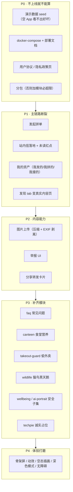

# 小程序上线交付计划（可执行轮次）

> 上游：[`docs/architecture/06-roadmap.md`](./architecture/06-roadmap.md)（M0–M4 战略路线，管"为什么这个顺序"）。
> 本文管**执行**：每一轮改什么文件、做完怎么验证、门禁怎么过。
> 冻结契约 [`00-FROZEN-CONTRACT.md`](./architecture/00-FROZEN-CONTRACT.md) 仍然是最高约束，本文不改变它。

版本：`v1` · 2026-10-17 · 范围：`apps/miniapp` + `services/api`（Web 门户不在本轮范围）

---

## 0. 现状盘点（2026-10-17，逐条可复核）

### 0.1 已经「真能用」的（有业务逻辑的后端 + 有小程序页面）

| 模块 | 后端 | 小程序页面 | 状态 |
| --- | --- | --- | --- |
| `groupbuy` 拼单 | 创建/参团/成团（含行锁幂等） | 列表、详情 | ⚠️ **缺"发起拼单"页** |
| `flea-market` 跳蚤 | 发布/筛选/状态流转 | 列表、发布、详情 | ✅ |
| `errand` 跑腿 | 发布/接单/送达 | 列表、发布、详情 | ✅ |
| `buddy` 找搭子 | 招募/加入/关闭 | 列表、发布、详情 | ✅ |
| `lost-found` 失物招领 | 双向登记/匹配 | 列表、发布、详情 | ✅ |
| `forum` 论坛 | 发帖/回复/匿名/治理 | 列表、发帖、详情 | ✅ |
| `dorm-harmony` 宿舍矛盾 | 匿名提交/二次同意/追踪码 | 提交 + 凭码跟踪 | ⚠️ 缺调解员侧 |
| `auth` 身份 | 两級身份 + 校园绑定 + 实名脱敏 | 绑定页 | ✅ |
| `schedule` 课表 | 今日/本周/同步/冲突 | 今日 + 本周 | ✅ |
| `campus-card` 校园卡 | 余额/流水/异常/挂失 | 完整 | ✅ |
| `profile` 我的 | 隐私开关/同意/导出 | 我的 + 编辑 + 隐私与数据 | ✅ |
| `agent` 可达鸭 | facts-first + 白名单 RAG | 全局 FAB + 页面 | ✅ |
| `notifications` | 站内信 CRUD（**无人写入**） | 仅"订阅授权" | ❌ 站内信全空 |

### 0.2 只有脚手架、端上没有页面的（7 个）

`takeout-guard` 偷外卖 · `canteen` 食堂营养 · `faq` 常见问题 · `wildlife` 猫鸟黑天鹅 ·
`techpie` TechPie 整合 · `ai-portrait` AI 校园画像 · `wellbeing` 心理治疗

> 后端这 7 个都是 `scripts/scaffold.mjs` 生成的通用 CRUD：
> `GET/POST /items`、`GET/PATCH/DELETE /items/:id`，每个约 220–380 行，**没有领域规则**。
> 也就是说：**能存能查，但不是产品功能**。

### 0.3 页面级缺失（已交付模块内部）

> 状态截至 2026-10-17 本轮（R0+R1）结束：已修复项标注 ✅ 并给出落点。

| # | 缺失 | 证据 | 本轮状态 |
| --- | --- | --- | --- |
| 1 | **无法发起拼单** | `presentation/pages/groupbuy/` 只有 `list` + `detail` | ✅ 新增 `groupbuy/create`（列表悬浮入口 + 登录门禁） |
| 2 | **站内信全空** | `messages/index.tsx` 只有订阅按钮；后端无任何模块写 `Notification` | ✅ 后端 5 个写入点 + 小程序真实列表/未读/tabBar 红点 |
| 3 | **发现 tab 是"平台能力演示台"** | `discover/index.tsx` 全是扫码/地图/分享的试跑按钮 | ✅ 真实内容在上，能力试跑收进 `KdyDemoTools` |
| 4 | **无图片** | 全仓库无 `chooseImage`/`chooseMedia`/`uploadFile` | ⛔ 未做（R2）。容器无持久化存储 → 必须接 COS |
| 5 | **无举报入口** | UI 层 0 处「举报」 | ⛔ 未做（R2） |
| 6 | **无分享** | 只有 `groupbuy/detail` 一个页面上报分享 | ⛔ 未做（R2） |
| 7 | **无"我的资产"** | 我发布的/我拼的/我接的单，散在页面里靠筛选 | ⚠️ 部分完成：`profile/assets` 内联拼单两角色 + 其余模块入口（不做假聚合） |
| 8 | **无全局搜索** | 搜索框各列表页各写一遍，不跨模块 | ⛔ 未做 |
| 9 | **无骨架屏/下拉刷新** | 只有 `groupbuy/list` 有 | ⛔ 未做（R5）；消息页本轮已补下拉刷新 |
| 10 | **无用户协议 / 隐私政策页** | 小程序审核必需项 | ✅ `pages/legal/{terms,privacy}`，文案单一真相来源 |

### 0.4 工程化 / 上线缺失

| # | 缺失 | 影响 | 本轮状态 |
| --- | --- | --- | --- |
| 1 | **没有 `prisma/seed.ts`** | `npm run prisma:seed` 直接失败；所有列表都是空的 | ✅ 已写并跑通（幂等；生产需 `SEED_FORCE=1`） |
| 2 | **没有 compose 文件** | `local-development.md` 让用 Docker 起 PG，但仓库里没有 | ✅ 实际存在 `services/api/docker-compose.yml`（盘点有误）；已修正文档命令指向它，**不再新增第二份**（容器名冲突） |
| 3 | **无部署文档 / 生产配置** | 没有环境变量清单、迁移流程、HTTPS/域名说明 | ✅ `docs/deploy.md`；并补了 `GET /health` 与「生产缺 `DATABASE_URL` 即启动失败」的护栏 |
| 4 | **无分包** | 补模块后必然超限 | ⛔ 本轮 `dist` 1.6 MB，仍在上限内；分包挪到 R6（见 R0 表格里的取舍说明） |
| 5 | **无错误上报** | 线上白屏无法发现 | ⛔ 未做（R6）。当前靠 `X-KedaYa-Trace` 关联日志 |
| 6 | **无审核材料清单** | 提交审核会来回被拒 | ✅ `docs/deploy.md` §10 有提审前自查清单与页面路径 |

### 0.5 诚实的边界（我做不到的）

| 项 | 为什么 | 谁来做 |
| --- | --- | --- |
| 真实校园数据（课表/余额/CAS） | 需要**学校官方授权**；已有 `live` 适配器，等授权 | 你去跟信息办谈 |
| 真机视觉验收 | 本机微信 IDE 服务端口关闭 | 你导入 `apps/miniapp/dist` |
| 小程序**发布**（提审、类目、备案域名、HTTPS 证书） | 需要企业主体 + 微信后台操作 | 你 |
| 高敏模块的**合规门禁** G1–G3（隐私政策复核、同意文案、PIA） | 需要法务/心理中心排期（契约 §4.3 A3.17） | 你去指派 |
| 高敏模块上线 | 契约硬门禁：G1–G3 未过**不发布** | — |

---

## 1. 目标的可检验定义

| 口号 | 可检验的判据 |
| --- | --- |
| **完备功能** | 19 个模块中，端上可用的 ≥ 15 个；余下 4 个（`techpie`/`ai-portrait`/`wellbeing` 的敏感部分）在页面上**如实说明"为什么现在不能用"** + 给出下一步动作，不留死路 |
| **UI 好看** | 每个页面有：清晰标题与副标题、统一卡片节奏、空态有插画与动作、无裸文字列表；令牌零硬编码色值（已有 `wxss-safety.test.ts` 与令牌注入保障） |
| **交互丝滑** | 每个列表页有骨架屏 + 下拉刷新 + 触底加载；页面冷启动先出缓存（契约 §8，已有基础）；关键写操作 ≤ 1 次确认；无 300ms 以上的"无反馈点击" |
| **可上线部署** | 干净 clone 后 4 条命令能起本地环境（含演示数据）；`docs/deploy.md` 覆盖生产环境变量、迁移、回滚；主包 < 2MB；隐私政策/用户协议页存在 |
| **门禁** | 每轮结束：api/miniapp/web 的 typecheck+test+lint 全绿 + `npm run build:weapp` 成功 |

---

## 2. 差距优先级（为什么是这个顺序）



**排序理由**

1. **P0 里最"划算"的是 seed**：它是唯一一个能立刻把"空壳"变成"像模像样"的动作，且后续每一轮的视觉打磨都要靠它来验收。
2. **P1 在 P3 之前**：缺少"发起拼单"和"站内信"是**主链路断裂**（首页主打拼单却发不了；消息 tab 点进去是空的）。断裂的主链路比缺失的边缘模块严重得多。
3. **P2 在 P3 之前**：图片是跳蚤/失物/论坛**从"能存文字"到"能真用"**的门槛。不先解决，补再多模块也只是多几个文字列表。
4. **P3 内部按"合规风险从低到高"**：faq/canteen/takeout/wildlife 是低敏；`wellbeing`/`ai-portrait` 是**最高敏**，必须最后，且只能做合规允许的子集。
5. **P4 放最后但要每轮顺手做**：组件层先留好扩展位（如 `KdyCard` 的 `elevated`），最后统一补齐动效与插画，避免反复改页面。

---

## 3. 轮次计划

> 每轮 = 一次可提交的增量；结束时跑固定门禁（§4）。
> 每轮产物都**可独立上线**，不存在"做一半的中间态"。

### R0 · 地基补齐 —— ✅ 已完成（2026-10-17）

| 产物 | 文件 | 验收 | 结果 |
| --- | --- | --- | --- |
| 本地一键起 PG | `services/api/docker-compose.yml` | `docker compose -f services/api/docker-compose.yml up -d postgres` 后连接串直接可用 | ✅ 沿用既有 compose（**未新增第二个 compose**：根目录再放一份会让容器名 `kedaya-postgres` 冲突。已把 `docs/local-development.md` 的命令改成指向既有文件） |
| 演示数据 | `services/api/prisma/seed.ts` | `npm run prisma:seed` 成功；每个列表页有 ≥ 8 条中文校园数据 | ✅ 幂等可重复执行；生产环境除非 `SEED_FORCE=1` 否则拒绝；覆盖十余类数据 + 6 个演示账号 |
| 生产部署说明 | `docs/deploy.md` | 环境变量逐条说明；含迁移/回滚/小程序发布流程 | ✅ 12 节，含验收 curl 清单、故障排查表、以及**未验证项诚实清单** |
| 容器化 | `services/api/Dockerfile` + 根 `.dockerignore` | 多阶段构建、非 root、单 `CMD`、`TZ=Asia/Shanghai`、`PORT=80` | ⚠️ **未本地验证**（交付本机没有 Docker）；已在 `docs/deploy.md` 给出验证步骤 |
| 健康检查 | `services/api/src/main.ts` 的 `GET /health` | 云托管探针可用；**只探进程存活，不查库** | ✅ 实测 200（`curl -i localhost:3999/health`） |
| 生产配置自检 | `prisma.service.ts` + `prisma.config.ts` | 生产环境缺 `DATABASE_URL` 时**启动即报错**，而不是静默空连接 | ✅ 这是本轮新加的护栏（原先会以空串启动、之后每个请求 500） |
| 分包配置 | `config/index.ts` + `app.config.ts` | 主包 < 2MB 且 `dist` 出现 `subPackages` | ❌ **本轮不做**：主包 1.6 MB 仍在上限内，而分包要把 `presentation/pages/**` 整体搬家、改动所有页面的相对 import 深度与 `routes.test.ts` 断言，风险 > 收益。已记入 R6 |
| 法务页面 | `pages/legal/{terms,privacy}/index.tsx` | 「我的」页可进入；审核材料可引用 | ✅ 文案集中在 `presentation/content/legal.ts`（与隐私设置页共用），含 `TODO(上线)` 标注待补项 |

### R1 · 主链路断裂修复 —— ✅ 已完成（2026-10-17）

| 产物 | 验收 | 结果 |
| --- | --- | --- |
| 发起拼单（`groupbuy/create`） | 能创建 → 出现在列表首位 → 分享出去能参团 | ✅ 后端归属只认 JWT（实测请求体里的 `ownerId` 被忽略）；小程序端单价「元 → 整数分」、截止时间用相对预设（不会选中过去）；列表页有悬浮发起入口 + 登录门禁 |
| 站内信真实落地 | 参团/成团/被接单时**后端写入**；消息页有真实列表 + 未读 + tabBar 红点 | ✅ 后端 5 个写入点（拼单参团/成团、跳蚤预订/解除、跑腿接单/送达/完成、论坛回复），`notify` best-effort（吞异常 + 记日志，主流程不会因通知失败 500）；小程序端真实列表 + 未读筛选 + 全部已读 + 点击按 `link` 跳转（未知页面不可点）+ tabBar 红点 |
| 我的资产 | 「我的」页进入"我发起的/我参与的/我发布的/我接的单"三合一，每类都有空态与动作 | ⚠️ **按实际情况收窄**：`profile/assets` 内联「我的拼单（发起/参与）」，其余模块给各列表页入口（各模块列表页已有自己的「我的」筛选）。不做假聚合 —— 把五个模块硬塞进一页只会让每条都看不全 |
| 发现 tab 改造 | 首页/发现不再是演示台；平台能力试跑收进 `KdyDemoTools` | ✅ 发现页现在真实内容在上（六个生活模块 + 校园服务入口），能力试跑与差异矩阵收进折叠的 `KdyDemoTools`；同时**修掉了一句已经在骗人的文案**（旧版写着"拼单是当前唯一跑通的业务模块"） |
| 拼单后端富视图 | 列表/详情返回可展示视图而非数据库行 | ✅ 顺带修掉一个**静默 bug**：小程序端 `httpGroupBuyRepository` 原先把后端行直接强转成富形状 `GroupBuy`，字段全 `undefined`。现在两边同名同义，且 `description`/`pickupPlace` 的 `null` 会归一化成 `''` |

### R2 · 内容与媒体能力 —— ✅ 已完成（后端 + 小程序端，2026-10-17）

| 产物 | 验收 | 结果 |
| --- | --- | --- |
| 图片上传链路 | 后端上传端点（适配器模式：本地磁盘 → 可换 OSS）+ 压缩 + **EXIF GPS 剥离**（契约 A2.5） | ✅ 存储端口 + 三种适配器（`disabled` 默认 / `local` 开发 / `s3` 兼容 COS·OSS·MinIO·R2）；**零新依赖**（手写 SigV4，用 AWS 官方文档示例逐字节比对过）；剥离是**段级删除**（只删元数据段、不动像素，无第三方图像库） |
| 三处接入 | 跳蚤发布可传图；失物招领可传图；论坛发帖可传图；详情页可预览大图 | ✅ 三个模块 `imageUrls` 字段 + 迁移；发布页 Taroify 风格的自绘宫格（逐张状态 + 点图重试）；详情页宫格 + 微信原生大图预览；列表卡片有图时用缩略图取代文字徽标 |
| 反外链 | 只接受本平台产出的图片地址 | ✅ `MediaUrlPolicy.assertAllowed`（服务端）—— 防止帖子变成外站导流 / 追踪像素载体。实测外链建帖返回 400 |
| 举报 UI | 跳蚤/论坛/跑腿详情可举报；举报后该内容对举报人不可见 | ⏳ 未做（本轮聚焦媒体能力；举报留到 R6 上线准备一并做：举报是审核材料的一部分） |
| 分享 | 跳蚤/拼单/失物详情可转发卡片（带参数直达） | ⏳ 未做（同上，留到 R6） |

**本轮的两个关键取舍**（都写进了 `docs/deploy.md` 5.4）：

1. **服务端中转，不做预签名直传**。直传省流量，但无法保证剥离 EXIF（客户端可被抓包替换），
   而契约 A2.5 明确要求「上传带 GPS 的照片后下载检查，GPS 必须消失」。
2. **`MEDIA_STORAGE=disabled` 时客户端整块隐藏选图入口**（而不是显示一个点了必然失败的按钮）；
   问不通时入口**保留但禁用 + 给「重试」**（而不是让功能凭空消失）。

### R3 · 补齐低敏模块（4 个）

`faq`（与可达鸭知识库同源，避免两份答案）→ `canteen` → `takeout-guard` → `wildlife`。
每个模块：后端补领域逻辑（不能停在通用 CRUD）+ 小程序列表/发布/详情三页 + 单测。

### R4 · 高敏模块的安全子集

| 模块 | 做什么 | 不做什么（并说明原因） |
| --- | --- | --- |
| `wellbeing` | 危机资源出口（首页两次点击内可达）、预约**意向**登记、自助资源 | **不做量表解读**（PHQ-9 等需心理中心背书 + 值班 SLA）、不做真实排班预约 |
| `ai-portrait` | 默认关闭的开关 + 可解释标签展示 + 关闭即级联删除 | 不生成画像（无行为数据积累 + 需 PIA） |
| `dorm-harmony` 补齐 | 进度查询、调解员侧骨架 | 不做跨案件检索 |

> 这一轮的产物**默认不可发布**：页面上明确标注"待合规审批（G1–G3）"，代码就绪但 `CAMPUS/WELLBEING_ENABLED` 类开关关闭。

### R5 · 体验打磨（好看 + 丝滑）—— 🔶 部分完成（2026-10-17，见第 9 节）

骨架屏组件化 → 下拉刷新与触底加载统一到 `application/common/listUseCase` → 列表入场与按钮反馈动效 →
原创吉祥物空态插画（**ADR 0005：不得使用宝可梦素材**）→ 深色模式（令牌已支持）→ 对比度与无障碍。
每个页面按清单过一遍，逐页截图对比。

已完成：骨架屏组件化（七个列表页）、下拉刷新（保留筛选、转圈等请求结束）、
图片懒加载、按下反馈、触底加载早已统一在 `listUseCase`。
未完成：吉祥物空态插画（需要原创素材）、深色模式、逐页截图对比（需真机/开发者工具）。

### R6 · 上线准备 —— 🔶 主要项已完成（2026-10-17，见第 8 节）

分包细化与按需注入 → 图片懒加载与 CDN → 错误上报与性能埋点 →
审核材料（类目、截图、隐私说明、域名白名单）→ 压测与容量评估。

已完成：分包、错误上报、错误边界、内容举报（审核硬性要求）、审核/运维文档。
未完成：图片懒加载、压测脚本、性能埋点、业务页分享入口。

---

## 4. 每轮固定门禁

```bash
npm run typecheck -w @kedaya/api && npm run test -w @kedaya/api && npm run lint -w @kedaya/api
npm run typecheck -w @kedaya/miniapp && npm run test -w @kedaya/miniapp && npm run lint -w @kedaya/miniapp
npm run build:weapp
npm run typecheck -w @kedaya/web && npm run test -w @kedaya/web && npm run lint -w @kedaya/web
```

外加两条本仓特有的硬规则（已有测试守着，别踩）：

- `apps/miniapp/src/presentation/theme/__tests__/wxss-safety.test.ts`：禁止 `> :first-child` / 裸 `*` 等
  WXSS 不支持的选择器（会导致 `common.wxss` 编译失败、全局白屏）；
- 色值只能来自 `packages/design-tokens/tokens.json`。

## 5. 每轮结束的固定记录

1. 更新本文件对应轮次的"实际完成 / 未完成 / 新发现的问题"；
2. 更新 `apps/miniapp/README.md` 的已实现/未实现清单与测试表；
3. 更新 `apps/web/src/domain/models/delivery.ts`（Web 门户的模块状态唯一真相来源）；
4. 新分支提交并推送，写明**验证方式**（跑了什么、看到什么）。

---

## 6. 本轮记录（R0 + R1 · 2026-10-17）

### 新增 / 改动

- 新增 `services/api/prisma/seed.ts`（幂等；生产需 `SEED_FORCE=1`）。
- 新增 `services/api/Dockerfile` + 根 `.dockerignore`（多阶段、`node:22.23-alpine`、`TZ=Asia/Shanghai`、`PORT=80`）。
- 新增 `docs/deploy.md`（微信云托管部署 + 小程序提审 + 未验证项诚实清单）。
- 新增 `apps/miniapp/.env.example`（`TARO_APP_*` 构建期变量）。
- 新增法务页：`presentation/content/legal.ts` + `components/KdyLegalDoc` +
  `pages/legal/{terms,privacy}`；「我的 → 关于」与隐私页共用同一份文案。
- 新增 `pages/groupbuy/create`（发起拼单）与 `pages/profile/assets`（我的资产）。
- 重写站内信：后端新增 `common/notifications/notification.port.ts` + notifications 模块；
  小程序端新增 `domain/models/notification.ts`、`httpNotificationRepository`、
  `application/notification/notificationUseCases.ts`、`platform/tabBar.ts`，并重写
  `pages/messages`（真实列表 + 未读 + 红点）。
- 拼单后端重写为**富视图**（`initiatorName` / `priceFen` / `pickupPlace` / `participants` / 派生 `status`），
  分类白名单、`sort`、`mine+role`；小程序端 `httpGroupBuyRepository` 改为归一化映射
  （原先把后端行强转成富形状，字段全 `undefined`）。
- 发现页改为真实模块入口（`MODULE_ENTRY_PATHS` 与首页共用），能力试跑收进 `KdyDemoTools`。
- 新增 `GET /health`（存活探针，刻意不查库）；生产环境缺 `DATABASE_URL` 时**启动即报错**。

### 未完成 / 主动推迟

- **分包**：主包 1.6 MB 仍在上限内，搬家风险 > 收益 → 推迟到 R6（详见 R0 表格）。
- **图片上传**：仍未实现（云托管容器无持久化存储 → 必须接 COS）。
- **Docker 镜像本地构建**：**未验证**（交付本机没有 Docker）。`docs/deploy.md` §3/§9 给出验证步骤。
- **小程序真机 / 开发者工具验证**：未做（本机 IDE 服务端口关闭）。
- **Web 门户**：不在本轮范围（仅同步了 `delivery.ts` 的模块交付状态）。

### 新发现的问题（本轮顺手修掉）

1. **拼单列表静默 bug**：小程序端把后端数据库行直接强转成富形状 `GroupBuy`，
   字段全 `undefined`，UI 显示空白但不报错 → 改为后端返回富视图 + 前端归一化。
2. **未读数非幂等**：`markRead` 在本地按"返回值已读"就 -1，重复点同一条会多扣 →
   改为重新向服务端要未读数。
3. **`POST /notifications/items` 可被外部调用**：脚手架泄露的写接口 → 已移除，
   只保留内部 `NotificationPort`。
4. **文档与实现不符**：`mine=1` 缺省 role 注释写"两者都算"，实现是 `member` → 已按实现纠正。

### 验证方式

- 门禁四条命令全绿（api 461 / miniapp 409 / web 88 测试通过；`build:weapp` 产物 1.6 MB）。
- 后端端到端实测（curl，`PORT=3999`）：拼单列表/详情/创建/参团/满员冲突/权限、
  通知 4 个端点、`/health` 200 —— 详见提交信息。
- **未做**：Docker 构建、云托管部署、真机预览（环境限制，已在 `docs/deploy.md` 标注）。

---

## 7. 本轮记录（R2 · 2026-10-17）

### 后端：`services/api/src/common/media/**`（新）

| 文件 | 职责 |
| --- | --- |
| `image-metadata.ts` | **段级**剥离 JPEG（APP1/APP13/COM/非 ICC 的 APP2）与 PNG（tEXt/zTXt/iTXt/eXIf/tIME）元数据；保留 APP0/ICC/APP14；结构校验失败一律抛 `ImageRejectedError` |
| `s3-signature.ts` | 零依赖 SigV4（含 canonicalPath 防双重编码、query 排序、sessionToken），**AWS 官方文档 IAM `ListUsers` 示例逐字节复现** |
| `media.port.ts` / `media-url.ts` | 存储端口、URL 白名单策略（只认本平台产出的地址） |
| `{disabled,local-disk,s3}-media.storage.ts` | 三种适配器；key 由服务端生成且**不含 `/`**（结构上不可能路径穿越） |
| `media.service.ts` / `media.controller.ts` / `media.module.ts` | `GET media/config`、`POST media/images`、`DELETE media/images`、`GET media/files/:key`（仅 local）；`@Global()` 基础设施层 |
| `skip-envelope.decorator.ts` | 让回图片字节的路由不被套信封（否则 `res.send()` 后拦截器再 `res.json()` 会 `Cannot set headers after they are sent`） |

原子性顺序（不可调换）：存储可用性 → base64 解码 + 原始大小拦截 → 魔术字节嗅探 →
剥离元数据 + 宽高合理性 → 服务端生成 key → 落存储 → 拼绝对地址；剥离失败一律 `VALIDATION_FAILED`。

### 小程序端（新）

| 文件 | 职责 |
| --- | --- |
| `domain/models/media.ts` | 上限常量、`sniffBase64Image`（**手写 base64 头解码**，因为小程序没有 Node `Buffer`）、`imageSummary` |
| `domain/ports/mediaPort.ts` / `mediaRepository.ts` | 相册选图端口 + 媒体仓储端口 |
| `platform/imagePicker.ts` / `fileSystem.ts` | `chooseMedia` 多选 → 质量梯度压缩（80/60/40）→ base64；**跳过项逐条给出可照做的原因** |
| `data/repositories/{http,mock}MediaRepository.ts` | 真后端 / mock（mock **返回 data URL 本身**，所以离线也能看到真图） |
| `application/media/mediaUseCases.ts` | 可用性状态机：`unknown` / `loading` / `enabled` / `disabled(not-configured\|unavailable)`，带并发去重与强制重试 |
| `presentation/hooks/useImageAttachments.ts` | 选完立即上传、串行上传、逐张状态、点图重试、`imageSubmitProblem`（有图没传成**不允许提交**） |
| `presentation/components/KdyImageUploader` / `KdyImageGallery` | 发布页宫格 + 详情页宫格 / 列表缩略图（点击进微信原生大图预览） |

### 实测（`MEDIA_STORAGE=local`，`PORT=3999`）

1. 构造一张**注入 GPS EXIF 段的真实 JPEG**（1237 B）上传 → 返回 201，
   `metadataStripped: true`，落盘 1167 B（少掉的 70 B 就是被删掉的元数据段）。
2. 取回该图：`Exif\0\0` 与 `GPSLatitude` 均**不存在**，首字节 `FFD8`、尾字节 `FFD9`（仍是合法 JPEG）。
3. 跳蚤 / 失物招领 / 论坛三个模块**带图发布**均 201 且 `imageUrls` 落库；
   外链地址 → **400 `VALIDATION_FAILED`**（「只能使用本平台上传的图片」）。
4. 未登录上传 → 401；`DELETE /media/images` 幂等；非法 key → 400。

### 未完成 / 主动推迟

- **真实对象存储的首次 PUT**：**未验证**（没有 COS/OSS 凭据）。SigV4 已用官方示例逐字节校验，
  但网络与权限只能配好凭据后验证 —— 步骤写在 `docs/deploy.md` 5.4「上线前必做的图片验收」。
- **小程序端选图真机验证**：未做（本机开发者工具服务端口关闭）→ `docs/deploy.md` §10.4 给了六步自测清单。
- **举报 / 分享**：推迟到 R6（属于审核材料的一部分）。
- **演示数据不带图**：mock 种子 `imageUrls: []` —— 塞假图比空着更糟（用户会以为图挂了）。
  想验证带图链路请自行选图（mock 模式离线即可）。

### 验证方式

- 门禁：api typecheck + 505 测试 + lint 全绿；miniapp typecheck + 442 测试 + lint 全绿；
  `build:weapp` 成功（当时按 `du -sh` 记为 1.7 MB —— **该数字是错的**，
  见下方 R6 记录的「体积测量更正」；真实主包约 1180 KB，R6 已分包降到约 1010 KB）。
- 媒体模块专项：`image-metadata.spec.ts` 13 项、`s3-signature.spec.ts` 7 项、
  `media.service.spec.ts` 15 项；小程序端新增 `domain/models/__tests__/media.test.ts`（16 项）、
  `application/media/__tests__/mediaUseCases.test.ts`（13 项）、`mockMediaRepository.test.ts`（4 项）。

---

## 8. 本轮记录（R6 · 2026-10-17）

R6 的目标是「上线准备」。按「**能让人真正使用**」这条线排优先级：
先补**出问题能看见、用户看不到白屏**（否则上线等于闭眼开车），再补**审核硬性要求**（举报），
最后才是体积与性能的约束。

### 8.1 客户端可观测性 + 错误边界

- **后端**：`POST /api/v1/telemetry/client-events`（匿名可调用 —— 崩溃最常发生在登录前），
  新表 `ClientEvent`（迁移 `20261017072546`）。服务端做安全边界：
  `kind` 白名单、入库前脱敏（Bearer / JWT / accessToken / password / 邮箱 / 手机号）、
  超长截断（按码点）、按来源 30 条/分钟限流。**只写不读**（没有管理员鉴权就不加裸读接口）。
- **小程序**：`platform/telemetry.ts`（去重 / 会话上限 / 客户端截断 / 上报绝不抛错）、
  `KdyErrorBoundary`（任何渲染异常退化为「重试 / 返回首页」，`onAppRoute` 自动复位）、
  全局钩子接 `onError` / `onUnhandledRejection` / `onPageNotFound`
  （这三类错误在 React 树之外，不挂钩子就只存在于用户手机上）。
- **只报服务端故障**：`request.ts` 的 `onServerError` 仅在 `code === 'INTERNAL'` 时回调。
  断网 / 校验失败 / 401 一律不报 —— 噪声淹没真故障比缺少数据更糟。
- 遥测**不是**用户可见模块，因此**没有**加进 `@kedaya/contracts` 的 `MODULES`
  （那 19 个被契约 §4 冻结，加一个会同时打破 `apps/web` 的交付断言与首页宫格）。

### 8.2 分包

- 六个生活模块 + 宿舍矛盾各成一个子包（共 19 页）。
- **刻意留在主包**：4 个 tabBar 页（微信强制）、`auth/*`（任何入口都可能跳登录，
  分包会让「点登录先等下载」）、`profile/*`（与 tabBar 的 `profile` 同根，拆开违规）、
  `agent`（全局悬浮球）、`identity` / `schedule` / `campusCard` / `legal/*`。
- **预下载只在「发现」页 + Wi-Fi**：首页是最没意图的入口，
  在 4G 上替用户下七个模块是拿流量换可能用不到的顺滑。
- `routes.test.ts` 升级为四方一致性：`pages` + `subPackages` 展开后必须恰好等于 `PAGE_PATHS`、
  tabBar 页必须在主包、子包 root 不嵌套、`preloadRule` 只指向真实子包且必须是 `wifi`。

### 8.3 体积测量更正（重要）

之前几轮用 `du -sh` 报「1.6 / 1.7 MB」是**错的** —— `du` 按 4 KB 块对齐统计，
几百个小文件会虚高约 45%。改成**按文件字节求和**后：

| | 分包前 | 分包后 | 上限 |
| --- | --- | --- | --- |
| 主包 | 1183 KB | **1045 KB** | 2048 KB |

`docs/deploy.md` §10.1 给了一条可复制的自检命令（按字节求和并打印主包大小），上线前跑一次。
后来加举报弹层（Taroify `Popup` 依赖 `react-transition-group`）多了 32 KB，
仍在余量内。

顺带修掉一个**会让构建直接失败**的坑：Taro 给小程序端设的 `react-dom$` 别名是裸包名
`@tarojs/react`，而 npm workspaces 把 Taroify 的 `react-transition-group` 提升到了根
`node_modules`，根目录下没有 `@tarojs/react` → `Module not found`。
修法是把别名换成绝对路径（`apps/miniapp/config/index.ts` 的 `mini.webpackChain`）。

### 8.4 内容举报（审核硬性要求）

- 后端 `POST /api/v1/reports` + `GET /api/v1/reports/mine`，新表 `ContentReport`
  （迁移 `20261017074007`）。六个可举报对象、七个原因（白名单）、
  `@@unique(reporterId, targetType, targetId)` 去重、不能举报自己。
- **刻意不自动下架**：阈值（3 个**不同的人**）只做打标 + `[moderation]` WARN 日志，
  下架是人工复核后的 SQL。自动下架等于给任何人一个「凑三个人就能删帖」的按钮。
- 小程序：`KdyReportEntry`（一行接入，自己的内容不渲染）、`KdyReportSheet`、
  `useReportEntry`（会话缓存「我举报过什么」，列表里连看十条只发一次请求）；
  论坛**每条回复**也能单独举报（回复是最常被用来骂人的地方）。
- 409 被用例层翻译成「你之前已经举报过了」的成功回执 ——
  否则用户会怀疑自己第一次到底提交成功没有。
- 运维流程（每天看一次队列、下架的 SQL 及其**真实局限**）写在 `docs/deploy.md` §5.6。

### 8.5 实测

- 遥测：含 token / 邮箱 / 手机号的上报 → 库里为 `<redacted>`；900 字符 → 落库 500 + `…`；
  未知 `kind` → `error`；限流精确命中（窗口内先有 2 条，之后 35 连发只过 28 条 = 30）。
- 举报：自举报 400 / 未登录 401 / 未知类型与原因 400 / 不存在的内容 404 / 重复 409 /
  三个不同的人举报 → `escalated=true` 且历史记录一并打标 + ⚠️ 日志。
- 门禁：api 44x 测试 + lint、miniapp 486 测试 + lint、`build:weapp` 成功（主包 1045 KB）。

### 8.6 分享入口（五个业务详情页）

- 五个详情页（跳蚤 / 跑腿 / 搭子 / 失物 / 论坛）都接上了 `useShareAppMessage` +
  页面底部的 `<KdyShareEntry />`（`open-type="share"` 按钮）。
- **微信的硬约束**：转发只能由用户点击 `open-type="share"` 的按钮（或右上角胶囊）触发，
  代码不能静默分享。所以组件必须是 Button，不能是「带 onClick 的 View」——
  后者点了毫无反应，而且开发者工具里不报错，上线前很难发现。
- 落地路径带上 id：好友点开看到的就是**这一条**，而不是被丢回列表里再找一遍。
  这一条对拼单/跑腿/搭子尤其重要 —— 它们本来就靠转发才能凑齐人。
- 论坛的**每条回复**也能单独举报（回复是最常被用来骂人的地方），
  整个页面共用一个举报弹层（每条一个弹层会 N 倍挂载开销）。

### 8.7 本轮最重要的一个修复：邮箱验证码**从来没有真正发出去过**

排查「还能不能上线」时发现的：`MAIL_PORT` 只有一个实现 ——
`ConsoleMailAdapter`（把验证码写进服务端日志）。开发时这没问题，
但生产镜像固定 `NODE_ENV=production`、`AUTH_DEV_EXPOSE_CODES` 必须为 false：
于是用户点「获取验证码」会看到 200「已发送」，邮箱里**永远收不到**。
邮箱注册、找回密码、绑定邮箱三条自助路径**全部静默失效** ——
而校园 CAS 目前还是 Mock，也就是说**新用户在真实部署里注册不了**。

修法不是「补一个适配器」那么简单，而是三件事一起：

1. **真发信实现** `SmtpMailAdapter`：零依赖手写 SMTP 客户端
   （连接超时 / EHLO 能力解析 / STARTTLS 升级 / AUTH PLAIN 与 LOGIN /
   MAIL-RCPT-DATA-QUIT / RFC 2047 中文主题 / 正文整体 base64）。
   选它的理由：用到的只是 SMTP 的一个很小的子集，换来依赖树里不多一个包，
   而且出错信息能写成人话。
2. **不允许静默降级**：服务器没提供 STARTTLS 且没显式允许明文时**拒绝发送**
   （否则用户名、密码、验证码都明文过网）；生产环境没有 SMTP 配置时
   **服务拒绝启动**。这一条最关键 —— 假功能不许上线。
3. **文档与验收**：`docs/deploy.md` §5.7 列了服务商选择、SPF/DKIM/DMARC、
   5 步验收命令与常见故障。

验证方式：12 个单测（内存假 SMTP 服务器逐条断言命令序列，含「凭据绝不泄露到明文」
与「收件人被拒时不进入 DATA」），加上一次**真链路联调**：
`AUTH_DEV_EXPOSE_CODES=false` 起服务 → 请求验证码（响应里没有 `devCode`）→
假 SMTP 收到完整 MIME（中文主题已是编码字）→ 用邮件正文里的验证码注册成功。
另验证了 `NODE_ENV=production` 无 `SMTP_HOST` 时启动即失败、配上后正常启动。

### 8.8 压测脚本（`scripts/smoke-loadtest.mjs`）

- 零依赖（Node 内置 `fetch`），只打**读接口**，所以可以对预发/生产随时跑，不产生脏数据。
- 预热不计入统计；输出吞吐、p50/p95/p99、按路径拆分、错误明细；错误率超阈值时**退出码 1**，
  可以直接当发布卡点用。
- 本机（单进程 + 本机 PG）实测：20 并发 × 6s → 10784 请求、0 错误、**1845 req/s**、
  p95 25ms。
- **但这不能推出云托管的容量**：本机没有网络往返、没有容器冷启动、没有云数据库的连接数上限。
  它给的是「服务端逻辑本身不慢」这个下限；真实容量必须在云托管环境跑一次
  （`docs/deploy.md` §7 给了命令与判断标准）。

### 8.9 提审材料清单（`docs/review-checklist.md`）

新增一份独立的提审清单：主体与类目、域名备案与合法域名、隐私指引与实际采集项对齐、
UGC 内容安全（举报入口位置 / 处理时效 / **msgSecCheck 未接入**这个真实缺口）、
演示账号与审核路径（CAS 是 Mock，必须给邮箱账号）、提审前逐项自检、
以及「已知会被驳回的风险点」。

其中两条最需要决策者拍板：
- **内容安全接口（`security.msgSecCheck` / `imgSecCheck`）尚未接入** ——
  目前只靠举报 + 人工复核。UGC 类小程序提审时这是最常见的驳回点，需要定「自研接入」
  还是「用云托管的内容安全服务」。
- **命名风险（ADR 0005）**：`可达鸭` 的商标/角色 IP 风险状态仍是
  「已接受但风险未消解」，提审前需要一次显式决策（改名或继续承担风险）。

### 8.10 未完成 / 主动推迟

- **真机验证**：错误边界、崩溃上报、举报弹层、分包跳转体验、分享按钮、
  骨架屏与下拉刷新都**没有在真机上点过**（本机微信开发者工具服务端口关闭）
  → `docs/deploy.md` §9 逐条列了自测步骤。
- **内容安全接口（`msgSecCheck` / `imgSecCheck`）**：未接入（见 §8.9），
  这是提审层面最可能被卡的一项。
- **真实环境压测**：脚本已就绪并在本机跑通，但**云托管环境的容量数字还没有**。
- **真实邮件服务商投递**：链路已用本地假 SMTP 走通，但送达率（SPF/DKIM/DMARC、
  进不进垃圾箱、退信处理）必须配好凭据后实测 —— 见 `docs/deploy.md` §5.7。
- **性能埋点**：只做了错误上报，页面耗时/接口耗时埋点推迟（当前瓶颈更可能是接口，
  而不是客户端渲染，先不上昂贵的埋点）。
- **下架后的详情直链**：已知限制（列表消失、直链仍可打开），见 `docs/deploy.md` §5.6。
- **朋友圈分享（`shareTimeline`）**：未开（需要 `showShareMenu` 逐页调用，
  且个人主体受限）。当前只支持转发给好友。

---

## 9. 本轮记录（R5 · 2026-10-17）

R5 是「好看 + 丝滑」。按「**用户能感觉到**」这条线选了四件事做，
而不是把清单上的每一格都打勾 —— 深色模式和空态插画都需要额外素材，
做了反而会拖慢「能上线」这个唯一目标。

### 9.1 首屏骨架屏（`KdyListSkeleton`）

- 七个列表页（拼单 / 跳蚤 / 跑腿 / 搭子 / 失物 / 论坛 / 消息）的首屏
  从「转圈 + 正在加载…」换成骨架。
- **形状与真实卡片同尺寸**（64px 方图 + 标题 + 两行副信息，卡片圆角/留白/边距与 `KdyCard` 一致），
  所以数据到位时是骨架**长成了**内容，不会高度跳变导致手指打滑。
- **只在没有数据时用**：`status: 'loading'` 在列表用例里本来就只在无条目时出现，
  刷新已有内容时仍旧是「旧内容 + 静默更新」——
  把用户正在读的列表换成骨架是体验倒退，这一点已在组件注释里写死。

### 9.2 下拉刷新（五个模块列表 + 拼单列表）

- 页面配置开 `enablePullDownRefresh`，`usePullDownRefresh` 里调
  `list.load({ cursor: null })` —— **保留当前筛选条件**（`listUseCase` 的 `load` 会合并 query），
  与「重试」按钮走同一条路径，因此不存在「下拉刷新和搜索按钮行为不一致」这种经典问题。
- 转圈**等请求真的结束**再 `stopPullDownRefresh()`：早收会让用户以为刷完了、其实还没到。
- 顺手补上了这五个页面此前缺失的 `navigationBarTitleText`（之前继承全局的「可达鸭」）。

### 9.3 图片懒加载与按下反馈

- 列表缩略图 + 详情宫格都开 Taroify `Image` 的 `lazyLoad`：
  一屏 20 张图同时开请求在校园网下是实打实的等待。
- `KdyCard` 在可点击时给 `hoverClass`（不可点击传 `none`）。
  没有按下反馈的卡片会让人怀疑"点到了没有"，于是连点两下，
  而第二下可能正好落在跳转后的页面上。

### 9.4 验证方式

门禁：miniapp typecheck + 486 测试 + lint 全绿；`build:weapp` 成功（主包 1050 KB）；
逐个核对 `dist/presentation/pages/*/list/index.json` 里 `enablePullDownRefresh: true` 与导航标题已生效。

**未验证**：以上全是视觉/交互行为，**没有在真机上点过**
（本机微信开发者工具服务端口关闭）→ `docs/deploy.md` §9 已列为未验证项。
