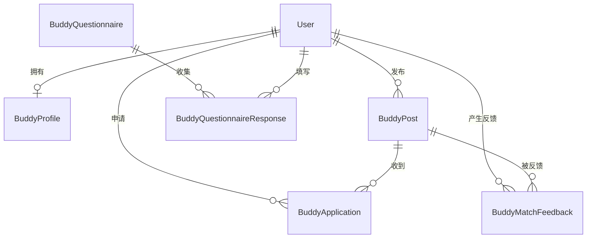
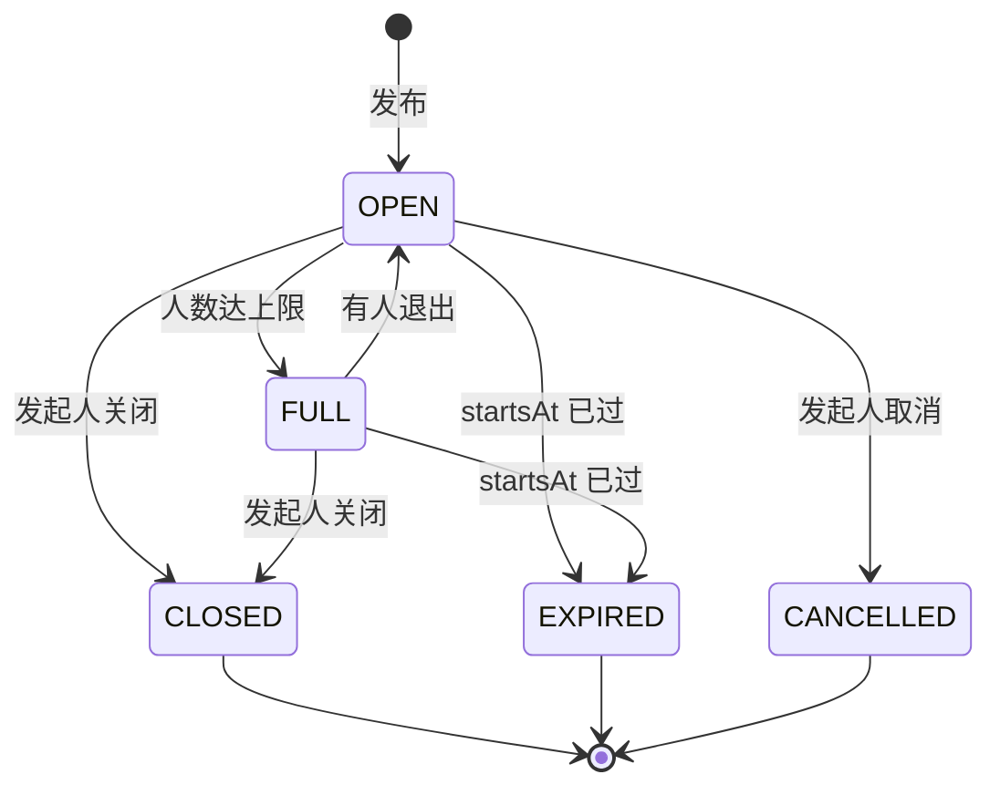
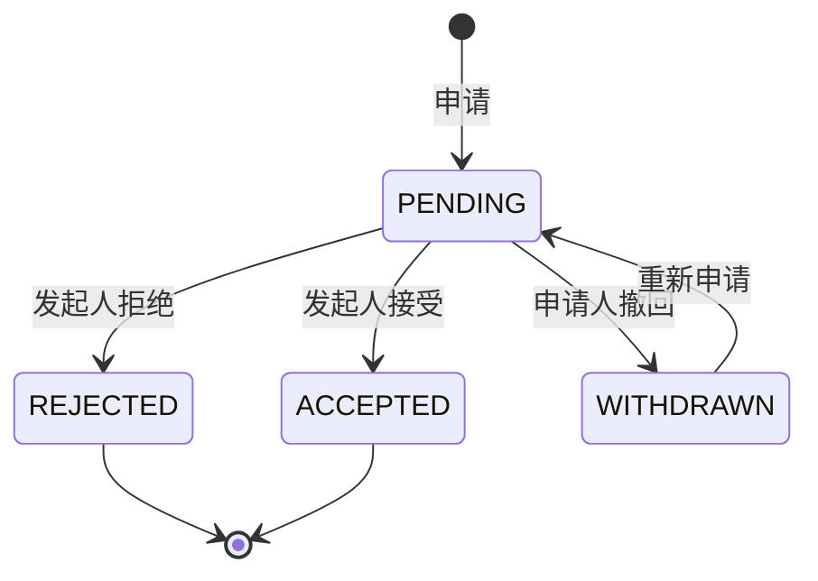
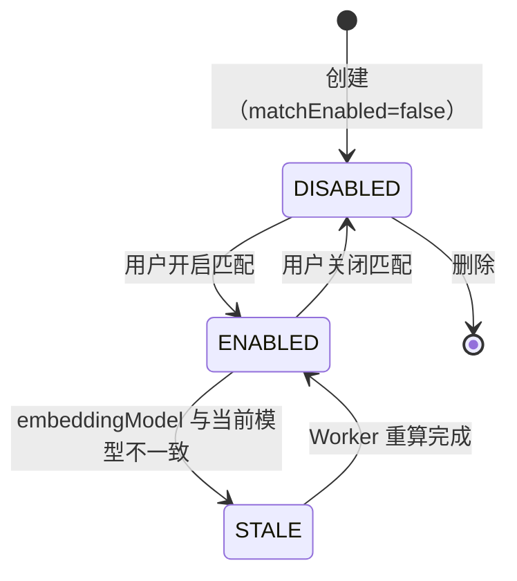
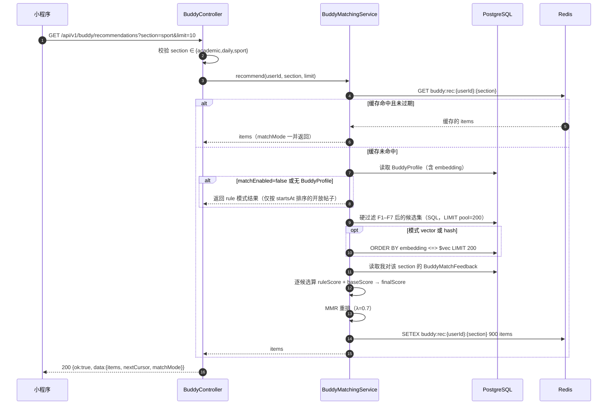

# 功能规格 · 找搭子 `buddy`（接入 STUMatch 匹配能力）

| 项 | 值 |
| --- | --- |
| 模块 ID | `buddy`（契约 §4.1，敏感级 **低**） |
| 路由前缀 | `/api/v1/buddy/*`（契约 §6.1） |
| 文档版本 | `v1` · 2026-10-17 |
| 上游契约 | `docs/architecture/00-FROZEN-CONTRACT.md` §4.1 / §5 / §6.1 / §9 / §11.1 / §11.2 / §11.3 |
| 领域骨架 | `docs/architecture/02-domain-model.md` §2.3（第 512–551 行，**已冻结，本规格向后兼容**） |
| 参考实现 | `tzhazuma/STUMatch`（内部名 UniMatch），本地 clone `/tmp/stumatch-ref` |
| 技术栈 | NestJS 12.1.3 + Prisma 7.10.1 + PostgreSQL 16 + Redis 7 + Zod 4.6.7 |

> **本规格的定位**：`02-domain-model.md` §2.3 已冻结 `BuddyPost` / `BuddyApplication` 的字段与状态机。
> 本文**不改动**那两张表，只在其上补 `BuddyProfile` / `BuddyMatchFeedback` / `BuddyQuestionnaire`，
> 并把 STUMatch 的匹配算法提炼成 NestJS + Prisma 可直接实现的规格。

---

## 1. 目标与非目标

### 1.1 目标

| # | 目标 |
| --- | --- |
| G1 | 同学可以发布**一次性活动组队**（运动/自习/吃饭/出行），他人申请加入 |
| G2 | 系统能在"发布"之外提供**主动推荐**：把适合我的搭子活动排到前面 |
| G3 | 推荐是**可解释**的 —— 每条推荐必须给出中文理由（沿用 STUMatch 的 `match_reason` 机制） |
| G4 | 推荐算法在**没有任何 embedding API key**、甚至**没有 pgvector 扩展**时仍可工作（分级降级） |
| G5 | 全流程符合契约：游标分页、10 个冻结错误码、`Idempotency-Key`、JSON Merge Patch |

### 1.2 非目标（**明确不做**，含理由）

| # | 不做的事 | 理由 |
| --- | --- | --- |
| **N1** | **不做 `dating`（交友/约会）板块** | 见 §1.3 —— 这是本规格最重要的一条非目标 |
| N2 | 不做即时聊天 | `buddy` 只负责"撮合到活动"，沟通在申请通过后通过站内通知 + 联系方式交换完成。IM 是另一个模块的工作量（STUMatch 有 WebSocket 聊天，我们不在本模块抄） |
| N3 | 不做用户间"划卡/滑动"式无限浏览 | 上科大是单校部署，用户池只有几千人。无限浏览会**耗尽候选池**并鼓励把同学当商品浏览；改为**以活动为单位的列表 + 主动推荐** |
| N4 | 不做信用分 / 违约金 | 与 `errand` 的信用体系重叠，且组队违约无实际损失可计量 |
| N5 | 不采集性别用于匹配打分 | `BuddyPost.genderPreference` 是**发起人的准入约束**（契约已冻结），不是打分特征。性别**不进**向量、不进特征、不参与打分 |
| N6 | 不做"人脸/照片"匹配 | 无产品价值，且生物识别信息属 PIPL 敏感个人信息 |

### 1.3 为什么明确不抄 STUMatch 的 `dating` 板块

STUMatch 有三个板块，其 `SECTION_RULES` 与 `SECTION_FIELDS` 明确定义了第三个板块：

```python
# /tmp/stumatch-ref/services/backend/unimatch/services/matching.py:21-34
SECTION_RULES = {
    "academic": {"fields": ["major", "education_level", "research_direction", "school"],
                 "priority": ["major", "education_level"]},
    "daily":    {"fields": ["interests", "age", "location"],
                 "priority": ["interests", "age"]},
    "dating":   {"fields": ["age", "interests", "location", "mbti", "dating_purpose"],
                 "priority": ["age", "interests"]},
}
```

```python
# /tmp/stumatch-ref/services/backend/unimatch/routers/discovery.py:23-27
SECTION_FIELDS = {
    "academic": ["research_direction"],
    "daily": ["bio"],
    "dating": ["dating_purpose", "family_status", "ideal_person"],
}
```

其 `dating` 板块的特征字段是 `dating_purpose`（交友目的）、`family_status`（家庭状况）、`ideal_person`（理想型），
打分规则见 `/tmp/stumatch-ref/services/backend/unimatch/services/matching.py:286-298`（年龄差 ≤2 加 0.35、共同兴趣、同城）。

**我们不做，理由三条，按重要性排序：**

1. **合规**：本项目的一级身份是**上科大统一身份认证**（契约 §5），即 `dating` 板块的每一份资料都绑定到真实学号与姓名。
   `dating_purpose` / `family_status` / `ideal_person` 属于婚恋倾向与家庭状况，在 PIPL 下接近"敏感个人信息"的边界，
   一旦与实名身份同表存储，泄漏后果不可逆。而契约 §9 的判定规则（`packages/contracts/src/modules.test.ts`）规定
   `buddy` 敏感级为**低**、**无同意门** —— 承载 `dating` 就必须新增同意门 + 新增 ADR + 新增 PIA 条目，
   这是本项目当前资源无法承担的（契约 §11.9 第 3 项：PIA 报告**无责任人、未编写**）。
2. **产品定位**：契约 §4.1 对 `buddy` 的一句话定义是"**运动/自习/吃饭/出行 组队匹配**"。
   把"组队"扩展成"择偶"是定位漂移，且需要一套完全不同的审核与举报资源
   （骚扰、虚假资料、线下安全事件）。`forum` 的举报治理能力在 M2 才上线（`06-roadmap.md:170`），
   在治理工具到位之前开放择偶匹配是**顺序错误**。
3. **技术**：`dating` 的打分特征（年龄、MBTI、理想型）在我们这里**不可用** ——
   上科大是单校部署，年龄集中在 18–26，年龄差特征退化；
   `MBTI` 无科学效度且引入歧视性标签风险。抄过来只会得到一堆无效特征。

> **结论**：三个板块改为 `academic`（学术/自习）、`daily`（日常/吃饭/出行）、`sport`（运动组队）。
> 命名上前两个与 STUMatch 对齐以便追溯，第三个替换 `dating`。
> **如果未来确实要做 dating，必须新开一个模块 ID + 新 ADR + 独立同意门，不得挂在 `buddy` 下。**

---

## 2. 领域模型

### 2.1 实体总览



### 2.2 `BuddyProfile`（**新增**）

我的匹配资料。与 `profile` 模块的 `User` 资料分离：`profile` 存"我是谁"，`BuddyProfile` 只存"匹配要用的特征"。
**这个分离是刻意的** —— 撤回/关闭匹配只需删 `BuddyProfile`，不影响账号资料。

| 字段 | 类型 | 必填 | 默认 | 约束 | 说明 |
| --- | --- | --- | --- | --- | --- |
| `userId` | `string(ulid)` | 是 | — | 唯一，FK→`User` | 一人一份 |
| `sections` | `enum<academic\|daily\|sport>[]` | 是 | `[]` | 至少 1 项才可被推荐 | 参与哪些板块 |
| `interestTags` | `string[]` | 是 | `[]` | ≤20 项，每项 ≤24 字，白名单校验 | 兴趣标签，见 §3.2 |
| `activityTags` | `string[]` | 是 | `[]` | ≤10 项，取自活动标签白名单 | 想做的活动类型 |
| `skillLevel` | `enum<beginner\|casual\|regular\|competitive>` | 否 | `casual` | 仅 `sport` 板块使用 | 运动水平 |
| `availability` | `{ dow: int; startMin: int; endMin: int }[]` | 是 | `[]` | `dow` 0–6；`startMin`/`endMin` 0–1439；`endMin > startMin` | 每周可用时段（分钟粒度，本地时区 Asia/Shanghai） |
| `preferredAreas` | `string[]` | 是 | `[]` | 取自校园地点白名单，≤5 项 | 常去区域（**不是**精确坐标） |
| `department` | `string` | 否 | `null` | ≤64 字 | 院系。**唯一与 `profile` 重叠的字段**，用于 `academic` 板块（见 §3.3） |
| `bio` | `string` | 否 | `null` | ≤200 字 | 一句话自述，**过内容安全** |
| `embedding` | `vector(768)` | 否 | `null` | pgvector，见 §4 | 由 §3.4 的 `profileText` 生成 |
| `embeddingModel` | `string` | 否 | `null` | ≤64 字 | 生成该向量的模型标识，模型变更时用于判断是否需要重算 |
| `matchEnabled` | `bool` | 是 | `false` | — | **默认关闭**：不主动开启就不进推荐池（见 §6.3） |

> `matchEnabled` 默认 `false` 是隐私决策：匹配需要暴露"我的兴趣/可用时段"给算法，
> 属于对个人信息的新用途，**不默认开启**。用户在小程序里显式打开。

### 2.3 `BuddyPost`（**沿用契约 §2.3，不新增必填字段**）

契约 `02-domain-model.md:518-527` 已冻结：

| 字段 | 类型 | 必填 | 说明 |
| --- | --- | --- | --- |
| `activity` | `enum<sport\|study\|meal\|travel\|game\|other>` | 是 | 冻结 |
| `status` | `enum<OPEN\|FULL\|CLOSED\|EXPIRED\|CANCELLED>` | 是 | 冻结，状态机见 §2.6 |
| `title` | `string` | 是 | 1–60 字 |
| `description` | `string` | 否 | ≤1000 字 |
| `location` | `string` | 是 | 取自校园地点白名单 |
| `startsAt` | `string(iso)` | 是 | 必须晚于当前 |
| `capacity` | `int` | 是 | 2–20 |
| `joinedCount` | `int` | 是 | |
| `genderPreference` | `enum<any\|same\|other>` | 是 | 默认 `any` |
| `creatorId` | `string(ulid)` | 是 | |

**本规格新增的字段（可选，需同步补进 `02-domain-model.md` §2.3）：**

| 字段 | 类型 | 必填 | 默认 | 说明 |
| --- | --- | --- | --- | --- |
| `tags` | `string[]` | 是 | `[]` | ≤8 项，取自活动标签白名单。**匹配打分的主特征** |
| `durationMin` | `int` | 否 | `null` | 预计时长（分钟），30–480。用于时段重叠判断 |
| `minSkillLevel` | `enum<beginner\|casual\|regular\|competitive>` | 否 | `null` | 仅 `sport`；作为**硬过滤**，不是打分 |
| `autoCloseAt` | `string(iso)` | 否 | `startsAt` | 到期自动转 `EXPIRED` 的时间 |

> **不新增 `section` 字段**：板块由 `activity` **派生**，避免同一信息两处存储导致不一致：
>
> | 板块 | 来源 `activity` |
> | --- | --- |
> | `academic` | `study` |
> | `daily` | `meal`, `travel`, `other` |
> | `sport` | `sport`, `game` |
>
> 派生函数 `sectionOf(activity)` 是 `domain/` 下的纯函数，被单测覆盖（契约 `02-domain-model.md:36` 规则 2）。

### 2.4 `BuddyApplication`（**沿用契约 §2.3**）

契约 `02-domain-model.md:528-531` 已冻结：`postId` / `applicantId` / `status`(`PENDING|ACCEPTED|REJECTED|WITHDRAWN`) / `message`(≤200 字)。

**新增：**

| 字段 | 类型 | 必填 | 默认 | 说明 |
| --- | --- | --- | --- | --- |
| `decidedAt` | `string(iso)` | 否 | `null` | 接受/拒绝时刻，审计用 |
| `decidedBy` | `string(ulid)` | 否 | `null` | 必须等于 `post.creatorId` |

**唯一约束**：`@@unique([postId, applicantId])` —— 同一人对同一活动只能有一条申请记录（撤回后重新申请是**更新**该行回 `PENDING`，不是插新行）。

### 2.5 `BuddyMatchFeedback`（**新增**，移植自 STUMatch `MatchFeedback`）

STUMatch 的反馈模型见 `/tmp/stumatch-ref/services/backend/unimatch/models.py:234-250`：
`user_id` / `target_user_id` / `section` / `action`(like|dislike|skip)。

**我们的适配**：反馈目标是**帖子**而非用户。理由：`buddy` 的推荐单位是活动，
对"这个人"表达不喜欢会变成对同学的隐性评价（且会泄漏为"我被某人踩过"），对"这个活动"表达不感兴趣则是无害的。

| 字段 | 类型 | 必填 | 说明 |
| --- | --- | --- | --- |
| `userId` | `string(ulid)` | 是 | 反馈者 |
| `targetPostId` | `string(ulid)` | 是 | 被反馈的帖子 |
| `section` | `enum<academic\|daily\|sport>` | 是 | 反馈发生的板块。**隔离维度**，见 §3.6 |
| `action` | `enum<like\|dislike\|skip>` | 是 | 与 STUMatch 同名同义 |
| `createdAt` | `string(iso)` | 是 | 衰减计算基准 |

**唯一约束**：`@@unique([userId, targetPostId, section])` —— 同一板块内对同一帖子的反馈可覆盖（UPSERT），避免刷反馈。

### 2.6 `BuddyQuestionnaire` / `BuddyQuestionnaireResponse`（**新增**，移植自 STUMatch）

STUMatch 的问卷模型见 `/tmp/stumatch-ref/services/backend/unimatch/models.py:179-231`：
`Questionnaire(slug, title, section, description, questions JSON, is_active)` +
`QuestionnaireResponse(questionnaire_id, user_id, answers JSON)`。
题型与校验见 `/tmp/stumatch-ref/services/backend/unimatch/routers/questionnaires.py:30-107`
（`single_choice` / `multiple_choice` / `rating`，含 `required`、`min`、`max`）。

**我们保留同样的形状**，因为它是可用的最小设计：问题定义存在 DB（可运营调整，不需发版），答案存 JSON。

| 实体 | 字段 | 类型 | 必填 | 说明 |
| --- | --- | --- | --- | --- |
| `BuddyQuestionnaire` | `slug` | `string` | 是 | 唯一，如 `buddy-academic-v1` |
| | `title` | `string` | 是 | ≤128 字 |
| | `section` | `enum<academic\|daily\|sport>` | 是 | 归属板块 |
| | `description` | `string` | 否 | ≤500 字 |
| | `questions` | `json` | 是 | 题目数组，schema 见下 |
| | `isActive` | `bool` | 是 | 默认 `true` |
| | `version` | `int` | 是 | 从 1 递增；改题必须新建版本，不原地改（否则历史答案无法解释） |
| `BuddyQuestionnaireResponse` | `questionnaireId` | `string(ulid)` | 是 | FK |
| | `userId` | `string(ulid)` | 是 | FK |
| | `answers` | `json` | 是 | `{ [questionId]: value }` |
| | `version` | `int` | 是 | 冗余记录当时版本 |

`questions` 单项 schema（与 STUMatch 的校验器一致）：

```ts
type Question =
  | { id: string; type: 'single_choice';   required?: boolean; options: { value: string; label: string }[] }
  | { id: string; type: 'multiple_choice'; required?: boolean; options: { value: string; label: string }[] }
  | { id: string; type: 'rating';          required?: boolean; min: number; max: number }
  | { id: string; type: 'text';            required?: boolean; maxLength: number };
```

**答案 → `BuddyProfile` 的同步**：移植 STUMatch 的 `_sync_profile_from_answers`
（`/tmp/stumatch-ref/services/backend/unimatch/routers/questionnaires.py:117-169`），
但**只同步白名单键**（`interestTags` / `activityTags` / `availability` / `skillLevel` / `preferredAreas` / `department`）。
其余键只进 `answers`，不落到 `BuddyProfile`。

### 2.7 `BuddyMatchScore`（**可选缓存**，仅在性能需要时建）

| 字段 | 类型 | 必填 | 说明 |
| --- | --- | --- | --- |
| `userId` | `string(ulid)` | 是 | |
| `postId` | `string(ulid)` | 是 | |
| `section` | `enum<academic\|daily\|sport>` | 是 | |
| `score` | `decimal(5,4)` | 是 | 0.0000–1.0000 |
| `reason` | `string` | 是 | ≤200 字中文理由 |
| `computedAt` | `string(iso)` | 是 | |
| `expiresAt` | `string(iso)` | 是 | 建议 TTL 15 分钟 |

**是否要建**：先用 §3.7 的"实时计算 + Redis 短缓存"方案。只有当 `recommend` P95 > 300ms 时才落这张表。
**不要一开始就建** —— 它引入缓存失效问题（用户改了兴趣、帖子状态变了），
在只有几千用户、几百活跃帖子的规模下，实时算更快也更简单。

### 2.8 状态机

#### `BuddyPost`（**沿用契约，不得改动**）



> 该图与 `02-domain-model.md:535-548` **逐字一致**。本规格不新增 `BuddyPost` 状态。
> `autoCloseAt` 到期走 `OPEN/FULL → EXPIRED`，是已有转移。

#### `BuddyApplication`（**沿用契约**）



> `WITHDRAWN --> PENDING` 是为 `@@unique([postId, applicantId])` 服务的：撤回后想再申请，
> 复用同一行。**这是对契约的补充**（契约只列了 4 个状态，未说明撤回后能否重申请），需 Lead 确认。

#### `BuddyProfile`（**新增**）



`STALE` 是**内部标记**，不暴露给客户端；处于 `STALE` 时推荐自动降级到 §3.5 的 `hash` 模式。
**规则**：状态流转只走 `domain/buddy/buddy-profile.state.ts` 的 `canTransition(from, to)`
纯函数（契约 `02-domain-model.md:36` 规则 2）。

---

## 3. 匹配算法规格

> 本章是本文档的核心。STUMatch 的实现分布在 `services/matching.py`，下面**逐段提炼并标注行号**，
> 然后给出我们的适配。

### 3.1 STUMatch 到底怎么算的（**实证**）

主入口 `MatchingService.recommend()`，`/tmp/stumatch-ref/services/backend/unimatch/services/matching.py:383-470`。

**第 1 步 · 构造我的画像文本**（`matching.py:176-197`）：
把 `school` / `major` / `education_level` / `mbti` / `interests` / `location` / `bio` /
`research_direction` / `dating_purpose` / `ideal_person`，**加上所有问卷答案的值**，拼成一个字符串。

**第 2 步 · 文本 → 向量**（`matching.py:225-258`）：

```python
# matching.py:233-247 —— 有模型时
dim = self.settings.VECTOR_DIMENSION          # config.py:32  → 384
embedding = model.encode(text, normalize_embeddings=True)
if len(embedding) > dim: embedding = embedding[:dim]        # 截断
elif len(embedding) < dim: embedding = np.pad(...)          # 补零
embedding = embedding / norm                                 # L2 归一化
```

```python
# matching.py:251-258 —— 没有模型时的确定性哈希向量
vec = np.zeros(dim, dtype=np.float32)
for i, ch in enumerate(text):
    vec[(i + ord(ch)) % dim] += 1.0
return (vec / np.linalg.norm(vec)).tolist()
```

> ⚠️ **这个哈希向量不是语义向量**。它把字符按 `(位置 + 码点) % 384` 投桶再归一化。
> 它只对"字符多重集相似"的文本给出高余弦 —— 本质上是个**带位置扰动的词袋哈希**。
> STUMatch 自己称其为 "MVP fallback"（`matching.py:229`）。
> **我们采用它，但必须诚实地把它定位为"降级档"，而不是"等价替代"。**

**第 3 步 · 向量召回候选**（`matching.py:413-425`）：

```python
distance = _vector_distance_sql(vector)   # matching.py:72-75
# → text("profile_vector <=> '[...]'::vector")
stmt = (select(Profile, User, label("distance", distance))
        .where(User.id != user_id, User.status == "active",
               Profile.profile_vector.is_not(None))
        .order_by(text("distance ASC"))
        .limit(200))                       # matching.py:423 —— 候选池 200
```

**第 4 步 · 基础分**（`matching.py:434`）：
`base_score = max(0.0, 1.0 - distance)` —— 余弦距离转相似度。

**第 5 步 · 规则分**（`matching.py:260-301`）：

| 板块 | 规则 | 加分 |
| --- | --- | --- |
| `academic` | 同专业 | `+0.4` |
| | 同学历 | `+0.2` |
| | 同学校 | `+0.2` |
| `daily` | 共同兴趣 | `+min(0.5, 0.15 × 数量)` |
| | 年龄差 ≤3 | `+0.2` |
| `dating` | 年龄差 ≤2 | `+0.35` |
| | 共同兴趣 | `+min(0.4, 0.15 × 数量)` |
| | 同城 | `+0.15` |

同时产出中文 `reason`（`matching.py:269, 275, 282, ...`），无任何命中时回落为 `"有潜在匹配"`（`matching.py:299-301`）。

**第 6 步 · 双塔分（可选）**（`matching.py:78-159`）：
从 JSON 权重文件读 `user_embeddings` / `item_embeddings` / `mlp`。
两塔各自 L2 归一化后，有 `mlp` 则 `ReLU(W1·x+b1)` → `W2·h+b2` → `sigmoid`（`matching.py:123-131`），
否则 `sigmoid(dot)`（`matching.py:155-156`）。权重文件不存在时 `score()` 返回 `None`（`matching.py:135-136`）。

**第 7 步 · 融合**（`matching.py:437-441`）：

```python
if tower_score is not None:
    final_score = base_score * 0.50 + rule_score * 0.30 + tower_score * 0.20
else:
    final_score = base_score * 0.70 + rule_score * 0.30
```

**第 8 步 · 反馈调整**（`matching.py:349-381`）：

```python
action_weights = {"like": 0.20, "dislike": -0.30, "skip": -0.05}   # matching.py:367-371
halflife_days = 30.0                                                # matching.py:366
decay = math.exp(-days / halflife_days)                             # matching.py:379
adjustments[fb.target_user_id] = delta * decay                      # matching.py:380
final_score = clamp(final_score + adjustment, 0.0, 1.0)             # matching.py:445
```

反馈按 `section` 隔离（`matching.py:357-362` 的 `where` 条件），
测试见 `/tmp/stumatch-ref/services/backend/tests/test_matching.py:121-167`
（断言 `academic` 的 dislike **不**影响 `daily` 的分数）。

**第 9 步 · MMR 多样性重排**（`matching.py:303-347`）：

```
mmr(i) = λ × relevance(i) − (1 − λ) × max_{s ∈ selected} cos(vec_i, vec_s)
```

λ 默认 `0.7`（`config.py:103`），首个必选相关度最高者（`matching.py:324-327`）。

### 3.2 我们的适配 —— 标签与兴趣体系

**问题**：STUMatch 的 `interests` 是自由文本数组，共同兴趣靠**字符串精确相等**（`matching.py:277-282` 的 `set` 交集）。
自由文本会导致 `"羽毛球"` / `"打羽毛球"` / `"badminton"` 互不匹配。

**我们的做法**：`interestTags` / `activityTags` / `BuddyPost.tags` **一律取自服务端维护的封闭标签表**，
不允许自由文本进入匹配特征。标签表存在 DB（可运营），结构：

| 字段 | 类型 | 说明 |
| --- | --- | --- |
| `key` | `string` | 机器值，如 `badminton`，唯一 |
| `label` | `string` | 中文显示名，如 `羽毛球` |
| `group` | `enum<sport\|study\|meal\|travel\|interest>` | 分组，供 UI 分栏 |
| `aliases` | `string[]` | 别名词表，**仅用于搜索**，不用于匹配 |
| `isActive` | `bool` | 下架标签不删除（历史数据仍引用） |

**约束**：
- `BuddyProfile.interestTags` ≤20 项，`activityTags` ≤10 项，`BuddyPost.tags` ≤8 项；
- 校验用 Zod `z.enum(TAG_KEYS)`，非法标签返回 `VALIDATION_FAILED`（422）；
- 标签表变更必须走 migration + 审计，**不得运行时改**（否则历史匹配不可复现）。

**为什么封闭标签比 embedding 更重要**：封闭标签让"共同标签数"这个特征**精确且可解释**；
embedding 只负责捕捉标签覆盖不到的长文本（`bio`、`description`）相似度。两者是互补的，不是替代的。

### 3.3 三板块的规则分（我们的系数）

**关键适配 1：删掉"同学校"规则。**
STUMatch 的 `academic` 有 `+0.2 同学校`（`matching.py:273-275`）。
**上科大是单校部署，这条规则恒为真** —— 它给所有候选加同样的 0.2，对排序**零信息量**，
却让总分虚高 0.2，压缩了其他特征的区分度。**必须删除**，把 0.2 重新分配给有区分度的特征。

**关键适配 2：`age` 换成 `availability` 重叠。**
STUMatch 的 `daily` 用"年龄差 ≤3"（`matching.py:283-285`）。
年龄在单校部署下区分度低，且年龄是**不该用于组队的特征**。
组队的真实约束是**时间能不能碰上**。我们换成"可用时段重叠"。

**关键适配 3：新增硬过滤（在打分之前）**。
STUMatch 的 `recommend` 没有硬过滤，只靠软打分。组队场景下有些条件是**必须满足**的，软打分会导致推荐出根本没法参加的活动。

**硬过滤清单**（不满足直接不进候选集）：

| # | 条件 | 依据 |
| --- | --- | --- |
| F1 | `post.status = OPEN` 且 `joinedCount < capacity` | 已满/已关闭无意义 |
| F2 | `post.startsAt > now()` | 已过期 |
| F3 | `post.creatorId != me` | 不推荐自己发的 |
| F4 | 我未申请过（无 `PENDING`/`ACCEPTED` 的 `BuddyApplication`） | 已申请的不再推荐 |
| F5 | `genderPreference` 与我性别相容 | 契约已冻结的准入约束 |
| F6 | `minSkillLevel` 存在时，我的 `skillLevel` ≥ 它 | 仅 `sport` |
| F7 | 我的 `availability` 与 `[startsAt, startsAt + durationMin]` 有交集 | 见下 |

**F7 的实现**（纯函数，无 IO）：

```ts
// domain/buddy/availability.ts
// 判断某活动时间窗是否落在我的任一可用时段内
export function overlapsAvailability(
  availability: Array<{ dow: number; startMin: number; endMin: number }>,
  startsAt: Date, durationMin: number, tz = 'Asia/Shanghai',
): boolean {
  const local = toZonedTime(startsAt, tz);            // date-fns-tz
  const dow = local.getDay();
  const start = local.getHours() * 60 + local.getMinutes();
  const end = start + durationMin;
  return availability.some(
    (a) => a.dow === dow && a.startMin < end && start < a.endMin,
  );
}
```

> 跨零点的活动（`end > 1440`）按**次日**处理：`end > 1440` 时同时检查 `dow+1` 的时段。
> 这是边界情况，必须有单测。

**软打分表（我们采用的系数）：**

| 板块 | 规则 | 加分 | 相对 STUMatch 的变化 |
| --- | --- | --- | --- |
| **`academic`** | 同 `department` | `+0.4` | 由"同专业"改为"同院系"（我们只有院系粒度，见下） |
| | 共同 `interestTags` | `+min(0.3, 0.10 × n)` | **新增**（STUMatch 的 academic 没有兴趣项） |
| | 共同 `activityTags` | `+0.1` | **新增** |
| | ~~同学校~~ | ~~+0.2~~ | **删除**（恒为真，零信息量） |
| | ~~同学历~~ | — | 我们无 `education_level`，本科生/研究生信息在 `profile` 模块，不复制 |
| **`daily`** | 共同 `interestTags` | `+min(0.5, 0.15 × n)` | 保持 STUMatch 系数 |
| | 可用时段重叠（非硬过滤时的软分） | `+0.2` | 替换"年龄差 ≤3" |
| | 同 `preferredAreas` | `+0.1` | **新增**（替代 STUMatch 的"同城"，单校部署下"同城"无意义） |
| **`sport`** | `skillLevel` 相同 | `+0.3` | **新增**（替代 dating 的年龄差） |
| | 共同 `activityTags` | `+min(0.4, 0.15 × n)` | **新增** |
| | 共同 `interestTags` | `+min(0.2, 0.10 × n)` | **新增** |
| | 同 `preferredAreas` | `+0.1` | **新增** |

**关于 `department` 而不是 `major`**：STUMatch 用 `major`（`matching.py:267-269`）。
我们的 `User` 资料里院系是可靠字段，专业粒度在小程序端填报质量不可控（会出现"计算机" / "CS" / "计算机科学与技术"三种写法）。
**用院系 + 封闭兴趣标签替代专业字符串匹配**，避免 STUMatch 那个精确字符串相等的脆弱性。

**规则分上限**：各板块规则分之和可能超过 1.0（`academic` 最高 0.4+0.3+0.1=0.8；`daily` 0.5+0.2+0.1=0.8；`sport` 0.3+0.4+0.2+0.1=1.0）。
**融合前必须 `clamp(ruleScore, 0, 1)`**，否则 `0.30` 的权重会被放大。

### 3.4 融合公式（我们采用的）

**模式 A —— 向量 + 规则（默认，需 pgvector + embedding）**

```
finalScore = clamp(
    baseScore × 0.50
  + ruleScore × 0.30
  + towerScore × 0.20
  + feedbackAdjustment,
  0.0, 1.0)
```

其中：
- `baseScore = max(0, 1 − cosineDistance(me.embedding, post.embedding))`（`matching.py:434` 同款）
- `ruleScore = clamp(ruleScoreFor(section, me, post, creatorProfile), 0, 1)`
- `towerScore`：**默认不存在**，见下
- `feedbackAdjustment`：见 §3.6

**模式 B —— 无 embedding 模型（`hash` 降级）**

向量由 §3.5 的哈希函数生成，公式**不变**，但必须在响应里带
`"matchMode": "hash"`，且前端展示理由时**不得**声称语义相似。

**模式 C —— 无 pgvector / 无 embedding 列（`rule` 降级）**

```
finalScore = clamp(ruleScore × 1.0 + feedbackAdjustment, 0.0, 1.0)
```

即 `baseScore` 与 `towerScore` 权重归零，规则分占满。**这是最重要的降级档** ——
它在**没有安装 pgvector 扩展、没有任何模型**的纯 PostgreSQL 上就能工作，
且因为 §3.2 的封闭标签体系，规则分本身已经能给出可用的排序。

**关于 `towerScore`（双塔）—— 我们的判断：不做。**

STUMatch 的双塔权重来自 `services/ai/outputs/recommendation_weights.json`（`config.py:102`），
是**离线训练的产物**。我们没有：
- 训练数据（STUMatch 有真实用户行为日志，我们没有冷启动数据）；
- 训练管线（STUMatch 的 `services/ai/` 目录，我们没有）；
- 任何证据表明这套权重可迁移到"组队"任务（它是在"交友/学术社交"上训的）。

**因此规格中 `towerScore` 恒为 `None`**，实际生效的是 `baseScore × 0.70 + ruleScore × 0.30`。
公式里保留 0.20 项是为了**未来接入时不必改公式**，但**现在不要实现权重文件加载** —— 那会造出一个永远读不到的代码路径。
**这一条写进未决问题（§9）**：如果未来要训双塔，需要先有 ≥6 个月的行为日志。

> 于是模式 A 的实际公式是 `baseScore × 0.70 + ruleScore × 0.30`，
> 与 STUMatch 的 "no tower" 分支（`matching.py:441`）**逐字一致**。这是刻意对齐，便于对照验证。

### 3.5 降级路径的实现

**配置开关**（`services/api/src/config/buddy.config.ts`）：

```ts
export const BuddyMatchingMode = z.enum(['vector', 'hash', 'rule']);
export type BuddyMatchingMode = z.infer<typeof BuddyMatchingMode>;

export const buddyConfig = z.object({
  BUDDY_MATCHING_MODE: BuddyMatchingMode.default('hash'),
  BUDDY_EMBEDDING_MODEL: z.string().default(''),      // 空 = 不加载模型
  BUDDY_VECTOR_DIM: z.coerce.number().int().default(768),
  BUDDY_MMR_LAMBDA: z.coerce.number().min(0).max(1).default(0.7),
  BUDDY_CANDIDATE_POOL: z.coerce.number().int().default(200),
  BUDDY_FEEDBACK_HALFLIFE_DAYS: z.coerce.number().default(30),
});
```

| 模式 | 前置条件 | `baseScore` 来源 | 启动自检 |
| --- | --- | --- | --- |
| `vector` | pgvector 扩展已装 + `BUDDY_EMBEDDING_MODEL` 非空且模型可加载 | 真 embedding 余弦 | 启动时 `SELECT extversion FROM pg_extension WHERE extname='vector'`；失败则**降级到 `hash` 并 WARN**，不崩溃 |
| `hash` | 仅需 `embedding` 列存在 | 哈希向量余弦 | 启动时检查列存在；失败则降级到 `rule` |
| `rule` | 无 | 无（权重归零） | 无 |

**启动自检必须是"降级而非崩溃"**：契约 §8 要求启动不阻塞，
且 `buddy` 是低敏感模块，绝不能因为 pgvector 没装导致整个 API 起不来。

**哈希向量的 TypeScript 实现**（逐行对应 `matching.py:251-258`）：

```ts
// services/api/src/modules/buddy/domain/hash-vector.ts
/**
 * 确定性哈希向量。移植自 STUMatch matching.py:251-258。
 * ⚠️ 这不是语义向量 —— 它是带位置扰动的字符袋哈希。
 * 仅作为无 embedding 模型时的降级档，不得对外声称"语义相似"。
 */
export function hashVector(text: string, dim: number): number[] {
  const vec = new Float32Array(dim);
  for (let i = 0; i < text.length; i++) {
    vec[(i + text.charCodeAt(i)) % dim] += 1.0;
  }
  let norm = 0;
  for (let i = 0; i < dim; i++) norm += vec[i] * vec[i];
  norm = Math.sqrt(norm);
  if (norm === 0) return Array.from(vec);
  return Array.from(vec, (v) => v / norm);
}
```

> **注意 JS 与 Python 的差异**：`text.charCodeAt(i)` 返回 UTF-16 码元，
> Python 的 `ord(ch)` 对 BMP 内字符返回相同的码点值，但**对 emoji / 生僻字（非 BMP）会不同**
> （JS 是代理对，两次迭代；Python 是一次迭代，码点 > 0xFFFF）。
> 这意味着**同一段文本在两种实现下得到的向量不同**。
> 我们不需要与 STUMatch 跨语言一致（两个系统不共享数据），但**必须固定一种实现并单测**。
> 见 §8 验收标准 T7。

**`profileText` 的构造**（对应 `matching.py:176-197`）：

```ts
// 只拼入"匹配特征"，不拼入任何敏感字段
function buildProfileText(p: BuddyProfile, post?: BuddyPost): string {
  return [
    ...p.activityTags,       // 标签 key
    ...p.interestTags,
    ...p.preferredAreas,
    p.department ?? '',
    p.skillLevel,
    p.bio ?? '',
    ...(post ? [post.title, post.description ?? '', ...post.tags] : []),
  ].filter(Boolean).join(' ');
}
```

> **与 STUMatch 的关键差异**：STUMatch 把 `mbti` / `dating_purpose` / `ideal_person` 拼进文本
> （`matching.py:181-188`）。我们**不拼** —— 这些字段我们根本不采集（§1.2 N5、§1.3）。
> 同时我们**不拼** `gender`、`age`、精确位置。这是隐私边界的技术落地：不进文本 = 不进向量 = 不可能从向量反推。

### 3.6 反馈与衰减（移植 STUMatch）

```ts
// services/api/src/modules/buddy/domain/feedback.ts
const ACTION_WEIGHTS = { like: 0.20, dislike: -0.30, skip: -0.05 } as const;
const HALFLIFE_DAYS = 30;

export function feedbackAdjustment(
  feedbacks: BuddyMatchFeedback[], now: Date,
): Map<string, number> {
  const out = new Map<string, number>();
  for (const fb of feedbacks) {
    const delta = ACTION_WEIGHTS[fb.action];
    const days = Math.max(0, (now.getTime() - fb.createdAt.getTime()) / 86_400_000);
    const decay = Math.exp(-days / HALFLIFE_DAYS);   // matching.py:379
    out.set(fb.targetPostId, delta * decay);         // 同一帖子多次反馈取最后一次
  }
  return out;
}
```

**必须保证 section 隔离**（`matching.py:357-362`）：查询反馈时 `WHERE section = $section`。
**验收测试 T4 直接对应 STUMatch 的 `test_matching.py:121-167`** —— 这是最容易写错的地方。

**`skip` 的特殊处理**：`skip` 权重 `-0.05` 很小，但它在**同一帖子上会累积**
（用户反复划过同一帖子）。我们的 `@@unique([userId, targetPostId, section])` UPSERT 语义意味着
**不会累积**，只保留最后一次。这**偏离**了 STUMatch（它每次 `POST` 插新行，`adjustments` 用字典覆盖
`matching.py:380`，实际也是"最后一次生效"）。**结论：行为等价**，但我们用唯一约束在数据库层面保证，
而不是靠应用层字典覆盖。

### 3.7 推荐流程（端到端）



**Redis 缓存**：TTL 900 秒（15 分钟）。**失效触发**：
- 我更新 `BuddyProfile` → `DEL buddy:rec:{userId}:*`
- 帖子状态变更（FULL/CLOSED/EXPIRED/CANCELLED）→ `DEL` 该帖所在 section 的**全部**用户缓存**不做**（代价过高）。
  改为**短 TTL + 响应时二次校验**：返回前对每个 item 重新读一次 `status`，
  已失效的**静默剔除**（不报错，避免"推荐列表里有已满活动"的体验问题）。

> 二次校验的代价是 N 次点查（N ≤ 10）。用 `WHERE id IN (...)` 一次查完，可接受。

---

## 4. pgvector 在 NestJS + Prisma 上的落地

### 4.1 安装扩展

```sql
-- prisma/migrations/20261017_enable_pgvector/migration.sql
CREATE EXTENSION IF NOT EXISTS vector;
```

**部署注意**：

| 环境 | 做法 |
| --- | --- |
| 本地 / CI | 用 `pgvector/pgvector:pg16` 镜像（官方镜像，已编译扩展），**不要**用 `postgres:16` 再自己编译 |
| 生产 | 需要 superuser 或具备 `CREATE EXTENSION` 权限的角色执行一次。托管 PG 多数支持（阿里云 RDS PG 支持 `vector`，需确认版本 ≥ 0.5.0 以使用 HNSW） |
| 无权限时 | **降级到 `rule` 模式**，不阻塞上线。这就是 §3.5 三档降级存在的意义 |

**验证命令**（写进 CI）：

```bash
docker compose exec -T db psql -U postgres -d kedaya -c \
  "SELECT extname, extversion FROM pg_extension WHERE extname='vector';"
# 期望：vector | 0.7.x（≥0.5.0 才有 hnsw）
```

### 4.2 Prisma schema（**关键：Prisma 不能迁移 `Unsupported`**）

```prisma
// services/api/prisma/schema.prisma
model BuddyProfile {
  userId           String   @id
  user             User     @relation(fields: [userId], references: [id], onDelete: Cascade)
  sections         String[] @default([])
  interestTags     String[] @default([])
  activityTags     String[] @default([])
  skillLevel       String?  @default("casual")
  availability     Json     @default("[]")
  preferredAreas   String[] @default([])
  department       String?
  bio              String?
  matchEnabled     Boolean  @default(false)

  /// pgvector 列。Prisma 无法表达 vector 类型，也无法为它生成迁移。
  /// 必须用手写 SQL 创建（见 §4.3）。该字段在 Prisma Client 中
  /// 不出现在 create/update 入参里，也不能被 findMany 直接 select —— 只能走 $queryRaw。
  embedding        Unsupported("vector(768)")?
  embeddingModel   String?

  createdAt        DateTime @default(now())
  updatedAt        DateTime @updatedAt
  deletedAt        DateTime?

  @@index([matchEnabled])
  @@map("BuddyProfile")
}
```

> **`Unsupported("vector(768)")?` 的三个真实限制**（必须写进代码注释，否则一定有人踩）：
> 1. `prisma migrate dev` **不会**为它生成 DDL。第一次 `migrate dev` 会提示需要手写迁移，
>    或者生成一个 `ALTER TABLE ... ADD COLUMN "embedding" vector(768)` 的**空迁移**让你自己填。
>    **正确做法**：`prisma migrate dev --create-only`，然后手工编辑 migration.sql。
> 2. Prisma Client **不暴露**该字段给 `create` / `update` / `select`。写入必须用
>    `$executeRaw`，读取必须用 `$queryRaw`。
> 3. `prisma db pull`（introspection）**能**识别 vector 列并生成 `Unsupported(...)`，
>    但**维度信息可能丢失**，重新生成 schema 时务必 diff 检查。

### 4.3 手写迁移（含索引）

```sql
-- prisma/migrations/20261017_buddy_profile_embedding/migration.sql

-- 1) 列（Prisma 不会生成这一句）
ALTER TABLE "BuddyProfile"
  ADD COLUMN IF NOT EXISTS "embedding" vector(768);

-- 2) HNSW 索引。需要 pgvector >= 0.5.0。
--    vector_cosine_ops 必须与查询用的 <=> 算子匹配，否则索引不会被使用。
CREATE INDEX IF NOT EXISTS "BuddyProfile_embedding_hnsw_idx"
  ON "BuddyProfile"
  USING hnsw ("embedding" vector_cosine_ops)
  WITH (m = 16, ef_construction = 64);

-- 3) 可选：为候选集的硬过滤建普通索引
CREATE INDEX IF NOT EXISTS "BuddyPost_status_startsAt_idx"
  ON "BuddyPost" ("status", "startsAt");
```

**索引选择**：

| 索引 | 建索引速度 | 查询速度 | 适用 |
| --- | --- | --- | --- |
| 无索引 | — | 全表扫描 + 精确排序 | **候选 < 5000 行时最优** |
| `ivfflat` | 快 | 中（需 `lists` 调参，且**必须**先有数据再建） | 数万行 |
| `hnsw` | 慢、内存高 | 高（无需调参） | **推荐**，但小数据量下收益为负 |

> **我们的建议**：**先不建向量索引**。上科大活跃 `BuddyProfile` 数量在几千量级，
> 顺序扫描 + `ORDER BY <=> LIMIT 200` 在 5ms 量级，比 HNSW 更简单也更准（HNSW 是近似检索，会漏真近邻）。
> **在 §8 验收标准里加一条性能门槛**：当 `BuddyProfile` 行数 > 20,000 或推荐 P95 > 300ms 时，才建 HNSW。
> **不要照着"生产实践"无脑建索引** —— 在小数据量下这是纯负债。

### 4.4 向量查询（`$queryRaw` + 参数绑定，**严禁字符串拼接**）

```ts
// services/api/src/modules/buddy/data/buddy-vector.repository.ts
import { Injectable } from '@nestjs/common';
import { Prisma } from '@prisma/client';
import { PrismaService } from '../../platform/prisma/prisma.service';

export interface VectorCandidate { postId: string; distance: number }

@Injectable()
export class BuddyVectorRepository {
  constructor(private readonly prisma: PrismaService) {}

  /**
   * 用 pgvector 余弦距离召回候选帖子。
   *
   * 安全要点：
   *  - 向量通过 $queryRaw 的模板参数绑定（$1），**不是**字符串拼接；
   *    ::vector 转换作用在绑定参数上，Postgres 不会把它当 SQL 解析。
   *  - 额外做一次数值校验（见 toVectorLiteral），纵深防御：
   *    即使调用方传入了被污染的数据，也无法构造出非数值内容。
   */
  async findSimilarPosts(
    embedding: number[],
    sectionActivities: string[],
    limit = 200,
  ): Promise<VectorCandidate[]> {
    const literal = toVectorLiteral(embedding);

    return this.prisma.$queryRaw<VectorCandidate[]>(Prisma.sql`
      SELECT p."id" AS "postId",
             (p."embedding" <=> ${literal}::vector) AS "distance"
      FROM "BuddyPost" p
      WHERE p."embedding" IS NOT NULL
        AND p."status" = 'OPEN'
        AND p."startsAt" > now()
        AND p."deletedAt" IS NULL
        AND p."activity" = ANY(${sectionActivities}::text[])
      ORDER BY p."embedding" <=> ${literal}::vector ASC
      LIMIT ${limit}
    `);
  }

  /** 写入向量。Unsupported 字段无法走 Prisma Client 的 update。 */
  async setPostEmbedding(postId: string, embedding: number[]): Promise<void> {
    const literal = toVectorLiteral(embedding);
    await this.prisma.$executeRaw(Prisma.sql`
      UPDATE "BuddyPost" SET "embedding" = ${literal}::vector, "updatedAt" = now()
      WHERE "id" = ${postId}
    `);
  }
}

/**
 * number[] → pgvector 文本字面量 '[0.1,0.2,...]'。
 * 拒绝 NaN / Infinity / 非有限数，拒绝空数组。
 */
export function toVectorLiteral(v: number[]): string {
  if (!Array.isArray(v) || v.length === 0) {
    throw new Error('toVectorLiteral: empty vector');
  }
  for (const n of v) {
    if (typeof n !== 'number' || !Number.isFinite(n)) {
      throw new Error('toVectorLiteral: non-finite component');
    }
  }
  return `[${v.join(',')}]`;
}
```

> **为什么这样是安全的**：`${literal}` 被 Prisma 转成 `$1` 绑定参数，
> `::vector` 是对该参数的**类型转换**，不是 SQL 注入点。
> 即便如此我们仍加了 `toVectorLiteral` 的数值白名单 —— 因为"绑定参数就安全"这个信念
> 在有人改成 `Prisma.raw()` 的那一刻就会失效。纵深防御的成本是 6 行代码。

> ⚠️ **`BuddyPost` 需要 `embedding` 列吗？** 需要。§3.4 的 `baseScore` 比较的是
> "我的画像向量" vs "帖子向量"。因此 `BuddyPost` 也要加 `embedding Unsupported("vector(768)")?`，
> 并在帖子创建/更新时由 Worker 异步生成（**不在请求路径上做 embedding 推理**，
> 否则发布帖子的 P95 会被模型推理拖到秒级）。

### 4.5 降级模式的查询（无 pgvector 时）

```ts
// 模式 rule：完全不需要 embedding 列
async findRuleCandidates(sectionActivities: string[], limit: number) {
  return this.prisma.buddyPost.findMany({
    where: {
      status: 'OPEN',
      startsAt: { gt: new Date() },
      deletedAt: null,
      activity: { in: sectionActivities },
    },
    orderBy: { startsAt: 'asc' },
    take: limit,
  });
}
```

**这个查询在任何 PostgreSQL 16 上都能跑**，不需要任何扩展。它是"最低可上线版本"。

---

## 5. API 规格

### 5.1 端点总表

全部前缀 `/api/v1/buddy`。所有端点要求 `Authorization: Bearer <accessToken>`（`UNAUTHENTICATED` = 401）。

| # | 方法 | 路径 | 说明 | 幂等键 |
| --- | --- | --- | --- | --- |
| 1 | `GET` | `/profile` | 读我的匹配资料 | — |
| 2 | `PUT` | `/profile` | 整体替换我的匹配资料 | 可选 |
| 3 | `DELETE` | `/profile` | 删除匹配资料（含 embedding） | 可选 |
| 4 | `GET` | `/items` | 活动列表（游标分页） | — |
| 5 | `POST` | `/items` | 发布活动 | **必需** |
| 6 | `GET` | `/items/:id` | 活动详情 | — |
| 7 | `PATCH` | `/items/:id` | 更新（JSON Merge Patch） | 可选 |
| 8 | `DELETE` | `/items/:id` | 取消活动（转 `CANCELLED`） | 可选 |
| 9 | `POST` | `/items/:id/join` | 申请加入 → 建 `BuddyApplication` | **必需** |
| 10 | `POST` | `/items/:id/leave` | 撤回申请 | **必需** |
| 11 | `POST` | `/items/:id/close` | 发起人关闭活动 | **必需** |
| 12 | `POST` | `/items/:id/decide` | 发起人接受/拒绝某申请 | **必需** |
| 13 | `GET` | `/applications` | 我的申请列表 | — |
| 14 | `GET` | `/recommendations` | 主动推荐 | — |
| 15 | `POST` | `/items/:id/feedback` | 提交 like/dislike/skip | **必需** |
| 16 | `GET` | `/questionnaires` | 问卷列表 | — |
| 17 | `GET` | `/questionnaires/:slug` | 问卷详情 | — |
| 18 | `POST` | `/questionnaires/:slug/responses` | 提交答案 | **必需** |
| 19 | `GET` | `/questionnaires/:slug/responses/me` | 我的答案 | — |

> 端点 9–12 使用契约 §6.1 的领域动作形状 `POST /api/v1/<mod>/items/:id/<action>`。

### 5.2 ⚠️ 动作名必须登记进契约 §11.2

契约 §11.2 已冻结的动作表**没有 `buddy` 的任何条目**。本规格需要 5 个动作。
按契约 §11.2 的规定（"新增 action 必须**同时**改本表 + OpenAPI"），
**以下 5 行必须由 Lead 补进 `00-FROZEN-CONTRACT.md` §11.2 与 OpenAPI，否则实现不得开工**：

| 模块 | action | 语义 |
| --- | --- | --- |
| `buddy` | `join` | 申请加入活动（建 `BuddyApplication`，`PENDING`） |
| `buddy` | `leave` | 申请人撤回申请（`PENDING → WITHDRAWN`） |
| `buddy` | `close` | **发起人**关闭活动（`OPEN/FULL → CLOSED`） |
| `buddy` | `decide` | **发起人**接受或拒绝申请（`PENDING → ACCEPTED/REJECTED`） |
| `buddy` | `feedback` | 对帖子提交 like/dislike/skip |

**为什么 `decide` 不拆成 `accept` / `reject`**：两者共享全部前置校验
（必须是发起人、申请必须 `PENDING`、名额检查），拆开会产生两份重复的守卫代码。
用一个 `decide` + body `{"decision": "ACCEPTED" | "REJECTED"}` 更少出错。
**这与 `groupbuy` 的 `join`/`leave`/`cancel` 拆分并不矛盾** —— 那三个动作的**主体不同**
（成员 vs 发起人）且**效果完全不同**（退团 vs 取消整个拼单），所以必须拆。
`accept`/`reject` 的主体、前置、字段都相同，只有终态不同。

**`cancel` vs `close`**：契约里 `groupbuy` 同时有 `leave`（成员退团）与 `cancel`（发起人取消）。
我们对应的是 `leave`（撤回申请）与 `close`（发起人关闭）。
**刻意用 `close` 而不是 `cancel`**：`BuddyPost` 状态机里 `CLOSED` 与 `CANCELLED` 是两个不同终态
（`02-domain-model.md:540-547`），`close` 对应 `CLOSED`。
那 `CANCELLED` 谁触发？**`DELETE /items/:id`** —— 删除语义就是取消。这样动作名与状态名一一对应，无歧义。

### 5.3 `GET /api/v1/buddy/items`

**Query**：

| 参数 | 类型 | 必填 | 约束 |
| --- | --- | --- | --- |
| `section` | `enum<academic\|daily\|sport>` | 否 | 不传则不过滤 |
| `activity` | `enum<sport\|study\|meal\|travel\|game\|other>` | 否 | 多值用逗号分隔 |
| `tags` | `string` | 否 | 逗号分隔的标签 key，命中任一即返回 |
| `startsAfter` | `string(iso)` | 否 | 默认 `now()` |
| `cursor` | `string` | 否 | 上一页最后一条的 ULID（契约 api-contract §3.1） |
| `limit` | `int` | 否 | 1–100，默认 20 |
| `sort` | `enum<startsAt_asc\|createdAt_desc>` | 否 | 默认 `startsAt_asc`（组队场景下"什么时候"比"什么时候发的"重要） |

**响应 `200`**：

```json
{
  "ok": true,
  "data": {
    "items": [
      {
        "id": "01JBXR8K7M3QZ9V0P2N4T6W8YA",
        "activity": "sport",
        "section": "sport",
        "status": "OPEN",
        "title": "周六下午羽毛球，缺 2 人",
        "location": "体育馆 3 号场",
        "startsAt": "2026-10-24T06:00:00.000Z",
        "durationMin": 120,
        "capacity": 4,
        "joinedCount": 2,
        "genderPreference": "any",
        "tags": ["badminton", "indoor"],
        "creator": { "id": "01JBXR8K7M3QZ9V0P2N4T6W8YB", "nickname": "鸭鸭", "avatarUrl": null },
        "createdAt": "2026-10-17T02:00:00.000Z"
      }
    ],
    "nextCursor": "01JBXR8K7M3QZ9V0P2N4T6W8YB"
  },
  "traceId": "0f8b3a1c9d2e4f56"
}
```

**注意**：
- 响应**不含** `description` 全文（列表页只给摘要，详情页给全文）—— 减少一次请求的载荷与爬取面；
- 响应**不含** `creator` 的联系方式 —— 联系方式只在申请被接受后通过 `notifications` 交换（§6.2）；
- `nextCursor` 为 `null` 表示没有下一页（契约 api-contract §3.2）。

**错误**：

| 场景 | HTTP | `code` |
| --- | --- | --- |
| 未带 token | 401 | `UNAUTHENTICATED` |
| `section` / `activity` / `tags` 非法 | 422 | `VALIDATION_FAILED` |
| `limit` 超范围 | 422 | `VALIDATION_FAILED` |
| 请求过频 | 429 | `RATE_LIMITED` |

### 5.4 `POST /api/v1/buddy/items`（完整示例）

**Headers**：

```
Authorization: Bearer eyJhbGciOi...
Idempotency-Key: 7f3c1a92-4b8e-4d21-9c3f-2a5e8b1d0c47
Content-Type: application/json
```

**Body**：

```json
{
  "activity": "sport",
  "title": "周六下午羽毛球，缺 2 人",
  "description": "体育馆 3 号场，打两小时，新手也行",
  "location": "体育馆 3 号场",
  "startsAt": "2026-10-24T14:00:00+08:00",
  "durationMin": 120,
  "capacity": 4,
  "genderPreference": "any",
  "tags": ["badminton", "indoor"],
  "minSkillLevel": null
}
```

**成功 `201`**：

```json
{
  "ok": true,
  "data": {
    "id": "01JBXR8K7M3QZ9V0P2N4T6W8YA",
    "activity": "sport",
    "status": "OPEN",
    "title": "周六下午羽毛球，缺 2 人",
    "startsAt": "2026-10-24T06:00:00.000Z",
    "capacity": 4,
    "joinedCount": 1,
    "creatorId": "01JBXR8K7M3QZ9V0P2N4T6W8YB",
    "createdAt": "2026-10-17T02:00:00.000Z"
  },
  "traceId": "0f8b3a1c9d2e4f56"
}
```

> `joinedCount` 初始为 `1`（发起人自己占一位）。**这是必须明确的语义** ——
> 契约 `02-domain-model.md:525` 只说 `joinedCount` 是 `int`，未说明初值。
> 我们定为 `1`（发起人计入），因此 `capacity` 是**含发起人的总人数**，`capacity ≥ 2` 才合理。
> **需 Lead 确认这条语义**，并补进领域模型。

**错误**：

| 场景 | HTTP | `code` | `details.reason` |
| --- | --- | --- | --- |
| 缺 `Idempotency-Key` | 422 | `VALIDATION_FAILED` | `IDEMPOTENCY_KEY_REQUIRED` |
| `title` 超 60 字 / `capacity` 不在 2–20 / `startsAt` 早于当前 | 422 | `VALIDATION_FAILED` | 字段名 |
| `tags` 含未登记标签 | 422 | `VALIDATION_FAILED` | `UNKNOWN_TAG:<key>` |
| `location` 不在校园地点白名单 | 422 | `VALIDATION_FAILED` | `UNKNOWN_LOCATION` |
| `description` 命中联系方式模式（见 §6.4） | 422 | `VALIDATION_FAILED` | `CONTACT_INFO_IN_DESCRIPTION` |
| 同一 `Idempotency-Key` 重复提交且 body 不同 | 409 | `CONFLICT` | `IDEMPOTENCY_KEY_REUSED` |
| 未开启匹配资料（`matchEnabled=false`） | — | — | **不报错**：发帖不要求开匹配 |

### 5.5 `POST /api/v1/buddy/items/:id/join`

**Body**：`{ "message": "我也常打，一起？" }`（可选，≤200 字）

**成功 `200`**：返回 `BuddyApplication`（`status: "PENDING"`）。

**错误**：

| 场景 | HTTP | `code` | `details.reason` |
| --- | --- | --- | --- |
| 活动已满 | 409 | `CONFLICT` | `POST_FULL` |
| 活动非 `OPEN` | 409 | `CONFLICT` | `POST_NOT_OPEN` |
| 已申请过（`PENDING`/`ACCEPTED`） | 409 | `CONFLICT` | `ALREADY_APPLIED` |
| 申请自己发的活动 | 409 | `CONFLICT` | `CANNOT_JOIN_OWN_POST` |
| 性别准入不符 | 403 | `FORBIDDEN` | `GENDER_PREFERENCE_MISMATCH` |
| 运动水平低于 `minSkillLevel` | 403 | `FORBIDDEN` | `SKILL_LEVEL_TOO_LOW` |
| 活动不存在或已删除 | 404 | `NOT_FOUND` | — |
| 缺 `Idempotency-Key` | 422 | `VALIDATION_FAILED` | `IDEMPOTENCY_KEY_REQUIRED` |

**并发正确性（硬要求）**：`join` 必须在一个事务里
`SELECT ... FOR UPDATE` 锁 `BuddyPost` 行，再检查 `joinedCount < capacity` 并递增。
**不得**用"先查后写"（会超员）。这对应 `06-roadmap.md:161` 说的"含行锁与幂等"。

```ts
// services/api/src/modules/buddy/application/join-post.usecase.ts（核心片段）
await this.prisma.$transaction(async (tx) => {
  // 行锁：并发 join 在此串行化
  const [post] = await tx.$queryRaw<Array<{ id: string; status: string; capacity: number; joinedCount: number }>>(
    Prisma.sql`SELECT "id","status","capacity","joinedCount" FROM "BuddyPost"
               WHERE "id" = ${postId} AND "deletedAt" IS NULL FOR UPDATE`,
  );
  if (!post) throw new NotFoundException();
  if (post.status !== 'OPEN') throw new ConflictException({ reason: 'POST_NOT_OPEN' });
  if (post.joinedCount >= post.capacity) throw new ConflictException({ reason: 'POST_FULL' });

  await tx.buddyApplication.create({ data: { postId, applicantId: userId, message, status: 'PENDING' } });
  // 注意：join 只是"申请"，不占名额。名额在 decide(ACCEPTED) 时递增。
});
```

> ⚠️ **重要语义澄清**：`join` 是**申请**，不是**入队**。
> 因此 `join` **不**递增 `joinedCount`，只有 `decide(ACCEPTED)` 才递增。
> 上面的 `FOR UPDATE` + 满员检查仍然必要 —— 它防止"活动只剩 1 个名额但有 10 人同时申请"
> 时发起人误接受超员。`decide` 里同样需要 `FOR UPDATE`。

### 5.6 `POST /api/v1/buddy/items/:id/decide`

**Body**：`{ "applicationId": "01J...", "decision": "ACCEPTED" }`

**权限**：仅 `post.creatorId === me`，否则 `FORBIDDEN`。

**成功 `200`**：返回更新后的 `BuddyApplication` 与 `BuddyPost`（含新 `joinedCount`）。

**副作用**：
- `ACCEPTED` → `joinedCount += 1`；若 `joinedCount === capacity` → `post.status = FULL`；
  向申请人发 `notifications`（类型 `BUDDY_APPLICATION_ACCEPTED`）；
  此时才通过 `notifications` 载荷交换联系方式（见 §6.2）。
- `REJECTED` → 通知申请人（`BUDDY_APPLICATION_REJECTED`）。**不给出拒绝理由**（发起人无义务解释，且理由文本会成为骚扰面）。

**错误**：`NOT_FOUND`（申请不存在/非本人帖）、`FORBIDDEN`（非发起人）、
`CONFLICT`（申请非 `PENDING`、名额已满 `POST_FULL`）。

### 5.7 `GET /api/v1/buddy/recommendations`

**Query**：`section`（**必填**）、`limit`（1–50，默认 10）

**响应 `200`**：

```json
{
  "ok": true,
  "data": {
    "matchMode": "hash",
    "items": [
      {
        "post": { "id": "01JBXR8K7M3QZ9V0P2N4T6W8YA", "title": "周六下午羽毛球，缺 2 人", "activity": "sport", "startsAt": "2026-10-24T06:00:00.000Z", "location": "体育馆 3 号场" },
        "score": 0.723,
        "reason": "运动水平相同、共同活动：羽毛球、常去同一区域"
      }
    ],
    "nextCursor": null
  },
  "traceId": "0f8b3a1c9d2e4f56"
}
```

| 字段 | 说明 |
| --- | --- |
| `matchMode` | `vector` / `hash` / `rule`。**必须暴露**，让前端能诚实展示（`rule` 模式下不要说"为你智能推荐"） |
| `score` | 保留 3 位小数（对齐 STUMatch `matching.py:466` 的 `round(score, 3)`） |
| `reason` | 中文理由，**必须非空**。无任何规则命中时用 `"有潜在匹配"`（对齐 `matching.py:299-301`） |

**`reason` 的构造规则**（移植 `matching.py:265-301` 的 `reasons` 列表，取前 3 条拼接）：

| 命中 | 文案 |
| --- | --- |
| 同 `department` | `同院系` |
| 共同 `interestTags` | `共同兴趣：A,B,C`（最多 3 个，对齐 `matching.py:282`） |
| 共同 `activityTags` | `共同活动：A,B` |
| 同时段可用 | `时间合适` |
| 同 `preferredAreas` | `常去同一区域` |
| 同 `skillLevel` | `运动水平相同` |
| 无命中 | `有潜在匹配` |

**错误**：`VALIDATION_FAILED`（缺 `section` 或值非法）、`UNAUTHENTICATED`、`RATE_LIMITED`。
**未开启匹配资料时**：不报错，返回 `matchMode: "rule"` + 按 `startsAt` 排序的开放帖子，
`reason` 统一为 `"按时间排序"`，`score` 为 `0`。**这保证"没填资料也能用"。**

### 5.8 `POST /api/v1/buddy/items/:id/feedback`

**Body**：`{ "section": "sport", "action": "like" }`

**语义**：UPSERT `BuddyMatchFeedback`（`@@unique([userId, targetPostId, section])`）。
**成功 `200`**：`{ "ok": true, "data": { "action": "like" } }`

**副作用**：`DEL buddy:rec:{userId}:{section}`（让下次推荐立刻反映反馈）。

**错误**：`NOT_FOUND`（帖子不可见）、`VALIDATION_FAILED`（`action` 非法）、`RATE_LIMITED`。
**限流**：每用户每分钟 ≤ 30 次（`RATE_LIMITED` = 429 + `Retry-After`）。

### 5.9 分页实现（**必须用游标，不能用 offset**）

```ts
// 契约 api-contract §3.1：cursor 就是上一页最后一条的 ULID
const where: Prisma.BuddyPostWhereInput = {
  status: 'OPEN',
  startsAt: { gt: startsAfter ?? new Date() },
  deletedAt: null,
  ...(cursor ? { id: { lt: cursor } } : {}),   // ULID 有序 → 天然游标
};
const rows = await this.prisma.buddyPost.findMany({
  where, orderBy: { startsAt: 'asc' }, take: limit + 1,
});
const hasMore = rows.length > limit;
const items = hasMore ? rows.slice(0, limit) : rows;
const nextCursor = hasMore ? items[items.length - 1].id : null;
```

> ⚠️ **注意**：`sort=startsAt_asc` 时用 `id < cursor` 会**跳条** ——
> 因为 `startsAt` 的顺序与 `id`（ULID，按创建时间）的顺序不一致。
> **正确做法**：`startsAt_asc` 排序时游标必须是**复合游标** `(startsAt, id)`。
> 实现：`WHERE (startsAt, id) > ($cursorStartsAt, $cursorId)`，游标编码为 `${startsAt.toISOString()}_${id}`。
> 这是本规格**唯一偏离**契约 api-contract §3.1（"cursor 就是 ULID"）的地方，
> 因为契约的假设是"列表按 createdAt 排序"。**需 Lead 裁决**：
> 要么把 §3.1 的游标定义放宽为"不透明复合游标"，要么本列表强制 `sort=createdAt_desc`。
> **推荐后者**（简单、符合契约），并在 UI 上把"最近发布"作为默认排序。

### 5.10 未使用的冻结错误码（**显式声明**）

| 错误码 | 是否使用 | 理由 |
| --- | --- | --- |
| `CAMPUS_BINDING_REQUIRED` | **不用** | `buddy` 不需要任何校园系统能力（不读课表、不读一卡通）。契约 §5 规则 3 的"已登录但未绑定"对本模块无影响 |
| `CONSENT_REQUIRED` | **不用** | `buddy` 敏感级为**低**、**无同意门**（契约 §9 判定规则）。**这是刻意的** —— 若未来加入 dating 板块，就必须启用此码 + 新增同意门（见 §1.3） |
| `UPSTREAM_UNAVAILABLE` | **可能用** | 仅当 `vector` 模式的 embedding 推理服务是外部依赖时。**自建本地模型则不用** |
| 其余 6 个 | 使用 | `UNAUTHENTICATED` / `FORBIDDEN` / `NOT_FOUND` / `VALIDATION_FAILED` / `RATE_LIMITED` / `CONFLICT` / `INTERNAL` |

---

## 6. 权限与隐私边界

### 6.1 可见性矩阵

| 数据 | 未登录 | 已登录他人 | 发起人 | 申请人（`PENDING`） | 申请人（`ACCEPTED`） |
| --- | --- | --- | --- | --- | --- |
| 活动列表/标题/时间/地点 | ✅ | ✅ | ✅ | ✅ | ✅ |
| 活动 `description` 全文 | ❌ | ✅ | ✅ | ✅ | ✅ |
| 发起人昵称/头像 | ✅ | ✅ | ✅ | ✅ | ✅ |
| 发起人**联系方式** | ❌ | ❌ | — | ❌ | ✅ |
| 申请人列表 | ❌ | ❌ | ✅ | 仅自己 | 仅自己 |
| 申请人 `message` | ❌ | ❌ | ✅ | 仅自己 | 仅自己 |
| `BuddyProfile`（兴趣/可用时段） | ❌ | ❌ | ❌ | ❌ | ❌ |
| `BuddyMatchFeedback` | ❌ | ❌ | ❌ | ❌ | ❌ |

> **`BuddyProfile` 对任何人都不直接可见**，包括发帖人。
> 它**只被算法使用**，输出只有 `score` + `reason`（`reason` 是聚合后的短语，如"共同兴趣：羽毛球"，
> 不暴露我的完整标签集）。这是关键的隐私设计：**匹配结果的解释不等于资料的泄漏**。

### 6.2 联系方式的交换

**问题**：组队最终要能联系上。但把联系方式放进 `description` 会让它公开可见并被爬取。

**方案**：
1. `BuddyPost.description` **禁止**包含联系方式（§6.4 的模式检测，命中返回 `VALIDATION_FAILED`）；
2. 联系方式**不存**在 `BuddyPost` 上。申请被 `ACCEPTED` 时，
   通过 `notifications` 模块向双方各发一条站内信，
   内容为对方的联系方式 —— 联系方式取自 `profile` 模块的**用户显式填写**字段；
3. 用户可在 `profile` 里设置"仅匹配成功后可见"，此时站内信只给一个"发起会话"按钮而不给原始号码。

> **这意味着我们需要 `profile` 模块提供一个"匹配成功后可见的联系方式"字段。**
> 这**不在本模块的作用域内**，是**跨模块需求**，必须写进交付说明交给 Lead
> （契约 §3 硬规则："需要跨作用域改动时，写进交付说明交给 Lead"）。

### 6.3 匹配资料的最小化与可撤回

| 原则 | 落地 |
| --- | --- |
| 默认不参与 | `BuddyProfile.matchEnabled` 默认 `false` |
| 可随时撤回 | `DELETE /api/v1/buddy/profile` 硬删该行（含 `embedding`），立即从推荐池移除 |
| 不采集敏感属性 | 无 `gender`、无 `age`、无 `birthDate`、无 `mbti`、无婚恋字段、无精确坐标 |
| 不进通用画像 | `BuddyProfile` **不得**被 `ai-portrait` 读取（契约 §9 数据最小化；虽未点名 `buddy`，但"兴趣+可用时段"是典型画像输入，**本规格主动禁止**） |
| 保留期 | 与 `User` 同生命周期；账号注销后 30 天内硬删（对齐 `05-security-privacy.md:456`） |
| 审计 | **不审计**（低敏感模块）。仅审计管理员的下架操作 |

**`ai-portrait` 禁令的实现**：在 `services/api/src/platform/auth/guards/portrait-scope.guard.ts`
的**拒绝列表**里加入 `BuddyProfile` / `BuddyMatchFeedback` / `BuddyQuestionnaireResponse`。
`06-roadmap.md:173` 已确立"先立规矩，再放数据"的原则 —— 这些表在 M2 就存在，
所以禁令必须在 M2 写进 Guard，而不是等 M4 的 `ai-portrait` 上线。

### 6.4 内容安全与反爬

| 风险 | 对策 |
| --- | --- |
| 联系方式绕过（`description` 里贴微信号/手机号） | 正则 + 白名单：中国大陆手机号、`[Vv]信?\s*[:：]?\s*\w+`、QQ 号模式 → `VALIDATION_FAILED` / `CONTACT_INFO_IN_DESCRIPTION` |
| 广告 / 代写 / 拼单引流 | `description` 过内容安全（M2 共享能力，`06-roadmap.md:182`） |
| 批量爬取活动列表 | 未登录 `RATE_LIMITED`（IP 维度 60 req/min）；登录后按用户维度 300 req/min |
| 枚举用户 | 活动详情按 ULID 取，且 `NOT_FOUND` 不区分"不存在"与"不可见"（api-contract §2.1） |
| 骚扰（反复申请后撤回） | 同一 `(postId, applicantId)` 撤回后 10 分钟内不得重新申请 → `RATE_LIMITED` |
| 虚假活动 | 举报入口复用 `forum` 的 `report` 能力；本模块不新建举报表 |

---

## 7. 与 STUMatch 的差异总表（**便于 Lead 审查偏离**）

| # | STUMatch 做法 | 引用 | 我们的做法 | 理由 |
| --- | --- | --- | --- | --- |
| D1 | 三个板块含 `dating` | `matching.py:21-34`, `discovery.py:23-27` | 改为 `academic`/`daily`/`sport` | 合规 + 定位（§1.3） |
| D2 | 匹配单位是**用户** | `matching.py:390-425` | 匹配单位是**帖子** | 组队是活动导向；避免对同学做隐性评价 |
| D3 | `academic` 有"同学校 +0.2" | `matching.py:273-275` | **删除** | 单校部署下恒为真，零信息量 |
| D4 | `daily` 用"年龄差 ≤3 +0.2" | `matching.py:283-285` | 改为"可用时段重叠" | 年龄不应用于组队；时间才是真约束 |
| D5 | 自由文本 `interests` 精确相等 | `matching.py:277-282` | 封闭标签表 | 自由文本匹配脆弱（"羽毛球" vs "打羽毛球"） |
| D6 | 有双塔权重文件 | `matching.py:78-159`, `config.py:102` | **不实现**，`towerScore` 恒 `None` | 无训练数据/管线；权重不可迁移（§3.4） |
| D7 | `VECTOR_DIMENSION = 384` | `config.py:32` | `768`（bge-base-zh-v1.5） | 中文语义质量；384 的 bge-small-zh 精度不足。**维度建库后不可改** |
| D8 | offset 分页 | `matching.py:501` | 游标分页 | 契约 §6.1 冻结 |
| D9 | `discover` 无硬过滤 | `matching.py:472-520` | F1–F7 硬过滤 | 避免推荐不可参加的活动 |
| D10 | 反馈按 `target_user_id` | `models.py:243-245` | 按 `targetPostId` | 避免对同学的隐性评价（D2 的推论） |
| D11 | 反馈每次插新行 | `models.py:234-250` | UPSERT + 唯一约束 | DB 层保证幂等，不靠应用层覆盖 |
| D12 | 无"匹配资料开关" | — | `matchEnabled` 默认 `false` | 隐私：匹配是新用途，不默认开启 |

**保留未改的 STUMatch 设计（刻意对齐，便于对照验证）**：

- 余弦距离算子 `<=>`（`matching.py:75`）
- `baseScore = max(0, 1 − distance)`（`matching.py:434`）
- 无塔时的 `base×0.70 + rule×0.30`（`matching.py:441`）
- 反馈权重 `like +0.20 / dislike −0.30 / skip −0.05` + 30 天半衰期（`matching.py:366-371, 379`）
- 反馈的 section 隔离（`matching.py:357-362`）
- MMR 重排 + λ 默认 0.7（`matching.py:303-347`, `config.py:103`）
- 候选池 200（`matching.py:423`）
- `reason` 中文文案 + "有潜在匹配"回落（`matching.py:269-301`）
- `score` 保留 3 位小数（`matching.py:466`）

---

## 8. 验收标准

> 每条都必须有可执行的测试。风格参照 `/tmp/stumatch-ref/services/backend/tests/test_matching.py`
> （Vitest + Prisma testcontainer）。

### 8.1 领域与状态机

| # | 标准 | 验证方式 |
| --- | --- | --- |
| T1 | `canTransition` 对 `BuddyPost` 的每一条合法转移返回 `true`，对全部非法转移返回 `false` | 表驱动单测，覆盖 5×5 全矩阵 |
| T2 | `sectionOf(activity)` 映射正确：`study→academic`；`meal/travel/other→daily`；`sport/game→sport` | 单测，6 个 `activity` 全覆盖 |
| T3 | 禁止在 Controller 里直接 `prisma.buddyPost.update({ status })` | ESLint 自定义规则 + 代码审查 |

### 8.2 匹配算法（**核心**）

| # | 标准 | 验证方式 | 对应 STUMatch 测试 |
| --- | --- | --- | --- |
| **T4** | `academic` 板块：同院系候选人排序**高于**不同院系候选人，且 `reason` 含 `"同院系"` | 集成测试 | `test_matching.py:38-79` |
| **T5** | `like` 反馈使该帖分数**高于**无反馈的同分帖；`dislike` 使其**低于** | 集成测试，`MMR_LAMBDA=1.0` 关闭 MMR | `test_matching.py:82-118` |
| **T6** | **section 隔离**：`academic` 的 `dislike` **不**改变该帖在 `daily` 板块的分数（`abs < 1e-6`）；`daily` 的 `like` 仍生效 | 集成测试 | `test_matching.py:121-167` |
| **T7** | `hashVector(text, 768)` 返回长度 768、L2 范数 `≈1.0`（`abs < 1e-5`） | 单测 | `test_matching.py:256-263` |
| **T8** | `hashVector` 对相同输入**确定**（两次调用逐元素相等） | 单测 | — |
| **T9** | `hashVector` 对**非 BMP 字符**（emoji `🦆`）不抛异常且范数仍为 1 | 单测 | — （Python/JS 差异，见 §3.5） |
| **T10** | MMR 在 `λ=0` 时，第二选是**与第一选最不相似**的候选 | 单测 | `test_matching.py:218-228` |
| **T11** | 无 `BuddyProfile` 时 `recommend` 返回 `matchMode: "rule"` 且**不抛异常** | 集成测试 | `test_matching.py:266-280` |
| **T12** | `ruleScore` 融合前被 `clamp(0,1)`：构造全命中的 `sport` 画像，断言 `finalScore ≤ 1.0` | 单测 | — （我们的补充，STUMatch 无此 clamp） |
| **T13** | 硬过滤 F1–F7 逐条：每条构造一个应被排除的候选，断言其**不在**结果中 | 表驱动集成测试 | — （STUMatch 无硬过滤） |
| **T14** | `overlapsAvailability` 跨零点边界（`endMin > 1440`）正确 | 单测 | — |
| **T15** | `toVectorLiteral` 拒绝 `NaN` / `Infinity` / 空数组 | 单测 | — |

### 8.3 API 契约

| # | 标准 | 验证方式 |
| --- | --- | --- |
| T16 | 所有 `POST` 缺 `Idempotency-Key` 返回 422 `VALIDATION_FAILED` / `IDEMPOTENCY_KEY_REQUIRED` | e2e，逐端点 |
| T17 | 同一 `Idempotency-Key` + 同一 body 重复提交，**只创建一条**资源，第二次返回**相同** `id` | e2e |
| T18 | 响应体严格匹配 `ApiEnvelope`：成功含 `ok:true,data,traceId`；失败含 `ok:false,error{code,message},traceId` | 契约测试（对 OpenAPI schema 校验） |
| T19 | 全部错误响应中 `error.code` ∈ 契约 §6.1 的 10 个值 | 契约测试（穷举测试用例的 code 集合） |
| T20 | 列表端点返回 `nextCursor`；`limit=1` 连续翻页能遍历全部结果且**无重复无跳过** | e2e |
| T21 | `PATCH` 遵循 RFC 7396：只传 `title` 不改其他字段；传 `null` 清空可空字段 | e2e |
| T22 | 并发 `decide(ACCEPTED)` 超过 `capacity` 时，恰好 `capacity - 1` 次成功，其余返回 409 `CONFLICT` / `POST_FULL` | 并发测试（`Promise.all` × 20） |
| T23 | 非发起人调用 `decide` / `close` 返回 403 `FORBIDDEN` | e2e |
| T24 | 不可见/不存在的活动详情均返回 404 `NOT_FOUND`（不区分） | e2e |
| T25 | `description` 含手机号 → 422 `VALIDATION_FAILED` / `CONTACT_INFO_IN_DESCRIPTION` | e2e，覆盖手机号/微信/QQ 三类模式 |

### 8.4 隐私与合规

| # | 标准 | 验证方式 |
| --- | --- | --- |
| T26 | 任何 `buddy` 响应**不含** `gender` / `age` / `birthDate` / `mbti` / `embedding` 字段 | 响应 schema 断言 |
| T27 | `GET /items` 与 `GET /items/:id`（非申请人视角）**不含**任何联系方式字段 | 响应 schema 断言 |
| T28 | `BuddyProfile` 不出现在任何 `GET` 响应的他人视角中 | e2e |
| T29 | `ai-portrait` 的 Guard 拒绝列表包含 `BuddyProfile` / `BuddyMatchFeedback` / `BuddyQuestionnaireResponse` | 架构测试（静态断言） |
| T30 | `DELETE /profile` 后，该用户在**下一次**推荐请求中不再出现（且 `embedding` 列已置 `NULL`） | e2e |
| T31 | `BuddyProfile` / `BuddyMatchFeedback` 已登记进 `retention-policy.ts`，否则 CI 失败 | 契约测试（`05-security-privacy.md:473` 要求） |

### 8.5 降级

| # | 标准 | 验证方式 |
| --- | --- | --- |
| T32 | `BUDDY_MATCHING_MODE=rule` 时全部端点正常工作，`matchMode === "rule"` | e2e（不带 pgvector 的 `postgres:16` 镜像） |
| T33 | `vector` 模式下若 `pgvector` 扩展缺失，应用**启动成功**并自动降级为 `hash`（日志含 WARN，不抛异常） | 启动测试 |
| T34 | `hash` 模式下若 `embedding` 列缺失，自动降级为 `rule` | 启动测试 |
| T35 | 三种模式的 `GET /recommendations` 都返回非空 `reason` | e2e × 3 |

---

## 9. 未决问题

| # | 问题 | 影响 | 谁决定 | 需要什么证据 |
| --- | --- | --- | --- | --- |
| **U1** | **5 个 action 名（`join`/`leave`/`close`/`decide`/`feedback`）尚未登记进契约 §11.2** | **阻塞实现** —— 契约 §11.2 规定"三端不得自创 action 名" | Lead | 本规格 §5.2 的 5 行表格；Lead 补进契约 + OpenAPI |
| **U2** | `joinedCount` 初值是否为 `1`（发起人计入）？`capacity` 是否含发起人？ | 影响 `join`/`decide` 的名额逻辑与 UI 文案 | Lead | 契约 `02-domain-model.md:525` 未说明。建议 `1` / 含 |
| **U3** | `sort=startsAt_asc` 时游标需复合 `(startsAt, id)`，与 api-contract §3.1 的"cursor 就是 ULID"冲突 | 影响列表正确性（会跳条） | Lead | 建议改默认排序为 `createdAt_desc` 以符合契约（§5.9） |
| **U4** | 是否有可用的中文 embedding 模型可自建部署？显存/CPU 成本？ | 决定默认模式是 `vector` 还是 `hash` | 运维 | 需实测 `BAAI/bge-base-zh-v1.5` 在目标机器上的 QPS 与延迟。**本规格默认 `hash`，未做实测** |
| **U5** | 向量维度选 768 还是 384 还是 1536？ | **建库后不可改**（改维度需全量重算 + 重建索引） | Lead + 运维 | 取决于 U4 的模型选择。**1536 只对应 OpenAI `text-embedding-3-small`，本规格不建议依赖外部 API key** |
| **U6** | 双塔权重是否值得未来投入？ | 影响是否保留 `towerScore` 占位 | 产品 | 需 ≥6 个月真实行为日志才能训练。**当前明确不做** |
| **U7** | `WITHDRAWN → PENDING`（撤回后重新申请）是否是契约允许的转移？ | 影响 `@@unique([postId, applicantId])` 的设计 | Lead | 契约只列了 4 个状态未说明；本规格补充，需确认（§2.8） |
| **U8** | `profile` 模块是否提供"匹配成功后可见的联系方式"字段？ | **跨模块依赖**，`buddy` 的完整闭环依赖它 | Lead | 需 `profile` 模块负责人确认；否则 `buddy` 只能做到"撮合"不能做到"联系"（§6.2） |
| **U9** | 内容安全（敏感词）能力在 M2 才上线，`buddy` 是否要等？ | 影响排期 | Lead | `06-roadmap.md:182` 把 `mod` 列为 M2 共享能力。建议 `buddy` 复用同一套，不单独实现 |
| **U10** | 校园地点白名单（`location` / `preferredAreas`）由谁维护？内容是什么？ | 阻塞 `location` 校验 | 产品 + 运营 | 需要一份上科大校园地点清单。**本规格假定它存在，实际未知** |
| **U11** | 举报入口复用 `forum.report` 是否合适（跨模块）？ | 影响治理闭环 | Lead | `forum` 的 `report` 是针对 `forum` 内容的；跨模块举报需要统一的 `Report` 表。建议在 M2 共享能力里做通用举报，而不是 `buddy` 自建 |

---

## 10. 交付说明

**本文档新增/修改的文件**：仅 `docs/features/buddy-matching.md`。

**需要 Lead 裁决后才能开工的前置项**：U1（action 登记，**硬阻塞**）、U2、U3、U7。

**需要跨作用域改动**（按契约 §3 硬规则，不由本规格直接修改）：

1. `docs/architecture/00-FROZEN-CONTRACT.md` §11.2 —— 补 5 行 `buddy` action（§5.2）；
2. `docs/architecture/02-domain-model.md` §2.3 —— 补 `BuddyPost.tags` / `durationMin` / `minSkillLevel` / `autoCloseAt`；
   补 `BuddyApplication.decidedAt` / `decidedBy`；新增 `BuddyProfile` / `BuddyMatchFeedback` /
   `BuddyQuestionnaire` / `BuddyQuestionnaireResponse` 的实体表；
3. `packages/contracts` —— 上述 action 与错误码 `details.reason` 的 OpenAPI 登记；
4. `services/api/src/platform/retention/retention-policy.ts` —— 登记 `BuddyProfile` / `BuddyMatchFeedback` /
   `BuddyQuestionnaireResponse`（否则 CI 失败，见 `05-security-privacy.md:473`）；
5. `services/api/src/platform/auth/guards/portrait-scope.guard.ts` —— 加入 `buddy` 三张表的拒绝列表（T29）。
