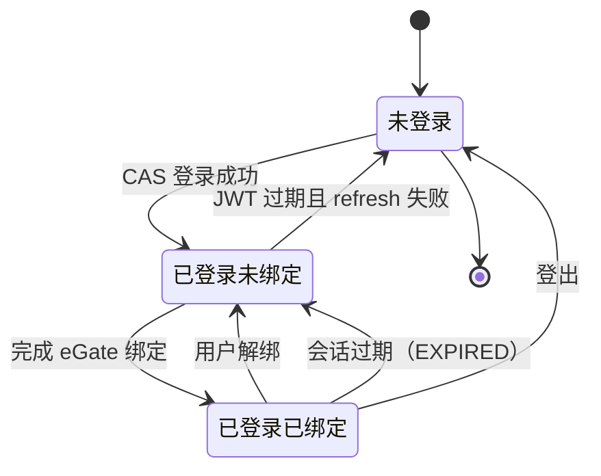
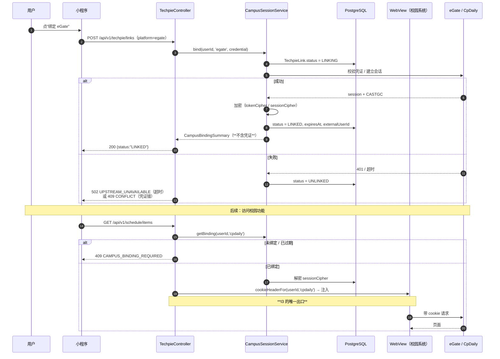

# 功能规格 · TechPie 能力整合 `techpie`

| 项 | 值 |
| --- | --- |
| 模块 ID | `techpie`（契约 §4.1，敏感级 **中**） |
| 路由前缀 | `/api/v1/techpie/*`（契约 §6.1） |
| 文档版本 | `v1` · 2026-10-17 |
| 上游契约 | `docs/architecture/00-FROZEN-CONTRACT.md` §4 / §5 / §6.1 / §9 / §11.1 / §11.2 / §11.3 / **§11.4** / §11.9 |
| 核心 ADR | `docs/adr/0004-auth-two-tier.md`（**必读全文**） |
| 领域骨架 | `docs/architecture/02-domain-model.md` §2.9（第 814–850 行，**已冻结，本规格向后兼容**） |
| 里程碑 | M1（`auth` 与 `schedule` 基础）、M4（`06-roadmap.md:316` "AI 与整合"） |
| 参考实现 | `HeZeBang/TechPie-flutter`，本地 clone `/tmp/techpie-ref` |
| 技术栈 | NestJS 12.1.3 + Prisma 7.10.1 + PostgreSQL 16 + Redis 7 + BullMQ |

---

## 1. 目标与非目标

### 1.1 目标

| # | 目标 |
| --- | --- |
| G1 | 逐项盘点 TechPie 已实现的校园能力，映射到可达鸭的 **19 个冻结模块 ID**，不留悬空 |
| G2 | 在**两级身份模型**（契约 §5）下给出 `AuthPort` / `CampusSessionPort` 的具体承接方案 |
| G3 | 满足契约 §11.4 的 **I1–I5 五条硬不变式**，并给出每条不变式的**强制手段**（不是文档警告） |
| G4 | 诚实呈现 **CASTGC 代持**的合规风险，给出不代持的兜底路径 |
| G5 | 给出分阶段接入顺序与**可验证**的每阶段验收标准 |

### 1.2 非目标

| # | 不做 | 理由 |
| --- | --- | --- |
| N1 | **不复制 TechPie 的任何代码** | 无 LICENSE 文件（§7）。只借鉴架构思想 |
| N2 | 不代理/转发 TechPie 的后端 API | 依赖他人自建服务（`techpie.geekpie.club`）可用性不可控，且会把用户凭证路由给第三方 |
| N3 | 不实现 Piazza / CourseBench 集成 | TechPie 自身**未实现**（`/tmp/techpie-ref/README.md:56-57` 仍是 `[ ]`） |
| N4 | 不做 Casdoor 云同步（`sync_service` / `watch_sync_service`） | 那是 GeekPie SSO 账号体系的能力，与可达鸭自有身份无关 |
| N5 | 不承诺"自动续期"可用 | `/auth/renew` 是 TechPie **自建后端**的能力（§6.3），我们无法假定它对我们开放 |

---

## 2. TechPie 能力清单（逐项，带引用）

### 2.1 来自 README Roadmap

`/tmp/techpie-ref/README.md:28-57`：

| 行号 | 能力 | 状态 |
| --- | --- | --- |
| `README.md:31` | Schedule（UI） | ✅ |
| `README.md:32` | Login（UI） | ✅ |
| `README.md:33` | Assignment（UI） | ❌ 未实现 |
| `README.md:44` | GeekPie SSO (Casdoor) login + token refresh | ✅ |
| `README.md:45` | eGate binding / CpDaily keep-alive（via `/api/auth/renew`） | ✅ |
| `README.md:46` | Schedule（API） | ❌ 未实现（UI 已有） |
| `README.md:47-51` | Homework / Resources：GradeScope / elearning / Piazza / ACM OJ | ❌ 未实现 |
| `README.md:53` | Auto renew token | ✅ |
| `README.md:54` | Auto refresh schedule | ✅ |
| `README.md:55` | Auto deadline fetch / jump | ❌ 未实现 |
| `README.md:56` | Piazza Forum | ❌ 未实现 |
| `README.md:57` | CourseBench Integration | ❌ 未实现 |

### 2.2 来自 Service 层清单

`/tmp/techpie-ref/CLAUDE.md:47-55`：

| 行号 | Service | 职责 |
| --- | --- | --- |
| `CLAUDE.md:48` | `AuthService` | **仅一级身份**：GeekPie Uni-Auth (Casdoor) SSO 登录、SSO token 刷新、登出级联。持有 `UserSession`（`geekpieToken` / `geekpieRefreshToken`）。**刻意不知道 CASTGC/CpDaily** |
| `CLAUDE.md:49` | `UniAuthService` | Casdoor OAuth：`login()` / `loginSdkOnly()` 用授权码换 `SsoTokens`（access + refresh + expiry）；`refresh()` 轮换 |
| `CLAUDE.md:50` | `ScheduleService` | 学期列表、课程表、开学日期；CpDaily cookie 来自 eGate 绑定；**401 时自动 `renewEgateBinding()` 重试** |
| `CLAUDE.md:51` | `AssignmentService` | 聚合 Blackboard + 考试表 + Gradescope + Hydro 的 DDL；**逐平台合并，单平台失败不清空其它** |
| `CLAUDE.md:52` | `ThirdPartyAuthService` | Gradescope / Hydro / **eGate** 的绑定、解绑、自动续期。**CASTGC 在 App 内的唯一来源** |
| `CLAUDE.md:53` | `StorageService` | `FlutterSecureStorage`（凭证）+ `SharedPreferences`（缓存/设置）。**用的是 `flutter_secure_storage_ohos` 硬分叉，不是上游 facade** |
| `CLAUDE.md:54` | `UpdateService` | GitHub `releases/latest` 版本检查。**刻意独立于自家后端**，无账号也能用 |
| `CLAUDE.md:55` | `ThemeService` | Material 动态取色、主题持久化 |

### 2.3 来自功能入口表（用户可见能力）

`/tmp/techpie-ref/lib/models/feature.dart:41-100`：

| 行号 | `id` | 中文名 | 模式 | 依赖 |
| --- | --- | --- | --- | --- |
| `feature.dart:42-51` | `elrc_recordings` | 课程录播 | `native` | 独立 WebView（`elrc.shanghaitech.edu.cn`） |
| `feature.dart:52-59` | `ecourse` | E云课堂 | `webviewWithCookie` | `CookieType.ecourse` |
| `feature.dart:60-67` | `student_leave` | 学生请假 | `webviewWithCookie` | `CookieType.egateApp` |
| `feature.dart:68-79` | `campus_card` | 校园卡（付款码） | `native` | **OPENID 绑定**（独立通道，见 §2.5） |
| `feature.dart:80-89` | `oa_gym` | 场馆预约 | `native` | CpDaily / CASTGC |
| `feature.dart:90-99` | `egate_xshd` | 学生活动 | `native` | `CookieType.egateApp` |

`FeatureMode` 定义在 `feature.dart:10-13`（`native` / `webviewWithCookie`），
`CookieType` 在 `feature.dart:15-19`（`ecourse` / `eams` / `egateApp`）。

### 2.4 会话节点树（TechPie 的实现细节）

`/tmp/techpie-ref/lib/services/session/session_node.dart`：

| 行号 | 内容 |
| --- | --- |
| `session_node.dart:188` | 节点树：`cpdaily`（顶层，账号密码/SMS 绑定，`/auth/renew`），派生子节点 `eams` / `elearning` / `egateApp` |
| `session_node.dart:201-208` | `renew()` **单飞**（single-flight）：并发调用共享一次 in-flight renew；`epoch` 单调递增防续期风暴 |
| `session_node.dart:339-350` | `_cookieFromAccount`：`cpdaily` 节点把 `raw['cookies']` 与 `CASTGC=<tgc>` **拼接** |
| `session_node.dart:616-622` | CpDaily keep-alive：`POST ${baseUrl()}${renewPath ?? '/auth/renew'}` |
| `session_node.dart:689, 736` | 子节点续期路径默认 `/auth/third-party/$id` |

`/tmp/techpie-ref/lib/services/third_party_auth_service.dart:252-290`（CpDaily 绑定区块）：

| 行号 | 内容 |
| --- | --- |
| `third_party_auth_service.dart:252-259` | 注释：cpdaily 绑定是新架构里 **CASTGC 唯一存在的地方**；一级 SSO session 无 `tgc`/`cookies` |
| `:266` | `hasCpdailyBinding` —— **所有依赖 CASTGC 的功能必须先检查这个** |
| `:269` | `cpdailyBinding` |
| `:270-273` | `cpdailyCookies()` —— 文档明确"**always ending with `CASTGC=<tgc>`**"；无绑定时返回 `''`，调用方须视为"会话不可用" |
| `:276` | `cpdailyStudentId` |
| `:278-280` | 续期委托给 `SessionNode.renew`，**单飞**：两个服务同时 401 只发**一次** `/auth/renew` |

### 2.5 校园卡：**独立的第二条绑定通道**

这是一个**关键发现**，与 eGate/CpDaily **不是同一条链路**：

| 证据 | 内容 |
| --- | --- |
| `/tmp/techpie-ref/lib/features/campus_card/data/api/ecard_api_client.dart:110` | eCard API 直连 `https://ecard.shanghaitech.edu.cn` |
| `/tmp/techpie-ref/lib/features/campus_card/data/auth/ecard_openid_auth_port.dart:30` | 默认 `baseUrl = 'https://ecard.shanghaitech.edu.cn'` |
| `/tmp/techpie-ref/lib/services/campus_card_service.dart:195-233` | `verifyOpenId()` / `connect(openId, channel)` / `disconnect()` —— 校园卡用 **OPENID** 绑定，`EcardOpenIdChannel.wechat` |
| `/tmp/techpie-ref/lib/services/ecard_bind_service.dart:82-84` | 注释：`CampusCardService.connect` 是 **OPENID 的唯一写入者** |
| `/tmp/techpie-ref/lib/services/ecard_bind_hijack.dart:52` | `static const host = 'ecard.shanghaitech.edu.cn'` —— 用一个 **DNS-only 隧道**劫持该域名以兑换绑定码 |
| `/tmp/techpie-ref/lib/services/ecard_bind_hijack.dart:41-47` | 注释：**仅 DNS**，TCP 不走隧道，所以不代理任何流量 |

**结论**：校园卡能力 **不依赖 CASTGC**。它依赖的是 eCard 的 OPENID 会话。
这对我们是个**好消息** —— 校园卡可以在"不代持 CASTGC"的前提下独立落地。

**但 DNS 劫持的做法我们不抄**：它依赖设备侧 VPN/DNS 配置能力，
在微信小程序里**根本做不到**（小程序无此 API），且从校园网角度看这是可疑流量。
见 §6.5。

### 2.6 场馆预约：一个**没有家的能力**

`/tmp/techpie-ref/docs/gym-reservation-verification.md` 记录了场馆预约的实现与验证，
其中暴露了一个我们**必须知道的事实**：

| 证据（`docs/gym-reservation-verification.md`） | 内容 |
| --- | --- |
| 第 8 行 | 后端是**独立仓库** `HeZeBang/shanghaitech-cpdaily-auth`（`main@74d67bb`），改的是 `lib/oa/gym.ts` |
| 第 14-16 行 | 原实现"每个场地 × 每个时段"串行查询，30 秒超时；新版改为单次日期查询 + 后续页面最多并发 4 个 |
| 第 16 行 | 学校 `pageIndex` **从 1 开始**，0 和 1 都返回第一页；从 1 读到 `pagenum` 并用 `recordCount` 核对 |
| 第 18 行 | 客户端复用**内存中的 OA Cookie**（来自 eGate 登录态），登出/解绑/登录态变化时清除 |
| 第 20 行 | **"缺少分类或结果时明确报'状态未知/结果不完整'，不能当作'已满/没有预约'"** |
| 第 20 行 | **"预约提交超时提示先查询记录，不自动重复提交"** |
| 第 24-29 行 | 物理场地映射：网球选项 4 → 提交 `pickleball / 1`；匹克球选项 2 → 提交 `tennis / 1`；匹克球二号（学校 ID 44）不出现在查询/可用性/预约中 |

**对我们的意义**：
1. 场馆预约需要 **CpDaily/OA 会话**（即 CASTGC 链路），因此受 §6 的合规红线约束；
2. 它的**领域模型在我们的 19 个模块里没有归属**（§3.3）；
3. 它揭示了**上游契约的脆弱性**：场地编号、`pageIndex` 起点、分类名称都会变，
   且"状态未知"与"已满"必须区分 —— 这是一条**通用的上游集成教训**，写进 §10。

### 2.7 一级身份的实证：Casdoor

| 证据 | 内容 |
| --- | --- |
| `/tmp/techpie-ref/lib/services/uni_auth_service.dart:17` | `const String _uniAuthServerUrl = 'https://auth.geekpie.club'` |
| `/tmp/techpie-ref/lib/services/api_base_url.dart:4` | `const String prodApiBaseUrl = 'https://techpie.geekpie.club/api'` |
| `/tmp/techpie-ref/CLAUDE.md:60` | 一级账号 = **GeekPie SSO (Casdoor)**，产出**无** CASTGC |

> ⚠️ **重要判断**：TechPie 的一级身份是 **GeekPie 的 Casdoor**（`auth.geekpie.club`），
> **不是上海科技大学的官方身份提供方**。
> 契约 §5 要求可达鸭的一级身份是"**上科大统一身份认证 (CAS / Egate OAuth)**"。
> **因此我们不能照抄 TechPie 的一级身份** —— 这是 §5.1 要解决的核心问题。

---

## 3. 能力 → 可达鸭模块映射

### 3.1 映射总表（19 个冻结 ID）

| # | TechPie 能力 | 证据 | 可达鸭模块 | 是否需二级绑定 | 备注 |
| --- | --- | --- | --- | --- | --- |
| 1 | 学期列表 / 课程表 / 开学日期 | `CLAUDE.md:50` | **`schedule`** | ✅ CpDaily | M1 范围（`06-roadmap.md:93`） |
| 2 | 考试表 | `assignment_service.dart:220` | **`schedule`** | ✅ CpDaily | 与课程表同一会话 |
| 3 | DDL 聚合（Blackboard + 考试 + Gradescope + Hydro） | `CLAUDE.md:51` | **`schedule`**（主）+ **`techpie`**（第三方 token 绑定） | ✅ 混合 | Blackboard/考试走 CpDaily；Gradescope/Hydro 走独立 token |
| 4 | 一卡通余额 / 流水 / 付款码 | `feature.dart:68-79` | **`campus-card`** | ⚠️ **OPENID**（非 CASTGC） | 见 §2.5 |
| 5 | eGate 绑定 / 解绑 / 续期 | `CLAUDE.md:52` | **`techpie`**（`CampusSessionPort` 的 `egate` 实现） | — | 这就是二级绑定的本体 |
| 6 | WebView CASTGC 注入（E云课堂 / 学生请假 / 学生活动） | `feature.dart:52-67, 90-99`；`CLAUDE.md:81` | **`techpie`** | ✅ CpDaily | 契约 §11.4 **I3** 的唯一出口 |
| 7 | 自动续期（token + 会话） | `README.md:53`；`session_node.dart:616-622` | **`techpie`** | ✅ | **可用性未知**（§6.3） |
| 8 | 课程录播（ELRC） | `feature.dart:42-51` | **`techpie`** | ❌ 独立 WebView | 无 cookie 注入，纯外链 |
| 9 | 场馆预约（OA Gym） | `feature.dart:80-89`；`gym-reservation-verification.md` | **⚠️ 无归属** | ✅ CpDaily | 见 §3.3 |
| 10 | 校园网（认证/查询） | — | **⚠️ 未发现** | — | 见 §3.4 |
| 11 | 云同步（Casdoor properties） | `sync_service.dart:207, 238` | **`profile`**（若做） | ❌ | 属 GeekPie 账号能力，非必须 |
| 12 | 版本更新检查 | `CLAUDE.md:54` | **`profile`**（设置页） | ❌ | 独立于后端，直接查 GitHub Releases |
| 13 | 主题（动态取色/持久化） | `CLAUDE.md:55` | **`profile`** | ❌ | 客户端本地能力，无服务端 |
| 14 | 登录 / 登出 / token 刷新 | `CLAUDE.md:48-49` | **`auth`** | ❌ | 一级身份 |
| 15 | 启动时序（缓存 hydrate → 首帧 → 后台刷新） | `CLAUDE.md:65-69` | 跨模块（契约 §8） | — | 已是冻结契约 |
| 16 | Piazza / CourseBench / elearning 作业 | `README.md:47-51, 56-57` | **不做** | — | TechPie 自身未实现（N3） |
| 17 | 留言板 / 好友 / 聊天 / 举报 | `models.py` 对应物不在 TechPie；见 `/tmp/techpie-ref` 无此服务 | **`forum`** | — | 可达鸭自有，不由 TechPie 来 |

### 3.2 映射结论（按模块归并）

| 模块 ID | 从 TechPie 承接的能力 |
| --- | --- |
| `auth` | 一级身份（**但身份源不同**，见 §5.1）、JWT 签发与刷新、登出级联 |
| `schedule` | 学期、课程表、考试、DDL 聚合（Blackboard / 考试表部分） |
| `campus-card` | 余额、流水、付款码（**走 OPENID 通道，与 CASTGC 解耦**） |
| `techpie` | eGate/CpDaily 绑定管理、WebView 会话注入、自动续期、第三方 token 绑定（Gradescope/Hydro）、课程录播入口 |
| `profile` | 版本更新检查、主题偏好、（可选）云同步 |
| **⚠️ 无归属** | **场馆预约（OA Gym）** |

### 3.3 场馆预约的归属问题（**必须由 Lead 裁决**）

场馆预约在 19 个模块里**找不到合适的家**：

| 候选 | 为什么不合适 |
| --- | --- |
| `schedule` | 语义是"课表/考试"，场馆预约是**资源预订**，不是日程 |
| `campus-card` | 语义是"卡与钱"，场馆预约是**场地** |
| `techpie` | 语义是"与 TechPie/GeekPie 体系互联互通"。场馆预约**不是 TechPie 的能力** —— 它是**学校 OA 的能力**，TechPie 只是消费者 |
| `errand` | 语义是"代取快递/买饭/送件"，完全不相关 |
| `groupbuy` | 语义是"拼团/凑单"，不相关 |

**三个选项，请 Lead 选一个**（本规格**不擅自新增模块**，因为契约 §4 的模块 ID 是冻结的）：

| 选项 | 做法 | 代价 |
| --- | --- | --- |
| **A（推荐）** | 新增模块 ID `facility`（场馆/资源预约） | 需改契约 §4 + 新增领域模型 + 新增 ADR。**但是诚实的** —— 强行塞进 `schedule` 会污染该模块的语义 |
| B | 归入 `techpie`，并在文档中说明"`techpie` 也承载学校 OA 能力的接入" | 零契约改动，但 `techpie` 变成杂物间 |
| C | **明确不做**，M4 再评估 | 零成本，但丢失一个高价值能力 |

> **本规格的立场**：**选 A**。理由是 `06-roadmap.md:173` 已经确立了"先立规矩"的原则 ——
> 模块边界一旦被"临时塞进去"污染，后续很难拆。
> **但这是一个跨作用域的契约变更，必须由 Lead 决定，本文档只提出。**

### 3.4 校园网：**未发现**

用户提示中提到了"校园网"。**在 `/tmp/techpie-ref` 中未找到校园网认证或查询的实现**：

```bash
# 实际执行的检索（在 /tmp/techpie-ref 内）
grep -rn "校园网\|network_auth\|portal\|srun\|drcom\|802.1x" lib/ --include=*.dart
# → 无匹配
```

> **诚实标注**：**TechPie 没有校园网能力**（至少在当前 clone 的 `master` 上没有）。
> 如果用户所指的"校园网"确实存在于 TechPie，那是在我们未检查的分支/提交上。
> 登记为未决问题 **U1**。
> **我们不应基于"TechPie 有校园网能力"这个未经证实的假设做设计。**

---

## 4. 两级身份模型对接（契约 §5 + §11.4）

### 4.1 契约要求回顾

契约 §5：

```
第一级 · 身份层 (Identity)        上科大统一身份认证 (CAS / Egate OAuth)
                                  → 决定 "你是谁" : userId / 学号 / 姓名 / 院系
                                  → 唯一产出 KedaYa 自有 JWT (access + refresh)

第二级 · 能力层 (Campus Session)   第三方系统绑定 (eGate / CpDaily / 教务 / 一卡通)
                                  → 决定 "你能访问哪些校园系统"
                                  → 产出各系统的 session cookie，绝不上抛为身份
```

**硬规则**（契约 §5）：
1. `AuthPort` 只认第一级，**不知道**任何校园系统的 cookie/session/tgc；
2. 校园系统能力必须通过 `CampusSessionPort` 获取；
3. "已登录但未绑定"是合法状态 → `CAMPUS_BINDING_REQUIRED`；
4. 敏感模块的授权独立。

### 4.2 一级身份：**我们不能照抄 TechPie**

| | TechPie | 可达鸭（契约 §5） |
| --- | --- | --- |
| 一级身份源 | GeekPie Casdoor（`auth.geekpie.club`） | **上科大统一身份认证（CAS / Egate OAuth）** |
| 产出 | `SsoTokens`（access + refresh） | **可达鸭自有 JWT** |
| 是否学校官方 | ❌ GeekPie 是学生组织 | ✅ 学校官方 |

**三个方案：**

| 方案 | 做法 | 优点 | 缺点 | 结论 |
| --- | --- | --- | --- | --- |
| **A** | 一级身份 = **学校 CAS 直连** | 符合契约 §5 字面要求；学号/姓名/院系来自权威源；无需中间方 | 需与信息办对接 CAS 客户端注册（**未知能否获批**） | ✅ **目标方案** |
| B | 一级身份 = **GeekPie Casdoor 联邦**（把 Casdoor 当作 OIDC IdP） | 复用 TechPie 已验证的链路；快速 | **一级身份不是学校官方** → 契约 §5 的字面要求不满足；且依赖 GeekPie 服务的可用性；用户需先有 GeekPie 账号 | ⚠️ 仅作**过渡/备选** |
| C | **双 IdP**：学校 CAS 为主，Casdoor 为可选联邦 | 兼容两类用户 | 复杂度翻倍；身份合并（同一人两个账号）是个真问题 | ⚠️ 仅在确有必要时 |

**推荐：A 为目标，B 为过渡。**

**过渡的理由**：契约 §11.9 第 1 项明确指出"学校是否允许第三方代持校园会话 —— 合规性未与信息办确认"，
且**阻塞 M1**。在信息办对接完成之前，B 可以让 M1 的**技术链路**先跑通
（验证 Port 形状、JWT 签发、两级状态机），**但必须在文档与 UI 上标明这是过渡身份源**。

> ⚠️ **B 作为过渡有一个前提**：**绝不能让 Casdoor 成为唯一的身份源**，
> 否则一旦 M1 需要切换到学校 CAS，所有已注册用户的身份都要迁移。
> **因此 `AuthPort` 的实现必须从第一天就是可替换的** —— 这正是 Port 模式的价值。

**统一约束（无论选 A 还是 B）**：

```ts
// services/api/src/modules/auth/domain/ports/auth.port.ts
// 契约 §11.4 能力集：发起登录 / 换 JWT / 刷新 / 登出 / 同步读会话
export interface AuthPort {
  /** 产出授权 URL（或由平台宿主代取授权码） */
  beginLogin(redirectUri: string, state: string): Promise<{ authorizeUrl: string }>;
  /** 授权码 → 可达鸭自有 JWT */
  exchangeCode(code: string, redirectUri: string): Promise<KedaYaTokens>;
  refresh(refreshToken: string): Promise<KedaYaTokens>;
  /** 登出并吊销全部 refresh token */
  logout(userId: string): Promise<void>;
}
```

**⚠️ I1 的强制（不是文档警告）**：

```ts
// 契约 §11.4 I1：身份层会话类型不含 cookie/cookies/session/sessionToken/tgc/castgc/ticket/tenant
export interface KedaYaIdentitySession {
  userId: string;
  studentId: string | null;
  name: string | null;
  department: string | null;
  // 严禁出现：cookie / cookies / session / sessionToken / tgc / castgc / ticket / tenant
}
```

强制手段（ADR §7 已规定，这里给出具体实现）：

| 手段 | 实现 |
| --- | --- |
| 类型断言测试 | `expect(Object.keys(session)).not.toContain(...)` 对 8 个禁用键名逐一断言 |
| 序列化键名断言 | 对 `JSON.stringify(session)` 的结果做正则扫描（`/castgc|tgc|sessionToken/i`） |
| ESLint 规则 | 禁止 `KedaYaIdentitySession` 类型上出现禁用字段名（`@typescript-eslint/naming-convention` + 自定义规则） |
| 日志脱敏 | 日志中间件对 8 个键名做**白名单外剔除**（不是黑名单 —— 白名单更安全） |

### 4.3 二级身份：`CampusSessionPort`

**契约 §11.4 能力集**：列出绑定 / 绑定 / 解绑 / 续期 / 查询是否已绑定 / **取得 cookie 注入串**。

```ts
// services/api/src/modules/techpie/domain/ports/campus-session.port.ts
export type CampusPlatform = 'egate' | 'cpdaily' | 'ecard' | 'gradescope' | 'hydro';

/** 绑定元数据 —— 只含状态，绝不含凭证。这是业务层唯一能拿到的形状。 */
export interface CampusBindingSummary {
  platform: CampusPlatform;
  status: 'UNLINKED' | 'LINKING' | 'LINKED' | 'EXPIRED' | 'REVOKED';
  externalUserId: string | null;
  expiresAt: string | null;
  lastSyncAt: string | null;
  // 严禁出现：cookie / cookies / session / sessionToken / tgc / castgc / ticket / tenant
}

export interface CampusSessionPort {
  listBindings(userId: string): Promise<CampusBindingSummary[]>;
  getBinding(userId: string, platform: CampusPlatform): Promise<CampusBindingSummary | null>;
  bind(userId: string, platform: CampusPlatform, credential: BindCredential): Promise<CampusBindingSummary>;
  unbind(userId: string, platform: CampusPlatform): Promise<void>;
  renew(userId: string, platform: CampusPlatform): Promise<CampusBindingSummary>;

  /**
   * 契约 §11.4 I3 —— 校园 cookie 的唯一受限出口。
   * 仅供 WebView 注入使用。业务层不得调用（见下方强制）。
   */
  cookieHeaderFor(userId: string, platform: CampusPlatform): Promise<string>;
}
```

**⚠️ I3 的强制（这是最容易破的一条）**：

契约 §11.4 I3 要求"校园系统 cookie 的**唯一出口**是一个受限方法，**仅供 WebView 注入**"。

| 强制手段 | 实现 |
| --- | --- |
| 目录隔离 | `cookieHeaderFor` 的实现**只在** `modules/techpie/data/webview-session/` 下被 import |
| ESLint 边界规则 | `no-restricted-imports`：除 `webview-session/` 外，禁止从该路径 import |
| 架构测试 | 静态扫描：全仓库中 `cookieHeaderFor(` 的调用点**必须**落在 `webview-session/` 目录内，否则 CI 失败 |
| 返回值形态 | 返回**完整 header 串**而不是 cookie 对象 —— 调用方拿到的是一个不透明的字符串，无法解析出单个 cookie 名 |

> **返回字符串而不是对象**是刻意的：它让调用方**在类型上**就无法挑选出 `CASTGC` 单独使用。
> 参考 ADR 0004 §2.3 的论证：强约束的价值在于"业务代码在类型上就拿不到 CASTGC"。

**⚠️ I2 的强制**：身份层不返回任何校园凭据。

```ts
// 架构测试（ADR §7.1 要求）
// 断言：AuthPort 的实现文件不得 import CampusSessionPort
expect(importsOf('modules/auth/data/**')).not.toInclude('campus-session.port');
```

**⚠️ I4 的强制**：「已登录但未绑定」是合法状态。

```ts
// 集成测试
const res = await request(app).get('/api/v1/schedule/items').set('Authorization', `Bearer ${jwtWithoutBinding}`);
expect(res.status).toBe(409);
expect(res.body.error.code).toBe('CAMPUS_BINDING_REQUIRED');   // 不是 UNAUTHENTICATED
```

**⚠️ I5 的强制**：读取本地会话必须**同步**可用（服务契约 §8 首帧）。

> 这一条主要约束**客户端**（小程序/Flutter/Web）。
> 对 NestJS 后端而言，等价要求是：**`GET /api/v1/auth/session` 必须是纯本地读取**，
> 不得触发任何上游调用（否则首帧会被网络阻塞）。
> 验收：在 mock 上游全部超时的环境下，该端点仍在 **50 ms** 内返回。

### 4.4 三级状态机（用户视角，ADR §5.3）



**关键**：`已登录已绑定 → 已登录未绑定`（会话过期）**不导致登出**。
这是 ADR §2.1 的核心教训 —— "CASTGC 失效"与"登录过期"是**两件事**。

**ADR §5.4 错误码映射**：

| 状态 | 访问 `schedule` 等校园能力 | 访问 `forum` 等自有能力 |
| --- | --- | --- |
| 未登录 | `UNAUTHENTICATED` (401) | `UNAUTHENTICATED` (401) |
| 已登录未绑定 | **`CAMPUS_BINDING_REQUIRED` (409)** | ✅ 正常 |
| 已登录已绑定 | ✅ 正常 | ✅ 正常 |

### 4.5 绑定流程时序



---

## 5. 数据模型

### 5.1 `TechpieLink`（**沿用契约 §2.9**）

契约 `02-domain-model.md:820-825` 已冻结：

| 字段 | 类型 | 必填 | 说明 |
| --- | --- | --- | --- |
| `userId` | `string(ulid)` | 是 | |
| `provider` | `enum<techpie\|geekpie>` | 是 | |
| `status` | `enum<UNLINKED\|LINKING\|LINKED\|EXPIRED\|REVOKED>` | 是 | |
| `externalUserId` | `string` | 否 | 对端标识 |
| `tokenCipher` | `string` | 否 | 对端 token，**加密存储** |
| `expiresAt` | `string(iso)` | 否 | |
| `lastSyncAt` | `string(iso)` | 否 | |

**⚠️ 契约 §2.9 的 `provider` 枚举是 `techpie|geekpie` —— 这与我们实际需要的平台不一致。**

我们真正需要区分的是**校园系统**（`egate` / `cpdaily` / `ecard` / `gradescope` / `hydro`），
而不是"对端产品"（techpie / geekpie）。这是契约骨架与实现需求之间的**真实缺口**。

**本规格的处理（需 Lead 裁决）**：

| 方案 | 做法 |
| --- | --- |
| **A（推荐）** | `provider` 枚举扩展为 `egate\|cpdaily\|ecard\|gradescope\|hydro\|geekpie`，把"平台"语义统一。`techpie`/`geekpie` 保留为**兼容值**（历史数据） |
| B | 新增 `platform` 字段，`provider` 保持不变 | 

**本规格采用 A 的字段名 + 明确登记为契约变更**（未决问题 U2）。

### 5.2 `TechpieSyncJob`（**沿用契约 §2.9**）

契约 `02-domain-model.md:827-830`：`linkId` / `kind`(`pull_schedule|pull_deadline|push_post`) /
`status`(`QUEUED|RUNNING|SUCCEEDED|FAILED|SKIPPED`) / `attempts`（指数退避，最多 5 次）。

**新增（可选）：**

| 字段 | 类型 | 必填 | 说明 |
| --- | --- | --- | --- |
| `lastError` | `string` | 否 | ≤500 字，**必须脱敏**（不得含 cookie/token） |
| `nextRetryAt` | `string(iso)` | 否 | 指数退避的下次重试时刻 |
| `startedAt` / `finishedAt` | `string(iso)` | 否 | |

### 5.3 `CampusSession`（**新增，凭证的唯一落点**）

> ⚠️ **这是整个模块**最敏感**的表。它存储校园系统会话密文。**
> **它不属于身份层**（契约 §5 硬规则 1），且**业务代码永远不直接读它**。

| 字段 | 类型 | 必填 | 说明 |
| --- | --- | --- | --- |
| `userId` | `string(ulid)` | 是 | |
| `platform` | `enum<egate\|cpdaily\|ecard\|gradescope\|hydro>` | 是 | |
| `status` | `enum<ACTIVE\|EXPIRED\|REVOKED>` | 是 | |
| `sessionCipher` | `string` | 是 | **加密后的会话**（含 cookie / CASTGC）。AES-256-GCM，密钥来自 KMS |
| `cipherKeyId` | `string` | 是 | 密钥版本，支持轮换 |
| `externalUserId` | `string` | 否 | 学号等对端标识 |
| `expiresAt` | `string(iso)` | 否 | |
| `lastRenewedAt` | `string(iso)` | 否 | |
| `renewFailCount` | `int` | 是 | 默认 0；≥3 时转 `EXPIRED` 并通知用户重绑 |

**约束**：
- `@@unique([userId, platform])`；
- **解密只允许在 `CampusSessionService` 内部**（同一文件作用域），不导出解密方法；
- 每次解密**写审计日志**（`05-security-privacy.md` §6.2）；
- 保留期：**解绑即硬删 `sessionCipher`**（对齐 `05-security-privacy.md:458` 对 `CampusBinding` 的策略）。

### 5.4 `TechpieAuditLog` 的登记

契约 §2.9 未提及 `techpie` 的审计，但 `techpie` 敏感级是 **中**。
**凭证的解密、绑定、解绑、续期必须落审计**（`05-security-privacy.md` §6.2）。

### 5.5 Prisma 草案

```prisma
model TechpieLink {
  id             String   @id @default(dbgenerated("gen_ulid()"))
  userId         String
  user           User     @relation(fields: [userId], references: [id], onDelete: Cascade)
  // 契约 §2.9 的 provider 枚举，本规格扩展为"校园平台"语义（U2）
  provider       String   // egate | cpdaily | ecard | gradescope | hydro | techpie | geekpie
  status         String   @default("UNLINKED") // UNLINKED|LINKING|LINKED|EXPIRED|REVOKED
  externalUserId String?
  tokenCipher    String?  // 对端 token（加密）
  expiresAt      DateTime?
  lastSyncAt     DateTime?
  createdAt      DateTime @default(now())
  updatedAt      DateTime @updatedAt
  deletedAt      DateTime?

  jobs TechpieSyncJob[]
  @@unique([userId, provider])
  @@index([status, expiresAt])
  @@map("TechpieLink")
}

model TechpieSyncJob {
  id           String   @id @default(dbgenerated("gen_ulid()"))
  linkId       String
  link         TechpieLink @relation(fields: [linkId], references: [id], onDelete: Cascade)
  kind         String   // pull_schedule|pull_deadline|push_post
  status       String   @default("QUEUED") // QUEUED|RUNNING|SUCCEEDED|FAILED|SKIPPED
  attempts     Int      @default(0)   // 指数退避，最多 5 次
  lastError    String?  // 必须脱敏
  nextRetryAt  DateTime?
  startedAt    DateTime?
  finishedAt   DateTime?
  createdAt    DateTime @default(now())
  updatedAt    DateTime @updatedAt

  @@index([status, nextRetryAt])
  @@map("TechpieSyncJob")
}

/// ⚠️ 校园会话密文。仅 CampusSessionService 内部可解密。业务层不可读。
model CampusSession {
  id             String   @id @default(dbgenerated("gen_ulid()"))
  userId         String
  user           User     @relation(fields: [userId], references: [id], onDelete: Cascade)
  platform       String   // egate|cpdaily|ecard|gradescope|hydro
  status         String   @default("ACTIVE") // ACTIVE|EXPIRED|REVOKED
  sessionCipher  String   // AES-256-GCM
  cipherKeyId    String
  externalUserId String?
  expiresAt      DateTime?
  lastRenewedAt  DateTime?
  renewFailCount Int      @default(0)
  createdAt      DateTime @default(now())
  updatedAt      DateTime @updatedAt

  @@unique([userId, platform])
  @@index([status, expiresAt])
  @@map("CampusSession")
}
```

---

## 6. 合规红线：CASTGC 代持

### 6.1 风险清单（**逐条，不回避**）

| # | 风险 | 说明 | 严重度 |
| --- | --- | --- | --- |
| **R1** | **学校未授权** | 契约 §11.9 第 1 项：**"学校是否允许第三方代持校园会话（CASTGC）—— 合规性未与信息办确认"，阻塞 M1** | **最高** |
| **R2** | **凭证保管责任** | 我们成为他人校园凭证的保管方。一旦泄漏，影响范围是**全部绑定用户**的校园系统访问权 | **最高** |
| **R3** | **上游 ToS** | 学校系统很可能**没有**授权第三方代持会话的服务条款。我们无法引用任何授权依据 | **高** |
| **R4** | **续期能力不可得** | `/auth/renew` 是 **TechPie 自建后端**（`shanghaitech-cpdaily-auth`）的能力（契约 §11.9 第 2 项）。**我们无法假定它对我们开放** | **高** |
| **R5** | **会话重放** | 持有 CASTGC 意味着我们（或任何拿到它的人）可以**以用户身份**访问校园系统，包括用户从未使用过的功能 | **高** |
| **R6** | **爆炸半径** | 服务端被入侵 → 全部用户的 CASTGC 同时泄漏。ADR §2.3 描述的失败场景（日志、JWT 载荷、崩溃上报）每一个都是泄漏点 | **高** |
| **R7** | **无官方冒充** | 契约 §9 要求"全站显著标注第三方非官方"。代持校园会话**加剧**了"看起来像官方"的观感风险 | 中 |
| **R8** | **撤回困难** | 用户解绑后，我们**无法证明**密文已被删除（除非有可验证的审计） | 中 |

### 6.2 ADR 0004 的结论（**必须引用**）

ADR `0004-auth-two-tier.md` §2.2 引用了 TechPie 自己的 `CLAUDE.md`，得出三条教训：

| # | 教训 | TechPie 做法 | 我们的加强（ADR §2.2 表格） |
| --- | --- | --- | --- |
| L1 | 两层身份必须分离 | `AuthService` / `ThirdPartyAuthService` 分离 | 保留，**提升为 Port 级接口契约** |
| L2 | 靠"模型里不放字段"隔离 | `UserSession` 刻意不含 `tgc`/`cookies` | **加强**：字段缺席是**弱约束** —— 加个字段就破了，且没有测试会失败 |
| L3 | 靠文档与命名约定提醒 | `CLAUDE.md` 大段警告 | **加强**：文档是**最弱**的约束，需要架构测试 |

ADR §2.2 的原文结论：

> **"一个只有文档保护的边界，在一次紧急修 bug 时就会消失。"**

ADR §4 否决的方案（**逐条列出，说明我们都考虑过**）：

| 方案 | 内容 | 否决理由（ADR §4） |
| --- | --- | --- |
| A | 单一 session（把 CASTGC 放进身份 session） | 失效模式混淆（ADR §2.1） |
| B | 把 CASTGC 放进 JWT 载荷 | 凭证发到客户端 |
| C | `AuthPort` 直接提供校园能力 | 破坏两层分离 |
| D | 客户端 WebView 注入 cookie 直连校园系统 | 凭证落到客户端 |
| E | 客户端本地缓存校园凭证（加密存储） | 凭证落到客户端 |
| F | 单点登录联合（KedaYa 做成 CAS 的一个 client） | 每次请求都走 CAS，不可行 |
| G | 两层合并成"校园统一会话" | 承认耦合，违背契约 §5 |

ADR §6.2 承认的负面后果：

> 两级模型的代价是**复杂度**：用户要理解"登录"与"绑定"是两件事，
> 且"已登录但未绑定"是个必须被 UI 正确表达的状态。

### 6.3 我们**能**做什么 vs **不能**做什么

**这是本节最重要的部分 —— 把"合规风险"转化成"可执行的方案选择"。**

| 能力 | 是否需要我们代持 CASTGC | 可行性 |
| --- | --- | --- |
| **校园卡**（余额/流水/付款码） | ❌ **不需要**（走 OPENID 通道，§2.5） | ✅ **可独立落地，无此合规风险** |
| **WebView 直连**（E云课堂/请假/学生活动/录播） | ⚠️ **可以不代持** —— 让用户在 WebView 里**自己登录**校园系统，cookie 留在 WebView | ✅ **推荐的低风险入口** |
| **课表/考试**（需要结构化数据） | ✅ **需要**（要调 CpDaily API） | ⚠️ 受 R1–R6 约束 |
| **DDL 聚合**（Blackboard） | ✅ **需要** | ⚠️ 同上 |
| **场馆预约** | ✅ **需要**（OA 会话） | ⚠️ 同上 |
| **自动续期** | ✅ **需要**（且依赖 TechPie 的自建后端） | ❌ **R4：不可得** |

**结论（我们的建议）**：

> **Phase 0 完全不代持 CASTGC**，只做：
> 1. 校园卡（OPENID 通道，独立）；
> 2. WebView 直连（用户在校园系统页面自己登录，我们**不接触** cookie）。
>
> **Phase 1+ 的结构化能力（课表/考试/DDL/场馆）在信息办书面确认之前不启动。**
>
> 这不是技术保守，而是**契约 §11.9 第 1 项已经把它标为 M1 阻塞项** ——
> 在未确认前实现，等于把一个已知的合规风险写进代码。

**兜底（如果信息办不同意代持）**：

| 兜底方案 | 说明 | 代价 |
| --- | --- | --- |
| **B1** | 全部改为 WebView 直连 —— 用户在校园系统页面登录，我们只提供入口 | 失去结构化数据（课表无法做提醒/冲突检测），退化为"书签" |
| **B2** | 用户手动录入/导入课表（截图 OCR 或 ICS 导入） | 用户体验差，但**零合规风险** |
| **B3** | 申请成为学校**官方认可**的第三方（走正式流程） | 周期长，结果未知 |
| **B4** | 只做不依赖校园系统的能力 | 产品价值大幅缩水 |

**推荐组合：B1（立即可做）+ B2（作为 B1 的增强）+ B3（并行推进）。**

### 6.4 必须由人解决的问题（**不能靠代码解决**）

| # | 问题 | 谁 | 何时 | 证据形式 |
| --- | --- | --- | --- | --- |
| **Q1** | 学校是否允许第三方代持校园会话（CASTGC）？ | **信息办**（需指派责任人） | **M1 前** | 书面回复/邮件 |
| **Q2** | `/api/auth/renew`（TechPie 自建后端）是否对我们开放？能否自建等价能力？ | 与 GeekPie / HeZeBang 沟通 | M1 前 | 书面确认 |
| **Q3** | 一级身份能否直接对接学校 CAS？需要什么审批？ | 信息办 | M1 前 | 书面回复 |
| **Q4** | PIA（个人信息保护影响评估）报告 —— 代持校园会话属于高风险处理活动 | **待指派**（契约 §11.9 第 3 项明确"无责任人、未编写"） | M1 启动 / M3 完成 | PIA 报告 |

> ⚠️ **本规格不假设上述任何一项已解决。** 全部登记为未决问题（§9）。

### 6.5 明确**不抄**的两个 TechPie 做法

| TechPie 做法 | 证据 | 为什么不抄 |
| --- | --- | --- |
| **DNS 隧道劫持 `ecard.shanghaitech.edu.cn`** | `ecard_bind_hijack.dart:52` | ① 微信小程序**没有**配置 DNS/VPN 的能力（无此 API）；② 从校园网视角看这是可疑流量；③ 依赖设备侧能力，Web 端同样不可行。**我们在小程序端应走官方 OpenID 授权流程** |
| **`flutter_secure_storage_ohos` 硬分叉** | `CLAUDE.md:53` | 那是 Flutter 侧的依赖选择，与我们无关。但**教训适用**：客户端安全存储的选择要慎重，且要用**官方维护**的库 |

---

## 7. ⚠️ 许可证约束（**必须置顶，不是脚注**）

### 7.1 事实核查（已实际执行）

| 检查 | 命令 | 结果 |
| --- | --- | --- |
| 仓库内是否有 LICENSE 文件 | `ls /tmp/techpie-ref/LICENSE*` | **`No such file or directory`** |
| README 声明 | `/tmp/techpie-ref/README.md:118-120` | `## License` → `MIT` |
| GitHub API | `curl -s https://api.github.com/repos/HeZeBang/TechPie-flutter` | `"license": null` |
| 契约登记 | `00-FROZEN-CONTRACT.md:506` | 第 7 项：**"TechPie-flutter 仓库无 LICENSE 文件（README 声称 MIT）—— 只借鉴架构模式，不复制代码"** |

### 7.2 结论与约束

> **README 声称 MIT，但仓库没有 LICENSE 文件，GitHub API 报 `license: null`。**
> 在**没有 LICENSE 文件**的情况下，"README 里写 MIT"在法律上**不构成明确的授权声明**
> —— MIT 许可证的生效依赖于 LICENSE 文件的副本随代码分发。
>
> **因此：**
>
> | 允许 | 禁止 |
> | --- | --- |
> | ✅ 阅读代码，理解架构思想 | ❌ **复制任何代码**（哪怕只有几行） |
> | ✅ 借鉴六边形分层、Port 模式、启动时序等**设计思想** | ❌ 复制 `feature.dart` 的能力清单**结构**（可以照抄"能力列表"这个事实，但不能照抄代码） |
> | ✅ 在文档中引用其文件路径与行号（**事实引用**） | ❌ 复制 `ecard_bind_hijack.dart` 的隧道实现 |
> | ✅ 独立实现等价能力 | ❌ 把 TechPie 的 Dart 代码"翻译"成 TypeScript（翻译仍是衍生作品） |
>
> **任何代码复用，必须先取得上游（HeZeBang / GeekPie）的书面澄清。**
> 澄清的最低要求：仓库补上 LICENSE 文件，或出具书面许可。

### 7.3 与我们的实现的关系

**本规格中的所有设计都是独立设计的**：

| 我们的设计 | 与 TechPie 的关系 |
| --- | --- |
| `AuthPort` / `CampusSessionPort` | 来自**契约 §5 + ADR 0004**，不是从 TechPie 代码抄的 |
| `CampusSession` 表 | 我们自己的表设计（TechPie 用 `SharedPreferences` + `FlutterSecureStorage`，是客户端存储，与服务端表结构无对应关系） |
| I1–I5 不变式 | 契约 §11.4 冻结，ADR §7 给出强制手段 |
| 单飞续期（single-flight） | **这是一个通用模式**（防止续期风暴）。TechPie 的做法（`session_node.dart:201-208`）是**证据**，我们独立实现 |
| 三级状态机 | ADR §5.3 |

> **"借鉴思想"与"复制代码"的界限**：我们借鉴的是**问题与解法**（"续期要单飞"），
> 不是**表达**（具体的 Dart 实现）。这是版权法上 idea/expression 二分的基本应用。
> **但本规格不提供法律意见**，最终判断需法务确认。

---

## 8. API 规格

### 8.1 端点总表

前缀 `/api/v1/techpie`。**全部需要登录**（`UNAUTHENTICATED`）。

| # | 方法 | 路径 | 说明 |
| --- | --- | --- | --- |
| 1 | `GET` | `/links` | 列出我的全部绑定（返回 `CampusBindingSummary[]`，**不含凭证**） |
| 2 | `POST` | `/links` | 发起绑定 |
| 3 | `GET` | `/links/:id` | 绑定详情 |
| 4 | `DELETE` | `/links/:id` | 解绑 |
| 5 | `POST` | `/links/:id/renew` | 手动续期 |
| 6 | `GET` | `/capabilities` | 当前用户可用的校园能力清单（含未绑定项的 `CAMPUS_BINDING_REQUIRED` 提示） |
| 7 | `GET` | `/sync-jobs` | 我的同步任务状态（游标分页） |
| 8 | `POST` | `/webview-session` | **换取一次性 WebView 注入票据**（见 §8.4） |

**⚠️ 端点 5/8 的 action 名必须登记进契约 §11.2**（见 §8.2）。

### 8.2 ⚠️ 动作名必须登记进契约 §11.2

契约 §11.2 已冻结的动作表**没有 `techpie` 条目**。本规格需要 **1 个**动作：

| 模块 | action | 语义 |
| --- | --- | --- |
| `techpie` | `renew` | 手动触发某绑定的会话续期 |

**为什么只需要 1 个**：

| 需求 | 为什么不用新 action |
| --- | --- |
| 绑定 | `POST /links`（创建资源） |
| 解绑 | `DELETE /links/:id`（删除资源，契约 §11.2 的 `close` 语义由 DELETE 承载） |
| 换 WebView 票据 | `POST /webview-session` —— **不是** `POST /links/:id/<action>` 形状，因为票据不属于某个 link，且是一次性资源 |

> **`POST /webview-session` 的形状偏离了契约 §6.1 的 `POST /<mod>/items/:id/<action>`**。
> 但它**不是**领域动作 —— 它创建的是一个**一次性票据资源**（与 `groupbuy` 的创建同类）。
> **本规格认为这符合契约精神**（契约 §6.1 的 action 形状是给"对已有资源施加领域动作"用的）。
> **仍需 Lead 确认**（未决问题 U3）。

### 8.3 `GET /api/v1/techpie/links`

**响应 `200`**：

```json
{
  "ok": true,
  "data": {
    "items": [
      {
        "id": "01JBXR8K7M3QZ9V0P2N4T6W8YA",
        "platform": "cpdaily",
        "status": "LINKED",
        "externalUserId": "2023XXXXXX",
        "expiresAt": "2026-10-24T02:00:00.000Z",
        "lastSyncAt": "2026-10-17T02:00:00.000Z"
      },
      {
        "id": "01JBXR8K7M3QZ9V0P2N4T6W8YB",
        "platform": "ecard",
        "status": "LINKED",
        "externalUserId": null,
        "expiresAt": null,
        "lastSyncAt": "2026-10-17T01:30:00.000Z"
      }
    ],
    "nextCursor": null
  },
  "traceId": "0f8b3a1c9d2e4f56"
}
```

**⚠️ 响应中严禁出现**：`cookie` / `cookies` / `session` / `sessionToken` / `tgc` / `castgc` / `ticket` / `tenant`
（契约 §11.4 I1 的镜像断言；契约已规定 `packages/contracts/src/openapi.test.ts` 对
`CampusBindingSummary` 做同样的键名断言）。

### 8.4 `POST /api/v1/techpie/webview-session`（I3 的唯一出口）

**这是整个模块**最需要小心**的端点。**

**Body**：`{ "platform": "cpdaily", "targetUrl": "https://ecourse.shanghaitech.edu.cn:8080/" }`

**校验（全部必须通过）**：

| 校验 | 失败 | 说明 |
| --- | --- | --- |
| 已登录 | 401 `UNAUTHENTICATED` | |
| `targetUrl` 的 host 在**校园域名白名单**内 | 403 `FORBIDDEN` / `TARGET_URL_NOT_ALLOWED` | **防开放重定向 / 凭证外泄到攻击者域名** |
| `targetUrl` 必须是 `https` | 422 `VALIDATION_FAILED` | |
| 该平台已绑定且 `status=ACTIVE` | 409 `CAMPUS_BINDING_REQUIRED` | |
| 未超过限流（10 次/分钟） | 429 `RATE_LIMITED` | |

**响应 `200`**：

```json
{
  "ok": true,
  "data": {
    "ticket": "wvt_01JBXR8K7M3QZ9V0P2N4T6W8YC",
    "expiresInSec": 30,
    "targetUrl": "https://ecourse.shanghaitech.edu.cn:8080/"
  },
  "traceId": "0f8b3a1c9d2e4f56"
}
```

**票据语义（关键设计）**：

| 属性 | 值 | 理由 |
| --- | --- | --- |
| **一次性** | 用后即焚 | 防重放 |
| **短时效** | **30 秒** | 只需覆盖"换取 → 打开 WebView"的时间 |
| **绑定 host** | 票据绑定到签发时的 `targetUrl` host | 防止票据被用于其它域名 |
| **不含 cookie** | 票据是**引用**，不是凭证 | 客户端**从未拿到** cookie |
| **换取方式** | 客户端用票据请求 `/api/v1/techpie/webview-session/:ticket`，服务端返回一个**一次性 URL**（含短期签名的中转页），中转页由**服务端**注入 cookie 后 302 到目标 | 见下 |

> ⚠️ **诚实标注**：小程序 `web-view` 组件**无法自定义请求头**，
> 因此**不能**由客户端直接带 cookie 打开校园系统页面。
> 标准做法是：服务端提供一个**中转页**（`https://api.kedaya.app/wv/:ticket`），
> 该页在服务端设置好 cookie 后 302 到目标 URL —— **但 302 无法携带自定义 cookie 到第三方域名**。
>
> **因此实际的可行方案有两种：**
>
> | 方案 | 做法 | 问题 |
> | --- | --- | --- |
> | **W1** | 中转页把 cookie 通过 **URL 参数**传给目标（校园系统不支持） | ❌ 不可行 |
> | **W2** | 中转页用 **JS 设置 document.cookie**（同域才行） | ❌ 跨域不可行 |
> | **W3** | 中转页返回一个**表单 POST** 到目标（若目标接受 POST 登录） | ⚠️ 取决于校园系统 |
> | **W4** | **不做 cookie 注入**，让用户在 WebView 里**自己登录**校园系统 | ✅ **可行且零合规风险** |
>
> **本规格推荐 W4（Phase 0）**，把 cookie 注入（W3）留给 Phase 2 且**必须在信息办确认后**。
> **这是一个重要的诚实结论：TechPie 能做 cookie 注入是因为它是原生 App
> （可以用 `WebViewController` 直接设 cookie），而微信小程序 `web-view` 组件做不到。**
> 登记为未决问题 **U4**（需实测 `web-view` 能力）。

### 8.5 `POST /api/v1/techpie/links`

**Body**：`{ "platform": "cpdaily", "credential": { "kind": "password", "studentId": "...", "password": "..." } }`

> ⚠️ **`credential` 的形态必须谨慎**：接受用户密码意味着我们**短暂持有明文密码**。
> 硬要求：
> - 明文密码**绝不落库、绝不落日志**（日志中间件对该字段做白名单外剔除）；
> - 只在**内存**中存活到换取会话为止；
> - 换到会话后**立即**丢弃（显式 `credential = null`）；
> - 若校园系统支持 **OAuth / 扫码 / SMS** 等免密码方式，**优先使用**（避免接触密码）。

**成功 `201`**：返回 `CampusBindingSummary`（`status: "LINKED"`）。

**错误**：

| 场景 | HTTP | `code` | `details.reason` |
| --- | --- | --- | --- |
| 缺 `Idempotency-Key` | 422 | `VALIDATION_FAILED` | `IDEMPOTENCY_KEY_REQUIRED` |
| 平台值非法 | 422 | `VALIDATION_FAILED` | `UNKNOWN_PLATFORM` |
| 凭证错误 | 409 | `CONFLICT` | `INVALID_CREDENTIAL` |
| 上游超时 | 502 | `UPSTREAM_UNAVAILABLE` | `UPSTREAM_TIMEOUT` |
| 已绑定 | 409 | `CONFLICT` | `ALREADY_LINKED` |
| 触发限流（防暴力破解） | 429 | `RATE_LIMITED` | — |

**限流（必须严格）**：绑定尝试 **5 次/小时/用户**、**20 次/天/用户**；
同 IP **50 次/小时**。**防密码暴力破解。**

### 8.6 `POST /api/v1/techpie/links/:id/renew`

**成功 `200`**：返回更新后的 `CampusBindingSummary`。

**错误**：`NOT_FOUND`（绑定不存在/非本人）、`UPSTREAM_UNAVAILABLE`（上游不可用）、
`CONFLICT` / `RENEW_NOT_SUPPORTED`（上游无续期能力 —— **这正是 R4**）。

**单飞要求**：同一 `(userId, platform)` 的并发续期请求**必须合并为一次上游调用**
（借鉴 TechPie `session_node.dart:201-208` 的 single-flight 思想，独立实现）。
实现：Redis 分布式锁 + 结果缓存（TTL 10 秒）。

### 8.7 未使用的冻结错误码

| 错误码 | 是否使用 | 理由 |
| --- | --- | --- |
| `CONSENT_REQUIRED` | **不用** | `techpie` 敏感级 **中**，契约 §9 的同意门只适用于 `wellbeing`/`dorm-harmony`/`ai-portrait` |
| `CAMPUS_BINDING_REQUIRED` | **使用（核心）** | 契约 §5 硬规则 3、ADR §5.4 |
| 其余 8 个 | 使用 | |

---

## 9. 分阶段接入顺序与验收标准

### 9.1 Phase 0 · 零合规风险入口（**可立即开工**）

**范围**：

| 能力 | 做法 |
| --- | --- |
| 校园卡（余额/流水/付款码） | OPENID 通道（§2.5），**与 CASTGC 完全解耦** |
| WebView 直连（E云课堂 / 学生请假 / 学生活动 / 课程录播） | 用户在校园系统页面**自己登录**，**我们不接触 cookie**（W4） |
| 一级身份（JWT 签发/刷新/登出） | 用**过渡 IdP**（方案 B），Port 形状按方案 A 设计 |

**依赖**：无校园授权。**不需要**信息办确认。

**交付**：`AuthPort` + `CampusSessionPort` 的**完整 Port 形状与架构测试**（I1–I5 全部可验证）。

**验收标准**：

| # | 标准 | 验证命令/方式 |
| --- | --- | --- |
| P0-1 | **I1**：`KedaYaIdentitySession` 的序列化键名不含 8 个禁用键 | `npm run test -w services/api -- auth-invariants` |
| P0-2 | **I2**：`modules/auth/data/**` 不 import `campus-session.port` | 架构测试（静态扫描） |
| P0-3 | **I3**：`cookieHeaderFor(` 的调用点全部在 `webview-session/` 目录内 | 架构测试 |
| P0-4 | **I4**：登录但未绑定 → 访问 `schedule` 返回 **409 `CAMPUS_BINDING_REQUIRED`**（**不是 401**） | e2e |
| P0-5 | **I5**：`GET /api/v1/auth/session` 在 mock 上游全超时环境下 **< 50 ms** 返回 | 集成测试 |
| P0-6 | 校园卡绑定（OPENID）→ 余额查询成功；**全程不产生任何 CASTGC** | e2e + 数据库断言（`CampusSession` 无 `cpdaily` 行） |
| P0-7 | WebView 直连的 `targetUrl` 白名单校验：非白名单域名 → 403 `FORBIDDEN` | e2e |
| P0-8 | `techpie` 与 `campus-card` 的**全部响应**不含 8 个凭证键名 | 契约测试（对 OpenAPI schema 校验） |

### 9.2 Phase 1 · 结构化校园数据（**⚠️ 阻塞于信息办确认**）

**范围**：课表、考试、DDL 聚合（需要 CpDaily API 调用）。

**依赖（**硬阻塞**）**：

| 依赖 | 状态 |
| --- | --- |
| Q1 学校允许代持校园会话 | ❌ **未确认**（契约 §11.9 第 1 项） |
| Q2 `/api/auth/renew` 或等价续期能力 | ❌ **未确认**（契约 §11.9 第 2 项） |
| Q3 一级身份对接学校 CAS | ❌ 未确认 |

> **在 Q1 得到书面肯定答复之前，Phase 1 不得开工。**
> 这是契约 §11.9 明确列为 M1 阻塞项的事项。

**验收标准（若获批准）**：

| # | 标准 |
| --- | --- |
| P1-1 | `CampusSession.sessionCipher` 全部为密文；数据库直查**看不到** `CASTGC` 明文 |
| P1-2 | 每次解密写审计日志（`05-security-privacy.md` §6.2） |
| P1-3 | 解绑后 `sessionCipher` **立即硬删**（对齐 `05-security-privacy.md:458`） |
| P1-4 | 并发 401 触发的续期**只发一次**上游请求（单飞） |
| P1-5 | 续期失败 3 次 → `status = EXPIRED` → 用户看到"需重新绑定"，**且 JWT 仍然有效**（I4） |
| P1-6 | 课表接口在上游不可用时返回 **502 `UPSTREAM_UNAVAILABLE`**，且**返回缓存数据**（若有） |
| P1-7 | 绑定密码**绝不落日志**：日志扫描测试（正则扫 `studentId`/`password` 上下文） |
| P1-8 | 绑定限流：第 6 次/小时 → 429 `RATE_LIMITED` |

### 9.3 Phase 2 · 场馆预约与高级能力（**需先解决 §3.3 的模块归属**）

**范围**：场馆预约（OA Gym）、cookie 注入（W3，若实测可行）。

**依赖**：Phase 1 全部通过 + 模块归属裁决（§3.3）+ `web-view` 能力实测（U4）。

**验收标准**：

| # | 标准 |
| --- | --- |
| P2-1 | **"状态未知"与"已满"必须区分**（`gym-reservation-verification.md` 第 20 行的教训）—— 上游解析不完整时返回 `UPSTREAM_UNAVAILABLE`，**不得**返回"无可用场地" |
| P2-2 | **提交超时不得自动重试**（防重复预约）—— 超时后返回 `UPSTREAM_UNAVAILABLE` + 提示"请先查询我的预约记录" |
| P2-3 | 场地映射表可配置且可测试（网球选项 4 → `pickleball/1` 等映射必须有单测） |
| P2-4 | 分页从 `pageIndex=1` 开始，且用 `recordCount` 校验完整性 |
| P2-5 | 同一物理场地同一时段在不同运动分组中**互斥**（提交时去重） |

### 9.4 Phase 3 · 自动续期（**依赖 R4 解决**）

| # | 标准 |
| --- | --- |
| P3-1 | 续期成功率达 95% 以上（需先有真实可用率数据） |
| P3-2 | 续期失败不导致登出（I4） |
| P3-3 | 单飞续期在 100 并发下只产生 1 次上游请求 |

> **P3 的前置条件是 Q2 解决。** 在此之前 Phase 3 不做。

### 9.5 里程碑对齐

| Phase | 对齐 `06-roadmap.md` | 说明 |
| --- | --- | --- |
| Phase 0 | **M1**（`06-roadmap.md:93` 基础模块） | `auth` 是 M1 范围；校园卡是 `campus-card`（M1） |
| Phase 1 | **M1**（`schedule`） | 但**被 Q1 阻塞** |
| Phase 2 | **M4**（`06-roadmap.md:316` "AI 与整合"） | 整合类能力 |
| Phase 3 | M4 | |

> ⚠️ **诚实的排期结论**：Phase 1 名义上属 M1，但**被一个未解决的法务问题阻塞**。
> 如果 Q1 在 M1 前无法解决，**M1 必须缩减为 Phase 0**。
> 这应当反映在 `06-roadmap.md` 的 M1 门禁（`06-roadmap.md:388` Go/No-Go）里。

---

## 10. 失败模式与降级

### 10.1 失败模式总表

| # | 失败 | 检测 | 处理 | 用户可见 |
| --- | --- | --- | --- | --- |
| F1 | 校园系统未绑定 | `getBinding` 返回 null / 非 ACTIVE | 返回 `CAMPUS_BINDING_REQUIRED` | "请先绑定 eGate" 引导页 |
| F2 | 会话过期（EXPIRED） | `expiresAt < now` | 尝试自动续期；失败则标记 EXPIRED | "绑定已过期，请重新绑定" |
| F3 | 续期接口不可用（R4） | 上游 404/501 | `CONFLICT` / `RENEW_NOT_SUPPORTED` | "该功能暂不可用"（**不谎称"已续期"**） |
| F4 | 上游超时 | 超时阈值（建议 6 s，对齐 TechPie `ecard_api_client.dart:122-124` 的 6 秒） | `UPSTREAM_UNAVAILABLE` | 展示缓存 + 稍后重试 |
| F5 | 并发 401 续期风暴 | 多个请求同时 401 | **单飞**（Redis 锁 + 结果缓存） | 无感 |
| F6 | 凭证错误 | 上游 401/403 | `CONFLICT` / `INVALID_CREDENTIAL`；**递增限流计数** | "学号或密码错误" |
| F7 | **上游返回"状态未知"** | 解析不完整 / 页数不符 | **必须**返回 `UPSTREAM_UNAVAILABLE`，**不得**当作"无数据" | "结果不完整，请重试" |
| F8 | 提交操作超时 | 写操作超时 | **不自动重试** | "请先查询记录确认是否已提交" |
| F9 | 解密失败（密钥轮换） | GCM 校验失败 | 标记 EXPIRED，要求重绑；**不重试** | "绑定失效，请重新绑定" |
| F10 | 上游 ToS/接口变更 | 解析持续失败 | 熔断该 platform（Redis 标记），**停止调用 30 分钟** | "该功能维护中" |
| F11 | 绑定时上游不可用 | 超时/5xx | `status` 回到 `UNLINKED`（**不留 LINKING 悬挂态**） | "绑定失败，请重试" |

> **F7 / F8 直接来自 TechPie 的实战教训**（`docs/gym-reservation-verification.md` 第 20 行）：
> > *"缺少分类或结果时明确报'状态未知/结果不完整'，不能当作'已满/没有预约'。
> > 预约提交超时提示先查询记录，不自动重复提交。"*
>
> **这两条应作为所有校园系统集成的通用规则**，写进我们的集成规范。

### 10.2 熔断与退避

| 项 | 值 |
| --- | --- |
| 单次请求超时 | 6 s（对齐 TechPie 的 6 秒设置） |
| 重试 | 指数退避 1s / 2s / 4s / 8s / 16s，**最多 5 次**（对齐契约 §2.9 的 `attempts` 上限） |
| **幂等性** | 只有 **GET / 只读**操作可重试。**写操作（绑定、预约、续期）绝不自动重试** |
| 熔断阈值 | 同一 platform 连续 5 次失败 → 熔断 30 分钟 |
| 熔断期间 | 返回 `UPSTREAM_UNAVAILABLE`，**不发上游请求** |
| 恢复探测 | 每 5 分钟放一个探测请求（半开） |

### 10.3 日志与脱敏（**硬要求**）

**绝对不进日志的内容**（`05-security-privacy.md` §6.3）：

| 内容 | 强制手段 |
| --- | --- |
| `CASTGC` / 任何 cookie 值 | 日志中间件**白名单外剔除**（只记录白名单字段，不是黑名单过滤） |
| 明文密码 | 同上 + `credential` 字段在进入日志前被替换为 `'[REDACTED]'` |
| `sessionCipher` / `tokenCipher` | 同上 |
| `ticket` | 同上 |

**验收（P1-7）**：日志扫描测试 —— 构造一次完整绑定流程，抓取全部日志输出，
正则扫描 `/castgc|CASTGC|tgc=|password/i`，**必须零命中**。

---

## 11. 未决问题

| # | 问题 | 影响 | 谁决定 | 需要什么证据 |
| --- | --- | --- | --- | --- |
| **U1** | TechPie 是否真的有"校园网"能力？ | 影响能力清单完整性 | 技术调研 | **在当前 clone 的 master 上未发现**（§3.4）。需确认是否在其它分支 |
| **U2** | 契约 §2.9 的 `provider` 枚举是 `techpie\|geekpie`，与实现需要的校园平台（`egate`/`cpdaily`/`ecard`/...）不一致 | 阻塞数据模型 | Lead | 建议扩展枚举为平台语义（§5.1） |
| **U3** | `POST /techpie/webview-session` 不符合契约 §6.1 的 `POST /items/:id/<action>` 形状 | 契约一致性 | Lead | 本规格认为它创建的是"一次性票据资源"，符合契约精神（§8.2） |
| **U4** | 微信小程序 `web-view` 组件**能否**实现 cookie 注入？ | **决定 I3 是否有实际出口** | 技术实测 | **本规格判断：不能**（`web-view` 无法自定义请求头、无法跨域设 cookie）→ 推荐 W4（用户自登录）。**必须实测确认** |
| **U5** | 场馆预约在 19 个模块中**没有归属** | 阻塞 Phase 2 | Lead | 建议新增 `facility` 模块（§3.3） |
| **U6** | 一级身份：学校 CAS 直连能否获批？Casdoor 是否只作过渡？ | 阻塞 M1 身份设计 | 信息办 | 需正式申请（Q3） |
| **U7** | 学校是否允许第三方代持校园会话（CASTGC）？ | **阻塞 Phase 1（M1）** | 信息办 | 书面回复（Q1）。契约 §11.9 第 1 项 |
| **U8** | `/api/auth/renew`（TechPie 自建后端）是否对我们开放？ | 阻塞 Phase 3 | GeekPie / HeZeBang | 书面确认（Q2）。契约 §11.9 第 2 项 |
| **U9** | TechPie 的许可证澄清（补 LICENSE 或书面许可） | 影响能否复用任何代码 | HeZeBang | **当前：不复制任何代码**（§7） |
| **U10** | PIA 报告责任人未指派 | 阻塞 M1 启动 | Lead | 契约 §11.9 第 3 项 |
| **U11** | 校园系统域名白名单的内容是什么？ | 阻塞 §8.4 的校验 | 技术调研 | 需列举 `*.shanghaitech.edu.cn` 下的实际域名（ecourse / egate / ecard / elrc / oa / acm ...） |
| **U12** | 绑定时接受明文密码是否可接受？能否改为 OAuth / 扫码 / SMS？ | 影响凭证处理风险 | 信息办 + Lead | 若学校提供 OAuth/扫码，应优先（§8.5） |
| **U13** | Gradescope / Hydro 的第三方 token 是否值得接入？ | 影响 `techpie` 范围 | 产品 | TechPie 已实现（`CLAUDE.md:52`），但我们是否要承担第三方凭据保管？**建议 M4 再评估** |

---

## 12. 交付说明

**本文档新增/修改的文件**：仅 `docs/features/techpie-integration.md`。

**需要 Lead 裁决后才能开工的前置项**：U2（`provider` 枚举，**硬阻塞数据模型**）、
U3（`webview-session` 形状）、U5（场馆预约归属）、U4（`web-view` 能力，**决定 I3 的可行性**）。

**需要跨作用域改动**（按契约 §3 硬规则，不由本规格直接修改）：

1. `docs/architecture/00-FROZEN-CONTRACT.md` §11.2 —— 补 1 行 `techpie.renew`（§8.2）；
2. `docs/architecture/02-domain-model.md` §2.9 —— 扩展 `TechpieLink.provider` 枚举（U2）；
   新增 `CampusSession` 实体表；补 `TechpieSyncJob.lastError` / `nextRetryAt` / `startedAt` / `finishedAt`；
3. `packages/contracts` —— `CampusBindingSummary` 的 I1 键名断言（契约 §11.4 已要求
   `openapi.test.ts` 做此断言）+ `techpie.renew` action + `details.reason` 登记；
4. `services/api/src/platform/retention/retention-policy.ts` —— 登记 `CampusSession`
   （解绑即硬删 `sessionCipher`，对齐 `05-security-privacy.md:458`）与 `TechpieSyncJob`；
5. `docs/architecture/06-roadmap.md` §7（门禁）—— **M1 的 Go/No-Go 必须包含 Q1 的答复**，
   否则 M1 应缩减为 Phase 0（§9.5）；
6. **`facility` 模块 ID** —— 若 Lead 采纳 §3.3 选项 A，需改契约 §4.1/§4.2 + 新增领域模型 + 新增 ADR。

**本规格明确不做的事**（避免被误读为遗漏）：

- 不复制 TechPie 任何代码（§7）；
- 不代理 TechPie 后端（N2）；
- 不实现 Piazza / CourseBench（TechPie 自身未实现，N3）；
- 不实现 Casdoor 云同步（N4）；
- **不假定学校已允许代持 CASTGC**（§6.4）。
