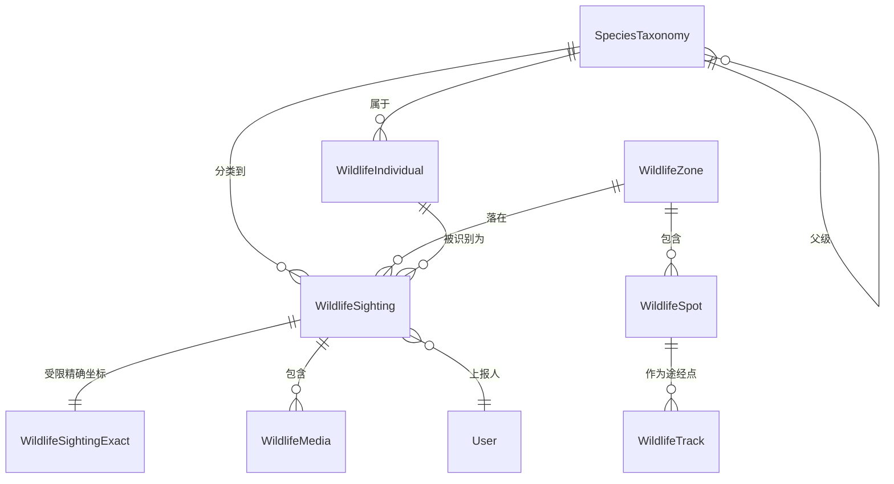
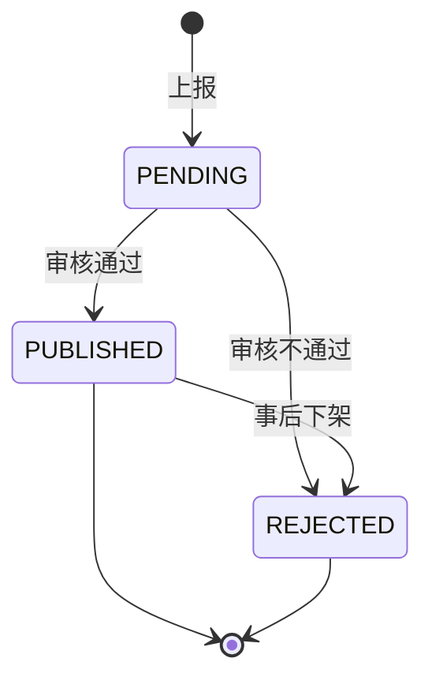
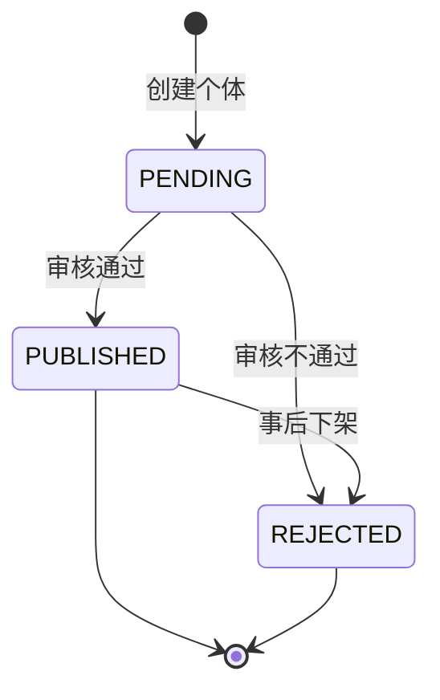
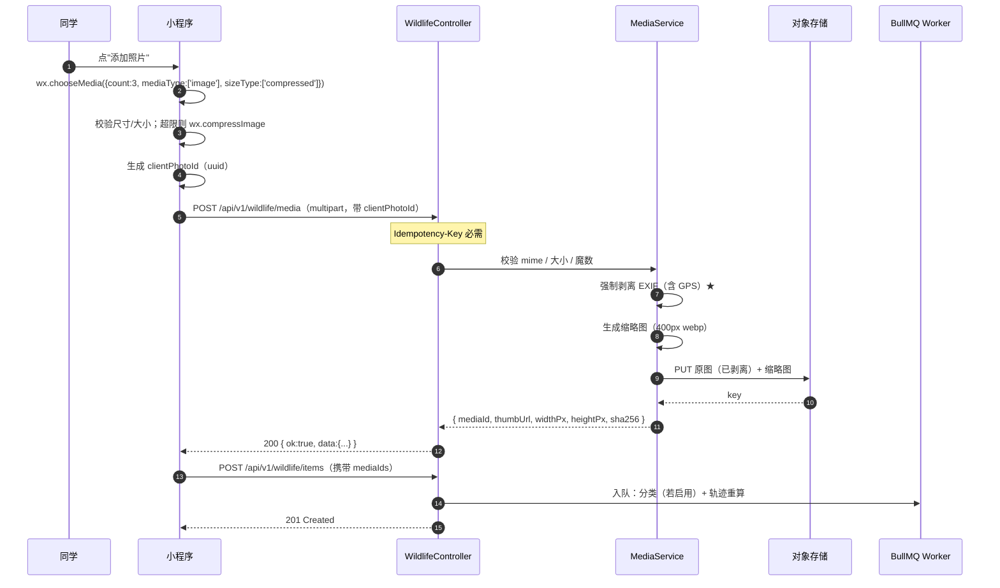
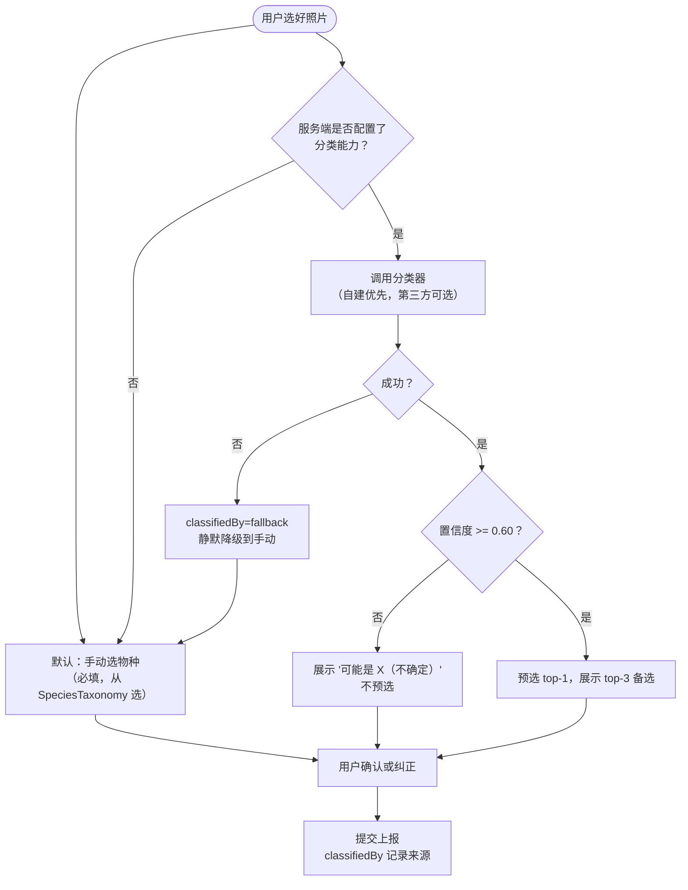
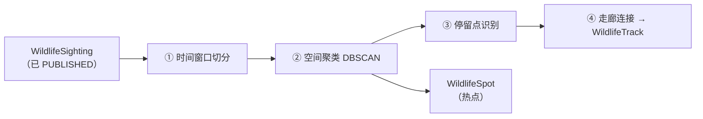
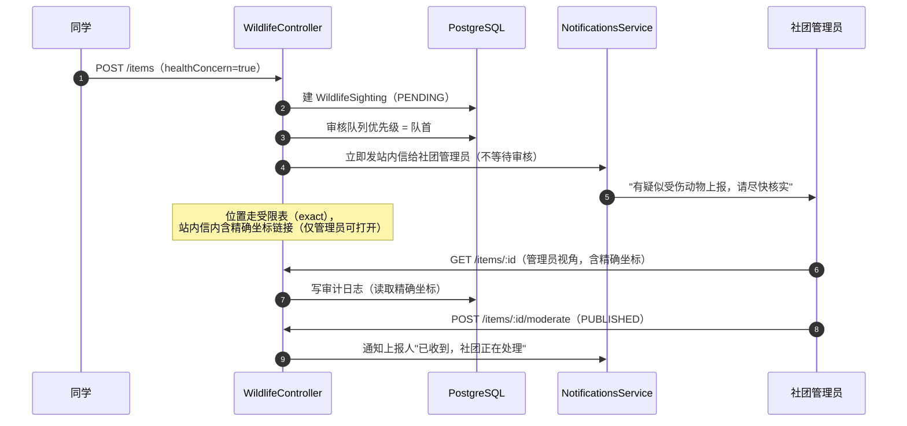
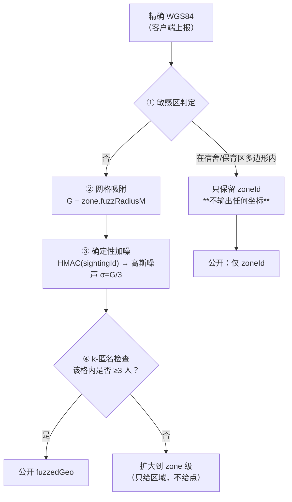

# 功能规格 · 猫/鸟/黑天鹅活动区域与轨迹 `wildlife`

| 项 | 值 |
| --- | --- |
| 模块 ID | `wildlife`（契约 §4.1，敏感级 **低**） |
| 路由前缀 | `/api/v1/wildlife/*`（契约 §6.1） |
| 文档版本 | `v1` · 2026-10-17 |
| 上游契约 | `docs/architecture/00-FROZEN-CONTRACT.md` §4.1 / §5 / §6.1 / §9 / §11.1 / §11.2 / §11.3 |
| 领域骨架 | `docs/architecture/02-domain-model.md` §2.10（第 852–884 行，**已冻结，本规格向后兼容**） |
| 里程碑 | M2（`06-roadmap.md:167`："区域地图 + 上报 + 审核"，备注"地图 SDK 接入"） |
| 技术栈 | NestJS 12.1.3 + Prisma 7.10.1 + PostgreSQL 16 + Redis 7 + Taro 4.3 / React 18（小程序） |

---

## 0. 用户原话需求 → 本文档章节映射（**逐条落实**）

> 用户原话：
> "对于猫，鸟等活动区域开始开发，希望以学校地图为背景，同学可以上传动物图片，发现时间和地点，
> 进行对动物的自动分类（也可以手动给个名字）来绘制动物活动轨迹方便遍管理"

| # | 原话片段 | 落实章节 | 落地结论 |
| --- | --- | --- | --- |
| R1 | "对于猫，鸟等活动区域开始开发" | §2、§7 | `WildlifeZone`（人工定义区域）+ `WildlifeSpot`（聚类热点）+ `SpeciesTaxonomy`（物种表） |
| R2 | "以学校地图为背景" | **§1** | **静态校园平面图 + 叠加层**为主方案；原生 `map` 组件为可选逃生口 |
| R3 | "同学可以上传动物图片" | §4 | `wx.chooseMedia` → 压缩 → 服务端代理上传 → 对象存储 → 缩略图；**强制 EXIF 剥离** |
| R4 | "发现时间和地点" | §3、§5、§7 | **`observedAt`（发现时间）必须与 `createdAt`（上报时间）分离** —— 契约缺此字段，见 §7.2 |
| R5 | "进行对动物的自动分类" | §5 | 三级方案对比 + **可离线降级**（无 key 时手动选物种）+ 置信度 + 人工纠正闭环 |
| R6 | "也可以手动给个名字" | §5.6、§7.4 | **两种解读都支持**：(a) 手动选物种；(b) 给**个体**起名（`WildlifeIndividual`） |
| R7 | "来绘制动物活动轨迹" | §6 | 离散点 → 空间聚类 → 停留点 → **推断轨迹**（明确标注"推断，非实测路径"） |
| R8 | "方便遍管理"（方便管理） | §8 | 审核队列 + 投喂规范告示位 + 健康异常告警 + 轨迹只读管理 |

---

## 1. 地图底图方案（R2）

### 1.1 三个候选方案的实测性对比

| 维度 | A. 小程序原生 `map` 组件 | B. **静态校园平面图 + 叠加层** | C. 自定义瓦片（`web-view` + Leaflet/MapLibre） |
| --- | --- | --- | --- |
| 底图内容 | 腾讯地图街道图 | **任意图**（校园平面图/自绘示意图） | 任意 XYZ 瓦片 |
| 能否显示校园平面图 | ❌ 不能替换底图 | ✅ **就是底图** | ✅ 可 |
| 坐标系 | **GCJ-02**（marker/polyline 全部按 GCJ-02 解释） | 图像像素空间（需仿射标定） | 取决于瓦片源 |
| 平移/缩放 | ✅ 原生手势 | ⚠️ 需自己实现（`movable-area` / `canvas` 手势） | ✅ Leaflet 自带 |
| 需要地图 key | ✅ 需要（腾讯位置服务，`map` 组件自 2021 起需 `subkey` 或小程序绑定） | ❌ 不需要 | ⚠️ 取决于瓦片源 |
| 个性化地图样式 | ⚠️ 需腾讯位置服务后台配置，自定义样式属**付费/企业**能力 | ✅ 完全自由 | ✅ 完全自由 |
| 室内/非道路区域 | ❌ 街道图无法表达楼内与草坪小径 | ✅ 可表达 | ✅ 可 |
| 离线可用 | ❌ | ✅ 图片可本地缓存 | ⚠️ 需缓存瓦片 |
| 审核风险 | 低 | 低 | **中** —— `web-view` 要求业务域名已备案并在小程序后台白名单 |
| 与小程序 UI 融合 | ✅ | ✅ | ❌ `web-view` 是全屏独立页面，返回栈割裂 |
| 主要成本 | 零（组件自带） | 底图**制作与标定** + 手势实现 | 瓦片服务 + 域名备案 + 两套技术栈 |

### 1.2 推荐：**方案 B 为主，方案 A 为可选逃生口**

**理由**：

1. **上科大校园是一个约 1 km² 的封闭园区**，活动范围远小于街道图的服务粒度。
   腾讯地图在这个尺度上会渲染出与校园无关的道路与建筑轮廓，**信息密度反而更低**。
2. **动物活动点大多在草坪、湖边、宿舍楼下、小径旁** —— 这些在街道图上**根本不存在**。
   用街道图当背景，用户看到的是"一个点落在某条不存在的路上"。
3. **方案 B 没有坐标系问题**（见 §3.3）：静态图用图像像素空间，
   WGS84 通过仿射变换映射到像素，**不经过 GCJ-02**。这直接绕开了本模块最大的技术陷阱。
4. **不依赖第三方地图 key**，不引入腾讯位置服务的配额与 ToS 约束。
5. 手势实现成本可控：校园图不需要瓦片式无限缩放，
   `movable-area` + `scale` 变换 + 双指缩放（`bindtouchmove` 计算两指距离）约 200 行即可，
   且**只支持 1×–4× 缩放**，不做无限缩放。

**逃生口（方案 A）的用法**：在观测点详情页提供"在腾讯地图中打开"按钮，
调用 `wx.openLocation({ latitude, longitude })` —— **该 API 要求传入 GCJ-02**，
因此这是 §3 坐标转换的**唯一必需消费点**（除非我们永远不提供这个按钮）。

### 1.3 校园平面图的落地方式（⚠️ **诚实标注未知**）

**这是本文档最大的未知项。** 分三条路径，按风险从低到高：

| 路径 | 授权要求 | 风险 | 建议 |
| --- | --- | --- | --- |
| **P1. 自绘示意图** | 无（原创） | **无** | ✅ **Phase 1 采用** |
| **P2. OpenStreetMap 数据渲染** | ODbL 许可，需署名 + 衍生数据库同许可 | 低（但有 share-alike 义务） | ⚠️ Phase 2 备选，需法务确认 ODbL 对闭源服务的传染范围 |
| **P3. 学校官方平面图** | **需要学校授权** | **高** | ❓ **未知，见下** |

**P1 自绘示意图的具体做法**：按校园主要建筑与步道的相对位置，
用 SVG 手工绘制一张**示意性**（非测绘精度）平面图：
- 底：校园边界多边形、草坪色块、水面（人工湖）色块
- 中：建筑轮廓（图书馆、体育馆、教学楼、宿舍区、食堂）+ 中文标注
- 上：步道、主要出入口

**为什么"示意图"够用**：本模块的用途是"让同学知道猫大概在哪个片区活动"，
**不需要测绘精度**。真正的精度要求来自 GPS 打点，那由 §3.4 的仿射标定解决 ——
即"图是示意性的，但坐标映射是精确标定的"。

**P3 的未知项必须诚实标注**：

| 未知项 | 状态 |
| --- | --- |
| 上科大是否公开发布过校园平面图 | **未知** —— 学校官网/迎新页可能有一张，但**未核实** |
| 该图是否允许第三方平台使用 | **未知** —— 未与学校宣传部门/信息办确认 |
| 授权形式（书面许可 / 口头 / 不接受） | **未知** |
| 是否需要付费 | **未知** |

> **处理方式**：**不阻塞开发**。P1 自绘示意图让 Phase 1 完全无授权风险地跑起来；
> P3 作为"如果拿到授权就替换底图"的**可插拔增强**（底图是配置项，见 §1.4）。
> **在拿到书面授权前，禁止把学校官方平面图放进仓库或对象存储。**
> 该未知项登记在 §10 未决问题 U1。

### 1.4 底图作为可配置资源

```ts
// packages/contracts/src/wildlife/basemap.ts
export interface CampusBasemap {
  /** 版本号，用于缓存失效 */
  version: string;
  /** 底图图片 URL（对象存储，经 CDN） */
  imageUrl: string;
  /** 图片像素尺寸 */
  widthPx: number;
  heightPx: number;
  /** 仿射标定：WGS84 → 像素，见 §3.4。6 个数按 [a,b,c,d,e,f] 排列 */
  affine: [number, number, number, number, number, number];
  /** 标定残差 RMSE（像素），必须 < 5，否则 CI 失败 */
  calibrationRmsePx: number;
  /** 控制点数量，必须 >= 6 */
  controlPointCount: number;
  /** 署名文本（P2 时必须是 OSM 署名） */
  attribution: string;
  /** 许可标识：'original' | 'odbl' | 'school-authorized' */
  license: 'original' | 'odbl' | 'school-authorized';
}
```

**约束（写进 CI 校验）**：
- `calibrationRmsePx < 5`；
- `controlPointCount >= 6`；
- `license === 'school-authorized'` 时，必须有对应的 `docs/legal/basemap-authorization.md` 记录授权来源，否则构建失败；
- `license === 'odbl'` 时，`attribution` 非空。

> **这条 CI 规则的作用**：把"学校授权"这个法务事项变成一个**机器可检查的前置条件**，
> 而不是靠人记住。参考 `05-security-privacy.md:473` 对 `retention-policy.ts` 的同类做法。

---

## 2. 领域模型总览

### 2.1 实体关系



### 2.2 `WildlifeZone`（**沿用契约 §2.10，不新增必填字段**）

契约 `02-domain-model.md:858-862` 已冻结。**语义：人工定义/管理方维护的区域**。

| 字段 | 类型 | 必填 | 说明 |
| --- | --- | --- | --- |
| `name` | `string` | 是 | 如"图书馆后草坪" |
| `species` | `string[]` | 是 | 主要物种标签（`SpeciesTaxonomy.id` 列表） |
| `geo` | `{ lat: number; lng: number; radiusM: number }` | 是 | **圆形**区域 |
| `feedingPolicy` | `enum<allowed\|discouraged\|forbidden>` | 是 | 投喂政策 |
| `note` | `string` | 否 | ≤500 字 |

**本规格新增（可选字段，需补进领域模型）：**

| 字段 | 类型 | 必填 | 默认 | 说明 |
| --- | --- | --- | --- | --- |
| `fuzzRadiusM` | `int` | 是 | `50` | 该区域的**位置模糊化半径**，见 §9.3 |
| `isSensitive` | `bool` | 是 | `false` | 敏感区（宿舍/保育区）→ 公开展示时**只给区域不给坐标** |
| `noticeText` | `string` | 否 | `null` | 告示位文案，见 §8.3 |
| `sortOrder` | `int` | 是 | `0` | 管理端排序 |

### 2.3 `WildlifeSpot`（**新增**）—— 与 `WildlifeZone` 的区别

> ⚠️ **这是一个必须讲清楚的区分，否则实现会混淆：**
>
> | | `WildlifeZone`（契约已有） | `WildlifeSpot`（本文新增） |
> | --- | --- | --- |
> | 来源 | **人工定义**（管理端录入） | **算法聚类**（从 `WildlifeSighting` 算出） |
> | 稳定性 | 稳定，改名需人工 | 每次重算可能变化 |
> | 用途 | 投喂政策、告示位、管理边界 | 展示"热点在哪"、轨迹的途经点 |
> | 可否编辑 | ✅ 管理端 CRUD | ❌ **只读**，只能重算 |
>
> 二者**不是同一张表**。`WildlifeSpot` 可落在某个 `WildlifeZone` 内（`zoneId` 可空）。

| 字段 | 类型 | 必填 | 说明 |
| --- | --- | --- | --- |
| `speciesId` | `string(ulid)` | 是 | 该热点对应的物种 |
| `zoneId` | `string(ulid)` | 否 | 落在哪个管理区域内 |
| `centroid` | `{ lat: number; lng: number }` | 是 | 聚类质心（**已模糊化**，见 §9.3） |
| `radiusM` | `int` | 是 | 95 分位半径 |
| `sightingCount` | `int` | 是 | 参与聚类的观测数 |
| `firstSeenAt` | `string(iso)` | 是 | 最早观测时间 |
| `lastSeenAt` | `string(iso)` | 是 | 最晚观测时间 |
| `hourHistogram` | `int[24]` | 是 | 24 小时分布直方图（"常见出没时段"） |
| `confidence` | `decimal(4,3)` | 是 | 0.000–1.000，聚类可信度 |
| `algorithmVersion` | `string` | 是 | 如 `dbscan-v1`，用于可复现 |
| `computedAt` | `string(iso)` | 是 | |

### 2.4 `WildlifeTrack`（**新增**）—— ⚠️ "推断轨迹"而非实测路径

> **必须诚实**：我们的数据来自**同学偶发上报**，不是 GPS 项圈。
> 因此**无法重建真实运动路径**。`WildlifeTrack` 是"由 N 次上报**推断**出的活动走廊"。
> **UI 必须显示"基于 N 次上报推断的活动范围"，禁止显示"这只猫的路线"。**
> 该约束写进 §11 验收标准 T18。

| 字段 | 类型 | 必填 | 说明 |
| --- | --- | --- | --- |
| `speciesId` | `string(ulid)` | 是 | |
| `individualId` | `string(ulid)` | 否 | 若已识别个体，则按个体出轨迹 |
| `spotIds` | `string(ulid)[]` | 是 | 途经的 `WildlifeSpot`，**按时间排序** |
| `pathGeoJson` | `json` | 是 | `LineString` 坐标串（**已模糊化**） |
| `totalDistanceM` | `int` | 是 | 折线长度 |
| `spanStartAt` | `string(iso)` | 是 | |
| `spanEndAt` | `string(iso)` | 是 | |
| `sightingCount` | `int` | 是 | |
| `method` | `enum<dbscan-chain>` | 是 | 生成方法。**只有一种，明确不做插值** |
| `confidence` | `decimal(4,3)` | 是 | |
| `isInferred` | `bool` | 是 | **恒为 `true`**。字段存在的唯一目的是让客户端**无法忘记**标注它 |
| `algorithmVersion` | `string` | 是 | |
| `computedAt` | `string(iso)` | 是 | |

### 2.5 `SpeciesTaxonomy`（**新增**）

| 字段 | 类型 | 必填 | 说明 |
| --- | --- | --- | --- |
| `scientificName` | `string` | 是 | 学名，如 `Cygnus atratus`。**唯一** |
| `commonNameZh` | `string` | 是 | 中文名，如"黑天鹅" |
| `commonNameEn` | `string` | 否 | 英文名 |
| `taxonRank` | `enum<species\|genus\|family\|order>` | 是 | 分类层级 |
| `parentId` | `string(ulid)` | 否 | 自引用，构成分类树 |
| `isProtected` | `bool` | 是 | 是否国家/地方保护动物（影响审核严格度） |
| `isNestingSensitive` | `bool` | 是 | **繁殖期敏感** → 触发 §9.4 的季节性加强模糊 |
| `nestingMonths` | `int[]` | 是 | 繁殖月份，如 `[3,4,5,6]`。仅 `isNestingSensitive` 时有意义 |
| `defaultFeedingPolicy` | `enum<allowed\|discouraged\|forbidden>` | 是 | 物种默认投喂政策 |
| `externalIds` | `json` | 是 | `{ inaturalist?: number; baiduLabel?: string; ... }` 用于对接识别 API 的标签映射 |
| `iconUrl` | `string` | 否 | 物种图标 |
| `isActive` | `bool` | 是 | 下架物种不删除（历史数据引用） |

**上科大已知物种（种子数据，**需社团确认**）：**

| 中文名 | 学名 | `isProtected` | `isNestingSensitive` | 默认投喂政策 |
| --- | --- | --- | --- | --- |
| 猫（家猫/流浪猫） | `Felis catus` | 否 | 否 | `discouraged` |
| **黑天鹅** | `Cygnus atratus` | **是**（外来引进，校方管理资产） | **是** | **`forbidden`** |
| 绿头鸭 | `Anas platyrhynchos` | 否 | 是 | `discouraged` |
| 麻雀 | `Passer montanus` | 否 | 否 | `forbidden` |
| 珠颈斑鸠 | `Spilopelia chinensis` | 否 | 否 | `forbidden` |
| 白鹭 | `Egretta garzetta` | 是 | 是 | `forbidden` |
| 喜鹊 | `Pica serica` | 否 | 否 | `forbidden` |

> ⚠️ **诚实标注**：上表是**基于"上科大校园有猫、鸟、黑天鹅"这一前提的合理推测**，
> **未做实地物种调查**。真实物种清单必须由**校园动物社团/生物教师**确认后录入。
> 登记为未决问题 U2。**尤其"黑天鹅是上科大校园真实存在的动物"是用户明确告知的事实，
> 但具体数量、活动水域、是否有官方管理方，本文档未知。**

### 2.6 `WildlifeSighting`（**沿用契约 §2.10 + 必要扩展**）

契约 `02-domain-model.md:863-869` 已冻结：

| 字段 | 类型 | 必填 | 说明 |
| --- | --- | --- | --- |
| `zoneId` | `string(ulid)` | 否 | |
| `species` | `string` | 是 | 冻结字段名。**本规格将其语义明确为 `SpeciesTaxonomy.id`** |
| `status` | `enum<PENDING\|PUBLISHED\|REJECTED>` | 是 | 默认 `PENDING` |
| `geo` | `{ lat: number; lng: number }` | 是 | 冻结。**本规格明确其语义为"模糊化后的可公开坐标"** |
| `photoUrls` | `string[]` | 否 | ≤3 张 |
| `healthConcern` | `bool` | 是 | 疑似受伤/异常 |
| `reporterId` | `string(ulid)` | 是 | |

**本规格新增字段（需补进领域模型 §2.10）：**

| 字段 | 类型 | 必填 | 默认 | 说明 | 需求来源 |
| --- | --- | --- | --- | --- | --- |
| **`observedAt`** | `string(iso)` | **是** | — | **发现时间**（用户选的），与 `createdAt`（上报时间）分离 | **R4** |
| `observedAtFuzzed` | `string(iso)` | 是 | — | 公开的**粗化**时间（见 §9.5） | 隐私 |
| `individualId` | `string(ulid)` | 否 | `null` | 若识别为某个已命名个体 | **R6** |
| `autoSpeciesId` | `string(ulid)` | 否 | `null` | 自动分类结果 | **R5** |
| `autoConfidence` | `decimal(4,3)` | 否 | `null` | 自动分类置信度 | **R5** |
| `classifiedBy` | `enum<manual\|vision_api\|ondevice\|fallback>` | 是 | `manual` | 分类来源 | **R5** |
| `correctedFromSpeciesId` | `string(ulid)` | 否 | `null` | 用户纠正了自动结果 → 训练样本 | **R5** |
| `note` | `string` | 否 | `null` | ≤200 字备注 | — |
| `isAnonymous` | `bool` | 是 | `false` | 匿名上报（对齐 `forum`/`takeout-guard` 的匿名能力） | 隐私 |
| `moderatedBy` | `string(ulid)` | 否 | `null` | 审核人 | §8 |
| `moderatedAt` | `string(iso)` | 否 | `null` | | §8 |
| `rejectReason` | `string` | 否 | `null` | ≤200 字，**仅审核端可见** | §8 |

### 2.7 `WildlifeSightingExact`（**新增，受限表**）—— 隐私架构的核心

> **设计依据**：复用 `05-security-privacy.md` §4.1"三张表、两个库"的**解耦思路** ——
> 精确坐标与公开记录**分表存储**，公开表**永远不含**精确坐标。

| 字段 | 类型 | 必填 | 说明 |
| --- | --- | --- | --- |
| `sightingId` | `string(ulid)` | 是 | 主键，FK→`WildlifeSighting` |
| `exactLat` | `decimal(10,7)` | 是 | **WGS84** 精确纬度 |
| `exactLng` | `decimal(10,7)` | 是 | **WGS84** 精确经度 |
| `exactAccuracyM` | `int` | 否 | 上报时的 GPS 精度 |
| `exactObservedAt` | `string(iso)` | 是 | 精确发现时间 |

**访问规则（硬要求）**：

| 角色 | 权限 |
| --- | --- |
| 普通用户 | ❌ **完全不可读**。任何 API 响应不含此表字段 |
| 上报人本人 | ❌ 也不可读（他自己知道，不需要从我们这读） |
| 审核员 | ✅ 可读（审核需要判断是否真的在校园内） |
| 社团管理员 | ✅ 可读（保育处置需要） |
| 审计 | **每次读取都写审计日志**（`05-security-privacy.md` §6.2） |

**为什么上报人本人也不能读**：读取接口会成为一个"用他人账号验证精确坐标是否被正确记录"的旁路，
且没有必要。**最小权限原则：不需要的能力就不提供。**

### 2.8 `WildlifeIndividual`（**新增**）—— "手动给个名字"（R6）

| 字段 | 类型 | 必填 | 说明 |
| --- | --- | --- | --- |
| `name` | `string` | 是 | 个体名，如"大橘""鹅鹅"。≤24 字 |
| `speciesId` | `string(ulid)` | 是 | 属于哪个物种 |
| `description` | `string` | 否 | ≤500 字识别特征描述 |
| `coverPhotoUrl` | `string` | 否 | 代表照片 |
| `isActive` | `bool` | 是 | |
| `createdBy` | `string(ulid)` | 是 | 创建者（**需审核后才公开**，防止恶搞命名） |

**约束**：
- `name` 过内容安全 + 敏感词（防止给动物起侮辱性名字，或借此指向真人）；
- **`@@unique([speciesId, name])`** —— 同物种内名字唯一，防止重复建个体；
- 创建个体是**低风险但需审核**的操作 → 走 `PENDING` 队列，与 sighting 审核复用同一套队列。

### 2.9 `WildlifeMedia`（**新增**）

| 字段 | 类型 | 必填 | 说明 |
| --- | --- | --- | --- |
| `sightingId` | `string(ulid)` | 是 | FK |
| `storageKey` | `string` | 是 | 对象存储 key（**已剥离 EXIF**） |
| `thumbKey` | `string` | 是 | 缩略图 key |
| `widthPx` / `heightPx` | `int` | 是 | |
| `byteSize` | `int` | 是 | 剥离后大小 |
| `mimeType` | `string` | 是 | `image/jpeg` / `image/webp` |
| `sha256` | `string` | 是 | 内容哈希，**用于去重**（同一张图重复上报） |
| `clientPhotoId` | `string` | 是 | 客户端生成的幂等键，见 §4.5 |
| `sortOrder` | `int` | 是 | 0–2 |

**约束**：`@@unique([sightingId, clientPhotoId])`、`@@index([sha256])`。

### 2.10 状态机

#### `WildlifeSighting`（**沿用契约，不得改动**）



> 与 `02-domain-model.md:873-881` **逐字一致**。

**新增的补充规则（不新增状态，只补转移条件）**：

| 规则 | 说明 |
| --- | --- |
| `PENDING → PUBLISHED` 前置 | 必须已确认物种（`species` 非空）。若 `autoSpeciesId` 有值但用户未确认，**不得**自动通过 |
| `PENDING → PUBLISHED` 前置（保护物种） | `SpeciesTaxonomy.isProtected = true` 时，**必须两名审核员**（双人复核），单人通过返回 `FORBIDDEN` |
| `PUBLISHED → REJECTED` 触发 | 管理员下架；**必须**填 `rejectReason` |
| `healthConcern = true` | **不改变状态机**，但触发通知（见 §8.4）。审核优先级提升到队首 |

#### `WildlifeIndividual`（**新增**）



> 与 `WildlifeSighting` 同构 —— 刻意复用同一套审核队列与守卫，减少代码面。

#### `WildlifeSpot` / `WildlifeTrack`（**无状态机**）

它们是**派生只读资源**，由 Worker 重算覆盖，不存在用户驱动的状态流转。
**因此它们没有 `status` 字段，也没有任何写端点。**

---

## 3. ⚠️ 坐标系陷阱（**本节是本模块最容易出错的地方**）

### 3.1 问题的准确表述

| 数据源 / 消费方 | 坐标系 | 说明 |
| --- | --- | --- |
| GPS 硬件原始输出 | **WGS84** | 国际标准（EPSG:4326） |
| `wx.getLocation({ type: 'wgs84' })` | **WGS84** | 小程序默认值 |
| `wx.getLocation({ type: 'gcj02' })` | **GCJ-02** | 需显式指定 |
| `wx.chooseLocation()` | **GCJ-02** | 返回的是腾讯地图拾取结果 |
| `wx.openLocation()` | **GCJ-02** | **要求**传入 GCJ-02 |
| 小程序 `<map>` 组件的 `markers` / `polyline` / `circles` | **GCJ-02** | 全部按 GCJ-02 解释 |
| 腾讯地图 / 高德地图 | **GCJ-02** | 国测局加密偏移 |
| OpenStreetMap / Google Maps（国际版） | **WGS84** | |

**偏移量级**：GCJ-02 相对 WGS84 的偏移在中国大陆约为 **300–700 米**，
且**随经纬度变化**（不是常量偏移，不能用"加一个固定值"修正）。

> **直接混用的后果**：一个在图书馆后草坪的观测点，如果按 WGS84 数值丢给 `<map>` 组件，
> **会显示在几百米外的教学楼或校门外**。而且这个错误**看起来像"数据错了"而不是"坐标系错了"**，
> 极难排查 —— 因此必须在代码层面杜绝，而不是靠人记住。

### 3.2 我们的规范：**WGS84 单一真相**

> **规范（硬要求）**：
> 1. **存储层一律 WGS84**。数据库里所有 `lat`/`lng` 字段的语义都是 WGS84。
> 2. **小程序端采集时显式指定 `type: 'wgs84'`**，绝不依赖默认值（默认值可能随基础库版本变化）。
> 3. **转换只发生在渲染层**，且只有两个消费点：
>    - 消费点 A：`<map>` 组件渲染 → WGS84 → **GCJ-02**
>    - 消费点 B：`wx.openLocation()` → WGS84 → **GCJ-02**
> 4. **静态底图方案（§1.2 推荐方案）不经过 GCJ-02** —— 走 §3.4 的仿射变换到图像像素。
>    这是方案 B 的核心优势：**它让坐标系陷阱的作用面从"整个地图"缩小到"两个按钮"**。
> 5. **字段命名必须自证坐标系**：数据库列名用 `lat`/`lng` 并在 Prisma 注释中标注 `WGS84`；
>    **禁止**出现 `gcjLat` / `gcjLng` 这类持久化列。GCJ-02 值**只在内存中短暂存在**。

```ts
// services/api/src/modules/wildlife/domain/geo.ts
/** 所有持久化坐标的语义。类型层面自证，防止误用。 */
export interface Wgs84Point { readonly datum: 'WGS84'; lat: number; lng: number }
export interface Gcj02Point { readonly datum: 'GCJ02'; lat: number; lng: number }

/** 只有这个函数能产出 GCJ02Point —— 让"忘记转换"在类型上不可能。 */
export function toGcj02(p: Wgs84Point): Gcj02Point { /* §3.3 */ }
```

> **类型层面自证的价值**：`<map>` 组件的 props 要求 `Gcj02Point`，
> 而数据库给的是 `Wgs84Point`，**TypeScript 会直接报错**。
> 这比"在文档里写一句要转换"强得多 —— 参考 ADR 0004 §3 对"弱约束 vs 强约束"的论证。

### 3.3 WGS84 ↔ GCJ-02 转换算法（可直接实现）

```ts
// packages/shared/src/geo/gcj02.ts

const A = 6378245.0;                 // 克拉索夫斯基椭球长半轴
const EE = 0.00669342162296594323;   // 第一偏心率平方

/** 中国大陆粗略外接矩形之外不做偏移（境外 GCJ-02 与 WGS84 相同） */
function outOfChina(lat: number, lng: number): boolean {
  return !(lng > 73.66 && lng < 135.05 && lat > 3.86 && lat < 53.55);
}

function transformLat(x: number, y: number): number {
  let ret = -100.0 + 2.0 * x + 3.0 * y + 0.2 * y * y + 0.1 * x * y + 0.2 * Math.sqrt(Math.abs(x));
  ret += (20.0 * Math.sin(6.0 * x * Math.PI) + 20.0 * Math.sin(2.0 * x * Math.PI)) * 2.0 / 3.0;
  ret += (20.0 * Math.sin(y * Math.PI) + 40.0 * Math.sin(y / 3.0 * Math.PI)) * 2.0 / 3.0;
  ret += (160.0 * Math.sin(y / 12.0 * Math.PI) + 320 * Math.sin(y * Math.PI / 30.0)) * 2.0 / 3.0;
  return ret;
}

function transformLng(x: number, y: number): number {
  let ret = 300.0 + x + 2.0 * y + 0.1 * x * x + 0.1 * x * y + 0.1 * Math.sqrt(Math.abs(x));
  ret += (20.0 * Math.sin(6.0 * x * Math.PI) + 20.0 * Math.sin(2.0 * x * Math.PI)) * 2.0 / 3.0;
  ret += (20.0 * Math.sin(x * Math.PI) + 40.0 * Math.sin(x / 3.0 * Math.PI)) * 2.0 / 3.0;
  ret += (150.0 * Math.sin(x / 12.0 * Math.PI) + 300.0 * Math.sin(x / 30.0 * Math.PI)) * 2.0 / 3.0;
  return ret;
}

/** WGS84 → GCJ-02（正向，闭式解） */
export function wgs84ToGcj02(lat: number, lng: number): { lat: number; lng: number } {
  if (outOfChina(lat, lng)) return { lat, lng };
  const dLat0 = transformLat(lng - 105.0, lat - 35.0);
  const dLng0 = transformLng(lng - 105.0, lat - 35.0);
  const radLat = (lat / 180.0) * Math.PI;
  let magic = Math.sin(radLat);
  magic = 1 - EE * magic * magic;
  const sqrtMagic = Math.sqrt(magic);
  const dLat = (dLat0 * 180.0) / (((A * (1 - EE)) / (magic * sqrtMagic)) * Math.PI);
  const dLng = (dLng0 * 180.0) / ((A / sqrtMagic) * Math.cos(radLat) * Math.PI);
  return { lat: lat + dLat, lng: lng + dLng };
}

/**
 * GCJ-02 → WGS84（反向，无闭式解 → 迭代逼近）。
 * 迭代 30 次可稳定收敛到 < 1e-9 度（约 0.1 毫米），远超需求。
 */
export function gcj02ToWgs84(lat: number, lng: number): { lat: number; lng: number } {
  if (outOfChina(lat, lng)) return { lat, lng };
  let wgsLat = lat;
  let wgsLng = lng;
  for (let i = 0; i < 30; i++) {
    const fwd = wgs84ToGcj02(wgsLat, wgsLng);
    const dLat = fwd.lat - lat;
    const dLng = fwd.lng - lng;
    if (Math.abs(dLat) < 1e-9 && Math.abs(dLng) < 1e-9) break;
    wgsLat -= dLat;
    wgsLng -= dLng;
  }
  return { lat: wgsLat, lng: wgsLng };
}
```

### 3.4 静态底图的仿射标定（方案 B 的坐标映射）

**步骤 1 · WGS84 → 局部 ENU 米制平面**（等距圆柱近似，校园尺度误差可忽略）：

```ts
// services/api/src/modules/wildlife/domain/enu.ts
export const CAMPUS_ORIGIN = { lat: 31.1780, lng: 121.5900 };  // ⚠️ 待实测，见 U3

export function toLocalMeters(lat: number, lng: number): { x: number; y: number } {
  const x = (lng - CAMPUS_ORIGIN.lng) * 111320 * Math.cos((CAMPUS_ORIGIN.lat * Math.PI) / 180);
  const y = (lat - CAMPUS_ORIGIN.lat) * 110540;
  return { x, y };
}
```

> **近似误差评估**：在 1 km 尺度上，等距圆柱近似的相对误差 < 0.01%（约 0.1 m），
> **远小于 GPS 本身的 5–20 m 误差**。因此**不必引入 proj4 或 PostGIS 做精确投影**。
> 这是一条"用数学分析替代依赖"的决策。

**步骤 2 · 局部米 → 图像像素（仿射变换）**：

```
[u]   [a b c] [x]
[v] = [d e f] [y]
              [1]
```

**步骤 3 · 最小二乘标定**（≥6 个控制点）：

```ts
// scripts/wildlife/calibrate-basemap.ts
// 控制点：{ wgsLat, wgsLng, px, py }
// 解 6 参数仿射（对 x 与 y 各解一个 3 参数线性最小二乘）
export function calibrate(pts: ControlPoint[]): {
  affine: [number, number, number, number, number, number];
  rmsePx: number;
} {
  // 设计矩阵 A = [[x, y, 1], ...]，目标 b = [px, ...] 与 [py, ...]
  // 正规方程：θ = (AᵀA)⁻¹ Aᵀ b
  // 残差：rmse = sqrt(mean((A θ - b)²))，对 u 与 v 合并计算
  // ... 实现见 §11 T5（必须有单测）
}
```

**标定流程（人工操作，一次性）**：

1. 在校园里选 **≥6 个易辨认的地标**（如体育馆入口、图书馆台阶、食堂门口、某个路口），
   分散在图的四角与中心（**不要都挤在一起**，否则仿射外推误差爆炸）；
2. 每个点用手机 GPS 记录 WGS84 坐标（多次取平均，去掉明显跳点）；
3. 在底图图片上读出该地标的**像素坐标**（用任意看图工具）；
4. 跑 `calibrate-basemap.ts`，得到 `affine` 与 `rmsePx`；
5. **要求 `rmsePx < 5`**。若 ≥5，说明控制点标错了或底图严重非仿射（比如用了透视图），
   **必须重标或换图**，不得放宽阈值。

### 3.5 验证方法（**这是本节最重要的部分**）

坐标系问题**无法靠肉眼发现**（偏移几百米看起来像"数据错了"）。必须**机器验证**。

#### V1 · 转换往返自洽（单测，无需外部数据）

```ts
// 往返误差：WGS84 → GCJ02 → WGS84 必须回到原点
const p = { lat: 31.1780, lng: 121.5900 };
const gcj = wgs84ToGcj02(p.lat, p.lng);
const back = gcj02ToWgs84(gcj.lat, gcj.lng);
expect(Math.abs(back.lat - p.lat)).toBeLessThan(1e-9);
expect(Math.abs(back.lng - p.lng)).toBeLessThan(1e-9);
```

> **能发现的问题**：反向迭代不收敛、常量写错。
> **不能发现的问题**：正反两个函数**同时**错了（比如都用同一个错误的常数）—— 往返仍然自洽。

#### V2 · 偏移量级断言（单测）—— **能发现 V1 发现不了的问题**

```ts
// 在上海，GCJ-02 相对 WGS84 的偏移必须在合理范围内
const d = haversineM(p, wgs84ToGcj02(p.lat, p.lng));
expect(d).toBeGreaterThan(200);   // 若 < 200，几乎肯定是"忘了转换"
expect(d).toBeLessThan(800);      // 若 > 800，几乎肯定是常量写错了
```

> **这条断言的价值**：如果有人误把 `wgs84ToGcj02` 实现成恒等函数（直接 return 入参），
> V1 的往返测试**仍然通过**（0 偏移往返当然自洽），但 V2 **立刻失败**。
> **这正是"偏移数百米"这类 bug 的唯一自动化防线。**

#### V3 · 外部控制点比对（集成测试，需人工提供数据）

| 步骤 | 做法 |
| --- | --- |
| 1 | 打开腾讯地图坐标拾取器（`https://lbs.qq.com/getPoint/`），在校园内选 ≥5 个地标，记录其 **GCJ-02** 坐标 |
| 2 | 对同一批地标，用手机 GPS（`type:'wgs84'`）或 WGS84 底图记录 **WGS84** 坐标 |
| 3 | 断言 `\|wgs84ToGcj02(wgs) − gcj\|` 的**球面距离 < 5 米** |
| 4 | 若失败，**先怀疑控制点采集**（手机 GPS 在楼内会偏 20 m+），再怀疑算法 |

> ⚠️ **诚实标注**：本文档**没有实际执行过 V3**，因为无法在当前环境获取上科大校园的
> 实测 WGS84 与腾讯 GCJ-02 控制点对。**V3 的 5 个控制点必须由人工实地采集后录入
> `services/api/test/fixtures/gcj02-control-points.json`。**
> 在此之前，V1 + V2 是自动化的，V3 是**待补**（未决问题 U4）。

#### V4 · 底图标定残差（CI）

`calibrationRmsePx < 5` 且 `controlPointCount >= 6`（§1.4 已规定，CI 校验）。

#### V5 · 端到端"同一只动物两次上报应落在同一片区"（集成测试）

构造两条相隔 30 米的上报，断言它们映射到静态底图后**像素距离 < 30 px**（在 1 m ≈ 1 px 的图上）。
这条测试能同时抓住：仿射矩阵错、`cos(lat)` 漏乘、经纬度顺序颠倒（`lat`/`lng` 互换）。

> **`lat`/`lng` 顺序颠倒是极高频的错误**，且在很多地方"看起来只是偏了一点"。
> 在上科大（lat≈31, lng≈121），颠倒后坐标会跑到地球另一处，
> 断言"在校园边界内"能立刻抓住它。**必须有这条断言**：

```ts
// 校园边界框（WGS84，待实测，见 U3）
export const CAMPUS_BBOX = { minLat: 31.170, maxLat: 31.186, minLng: 121.582, maxLng: 121.598 };
export function assertInCampus(p: { lat: number; lng: number }) {
  if (p.lat < CAMPUS_BBOX.minLat || p.lat > CAMPUS_BBOX.maxLat ||
      p.lng < CAMPUS_BBOX.minLng || p.lng > CAMPUS_BBOX.maxLng) {
    throw new ValidationError('COORDINATE_OUT_OF_CAMPUS');
  }
}
```

**所有写入路径（上报、个体、区域）都必须过 `assertInCampus`**，
超出范围返回 `VALIDATION_FAILED` / `COORDINATE_OUT_OF_CAMPUS`（422）。

---

## 4. 图片上传链路（R3）

### 4.1 端到端流程



**为什么用服务端代理上传而不是对象存储直传**：

| 方案 | 优点 | 缺点 | 结论 |
| --- | --- | --- | --- |
| **服务端代理** | EXIF 剥离**必然执行**（不依赖客户端配合）；校验在服务端；实现简单 | API 承担带宽 | ✅ **M2 采用** |
| OSS 直传（PostObject 签名） | API 不占带宽；小程序 `wx.uploadFile` 原生支持 | **EXIF 剥离变成"客户端承诺"** —— 客户端可绕过，且我们无法验证 | ⚠️ 仅当带宽成为瓶颈时迁移，且**仍需服务端二次处理** |

> **关键判断**：EXIF 剥离是**隐私要求**（§9.1），不能是"客户端承诺"。
> 只要客户端能绕过，就等于没有。因此 **M2 用服务端代理**。
> 校园规模下（预估每日数百张照片）代理带宽完全可接受。

### 4.2 客户端参数与限制

| 项 | 值 | 依据 |
| --- | --- | --- |
| API | `wx.chooseMedia`（**不用**已废弃的 `wx.chooseImage`） | 微信基础库 ≥2.10.0 |
| `count` | `3` | 契约 `photoUrls` ≤3 |
| `mediaType` | `['image']` | 只收图片 |
| `sizeType` | `['compressed']` | 让微信先压一次 |
| `sourceType` | `['album', 'camera']` | 允许拍照 |
| 客户端压缩阈值 | 若任一边 > 2048px 或 > 2 MB → `wx.compressImage({ quality: 80 })` | 减少上传失败率 |
| **服务端接受上限** | **5 MB / 张** | 超过返回 `VALIDATION_FAILED` / `MEDIA_TOO_LARGE` |
| **目标大小** | ≤ 1 MB | 压缩后典型值 |
| 接受格式 | `image/jpeg`, `image/png`, `image/webp` | 其他返回 `MEDIA_UNSUPPORTED_TYPE` |
| 魔数校验 | **必须**读文件头，不信任 `Content-Type` | 防止改扩展名绕过 |
| 最大边长 | 4096 px（超过则服务端缩放） | 防解压炸弹 |
| 最大像素数 | 40 MP | 防解压炸弹（`sharp` 的 `limitInputPixels`） |
| 单次上报总大小 | ≤ 15 MB | 3 × 5 MB |

### 4.3 EXIF 剥离（**硬要求，不是可选项**）

> **为什么这是硬要求**：手机照片的 EXIF 里**通常带 GPS 坐标**（精度可达米级）。
> 我们在 §9 精心设计的**位置模糊化会被 EXIF 完全绕过** ——
> 用户看到地图上是个 50 m 的模糊圈，但下载原图就能读到精确到 3 米的拍摄点，
> **直接暴露宿舍房间位置**。

```ts
// services/api/src/modules/wildlife/data/media-processor.ts
import sharp from 'sharp';

export async function stripExifAndNormalize(buf: Buffer) {
  // sharp 默认不保留 EXIF；显式 .rotate() 处理方向后重新编码，
  // 保证：① EXIF/GPS 全部丢失 ② 方向已烘焙进像素 ③ 重编码清除其它元数据段
  const pipeline = sharp(buf, { limitInputPixels: 40_000_000 })
    .rotate()                    // 按 EXIF Orientation 旋转后丢弃该标签
    .withMetadata({ exif: {} })  // 显式置空 EXIF
    .toFormat('jpeg', { quality: 85, mozjpeg: true });

  const { data, info } = await pipeline.toBuffer({ resolveWithObject: true });

  // 断言：输出确实不含 EXIF（防御性 —— 若 sharp 行为变化，这里会失败而不是静默泄漏）
  const meta = await sharp(data).metadata();
  if (meta.exif !== undefined) {
    throw new Error('EXIF_STRIP_FAILED');   // 宁可 500，也不放行带 GPS 的图
  }
  return { data, width: info.width, height: info.height };
}
```

**验收（§11 T9）**：上传一张带 GPS EXIF 的测试图，下载处理后的图，
用 `exiftool -GPS:all` 断言**输出为空**。**这条测试必须存在** —— 它是隐私防线的最后一道。

**保留期**：图片随所属 `WildlifeSighting` 删除，**延迟 30 天**硬删
（对齐 `05-security-privacy.md:471`）。必须在 `retention-policy.ts` 登记，否则 CI 失败。

### 4.4 缩略图

| 产物 | 规格 | 用途 |
| --- | --- | --- |
| 原图（已剥离） | ≤ 4096px 长边，JPEG q85 | 详情页大图 |
| `thumb` | 400px 长边，WebP q80 | 列表/地图弹窗 |
| 地图 marker 图 | 64×64，WebP q75 | 地图上的小圆点照片 |

由同一个 Worker 任务生成（**不在请求路径上做 sharp 处理**，否则上传 P95 会被拖到秒级）。
**上传接口只负责：校验 → 剥离 EXIF → 存原图 → 入队**。

### 4.5 失败重试与幂等

| 失败场景 | 客户端行为 |
| --- | --- |
| 网络超时 / `wx.uploadFile` fail | 保留临时文件路径，**指数退避重试 3 次**（1s / 3s / 9s），带进度条 |
| HTTP 5xx | 同上重试 |
| HTTP 422（格式/大小） | **不重试**，提示用户换图 |
| HTTP 429 | 读 `Retry-After`，退避后重试 |
| 3 次全失败 | 保留在本地草稿，提示"稍后重试"；**允许不带照片提交上报** |

**幂等**：
- 客户端为每张图生成 `clientPhotoId`（UUID v4），在重试时**复用**；
- 服务端 `@@unique([sightingId, clientPhotoId])` + `Idempotency-Key` 双重保证；
- `sha256` 去重：同一张图在同一 sighting 内重复上传，返回已有的 `mediaId`，不重复存储。

> ⚠️ **`clientPhotoId` 与 `sightingId` 的时序问题**：照片通常先于 sighting 上传。
> 因此**上传接口返回 `mediaId`，创建 sighting 时再传 `mediaIds` 关联**。
> 未关联的 `WildlifeMedia` 行由 Worker 在 **24 小时后清理**（孤儿媒体回收）。
> 这对应 `05-security-privacy.md:470` 对 `IdempotencyRecord` 的 24 小时策略。

---

## 5. 自动分类方案（R5、R6）

### 5.1 三条路径对比

| 维度 | A. 自建模型（微调） | B. 第三方视觉 API | C. 端侧推理 |
| --- | --- | --- | --- |
| 具体形态 | 微调 ViT/EfficientNet，NestJS 侧调用 ONNX Runtime | 百度/腾讯/阿里 图像识别，或 iNaturalist API | 小程序 `wx.createInferenceSession` + ONNX |
| 校园物种准确率 | **最高**（可针对黑天鹅/流浪猫微调） | 中（通用模型对"流浪猫"这种细分类别弱） | 中低（模型必须很小） |
| 冷启动成本 | **高** —— 需要标注数据（数千张）+ 训练 + 部署 | 低（接 API 即可） | 中（需转换模型 + 调优） |
| 运行成本 | 中（CPU 推理即可，校园规模够） | **按调用计费** | **零**（在用户手机上算） |
| 隐私 | ✅ 图片不出我们的服务器 | ❌ **图片上传到第三方** | ✅ **图片不出手机** |
| 网络依赖 | 服务端有网即可 | 服务端有网即可 | ✅ **完全离线** |
| 需要 key | ❌ 不需要 | ✅ **需要 API key** | ❌ 不需要 |
| 小程序能力门槛 | — | — | ⚠️ `wx.createInferenceSession` 需基础库支持，且模型大小受限 |
| 可解释性 | 中 | 中 | 低 |

**隐私评估（最重要的一条）**：候选 B 意味着把**用户拍摄的校园照片**发给第三方。
这些照片可能包含：人脸、宿舍内景、门牌号、其它同学的私人物品。
**这构成向第三方共享个人信息，需要单独告知并取得同意**（PIPL）。
而 `wildlife` 是**低敏感、无同意门**的模块（契约 §9）—— 加一个同意门是**错误的产品设计**
（参考契约 §11.6 对 `takeout-guard` 的同类论证：为低敏感场景加同意门只会阻碍正常使用）。

> **结论：不默认启用第三方 API。**

### 5.2 推荐方案：**手动选择为默认，自动分类为可选增强，且可离线降级**

**核心设计原则（一句话）**：

> **分类是增强，不是前置条件。没有分类，上报依然完整有效。**



**三档模式（与 §5.4 的配置开关对应）**：

| 模式 | 触发条件 | 行为 |
| --- | --- | --- |
| `manual`（**默认**） | 无分类服务配置 | 只提供手动选择物种。`classifiedBy = 'manual'` |
| `server` | 配置了自建模型或第三方 key | 自动给出建议 + 手动可覆盖 |
| `off` | 显式关闭 | 完全不调用分类器（用于故障时快速止血） |

### 5.3 分类器接口（**可插拔**）

```ts
// services/api/src/modules/wildlife/domain/ports/species-classifier.port.ts
export interface SpeciesPrediction {
  speciesId: string;      // 映射到 SpeciesTaxonomy.id
  confidence: number;     // 0..1
}

export interface SpeciesClassifierPort {
  readonly provider: 'local-onnx' | 'third-party' | 'none';
  /** 返回 top-K 预测，按 confidence 降序。无能力时返回空数组，不抛异常。 */
  classify(image: Buffer, topK: number): Promise<SpeciesPrediction[]>;
}
```

**实现：**

| 实现 | `provider` | 说明 |
| --- | --- | --- |
| `LocalOnnxClassifier` | `local-onnx` | 加载微调后的 ONNX 模型，进程内推理。**推荐路线** |
| `ThirdPartyClassifier` | `third-party` | 调外部 API，需 `WILDLIFE_VISION_API_KEY`。**默认不启用** |
| `NoopClassifier` | `none` | 恒返回 `[]`。**默认实现**，保证系统在零配置下工作 |

**标签映射**：第三方 API 返回的是它自己的标签体系，必须经
`SpeciesTaxonomy.externalIds` 映射到我们的 `speciesId`。
**映射不上的标签直接丢弃**（返回空），不要猜 —— 猜错物种比不分类更糟。

### 5.4 配置开关

```ts
// services/api/src/config/wildlife.config.ts
export const wildlifeConfig = z.object({
  WILDLIFE_CLASSIFIER: z.enum(['manual', 'server', 'off']).default('manual'),
  WILDLIFE_CLASSIFIER_PROVIDER: z.enum(['local-onnx', 'third-party', 'none']).default('none'),
  WILDLIFE_ONNX_MODEL_PATH: z.string().default(''),
  WILDLIFE_VISION_API_KEY: z.string().default(''),   // 空 = 不启用第三方
  WILDLIFE_CLASSIFIER_MIN_CONFIDENCE: z.coerce.number().default(0.60),
  WILDLIFE_CLASSIFIER_TOP_K: z.coerce.number().int().default(3),
  WILDLIFE_FUZZ_DEFAULT_RADIUS_M: z.coerce.number().int().default(50),
});
```

**启动自检**：`WILDLIFE_CLASSIFIER=server` 但 provider 不可用（模型文件缺失 / key 为空）
→ **降级到 `manual` 并 WARN**，**不崩溃**（同 §3.5 的 buddy 降级原则）。

### 5.5 置信度与人工纠正闭环

| 置信度区间 | 展示 | 预选 |
| --- | --- | --- |
| `≥ 0.85` | "识别为 **黑天鹅**（很确定）" | ✅ 预选 |
| `0.60 – 0.85` | "可能是 **黑天鹅**" | ✅ 预选，高亮"请确认" |
| `< 0.60` | "**无法确定**，可能是 黑天鹅 / 绿头鸭" | ❌ **不预选**，必须用户选 |

**纠正闭环**：

1. 用户改了物种 → 记录 `correctedFromSpeciesId = autoSpeciesId`，`classifiedBy` 保留原值；
2. 审核通过后，`(photoUrl, correctedSpeciesId)` 成为一条**标注样本**；
3. 每周导出标注样本到 `services/api/var/wildlife-training/`（**不入库**，避免污染业务表）；
4. 标注样本 ≥ 2000 条时才考虑微调自建模型（**当前为 0 条，不做模型**）。

> **这条闭环的价值**：它让"自动分类不准"从**产品缺陷**变成**数据资产积累**。
> 在冷启动阶段（0 标注样本）**不应该做模型** —— 应该先积累。

### 5.6 "手动给个名字"的两种解读（R6）—— **都支持**

用户原话"进行对动物的自动分类（也可以手动给个名字）"有两种合理解读：

| 解读 | 实现 | 成本 |
| --- | --- | --- |
| **(a) 手动选物种**（"我不知道这是什么，我自己选个类别"） | `WildlifeSighting.species` 手动选择 | 已有 |
| **(b) 给个体起名**（"这只猫我们叫它大橘"） | `WildlifeIndividual` | 低 |

**两种都实现**，因为：
- (a) 是**必需的**（§5.2 的降级路径就是它）；
- (b) 成本低（一张表 + 一个审核队列复用），且**上科大校园的猫确实有名字文化** ——
  给个体命名能显著提升上报的参与感与数据的连续性（"大橘今天在食堂"比"一只猫在食堂"信息量大得多）。

**UI 上的呈现**：物种选择器下方是**可选**的"这是某只熟悉的动物吗？"，
列出该物种已审核的 `WildlifeIndividual` + "新建个体"入口。

### 5.7 误分类的责任边界（**必须写清**）

| 项 | 界定 |
| --- | --- |
| 分类结果的**性质** | **建议**，不是事实。最终公开的物种是**用户确认后**的 `species` |
| 平台的责任 | 提供建议 + 允许纠正 + 人工审核兜底。**不保证识别准确率** |
| UI 必须显示 | "识别结果仅供参考，请确认" —— 当 `classifiedBy !== 'manual'` 时**必须**显示 |
| 保护物种的**加重责任** | `isProtected = true` 的物种**必须双人审核**（§2.10）；自动分类**不得**直接产出保护物种的公开记录 |
| **`healthConcern` 场景** | **禁止**依赖自动分类。疑似受伤必须人工确认物种后通知社团（错误的物种会导致错误的救治方案） |
| 免责声明的落点 | 用户协议 + 上报页脚注（不进同意门 —— 低敏感模块加同意门是错误设计，见 §5.1） |
| 已知准确率 | **未知** —— 我们没有实测数据（未决问题 U5）。**禁止在文档或 UI 中声称任何准确率数字** |

---

## 6. 活动轨迹生成（R7）

### 6.1 必须先说清的限制

> ⚠️ **我们的数据是"同学偶发上报"，不是 GPS 项圈。**
>
> 这意味着：
> - **无法**重建真实运动路径；
> - **无法**知道动物在两次上报之间去了哪；
> - 上报密度**直接决定**轨迹质量，且上报在时间/空间上**极不均匀**
>   （白天多、夜里少；教学楼附近多、湖边少）。
>
> **因此我们生成的叫"推断活动范围与走廊"，不叫"轨迹"。**
> 命名上 `WildlifeTrack` 沿用用户词汇，但**所有面向用户的文案必须写"推断"**。

### 6.2 生成流程（四步）



#### ① 时间窗口切分

| 参数 | 值 | 说明 |
| --- | --- | --- |
| 物种分组 | 按 `speciesId` | 不同物种不混算 |
| 个体分组 | 若 `individualId` 非空则按其分组，否则按物种 | 有名字的个体出独立轨迹 |
| 窗口长度 | **7 天**（滑窗，步长 1 天） | 太短则点太少，太长则把季节变化抹平 |
| 窗口内最少点数 | **5** | 少于 5 个点不出轨迹（避免"两点连一线"的伪轨迹） |

#### ② 空间聚类（DBSCAN）

**选择 DBSCAN 而不是 k-means 的理由**：我们**不知道**有几个活动区域（k-means 要求预先给定 k），
且上报点会形成**任意形状**的簇（沿湖边、沿步道），并且有大量**噪声点**
（同学在校园各处随手拍）。DBSCAN 正好处理这三点。

```ts
// services/api/src/modules/wildlife/domain/cluster.ts
export interface ClusterParams {
  epsM: number;      // 邻域半径（米）
  minPts: number;    // 核心点的最小邻居数
}

// 我们的默认值（校园尺度）
export const DEFAULT_CLUSTER: ClusterParams = { epsM: 50, minPts: 3 };

/**
 * DBSCAN。距离用 haversine 球面距离（校园 1 km 尺度下与平面距离差异 < 1 cm）。
 * 实现要点：用网格索引（cell = epsM）加速邻域查询，避免 O(n²)。
 */
export function dbscan(
  points: Array<{ lat: number; lng: number }>,
  params: ClusterParams,
): { clusters: number[][]; noise: number[] };
```

| 参数 | 默认 | 调参依据 |
| --- | --- | --- |
| `epsM` | **50 m** | 约为校园建筑间距的量级。**必须可配置**，并在管理端暴露 |
| `minPts` | **3** | 少于 3 个点的簇不可信（可能是同一人多次上报） |

**额外的可信度加权**：聚类时**按上报人去重** —— 同一个 `reporterId` 在同一簇内的多次上报
只计 1 次（防止一个人刷出"热点"）。这是**反作弊**的关键，`sightingCount` 应同时记录
"原始条数"与"去重后人数"。

#### ③ 停留点识别

对每个簇计算：

| 量 | 算法 |
| --- | --- |
| 质心 | 所有点的算术平均（在局部 ENU 米制空间算，再转回经纬度，**避免经纬度直接平均的投影误差**） |
| `radiusM` | 各点到质心距离的 **95 分位**（用分位数而非最大值，抗离群点） |
| `firstSeenAt` / `lastSeenAt` | 簇内最早/最晚 `observedAt` |
| `hourHistogram` | 按 `observedAtFuzzed` 的小时（本地时区）统计 24 桶 |
| `confidence` | `min(1, distinctReporters / 5) × min(1, sightingCount / 10)` —— **人越多、次数越多越可信** |

#### ④ 走廊连接

```
按 firstSeenAt 排序各簇 → 依次尝试连接相邻两簇：
  若 distance(centroid_i, centroid_j) <= 300 m
     且 (firstSeenAt_j - lastSeenAt_i) <= 6 h
  则连接（在 pathGeoJson 中加入一段直线）
  否则断开 → 结束当前 track，从 j 开始新 track
```

**明确不做的事**：
- ❌ **不做路径插值 / 样条平滑** —— 那会**编造**动物没走过的位置；
- ❌ **不做速度推断** —— 上报时间不是观测时间（用户可能几小时后才上传）；
- ❌ **不做地图匹配（map matching）到步道** —— 校园没有步道网络数据，且会强化"这是真实路径"的错觉。

> **只连直线、只连可信的相邻簇**。宁可轨迹断裂，也不编造。

### 6.3 PostGIS vs 纯 Prisma + 应用层：取舍

| 维度 | PostGIS | **纯 Prisma + 应用层** |
| --- | --- | --- |
| 空间类型 | `geography(Point,4326)` 一等公民 | 无，`Decimal(10,7)` 存 lat/lng |
| 距离查询 | `ST_DWithin` + GiST 索引，**快** | 需手写 haversine SQL 或内存计算 |
| 聚类 | `ST_ClusterDBSCAN` 窗口函数 | 自己实现（约 120 行） |
| 正确性 | 球面/椭球精确 | 需自己保证（但校园尺度下平面近似足够） |
| 运维成本 | **需要额外扩展**（`postgis` 比 `vector` 更大，托管 PG 支持度不一） | **零** |
| 迁移成本 | Prisma 同样不支持（需 `Unsupported` + 手写 SQL） | 无 |
| 团队熟悉度 | 需学习 | 已是 TS |
| 适用规模 | > 10 万点或需要复杂空间连接 | **校园规模（预估 < 5 万点）** |

**推荐：M2 用纯 Prisma + 应用层。**

**具体做法**：

```ts
// 第一步：SQL 侧用包围盒粗筛（走 (lat, lng) 复合索引），把候选压到可控规模
const bbox = expandBBox(center, radiusM);
const candidates = await this.prisma.wildlifeSighting.findMany({
  where: {
    species: speciesId,
    status: 'PUBLISHED',
    deletedAt: null,
    observedAt: { gte: windowStart, lte: windowEnd },
    geoLat: { gte: bbox.minLat, lte: bbox.maxLat },   // 见下方注
    geoLng: { gte: bbox.minLng, lte: bbox.maxLng },
  },
  select: { id: true, geoLat: true, geoLng: true, observedAt: true, reporterId: true },
});
// 第二步：应用层 haversine 精筛 + DBSCAN
```

> ⚠️ **注意**：契约把 `geo` 定义为一个 `{ lat, lng }` 对象（`02-domain-model.md:866`）。
> Prisma 的 `Json` 字段**无法建索引**，也**无法用 `gte/lte` 过滤**。
> **因此必须把 `geo` 拆成两个标量列 `geoLat` / `geoLng`（`Decimal(10,7)`）
> 并加 `@@index([geoLat, geoLng])`**，同时在 API 层仍以 `geo: {lat, lng}` 的形式返回
> （保持契约的响应形状不变）。
>
> **这是本规格对契约的一处实现层偏离**，需 Lead 确认（未决问题 U6）：
> 响应形状不变、存储形状改变，属于"表示层与持久层分离"，**不破坏契约**，
> 但必须在领域模型里注明"持久层用 `geoLat`/`geoLng` 标量列以便索引"。

**迁移到 PostGIS 的触发条件（写进文档，避免过早优化）**：

| 触发条件 | 阈值 |
| --- | --- |
| `WildlifeSighting` 行数 | > 50,000 |
| 单次轨迹重算耗时 | > 10 s |
| 需要跨物种空间连接（如"哪些热点与投喂禁止区重叠"） | 出现该需求时 |

**在此之前，引入 PostGIS 是纯负债**（运维复杂度换来的收益为零）。

### 6.4 重算调度

| 项 | 值 |
| --- | --- |
| 触发 | BullMQ **每日 03:00**（校园低峰）+ 每次 `PUBLISHED` 后入队（去抖 5 分钟） |
| 幂等 | `algorithmVersion` + `computedAt`；同版本同窗口重复跑结果一致 |
| 原子性 | 新结果写入临时表 → 校验 → 事务内 `TRUNCATE + INSERT`（避免读到半成品） |
| 可复现 | 存 `algorithmVersion` 与全部参数快照（`epsM` / `minPts` / 窗口）到 `WildlifeSpot.algorithmVersion` 的伴随记录 |
| 失败 | 保留上一次结果，**不清空**（宁可展示旧轨迹，也不展示空地图） |
| 对外 | `WildlifeSpot` / `WildlifeTrack` **无写端点**，只读 |

---

## 7. 数据模型（Prisma 草案）

```prisma
// services/api/prisma/schema.prisma（wildlife 相关）

model SpeciesTaxonomy {
  id                   String  @id @default(dbgenerated("gen_ulid()"))
  scientificName       String  @unique
  commonNameZh         String
  commonNameEn         String?
  taxonRank            String  // species | genus | family | order
  parentId             String?
  parent               SpeciesTaxonomy?  @relation("TaxonTree", fields: [parentId], references: [id])
  children             SpeciesTaxonomy[] @relation("TaxonTree")
  isProtected          Boolean @default(false)
  isNestingSensitive   Boolean @default(false)
  nestingMonths        Int[]   @default([])
  defaultFeedingPolicy String  @default("discouraged") // allowed|discouraged|forbidden
  externalIds          Json    @default("{}")
  iconUrl              String?
  isActive             Boolean @default(true)
  createdAt            DateTime @default(now())
  updatedAt            DateTime @updatedAt
  deletedAt            DateTime?

  sightings   WildlifeSighting[]
  individuals WildlifeIndividual[]
  spots       WildlifeSpot[]
  tracks      WildlifeTrack[]
  @@map("SpeciesTaxonomy")
}

model WildlifeZone {
  id           String  @id @default(dbgenerated("gen_ulid()"))
  name         String
  speciesIds   String[] @default([])
  centerLat    Decimal @db.Decimal(10, 7)   // WGS84
  centerLng    Decimal @db.Decimal(10, 7)   // WGS84
  radiusM      Int
  feedingPolicy String @default("discouraged")
  note         String?
  // —— 本规格新增 ——
  fuzzRadiusM  Int     @default(50)
  isSensitive  Boolean @default(false)
  noticeText   String?
  sortOrder    Int     @default(0)
  createdAt    DateTime @default(now())
  updatedAt    DateTime @updatedAt
  deletedAt    DateTime?

  sightings WildlifeSighting[]
  spots     WildlifeSpot[]
  @@index([isSensitive])
  @@map("WildlifeZone")
}

model WildlifeSighting {
  id                     String  @id @default(dbgenerated("gen_ulid()"))
  zoneId                 String?
  zone                   WildlifeZone? @relation(fields: [zoneId], references: [id])
  species                String   // SpeciesTaxonomy.id（契约冻结字段名）
  speciesRef             SpeciesTaxonomy @relation(fields: [species], references: [id])
  status                 String   @default("PENDING") // PENDING|PUBLISHED|REJECTED
  // geo 的持久化形态：拆成标量列以便索引（API 层仍返回 {lat,lng}）
  geoLat                 Decimal  @db.Decimal(10, 7)   // WGS84，已模糊化
  geoLng                 Decimal  @db.Decimal(10, 7)   // WGS84，已模糊化
  photoUrls              String[] @default([])
  healthConcern          Boolean  @default(false)
  reporterId             String
  reporter               User     @relation(fields: [reporterId], references: [id])
  // —— 本规格新增 ——
  observedAt             DateTime
  observedAtFuzzed       DateTime
  individualId           String?
  individual             WildlifeIndividual? @relation(fields: [individualId], references: [id])
  autoSpeciesId          String?
  autoConfidence         Decimal? @db.Decimal(4, 3)
  classifiedBy           String   @default("manual") // manual|vision_api|ondevice|fallback
  correctedFromSpeciesId String?
  note                   String?
  isAnonymous            Boolean  @default(false)
  moderatedBy            String?
  moderatedAt            DateTime?
  rejectReason           String?
  createdAt              DateTime @default(now())
  updatedAt              DateTime @updatedAt
  deletedAt              DateTime?

  exact   WildlifeSightingExact?
  media   WildlifeMedia[]
  @@index([species, status, observedAt])
  @@index([geoLat, geoLng])          // 包围盒粗筛
  @@index([status, createdAt])       // 审核队列
  @@index([healthConcern, status])   // 健康异常优先
  @@map("WildlifeSighting")
}

/// 受限表：精确坐标。仅审核员/社团管理员可读，每次读取写审计。
model WildlifeSightingExact {
  sightingId      String   @id
  sighting        WildlifeSighting @relation(fields: [sightingId], references: [id], onDelete: Cascade)
  exactLat        Decimal  @db.Decimal(10, 7)   // WGS84
  exactLng        Decimal  @db.Decimal(10, 7)   // WGS84
  exactAccuracyM  Int?
  exactObservedAt DateTime
  @@map("WildlifeSightingExact")
}

model WildlifeIndividual {
  id            String  @id @default(dbgenerated("gen_ulid()"))
  name          String
  speciesId     String
  species       SpeciesTaxonomy @relation(fields: [speciesId], references: [id])
  description   String?
  coverPhotoUrl String?
  status        String  @default("PENDING") // PENDING|PUBLISHED|REJECTED
  isActive      Boolean @default(true)
  createdBy     String
  createdAt     DateTime @default(now())
  updatedAt     DateTime @updatedAt
  deletedAt     DateTime?

  sightings WildlifeSighting[]
  @@unique([speciesId, name])
  @@map("WildlifeIndividual")
}

model WildlifeMedia {
  id            String @id @default(dbgenerated("gen_ulid()"))
  sightingId    String
  sighting      WildlifeSighting @relation(fields: [sightingId], references: [id], onDelete: Cascade)
  storageKey    String
  thumbKey      String
  widthPx       Int
  heightPx      Int
  byteSize      Int
  mimeType      String
  sha256        String
  clientPhotoId String
  sortOrder     Int    @default(0)
  createdAt     DateTime @default(now())

  @@unique([sightingId, clientPhotoId])
  @@index([sha256])
  @@map("WildlifeMedia")
}

model WildlifeSpot {
  id               String  @id @default(dbgenerated("gen_ulid()"))
  speciesId        String
  species          SpeciesTaxonomy @relation(fields: [speciesId], references: [id])
  zoneId           String?
  zone             WildlifeZone? @relation(fields: [zoneId], references: [id])
  centroidLat      Decimal @db.Decimal(10, 7)   // WGS84，已模糊化
  centroidLng      Decimal @db.Decimal(10, 7)
  radiusM          Int
  sightingCount    Int
  distinctReporters Int
  firstSeenAt      DateTime
  lastSeenAt       DateTime
  hourHistogram    Int[]   @default([])
  confidence       Decimal @db.Decimal(4, 3)
  algorithmVersion String
  computedAt       DateTime
  @@index([speciesId, computedAt])
  @@map("WildlifeSpot")
}

model WildlifeTrack {
  id               String  @id @default(dbgenerated("gen_ulid()"))
  speciesId        String
  species          SpeciesTaxonomy @relation(fields: [speciesId], references: [id])
  individualId     String?
  spotIds          String[] @default([])
  pathGeoJson      Json
  totalDistanceM   Int
  spanStartAt      DateTime
  spanEndAt        DateTime
  sightingCount    Int
  method           String  @default("dbscan-chain")
  confidence       Decimal @db.Decimal(4, 3)
  isInferred       Boolean @default(true)   // 恒 true
  algorithmVersion String
  computedAt       DateTime
  @@index([speciesId, computedAt])
  @@map("WildlifeTrack")
}
```

---

## 8. 投喂规范与伦理约束（R8）

### 8.1 伦理约束清单（**硬要求，写进 UI 与审核规则**）

| # | 约束 | 落地 |
| --- | --- | --- |
| E1 | **禁止投喂人类食物**（面包、零食、含盐含糖食品） | `SpeciesTaxonomy.defaultFeedingPolicy` + 区域 `feedingPolicy`；区域详情页显著提示 |
| E2 | **禁止在 `feedingPolicy = forbidden` 区域投喂** | 该区域的告示位 + 上报页提示 |
| E3 | **禁止追撵、捕捉、触摸、抱起** | 上报前的一次性伦理提示（§8.2） |
| E4 | **禁止闪光灯拍摄夜行动物** | 上报页提示 |
| E5 | **禁止公开巢穴/育雏位置** | **§9.4 季节性加强模糊**（技术强制，不靠自觉） |
| E6 | **禁止带走动物或其蛋/幼崽** | 伦理提示 + 举报入口 |
| E7 | **发现受伤动物不得自行处理** | `healthConcern = true` → 通知社团，UI 提示"请联系社团/专业人员" |
| E8 | **禁止用食物引诱以获取照片** | 伦理提示 |
| E9 | 黑天鹅等校方管理动物，**校方有最终处置权** | 平台定位为**信息记录**，不做任何"救助决策" |
| E10 | **平台不鼓励聚集围观** | 热点地图**不显示实时位置**，只显示历史聚合（延迟 ≥ 1 天） |

> **E10 的技术含义（重要）**：地图**不得**显示"刚刚有人在这里看到猫"的实时点位。
> 公开坐标必须是**历史聚合**（`WildlifeSpot` 的质心），且 `computedAt` 与当前时间
> **至少相差 24 小时**。这防止平台变成"围观召集工具"。
> 单条 `WildlifeSighting` 的坐标**不在地图上单独渲染** —— 只作为聚合的输入。

### 8.2 伦理提示的呈现方式

**不做同意门**（`wildlife` 是低敏感模块，加同意门是错误设计，参考契约 §11.6 对 `takeout-guard` 的论证）。

**改为"首次上报时的一次性伦理提示"**：

- 位置：上报表单**提交按钮上方**，折叠展开，默认**展开**；
- 内容：E1–E8 的精简版（≤5 条，每条 ≤20 字）；
- 交互：用户需**勾选**"我已阅读并遵守"才能提交（这是**表单校验**，不是同意门 ——
  它不记录为 `ConsentRecord`，不产生独立的授权状态，不阻塞浏览/查看）；
- 重复：同一用户只提示一次（本地存储标记 + 服务端 `ethicsAcknowledgedAt` 字段）。

> **"勾选"与"同意门"的区别（必须说清，否则会被误实现）**：
> - 同意门 = 独立的授权状态，可撤回，缺它则**整个模块不可用**（返回 `CONSENT_REQUIRED`）；
> - 这里的勾选 = **单次表单的操作确认**，缺它则**该次提交被拒**（`VALIDATION_FAILED`），
>   但**浏览地图、查看区域、看别人的上报完全不受影响**。
> 契约 §9 的同意门只适用于 `wellbeing` / `dorm-harmony` / `ai-portrait`。
> **`wildlife` 不在此列，不得引入 `CONSENT_REQUIRED`。**

### 8.3 告示位（黑天鹅等）

`WildlifeZone.noticeText` 在以下位置展示：

| 位置 | 展示内容 |
| --- | --- |
| 区域详情页顶部 | 完整 `noticeText` + `feedingPolicy` 徽章（`allowed` 绿 / `discouraged` 黄 / `forbidden` 红） |
| 地图上点击区域 | 气泡内显示 `noticeText` 摘要（前 40 字） |
| 上报表单（若选中的 `zoneId` 是 `forbidden`） | **红色警告条**："该区域禁止投喂，请勿投喂黑天鹅" |
| 物种详情页（`isProtected = true`） | 保护物种提示 + 校方管理规定链接 |

**黑天鹅专属告示文案（草案，需校方/社团确认）**：

> 🦢 **黑天鹅是校园的重要成员，也是校方管理的动物。**
> 请勿投喂（面包、零食等人类食物会损害它们的健康）。
> 请勿追撵、捕捉或近距离惊扰。
> 繁殖期请勿靠近巢区，也请勿在平台上公开巢穴位置。
> 发现受伤或异常，请在平台上标记"疑似受伤"，我们会通知社团处理。

> ⚠️ **诚实标注**：该文案是**草案**，**未经校方或动物社团审核**。
> 上科大对校园动物的**官方管理规定是否存在、内容为何，本文档未知**（未决问题 U7）。
> **上线前必须确认**，否则我们可能在替学校表态。

### 8.4 健康异常的通知链路



**关键**：健康异常的通知**不等待审核**（受伤动物不能等审核队列）。
**但公开可见仍要审核** —— 内部告警与对外发布是两条独立的路径。

---

## 9. 隐私：位置模糊化（fuzzing）

### 9.1 威胁模型（**先明确敌手**）

| # | 敌手 | 目标 | 我们的防线 |
| --- | --- | --- | --- |
| A1 | 好奇的同学 | 通过地图推断"某同学住在哪栋宿舍" | 网格吸附 + 敏感区无坐标 + 时间粗化 |
| A2 | 恶意用户（跟踪） | 通过多点上报交叉定位某个人的活动规律 | **确定性加噪**（防平均攻击）+ 时间粗化 + 热点延迟 24h |
| A3 | 爬虫 | 批量抓取全部坐标做画像 | 限流 + `NOT_FOUND` 不区分 + 只暴露聚合热点 |
| A4 | **EXIF 读取者** | 下载原图直接读 GPS | **§4.3 强制 EXIF 剥离** |
| A5 | 内部人员 | 直接查库拿精确坐标 | **受限表 + 审计**（§2.7） |
| A6 | 通过"我上报的点"反推 | 用户自己比对模糊前后差异来标定算法 | 模糊化在**服务端**执行，客户端**从未见过**精确坐标（除用户自己输入的） |

### 9.2 模糊化策略总览（**四层，必须全部生效**）



### 9.3 具体算法

#### ① 敏感区判定（**最强保证**）

```ts
// services/api/src/modules/wildlife/domain/fuzzing.ts
/** 敏感区多边形（WGS84）。宿舍区、保育区、巢区。由管理端维护。 */
export interface SensitivePolygon { id: string; ring: Wgs84Point[]; reason: string }

/**
 * 点在多边形内（射线法）。坐标先转到局部 ENU 米制平面再做，
 * 避免经纬度直接做射线法的边界问题。
 */
export function isInSensitiveArea(p: Wgs84Point, polys: SensitivePolygon[]): SensitivePolygon | null;
```

**命中敏感区的处理**：**不输出任何坐标**，只输出 `zoneId`。
这是**最强的隐私保证** —— 没有坐标就没有反推的可能。

> **为什么用"敏感区多边形"而不是"提高模糊半径"**：
> 半径再大，圆内仍然泄漏"在圆的哪一侧"。而宿舍楼是**离散的建筑物**，
> 用多边形精确圈定、完全不给坐标，是**确定性的**保证。

#### ② 网格吸附

```ts
const GRID_M = zone?.fuzzRadiusM ?? 50;   // 默认 50 m

/** 经纬度 → 局部米 → 吸附到 GRID_M 网格 → 回到经纬度 */
export function snapToGrid(p: Wgs84Point, gridM: number): Wgs84Point {
  const { x, y } = toLocalMeters(p.lat, p.lng);
  const sx = Math.round(x / gridM) * gridM;
  const sy = Math.round(y / gridM) * gridM;
  return fromLocalMeters(sx, sy);
}
```

> ⚠️ **网格吸附单独使用是不够的**：吸附后的点仍然是**格心**，
> 而格心与真实点的关系是"真实点在格内"，攻击者结合多次上报可以缩小范围。
> 因此**必须叠加 ③ 加噪**。

#### ③ 确定性加噪（**防平均攻击的关键**）

```ts
import { createHmac } from 'node:crypto';

/**
 * 确定性高斯噪声。
 *
 * ⚠️ 为什么必须"确定性"（按 sightingId 派生）而不是"每次随机"：
 * 若每次请求都重新随机，攻击者只需对同一 sighting 反复请求 N 次并取平均，
 * 噪声会以 1/√N 的速度衰减 —— 100 次请求就能把 σ=50m 的噪声压到 5m。
 * 按 sightingId 派生 HMAC，则**同一个 sighting 永远映射到同一个模糊点**，
 * 平均攻击无效。
 *
 * 密钥轮换：轮换后历史点的模糊位置会变化（这本身也是隐私增强），
 * 但会让"同一地点的历史聚合"看起来漂移。因此密钥轮换需配合全量重算。
 */
export function deterministicNoise(
  sightingId: string, sigmaM: number, secret: string,
): { dx: number; dy: number } {
  const mac = createHmac('sha256', secret).update(sightingId).digest();
  // Box-Muller：用两个独立的 [0,1) 均匀量生成标准正态
  const u1 = (mac.readUInt32BE(0) + 1) / 0x1_0000_0000;
  const u2 = (mac.readUInt32BE(4) + 1) / 0x1_0000_0000;
  const r = Math.sqrt(-2 * Math.log(u1));
  const z0 = r * Math.cos(2 * Math.PI * u2);
  const z1 = r * Math.sin(2 * Math.PI * u2);
  return { dx: z0 * sigmaM, dy: z1 * sigmaM };
}

export function fuzz(p: Wgs84Point, sightingId: string, zone: WildlifeZone | null, secret: string): Wgs84Point {
  const gridM = zone?.fuzzRadiusM ?? 50;
  const sigmaM = gridM / 3;          // 3σ ≈ grid，保证 99.7% 落在 ±1 格
  const { dx, dy } = deterministicNoise(sightingId, sigmaM, secret);
  const m = toLocalMeters(p.lat, p.lng);
  const sx = Math.round((m.x + dx) / gridM) * gridM;
  const sy = Math.round((m.y + dy) / gridM) * gridM;
  return fromLocalMeters(sx, sy);
}
```

**参数选择依据**：

| 参数 | 值 | 理由 |
| --- | --- | --- |
| 默认网格 `G` | **50 m** | 一个宿舍楼的尺度；比这更细就能区分"哪一栋" |
| 加噪 `σ` | `G / 3` | 3σ ≈ 1 格，噪声足以让相邻格混淆，又不会把点挪出区域 |
| 敏感区网格 | **200 m** | 宿舍区内部更粗 |
| 敏感区 | **无坐标** | 见 ① |

**隐私强度的诚实说明**：

> 网格吸附 + σ=G/3 加噪后，**攻击者能确定的范围约是 150 m × 150 m**（约 ±1.5 格）。
> 这在校园尺度上**不足以定位到具体宿舍房间**，但**足以定位到"哪片区域"**。
> **这是有意的取舍** —— 本模块的用途就是展示"猫在哪片区域活动"，
> 如果模糊到无法区分区域，功能就没有意义。
> **不能声称"完全匿名"**，只能说"模糊到片区级"。

#### ④ k-匿名检查

```ts
/**
 * 同一网格内、同一时间窗口（7 天）内，**去重上报人数** >= 3 才公开点位。
 * 否则只公开 zoneId（不给坐标）。
 *
 * 理由：如果某个格子里只有 1 个人上报，那个点的模糊位置
 * 仍然等价于"这个人当时在这附近" —— 而我们知道这个人是谁（reporterId）。
 */
export const K_ANONYMITY_MIN_REPORTERS = 3;
```

### 9.4 季节性加强（保护物种 / 繁殖期）

```ts
export function effectiveFuzzRadius(species: SpeciesTaxonomy, zone: WildlifeZone | null, at: Date): number | null {
  const base = zone?.fuzzRadiusM ?? 50;
  // 保护物种 + 繁殖期 → 加倍
  if (species.isProtected && species.isNestingSensitive) {
    const month = monthInShanghai(at);
    if (species.nestingMonths.includes(month)) {
      return base * 4;     // 50 m → 200 m
    }
  }
  if (species.isNestingSensitive) {
    const month = monthInShanghai(at);
    if (species.nestingMonths.includes(month)) return base * 2;
  }
  return base;
}
```

> **E5 的技术落地**：繁殖期（黑天鹅约 3–6 月）把模糊半径放大到 200 m，
> **即使有人想公开巢穴位置，公开出来的点也落在 200 m 范围内**。
> 这不是靠"提醒用户不要公开"，而是**技术上做不到公开**。

### 9.5 时间模糊化

**问题**：精确时间戳同样会泄漏 —— "某同学凌晨 3 点在宿舍区上报" 本身就暴露了作息。

| 场景 | 公开的时间粒度 |
| --- | --- |
| 普通区域，普通物种 | **粗化到小时**（分秒置 0） |
| 敏感区 | **粗化到天**（00:00） |
| 保护物种 + 繁殖期 | **粗化到天**，且**延迟 7 天**才公开 |

```ts
export function fuzzTime(t: Date, granularity: 'hour' | 'day'): Date;
```

**`WildlifeSpot` 的额外延迟**：`computedAt` 与当前时间**至少相差 24 小时**（§8.1 E10），
防止实时围观。

### 9.6 上报人身份的展示

| 场景 | 公开显示 |
| --- | --- |
| `isAnonymous = false` | 昵称 + 头像（来自 `profile`） |
| `isAnonymous = true` | **"匿名同学"** —— 且 `reporterId` **不出现在任何 API 响应中** |
| 任何场景 | **不显示**学号、姓名、院系、联系方式 |

**匿名身份的存储**：复用 `05-security-privacy.md` §4 的匿名身份基础设施
（`AnonymousIdentity` 表，与 `User` 表解耦）。**不要**在 `wildlife` 里另造一套。

### 9.7 模糊化密钥管理

| 项 | 要求 |
| --- | --- |
| 密钥 | `WILDLIFE_FUZZ_SECRET`，≥32 字节随机 |
| 存储 | 环境变量 / KMS，**不进代码库** |
| 轮换 | 支持轮换，但**轮换后必须全量重算**所有已发布记录的 `fuzzedGeo`（否则同一地点前后不一致） |
| 缺失 | **启动失败**（`fuzz` 是隐私关键路径，不能降级为"不加噪"） |

> **这是本模块唯一"缺配置就崩溃"的地方**，且是**故意的**：
> 加噪是隐私防线，静默降级等于静默泄漏。宁可启动失败。
> 对比 §5.4 的分类器降级（可以降级，因为分类不是隐私防线）。

---

## 10. API 规格

### 10.1 端点总表

前缀 `/api/v1/wildlife`。**读接口大部分无需登录**（契约 `02-domain-model.md:883`：`ListZones` 无需登录）。

| # | 方法 | 路径 | 登录 | 说明 |
| --- | --- | --- | --- | --- |
| 1 | `GET` | `/basemap` | ❌ | 当前底图配置（含 `affine` / `attribution` / `license`） |
| 2 | `GET` | `/species` | ❌ | 物种列表（分类树） |
| 3 | `GET` | `/zones` | ❌ | 区域列表（含 `feedingPolicy` / `noticeText`） |
| 4 | `GET` | `/zones/:id` | ❌ | 区域详情 |
| 5 | `GET` | `/spots` | ❌ | 聚合热点（**只读，延迟 ≥24h**） |
| 6 | `GET` | `/tracks` | ❌ | 推断轨迹列表 |
| 7 | `GET` | `/tracks/:id` | ❌ | 轨迹详情（含 `isInferred: true`） |
| 8 | `GET` | `/individuals` | ❌ | 已命名个体列表 |
| 9 | `GET` | `/items` | ❌ | 观测记录列表（游标分页，**仅 `PUBLISHED`**） |
| 10 | `GET` | `/items/:id` | ❌ | 观测详情 |
| 11 | `POST` | `/media` | ✅ | 上传照片（返回 `mediaId`） |
| 12 | `POST` | `/items` | ✅ | 上报观测 |
| 13 | `PATCH` | `/items/:id` | ✅ | 修正自己的上报（物种纠正，JSON Merge Patch） |
| 14 | `DELETE` | `/items/:id` | ✅ | 撤回自己的上报（软删） |
| 15 | `POST` | `/items/:id/moderate` | ✅ 审核员 | 审核（通过/拒绝） |
| 16 | `POST` | `/individuals` | ✅ | 创建命名个体 |
| 17 | `POST` | `/classify` | ✅ | 请求自动分类建议（可选，无能力时返回空） |

**无写端点的资源**：`WildlifeSpot` / `WildlifeTrack` —— **派生只读**，由 Worker 生成（§6.4）。

### 10.2 ⚠️ 动作名必须登记进契约 §11.2

契约 §11.2 已冻结的动作表**没有 `wildlife` 条目**。本规格需要 **1 个**动作。
按契约 §11.2 的规定（"新增 action 必须**同时**改本表 + OpenAPI"），
**以下 1 行必须由 Lead 补进 `00-FROZEN-CONTRACT.md` §11.2 与 OpenAPI，否则实现不得开工**：

| 模块 | action | 语义 |
| --- | --- | --- |
| `wildlife` | `moderate` | 审核员通过/拒绝一条观测（`PENDING → PUBLISHED/REJECTED`） |

**为什么只需要 1 个**：

| 需求 | 为什么不用新 action |
| --- | --- |
| 修正物种 | 用 `PATCH /items/:id`（JSON Merge Patch 改 `species` 字段）—— 这是**字段更新**，不是状态流转 |
| 撤回自己的上报 | 用 `DELETE /items/:id`（软删） |
| 创建命名个体 | 用 `POST /individuals`（创建资源，不是对已有资源的动作） |
| 请求分类建议 | 用 `POST /classify`（无状态的计算请求，不产生资源） |

> **与 `buddy` 的 `decide` 保持一致的推理**：`moderate` 用 body 的
> `{"decision": "PUBLISHED" | "REJECTED"}` 区分通过/拒绝，
> 因为两者的主体、前置校验、涉及字段完全相同，拆成 `publish`/`reject` 会产生重复守卫代码。

**`ListZones` 无需登录**：它是 `GET /zones`，**不是** action，符合契约形状。

### 10.3 `POST /api/v1/wildlife/items`（核心端点，完整示例）

**Headers**：`Authorization: Bearer ...`、`Idempotency-Key: <uuid>`（**必需**，契约 §11.3）

**Body**：

```json
{
  "species": "01JBXR8K7M3QZ9V0P2N4T6W8YA",
  "observedAt": "2026-10-17T08:30:00+08:00",
  "geo": { "lat": 31.17802, "lng": 121.59013 },
  "geoAccuracyM": 12,
  "zoneId": "01JBXR8K7M3QZ9V0P2N4T6W8YB",
  "mediaIds": ["01JBXR8K7M3QZ9V0P2N4T6W8YC"],
  "healthConcern": false,
  "individualId": null,
  "note": "在图书馆后草坪，两只",
  "isAnonymous": false,
  "autoSpeciesId": null,
  "autoConfidence": null,
  "classifiedBy": "manual",
  "ethicsAcknowledged": true
}
```

**字段校验**：

| 字段 | 规则 | 失败 `details.reason` |
| --- | --- | --- |
| `species` | 必须存在于 `SpeciesTaxonomy` 且 `isActive` | `UNKNOWN_SPECIES` |
| `observedAt` | 必须在**过去 30 天**内，且不晚于当前时间 +5 分钟 | `OBSERVED_AT_OUT_OF_RANGE` |
| `geo` | 必须过 `assertInCampus`（§3.5 V5） | `COORDINATE_OUT_OF_CAMPUS` |
| `geoAccuracyM` | 1–10000 | `INVALID_ACCURACY` |
| `mediaIds` | ≤3，且都未关联到其它 sighting | `MEDIA_ALREADY_LINKED` |
| `note` | ≤200 字，过内容安全 | `CONTENT_REJECTED` |
| `ethicsAcknowledged` | **必须为 `true`** | `ETHICS_NOT_ACKNOWLEDGED` |
| `classifiedBy` | 枚举值 | `INVALID_CLASSIFIER_SOURCE` |
| `autoSpeciesId` | 若非空必须存在 | `UNKNOWN_SPECIES` |

**成功 `201`**：

```json
{
  "ok": true,
  "data": {
    "id": "01JBXR8K7M3QZ9V0P2N4T6W8YD",
    "species": "01JBXR8K7M3QZ9V0P2N4T6W8YA",
    "speciesNameZh": "黑天鹅",
    "status": "PENDING",
    "observedAt": "2026-10-17T00:30:00.000Z",
    "observedAtFuzzed": "2026-10-17T00:00:00.000Z",
    "geo": { "lat": 31.17805, "lng": 121.59018 },
    "zoneId": "01JBXR8K7M3QZ9V0P2N4T6W8YB",
    "healthConcern": false,
    "photoUrls": ["https://cdn.kedaya.app/wildlife/01J.../thumb.webp"],
    "isAnonymous": false,
    "createdAt": "2026-10-17T02:45:00.000Z"
  },
  "traceId": "0f8b3a1c9d2e4f56"
}
```

> **注意**：返回的 `geo` 是**模糊化后**的坐标（与请求中的精确坐标不同）。
> 这是**有意的** —— 让客户端看到的就是最终公开值，避免客户端自己缓存精确坐标。
> `observedAt` 是精确时间（**上报人自己可以看到**），`observedAtFuzzed` 是公开时间。

**错误**：

| 场景 | HTTP | `code` | `details.reason` |
| --- | --- | --- | --- |
| 未登录 | 401 | `UNAUTHENTICATED` | — |
| 缺 `Idempotency-Key` | 422 | `VALIDATION_FAILED` | `IDEMPOTENCY_KEY_REQUIRED` |
| 坐标不在校园内 | 422 | `VALIDATION_FAILED` | `COORDINATE_OUT_OF_CAMPUS` |
| 未勾选伦理确认 | 422 | `VALIDATION_FAILED` | `ETHICS_NOT_ACKNOWLEDGED` |
| 图片超限/格式错 | 422 | `VALIDATION_FAILED` | `MEDIA_TOO_LARGE` / `MEDIA_UNSUPPORTED_TYPE` |
| 内容安全拦截 | 422 | `VALIDATION_FAILED` | `CONTENT_REJECTED` |
| 同一 `Idempotency-Key` body 不同 | 409 | `CONFLICT` | `IDEMPOTENCY_KEY_REUSED` |
| 上报过频 | 429 | `RATE_LIMITED` | — |
| 对象存储不可用 | 502 | `UPSTREAM_UNAVAILABLE` | — |

**限流**：每用户 **10 次/小时**、**30 次/天**（防刷点污染聚类）。

### 10.4 `GET /api/v1/wildlife/spots`（热点）

**Query**：`species`（可选）、`zoneId`（可选）、`minConfidence`（默认 `0.3`）、`limit`（默认 50）

**响应 `200`**：

```json
{
  "ok": true,
  "data": {
    "items": [
      {
        "id": "01JBXR8K7M3QZ9V0P2N4T6W8YE",
        "speciesId": "01JBXR8K7M3QZ9V0P2N4T6W8YA",
        "speciesNameZh": "黑天鹅",
        "zoneId": "01JBXR8K7M3QZ9V0P2N4T6W8YB",
        "centroid": { "lat": 31.17805, "lng": 121.59018 },
        "radiusM": 62,
        "sightingCount": 24,
        "distinctReporters": 9,
        "firstSeenAt": "2026-09-01T00:00:00.000Z",
        "lastSeenAt": "2026-10-15T00:00:00.000Z",
        "hourHistogram": [0,0,0,0,0,0,2,5,8,4,1,0,0,0,0,0,0,0,0,0,0,0,0,0],
        "confidence": 0.72,
        "computedAt": "2026-10-16T03:00:00.000Z",
        "isAggregated": true,
        "aggregationDelayHours": 24
      }
    ],
    "nextCursor": null
  },
  "traceId": "0f8b3a1c9d2e4f56"
}
```

**`isAggregated: true` + `aggregationDelayHours: 24`** 是**契约的一部分**（§8.1 E10），
让客户端**无法**把聚合热点误当成实时位置展示。

### 10.5 `GET /api/v1/wildlife/tracks/:id`

响应中**必须**含：

```json
{
  "ok": true,
  "data": {
    "id": "01JBXR8K7M3QZ9V0P2N4T6W8YF",
    "speciesId": "01JBXR8K7M3QZ9V0P2N4T6W8YA",
    "isInferred": true,
    "method": "dbscan-chain",
    "sightingCount": 31,
    "spanStartAt": "2026-09-20T00:00:00.000Z",
    "spanEndAt": "2026-10-14T00:00:00.000Z",
    "totalDistanceM": 480,
    "confidence": 0.58,
    "path": { "type": "LineString", "coordinates": [[121.5901, 31.1780], [121.5912, 31.1786]] },
    "disclaimer": "本轨迹由 31 次同学上报推断得出，并非实测运动路径。"
  },
  "traceId": "0f8b3a1c9d2e4f56"
}
```

> **`disclaimer` 由服务端下发**（而不是让客户端自己写文案）：
> 这样文案不可能被某个端"忘记加"。**这是把合规文案变成接口契约的一部分。**

### 10.6 未使用的冻结错误码（**显式声明**）

| 错误码 | 是否使用 | 理由 |
| --- | --- | --- |
| `CAMPUS_BINDING_REQUIRED` | **不用** | `wildlife` 不依赖任何校园系统能力 |
| `CONSENT_REQUIRED` | **不用** | `wildlife` 敏感级**低**、**无同意门**。§8.2 的伦理勾选是**表单校验**，不是同意门。**引入它就是错误设计** |
| `UPSTREAM_UNAVAILABLE` | **使用** | 对象存储 / 分类 API 不可用时 |
| 其余 8 个 | 使用 | |

### 10.7 分页

**统一 `createdAt_desc` 游标**（`id < cursor`，ULID 有序，符合 api-contract §3.1）。
**不做 `startsAt` 类排序**，从而避免 `buddy` 遇到的复合游标问题。
`/spots` 与 `/tracks` 数量有限（数百级），也走同一套游标。

---

## 11. 验收标准

### 11.1 坐标系（**最高优先级**）

| # | 标准 | 验证方式 |
| --- | --- | --- |
| **T1** | `wgs84ToGcj02` → `gcj02ToWgs84` 往返误差 < `1e-9` 度 | 单测，≥5 个点 |
| **T2** | **上海范围内偏移量级在 200–800 m** —— 这条能抓住"转换函数被实现成恒等函数" | 单测（§3.5 V2） |
| **T3** | 境外坐标（如东京）转换后**与原值相同**（`outOfChina` 生效） | 单测 |
| **T4** | 与人工采集的 ≥5 个腾讯 GCJ-02 控制点误差 < 5 m | 集成测试，fixture `gcj02-control-points.json`。⚠️ **数据待人工采集（U4）** |
| **T5** | 底图仿射标定 `rmsePx < 5` 且控制点数 ≥6 | CI 校验 `CampusBasemap` |
| **T6** | `assertInCampus` 拒绝校园外坐标；**`lat`/`lng` 互换能被拒绝** | 单测（§3.5 V5） |
| **T7** | 静态底图渲染：两个相距 30 m 的上报，像素距离在 25–35 px 之间（1 m ≈ 1 px 的图） | 集成测试 |

### 11.2 隐私模糊化（**硬要求**）

| # | 标准 | 验证方式 |
| --- | --- | --- |
| **T8** | 同一 `sightingId` 调用 `fuzz` 100 次，结果**逐元素完全相同**（防平均攻击） | 单测（§9.3 ③） |
| **T9** | 上传带 GPS EXIF 的图 → 处理后的图 `exiftool -GPS:all` 输出为空 | 集成测试。**失败则不得合并** |
| **T10** | 敏感区多边形内的上报，API 响应**不含** `geo` 坐标（只有 `zoneId`） | e2e |
| **T11** | 保护物种 + 繁殖月 → `effectiveFuzzRadius` 返回基准的 4 倍 | 单测（§9.4） |
| **T12** | k-匿名：某格内仅 1 人上报 → 不公开坐标，只给 `zoneId` | 集成测试 |
| **T13** | 公开时间粒度：敏感区粗化到天，普通区粗化到小时 | 单测 |
| **T14** | `WILDLIFE_FUZZ_SECRET` 缺失时应用**启动失败**（不静默降级） | 启动测试 |
| **T15** | 任何公开 API 响应**不含** `reporterId`（`isAnonymous=true` 时）也不含精确坐标 | 响应 schema 断言 |
| **T16** | `WildlifeSightingExact` 的读取写入审计日志 | 集成测试 |
| **T17** | 普通用户（非审核员）访问精确坐标的任何路径均返回 `FORBIDDEN`/`NOT_FOUND` | e2e |

### 11.3 轨迹与热点

| # | 标准 | 验证方式 |
| --- | --- | --- |
| **T18** | 所有 `WildlifeTrack` 响应含 `isInferred: true` 与非空 `disclaimer` | 响应 schema 断言 |
| **T19** | 同窗口同参数重算两次，结果**完全一致**（可复现） | 集成测试 |
| **T20** | 同 `reporterId` 在 10 m 内上报 10 次 → `distinctReporters === 1`，`sightingCount === 10`，且该簇**不因刷点而 confidence 变高** | 单测（反作弊） |
| **T21** | DBSCAN：构造 2 个明显分离的簇 + 3 个离群点 → 输出 2 簇 + 3 噪声 | 单测 |
| **T22** | 走廊连接：间隔 > 6h 或距离 > 300 m 的簇**不连接**（轨迹断裂） | 单测 |
| **T23** | 窗口内 < 5 个点 → 不产出 `WildlifeTrack` | 集成测试 |
| **T24** | `WildlifeSpot.computedAt` 与当前时间差 ≥ 24h | e2e |

### 11.4 API 契约

| # | 标准 | 验证方式 |
| --- | --- | --- |
| T25 | 所有 `POST` 缺 `Idempotency-Key` → 422 `VALIDATION_FAILED` | e2e |
| T26 | 重复 `Idempotency-Key` + 同 body → 只创建一条，返回相同 `id` | e2e |
| T27 | `error.code` ∈ 契约 §6.1 的 10 个值 | 契约测试 |
| T28 | 列表游标翻页无重复无跳过（`limit=1` 遍历） | e2e |
| T29 | `PATCH` 遵循 RFC 7396 | e2e |
| T30 | `GET /zones` 与 `GET /items` **无需登录**即可访问 | e2e（不带 token） |
| T31 | `POST /items` 未登录 → 401 `UNAUTHENTICATED` | e2e |
| T32 | 非审核员调 `moderate` → 403 `FORBIDDEN` | e2e |
| T33 | 保护物种的 `moderate(PUBLISHED)` 需两名审核员，单人返回 `FORBIDDEN` | e2e |
| T34 | `healthConcern=true` 时**不等待审核**即通知社团（站内信在审核前发出） | 集成测试 |

### 11.5 媒体

| # | 标准 | 验证方式 |
| --- | --- | --- |
| T35 | >5 MB 图片 → 422 `VALIDATION_FAILED` / `MEDIA_TOO_LARGE` | e2e |
| T36 | 改扩展名的非图片（`.jpg` 的文本）→ 422 `MEDIA_UNSUPPORTED_TYPE`（**魔数校验生效**） | e2e |
| T37 | 同 `clientPhotoId` 重试上传 → 返回**相同** `mediaId`，不重复存储 | e2e |
| T38 | 同 `sha256` 的图在同一 sighting 内去重 | e2e |
| T39 | 24 小时未关联的孤儿 `WildlifeMedia` 被清理 | 定时任务测试 |
| T40 | 40 MP 以上的图被拒（解压炸弹防护） | 单测 |

### 11.6 降级

| # | 标准 | 验证方式 |
| --- | --- | --- |
| T41 | `WILDLIFE_CLASSIFIER=manual` 时上报全流程可用，`classifiedBy === "manual"` | e2e |
| T42 | `server` 模式但模型文件缺失 → 启动成功并降级到 `manual`（WARN 不崩溃） | 启动测试 |
| T43 | `POST /classify` 在无能力时返回**空数组**（不报 5xx） | e2e |
| T44 | 分类置信度 < 0.60 时响应不含预选项（`preselected: false`） | 单测 |
| T45 | 对象存储不可用时 `POST /media` → 502 `UPSTREAM_UNAVAILABLE`（不是 500） | e2e |

---

## 12. 未决问题

| # | 问题 | 影响 | 谁决定 | 需要什么证据 |
| --- | --- | --- | --- | --- |
| **U1** | **上科大校园平面图能否获取？需要什么授权？** | 决定底图是 P1 自绘还是 P3 官方图 | 学校宣传部门/信息办 + Lead | **完全未知**。需正式询问。在拿到书面授权前用 P1 自绘（§1.3） |
| **U2** | 校园真实物种清单是什么？黑天鹅有几只？活动水域？有官方管理方吗？ | 影响 `SpeciesTaxonomy` 种子数据与告示文案 | 校园动物社团 / 生物教师 | **完全未知**。需实地调查。本文档 §2.5 的物种表是**推测** |
| **U3** | 校园边界框与 `CAMPUS_ORIGIN` 的**实测值**是什么？ | 阻塞 `assertInCampus` 与 ENU 投影 | 实地测量 | 需要 ≥6 个地标的实测 WGS84。**本文档用的是占位值** |
| **U4** | GCJ-02 控制点（V3 验证）的实测数据 | 影响 T4 能否执行 | 实地测量 | 需在校园内采集 ≥5 组 WGS84↔GCJ-02 对照。**未采集** |
| **U5** | 自动分类的实际准确率是多少？ | 影响是否值得投入自建模型 | 数据积累后评估 | **无实测数据**。**禁止声称任何准确率数字**。需先积累 ≥2000 条标注样本 |
| **U6** | 契约把 `geo` 定义为 `{lat,lng}` 对象，但 Prisma `Json` 无法索引。拆成 `geoLat`/`geoLng` 标量列是否可接受？ | 影响查询性能与实现方式 | Lead | 建议：**响应形状不变，持久层拆列**。需 Lead 确认（§6.3） |
| **U7** | 上科大对校园动物是否有官方管理规定？内容是什么？ | 影响告示文案与责任边界 | 校方 | **未知**。§8.3 的文案是草案，**未经校方审核**。上线前必须确认 |
| **U8** | 契约 `WildlifeSighting` 缺 `observedAt`（发现时间），只有 `createdAt`（上报时间） | **阻塞 R4** —— 用户明确要求"发现时间" | Lead | 必须补进 `02-domain-model.md` §2.10（§2.6） |
| **U9** | `wildlife.moderate` 动作名尚未登记进契约 §11.2 | **阻塞实现** | Lead | 本规格 §10.2 的 1 行表格 |
| **U10** | 敏感区多边形（宿舍/保育区）由谁绘制与维护？ | 阻塞 §9.3 ① | 管理端 + 校方 | 需要一份宿舍区/保育区边界。**未知** |
| **U11** | 是否引入 PostGIS？ | 影响依赖与运维 | 架构 | 建议**暂不引入**，触发条件见 §6.3 |
| **U12** | `wx.createInferenceSession`（端侧推理）在当前基础库下是否可用、模型大小上限多少？ | 影响路径 C 可行性 | 技术调研 | **未核实**。需实测微信开发者工具与真机 |
| **U13** | 照片中若含**人脸**（同学合影），是否要做人脸模糊？ | 合规（人脸是敏感个人信息） | Lead + 法务 | 建议：**至少做检测与提示**；但人脸检测本身需要模型。**当前未设计**，属已知缺口 |
| **U14** | 伦理勾选（§8.2）的 `ethicsAcknowledgedAt` 存在哪张表？ | 小 | 实现 | 建议存 `User` 的扩展表或独立 `WildlifeEthicsAck` |

---

## 13. 交付说明

**本文档新增/修改的文件**：仅 `docs/features/wildlife-map.md`。

**需要 Lead 裁决后才能开工的前置项**：U8（`observedAt`，**硬阻塞 R4**）、U9（action 登记，**硬阻塞**）、U6。

**需要跨作用域改动**（按契约 §3 硬规则，不由本规格直接修改）：

1. `docs/architecture/00-FROZEN-CONTRACT.md` §11.2 —— 补 1 行 `wildlife.moderate`（§10.2）；
2. `docs/architecture/02-domain-model.md` §2.10 —— 补 `WildlifeSighting.observedAt` / `observedAtFuzzed` /
   `individualId` / `autoSpeciesId` / `autoConfidence` / `classifiedBy` / `correctedFromSpeciesId` /
   `isAnonymous` / `note` / `moderatedBy` / `moderatedAt` / `rejectReason`；补 `WildlifeZone` 的
   `fuzzRadiusM` / `isSensitive` / `noticeText` / `sortOrder`；新增 `SpeciesTaxonomy` / `WildlifeSpot` /
   `WildlifeTrack` / `WildlifeIndividual` / `WildlifeMedia` / `WildlifeSightingExact` 的实体表；
   注明"持久层用 `geoLat`/`geoLng` 标量列以便索引"（U6）；
3. `packages/contracts` —— `wildlife.moderate` action + `CampusBasemap` 类型 + `details.reason` 登记进 OpenAPI；
4. `services/api/src/platform/retention/retention-policy.ts` —— 登记 `WildlifeSighting` /
   `WildlifeSightingExact` / `WildlifeMedia` / `WildlifeIndividual`（否则 CI 失败，`05-security-privacy.md:473`）；
5. `services/api/src/platform/auth/guards/portrait-scope.guard.ts` —— 加入 `wildlife` 各表的拒绝列表
   （`WildlifeSighting` 含位置与时间，是典型画像输入）；
6. `services/api/test/fixtures/gcj02-control-points.json` + `basemap-control-points.json` —— **待人工实地采集**（U3/U4）。
